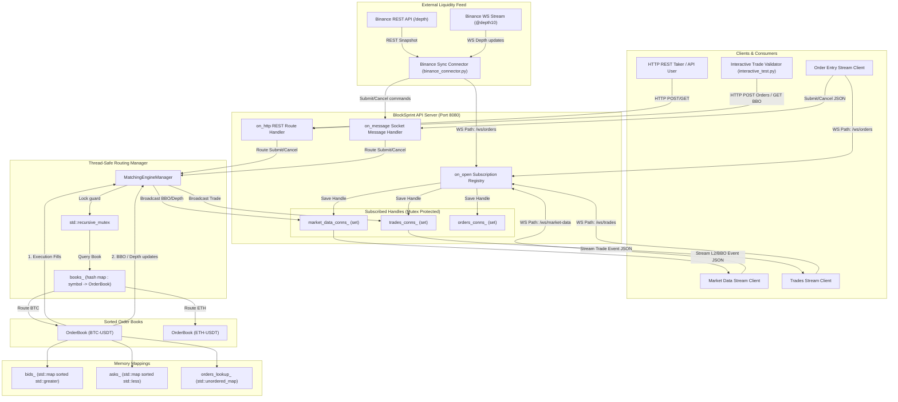
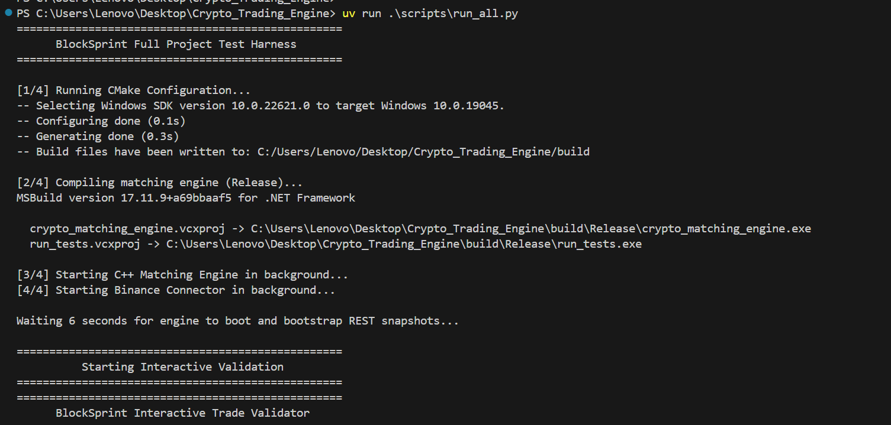
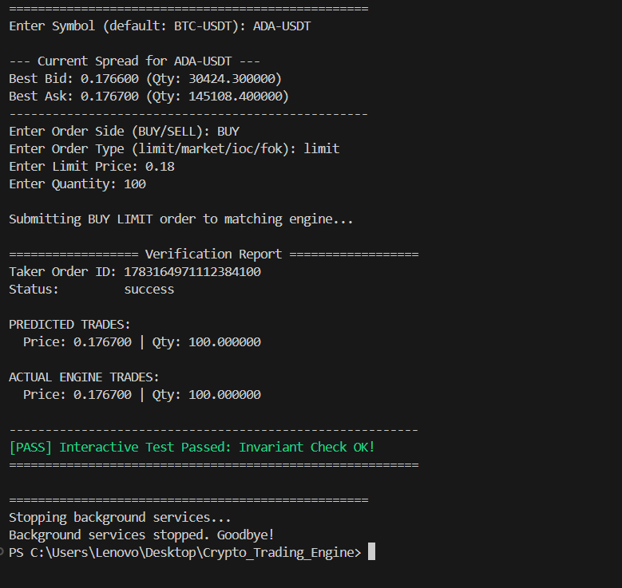
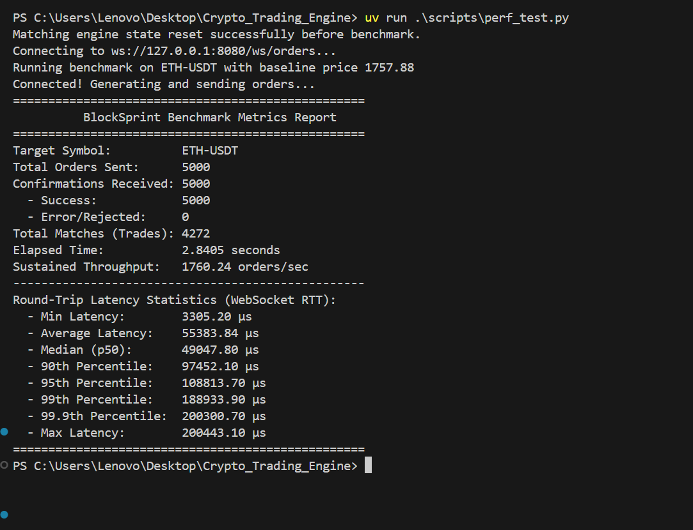

# BlockSprint - Ultra-Low-Latency Crypto Matching Engine

[](https://en.cppreference.com/w/cpp/17)
[](https://www.python.org/)
[](#)
[](#)

> **Branch note:** this is the `v2` development branch for BlockSprint 2.0 (Market Microstructure-Aware Backtesting & Execution Simulator). See [blocksprint_2.0_implementation_plan.md](blocksprint_2.0_implementation_plan.md). The frozen 1.0 release lives at tag `v1.0.0` / branch `release/v1`. The description below still covers the 1.0 feature set.

BlockSprint is an ultra-high-performance cryptocurrency matching engine built in modern **C++17**. It implements core trading execution rules based on REG NMS-inspired principles of strict **Price-Time Priority (FIFO)** and **Internal Order Protection (Anti-Trade-Through)**, coupled with a low-latency network API supporting REST HTTP requests and multi-feed WebSocket subscriptions.

It includes a live **Binance Sync Connector** that bridges real-world exchange liquidity to the local book in real-time, an **Interactive Trade Validator** for automated outcome verification, and a **Unified Harness** to execute, validate, and clean up the environment in one command.

---

## 1. Core Features & System Invariants

* **Price-Time Priority (FIFO)**: Orders are matched based on the best available price. For orders placed at the exact same price level, fills are allocated sequentially based on their time of arrival.
* **Internal Order Protection (Anti-Trade-Through)**: Restricts incoming marketable orders (Market or crossing Limit orders) from skipping price levels. The engine sweeps the book starting at the absolute best bids/asks, securing the best execution price for takers.
* **$O(1)$ Order Cancellations**: By storing a back-pointer double-linked list iterator inside the `Order` struct upon book entry, cancellations are retrieved via a hash map and erased from the price queue list in **$O(1)$ time**, bypassing expensive linear list scans or lazy deletion delays.
* **Supported Order Types**:
  - **Limit**: Rests on the book if not immediately marketable; executed at the limit price or better.
  - **Market**: Executes immediately against resting liquidity; unfilled volume is cancelled.
  - **IOC (Immediate Or Cancel)**: Fills as much volume as possible immediately up to the limit price; the unfilled remainder is cancelled.
  - **FOK (Fill Or Kill)**: Performs a pre-flight dry-run check. If the book cannot satisfy the *entire* order size at the limit price or better, the order is killed instantly without generating trades.
* **Thread-Safe Routing Manager**: Manages multiple symbol books (e.g. `BTC-USDT`, `ETH-USDT`) concurrently using a thread-safe registry with automatic book instantiation.
* **Asynchronous Multi-Feed API Server**: Provides REST JSON endpoints for order submissions and queries, alongside WebSocket feeds classifying clients into dedicated channels for market data streams (BBO & top 10 L2 depth), trade streams, and bi-directional order entries.
* **File-Based Logging Architecture**: Thread-safely redirects logs to local log files under the `logs/` directory, resolving timestamps to system local timezone.
* **Live Binance Order Book Sync**: A synchronization bridge utilizing the **Snapshot + WebSocket Delta** pattern to mirror real-time Binance order book depths directly in memory.
* **Interactive Trade Validation**: A multi-step validator comparing real-time engine outcomes against expected matching execution rules.
* **Unified Launch Harness**: A single command executor (`run_all.py`) that configures, builds, runs the background engine and sync services, initiates interactive CLI testing, and gracefully halts background processes.

---

## 2. Conceptual System Architecture

The following diagram illustrates how external feeds (Binance), clients, HTTP/WS network handlers, the thread-safe router, and the sorted order books coordinate execution flow:



---

## 3. Libraries & Dependencies

BlockSprint is built using header-only libraries cached locally under the `external/` directory. This guarantees that you can build the project offline without setting up package managers.

1. **[nlohmann/json](file:///c:/Users/Lenovo/Desktop/Crypto_Trading_Engine/external/nlohmann/json.hpp)** (v3.11.3): High-speed JSON serialization/parsing for network events.
2. **[asio](file:///c:/Users/Lenovo/Desktop/Crypto_Trading_Engine/external/asio)** (v1.30.2): Standalone low-latency asynchronous TCP socket networking.
3. **[websocketpp](file:///c:/Users/Lenovo/Desktop/Crypto_Trading_Engine/external/websocketpp)** (v0.8.2): Header-only WebSocket server framework built on Asio.
4. **pybind11** (v2.13.6, `external/pybind11`): the `blocksprint_sim` Python module (Phase 4).

For Python scripts, dependencies are defined in `pyproject.toml` and managed via `uv`. `uv sync` also builds the C++ simulator into the `blocksprint_sim` Python module (2–3 minutes the first time; see [docs/dev_setup.md](docs/dev_setup.md)).

---

## 4. Compilation & Execution Guide

### Prerequisites
* **Compiler**: Visual Studio 2022 with MSVC (C++17 support)
* **Build tool**: CMake (version 3.15 or higher)
* **Scripting**: Python (version 3.13 or higher)

### Method A: Unified Harness Execution (Recommended)

To compile the codebase, start the C++ matching engine server, start the Binance live synchronization connector, run the interactive trade validator, and cleanly shut down all background services on exit, run:

```powershell
uv run python scripts/run_all.py
# or using standard python:
python scripts/run_all.py
```
*Verification*: Follow the terminal prompts to select a pair (e.g. `ETH-USDT`) and place simulated orders (e.g., `BUY`, `LIMIT`, `price`, `qty`) to verify expected matching engine invariants.



---

### Method B: Manual Step-by-Step Execution

#### 1. Setup Environment
`asio` and `websocketpp` are git submodules, so clone recursively (or fetch them in an existing clone):
```powershell
git clone --recursive git@github.com:Rishav123raj/BlockSprint.git
# in an existing clone:
git submodule update --init
```

No Binance API key is needed: the connector only uses public market-data endpoints.

Install the Python requirements:
```powershell
uv sync
# or standard pip:
pip install requests websockets
```

#### 2. Configure & Build C++ Binaries
Detect compilers and build in `Release` configuration for maximum performance:
```powershell
cmake -B build
cmake --build build --config Release
```
This produces two executables:
* `build\Release\crypto_matching_engine.exe` (Production API and Matching Engine server)
* `build\Release\unit_tests.exe` (Engine unit test suite, doctest)

#### 3. Run Automated Unit Tests
Before launching the server, execute the unit tests to assert book invariants:
```powershell
.\build\Release\unit_tests.exe
# or through CTest:
ctest --test-dir build -C Release --output-on-failure
```
The summary is printed to the console and must end with `Status: SUCCESS!`.

#### 4. Run the Matching Engine Server
```powershell
.\build\Release\crypto_matching_engine.exe
```
The server starts listening on Port `8080` for REST requests and WebSocket client registrations (`--port N` for another). Each run logs to its own file, `logs/matching_engine-YYYYMMDD-HHMMSS.log` (UTC). Use `--log-level debug|info|warn|error|off`, `--log-file PATH`, `--log-dir DIR` or `--no-log` to change that (`--help` lists them).

A local connector can also stream normalized L2 events to `/ws/market-feed`, which builds the book through the simulator's own synthesizer (2.0, P7.1; `GET /api/market-feed` for its fidelity counters). The protocol is in [docs/live_platform_architecture.md](docs/live_platform_architecture.md) §7.8.

#### 5. Start the Binance Live Sync Connector (Second Terminal)
```powershell
uv run scripts/binance_connector.py
```
This syncs external L2 liquidity from major Binance quote markets directly into the BlockSprint engine. Since 2.0 (P7.2) it streams every depth update and trade, kept exact with Binance's sync rules, to `/ws/market-feed`, where the simulator's synthesizer builds the book with real queue positions; `--v1` runs the 1.0 per-level mirror. `uv run python -m research.live.feed_bridge --symbols BTCUSDT ETHUSDT` runs the bridge directly.

#### 6. Perform Interactive Test Verification (Third Terminal)
```powershell
uv run scripts/interactive_test.py
```
(or without prompts: `--symbol BTC-USDT --side buy --type market --qty 0.05`)
This launches a CLI prompting you for trade parameters, fetches live market depth, submits the order to BlockSprint, and asserts that the executed trades match the price-time rules exactly.



#### 7. Run WebSocket Throughput Benchmark
```powershell
uv run scripts/perf_test.py
```
Outputs performance benchmarks for bulk order processing inside [`logs/perf_test.log`](file:///c:/Users/Lenovo/Desktop/Crypto_Trading_Engine/logs/perf_test.log).



---

## 5. File & Directory Layout

```
BlockSprint/
├── CMakeLists.txt              # CMake build generation rules
├── pyproject.toml              # Python project dependencies definition
├── uv.lock                     # Lock file for Python dependencies
├── .gitignore                  # Git patterns to ignore
├── binance_integration_guide.md# Detailed technical guide for Binance live synchronization
├── command.md                  # Quick CLI command reference guide
├── README.md                   # Main project overview (this file)
│
├── src/                        # C++ Matching Engine Codebase
│   ├── core/                   # engine_core library (no networking)
│   │   ├── types.hpp/.cpp      # Fixed-point prices/quantities (1e-8 units), exact decimal parsing
│   │   ├── int128.hpp          # 128-bit helpers for exact notional and fee math
│   │   ├── clock.hpp           # IClock, WallClock (live), SimClock (replay)
│   │   ├── models.hpp          # Order, Trade, order types, STP policies
│   │   ├── events.hpp          # Execution reports
│   │   ├── market_data.hpp     # Plain BBO / depth snapshots and their JSON
│   │   ├── symbol_spec.hpp/.cpp # Per-symbol trading rules and order validation
│   │   ├── fees.hpp/.cpp       # Maker/taker fee schedules and exact fee math
│   │   ├── order_book.hpp/.cpp # Price-time order book: matching, STP, amend, intrusive queues
│   │   └── matching_engine.hpp/.cpp # Instantiable engine: books per symbol, clock, callbacks
│   ├── sim/                    # Market simulator (Phase 3, docs/simulator_architecture.md):
│   │                           #   RNG, event queue, .bse reader, reconstruction, synthesizer,
│   │                           #   queue models, latency, observed book, strategy
│   │                           #   gateway, simulator loop, run config, result
│   │                           #   recorder, bs_sim CLI
│   ├── api/
│   │   └── api_server.hpp/.cpp # HTTP REST and WebSocket router endpoints
│   ├── logger.hpp              # Thread-safe file logger (levels, per-run files)
│   └── main.cpp                # Application startup and OS signal handling
│
├── tests/core/                 # doctest unit tests (unit_tests target), see explanations/tests.md
│   ├── matching_test.cpp       # The six original 1.0 unit tests
│   ├── characterization_test.cpp # Pins exact 1.0 matching behavior for the 2.0 refactors
│   ├── *_test.cpp              # Invariants, STP, reports, validation, fees, post-only/amend, logger
│   ├── fuzz_test.cpp           # Engine vs a naive reference book, every report compared
│   ├── determinism_test.cpp    # Pinned cross-platform hash of the full output stream
│   ├── test_helpers.hpp        # Order builders and engine fixture
│   ├── workload.hpp            # Seeded random workload and golden hashes
│   └── test_main.cpp           # doctest entry point
├── tests/sim/                  # simulator unit tests (sim_tests target)
├── tests/python/               # pytest: recorder and data pipeline
│
├── bench/bench_core.cpp        # Engine throughput benchmark (docs/baseline/bench_core.md)
│
├── research/data/              # 2.0 market-data pipeline: recorder, normalizer, QC, packer, catalog,
│                               #   downloader (see docs/recorder_ops.md and docs/data_pipeline.md)
├── research/sim/               # Simulator validation (check_reconstruct.py: gate V0)
├── configs/sim/                # Simulator run configs (example_btc.json; bs_sim config shows the resolved one)
│
├── scripts/                    # Python Validation and Benchmarking Clients
│   ├── run_all.py              # Unified project builder, daemon manager, and validation script
│   ├── binance_connector.py    # Bridge syncing real-time Binance depth maps via WebSockets
│   ├── interactive_test.py     # Command-line interactive trade calculator and checker
│   ├── perf_test.py            # High-throughput load testing script for bulk orders
│   └── client_demo.py          # REST & WebSocket subscription integration test script
│
├── explanations/               # Detailed codebase documentation
│   ├── types.md                # Fixed-point prices and quantities
│   ├── clock.md                # Wall clock vs simulated clock
│   ├── models.md               # Orders, trades, order types, STP policies
│   ├── events.md               # Execution reports and their contract
│   ├── market_data.md          # BBO / depth snapshots
│   ├── symbol_spec.md          # Trading rules and validation
│   ├── fees.md                 # Fee schedules and fee math
│   ├── order_book.md           # Matching, STP, amend, data structures
│   ├── matching_engine.md      # The engine: books, clock, callbacks, hot path
│   ├── api_server.md           # REST and WebSocket API
│   ├── logger.md               # Logging
│   ├── main.md                 # Server entry point and command line
│   └── tests.md                # Test suites, fuzz, determinism, benchmark
│
├── external/                   # Locally cached header-only dependencies
│   ├── nlohmann/               # json.hpp library
│   ├── asio/                   # Standalone Asio networking headers
│   └── websocketpp/            # WebSocket++ server framework headers
│
└── logs/                       # Performance and validation outputs
    ├── matching_engine-*.log   # One engine log per run (UTC timestamps)
    ├── perf_test.log           # Throughput stats and benchmark results
    └── client_demo.log         # Client events and subscription flows
```

---

## 6. Unit Testing Matrix

The original unit tests in [`tests/core/matching_test.cpp`](tests/core/matching_test.cpp) verify key behaviors. [`tests/core/characterization_test.cpp`](tests/core/characterization_test.cpp) adds 21 cases that pin the exact 1.0 behavior, including a golden hash over a seeded 5,000-operation random workload.

| Test Case Name | Target Behaviors / Invariants Tested | Verification Mechanism |
| :--- | :--- | :--- |
| `price_time_priority` | Rest orders priority sorting by price then arrival timestamp. | Inserts overlapping buy orders; sweeps book with a sell; asserts execution order matches insertion sequence. |
| `internal_trade_through_protection` | Multi-level price sweeping protection (anti-trade-through). | Rest asks at different prices; sweeps asks; verifies price level increments sequentially. |
| `ioc_order_handling` | Immediate execution or cancellation. | Places buy IOC exceeding ask quantity; verifies immediate partial fill and remaining balance cancellation. |
| `fok_order_handling` | Pre-flight dry-run check. | Attempts FOK order above liquidity (fails/kills) and equal to liquidity (executes); verifies book consistency. |
| `order_cancellation` | $O(1)$ order cancellations. | Places a resting order; cancels it; verifies the book is empty and a second cancel of the same ID fails. |
| `order_modification` | Priority rules on amend. | Reduces the quantity of the first order at a level; sweeps the level; verifies it kept time priority. |
