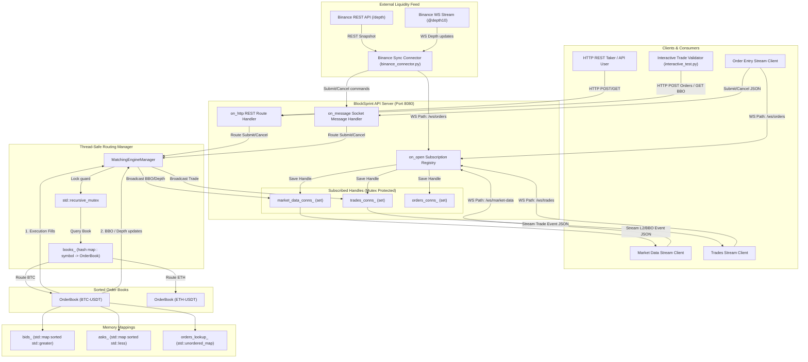

# BlockSprint - Ultra-Low-Latency Crypto Matching Engine

[](https://en.cppreference.com/w/cpp/17)
[](https://www.python.org/)
[](#)
[](#)

BlockSprint is an ultra-high-performance cryptocurrency matching engine built in modern **C++17**. It implements core trading execution rules based on REG NMS-inspired principles of strict **Price-Time Priority (FIFO)** and **Internal Order Protection (Anti-Trade-Through)**, coupled with a low-latency network API supporting REST HTTP requests and multi-feed WebSocket subscriptions.

It includes a live **Binance Sync Connector** that bridges real-world exchange liquidity to the local book in real-time, an **Interactive Trade Validator** for automated outcome verification, and a **Unified Harness** to execute, validate, and clean up the environment in one command.

---

## 1. Core Features & System Invariants

* **Price-Time Priority (FIFO)**: Orders are matched based on the best available price. For orders placed at the exact same price level, fills are allocated sequentially based on their time of arrival.
* **Internal Order Protection (Anti-Trade-Through)**: Restricts incoming marketable orders (Market or crossing Limit orders) from skipping price levels. The engine sweeps the book starting at the absolute best bids/asks, securing the best execution price for takers.
* **$O(1)$ Order Cancellations**: By storing a back-pointer double-linked list iterator inside the `Order` struct upon book entry, cancellations are retrieved via a hash map and erased from the price queue list in **$O(1)$ time**, bypassing expensive linear list scans or lazy deletion delays.
* **Supported Order Types**:
  - **Limit**: Rests on the book if not immediately marketable; executed at the limit price or better.
  - **Market**: Executes immediately against resting liquidity; unfilled volume is cancelled.
  - **IOC (Immediate Or Cancel)**: Fills as much volume as possible immediately up to the limit price; the unfilled remainder is cancelled.
  - **FOK (Fill Or Kill)**: Performs a pre-flight dry-run check. If the book cannot satisfy the *entire* order size at the limit price or better, the order is killed instantly without generating trades.
* **Thread-Safe Routing Manager**: Manages multiple symbol books (e.g. `BTC-USDT`, `ETH-USDT`) concurrently using a thread-safe registry with automatic book instantiation.
* **Asynchronous Multi-Feed API Server**: Provides REST JSON endpoints for order submissions and queries, alongside WebSocket feeds classifying clients into dedicated channels for market data streams (BBO & top 10 L2 depth), trade streams, and bi-directional order entries.
* **File-Based Logging Architecture**: Thread-safely redirects logs to local log files under the `logs/` directory, resolving timestamps to system local timezone.
* **Live Binance Order Book Sync**: A synchronization bridge utilizing the **Snapshot + WebSocket Delta** pattern to mirror real-time Binance order book depths directly in memory.
* **Interactive Trade Validation**: A multi-step validator comparing real-time engine outcomes against expected matching execution rules.
* **Unified Launch Harness**: A single command executor (`run_all.py`) that configures, builds, runs the background engine and sync services, initiates interactive CLI testing, and gracefully halts background processes.

---

## 2. Conceptual System Architecture

The following diagram illustrates how external feeds (Binance), clients, HTTP/WS network handlers, the thread-safe router, and the sorted order books coordinate execution flow:



---

## 3. Libraries & Dependencies

BlockSprint is built using header-only libraries cached locally under the `external/` directory. This guarantees that you can build the project offline without setting up package managers.

1. **[nlohmann/json](file:///c:/Users/Lenovo/Desktop/Crypto_Trading_Engine/external/nlohmann/json.hpp)** (v3.11.3): High-speed JSON serialization/parsing for network events.
2. **[asio](file:///c:/Users/Lenovo/Desktop/Crypto_Trading_Engine/external/asio)** (v1.30.2): Standalone low-latency asynchronous TCP socket networking.
3. **[websocketpp](file:///c:/Users/Lenovo/Desktop/Crypto_Trading_Engine/external/websocketpp)** (v0.8.2): Header-only WebSocket server framework built on Asio.

For Python scripts, dependencies are defined in `pyproject.toml` and managed via `uv` or `pip`.

---

## 4. Compilation & Execution Guide

### Prerequisites
* **Compiler**: Visual Studio 2022 with MSVC (C++17 support)
* **Build tool**: CMake (version 3.15 or higher)
* **Scripting**: Python (version 3.12 or higher)

### Method A: Unified Harness Execution (Recommended)

To compile the codebase, start the C++ matching engine server, start the Binance live synchronization connector, run the interactive trade validator, and cleanly shut down all background services on exit, run:

```powershell
uv run python scripts/run_all.py
# or using standard python:
python scripts/run_all.py
```
*Verification*: Follow the terminal prompts to select a pair (e.g. `ETH-USDT`) and place simulated orders (e.g., `BUY`, `LIMIT`, `price`, `qty`) to verify expected matching engine invariants.

---

### Method B: Manual Step-by-Step Execution

#### 1. Setup Environment
Ensure you have a `.env` file in the root directory containing your Binance API keys (the connector uses them to fetch and mirror public endpoints):
```ini
BINANCE_API_KEY=your_binance_api_key_here
BINANCE_API_SECRET=your_binance_api_secret_here
```
Install the Python requirements:
```powershell
uv add requests python-dotenv websockets
# or standard pip:
pip install requests python-dotenv websockets
```

#### 2. Configure & Build C++ Binaries
Detect compilers and build in `Release` configuration for maximum performance:
```powershell
cmake -B build
cmake --build build --config Release
```
This produces two executables:
* `build\Release\crypto_matching_engine.exe` (Production API and Matching Engine server)
* `build\Release\run_tests.exe` (Engine unit test suite)

#### 3. Run Automated Unit Tests
Before launching the server, execute the unit tests to assert book invariants:
```powershell
.\build\Release\run_tests.exe
```
Verify the output log [`logs/matching_engine.log`](file:///c:/Users/Lenovo/Desktop/Crypto_Trading_Engine/logs/matching_engine.log) contains `Passes: 6, Failures: 0`.

#### 4. Run the Matching Engine Server
```powershell
.\build\Release\crypto_matching_engine.exe
```
The server starts listening on Port `8080` for REST requests and WebSocket client registrations.

#### 5. Start the Binance Live Sync Connector (Second Terminal)
```powershell
uv run scripts/binance_connector.py
```
This syncs external L2 liquidity from major Binance quote markets directly into the BlockSprint engine.

#### 6. Perform Interactive Test Verification (Third Terminal)
```powershell
uv run scripts/interactive_test.py
```
This launches a CLI prompting you for trade parameters, fetches live market depth, submits the order to BlockSprint, and asserts that the executed trades match the price-time rules exactly.

#### 7. Run WebSocket Throughput Benchmark
```powershell
uv run scripts/perf_test.py
```
Outputs performance benchmarks for bulk order processing inside [`logs/perf_test.log`](file:///c:/Users/Lenovo/Desktop/Crypto_Trading_Engine/logs/perf_test.log).

---

## 5. File & Directory Layout

```
BlockSprint/
├── CMakeLists.txt              # CMake build generation rules
├── pyproject.toml              # Python project dependencies definition
├── uv.lock                     # Lock file for Python dependencies
├── .env                        # Configuration file for API keys
├── .gitignore                  # Git patterns to ignore
├── binance_integration_guide.md# Detailed technical guide for Binance live synchronization
├── command.md                  # Quick CLI command reference guide
├── README.md                   # Main project overview (this file)
│
├── src/                        # C++ Matching Engine Codebase
│   ├── models.hpp              # Order and trade structs with json serializers
│   ├── logger.hpp              # Thread-safe timezone-aware logging
│   ├── order_book.hpp/.cpp     # Core L2 order book queues and matching algorithms
│   ├── matching_engine.hpp/.cpp# Thread-safe manager & cross-symbol registry
│   ├── api_server.hpp/.cpp     # HTTP REST and WebSocket router endpoints
│   └── main.cpp                # Application startup and OS signal handling
│
├── tests/                      # Verification and Test Harnesses
│   ├── test_harness.hpp        # Lightweight assertion and suite execution runner
│   └── main_test.cpp           # Matching engine unit tests
│
├── scripts/                    # Python Validation and Benchmarking Clients
│   ├── run_all.py              # Unified project builder, daemon manager, and validation script
│   ├── binance_connector.py    # Bridge syncing real-time Binance depth maps via WebSockets
│   ├── interactive_test.py     # Command-line interactive trade calculator and checker
│   ├── perf_test.py            # High-throughput load testing script for bulk orders
│   └── client_demo.py          # REST & WebSocket subscription integration test script
│
├── explanations/               # Detailed codebase documentation
│   ├── models.md               # Explanation of models and data formats
│   ├── logger.md               # Details about the logging framework
│   ├── order_book.md           # OrderBook logic and double-linked order traversal
│   ├── matching_engine.md      # Engine registry and cross-symbol routing
│   ├── api_server.md           # API server, HTTP routing, and WS event emitters
│   └── main.md                 # Entry point flow explanation
│
├── external/                   # Locally cached header-only dependencies
│   ├── nlohmann/               # json.hpp library
│   ├── asio/                   # Standalone Asio networking headers
│   └── websocketpp/            # WebSocket++ server framework headers
│
└── logs/                       # Performance and validation outputs
    ├── matching_engine.log     # Engine execution and transaction logs
    ├── perf_test.log           # Throughput stats and benchmark results
    └── client_demo.log         # Client events and subscription flows
```

---

## 6. Unit Testing Matrix

The automated unit tests implemented in [`tests/main_test.cpp`](file:///c:/Users/Lenovo/Desktop/Crypto_Trading_Engine/tests/main_test.cpp) verify key behaviors:

| Test Case Name | Target Behaviors / Invariants Tested | Verification Mechanism |
| :--- | :--- | :--- |
| `price_time_priority` | Rest orders priority sorting by price then arrival timestamp. | Inserts overlapping buy orders; sweeps book with a sell; asserts execution order matches insertion sequence. |
| `internal_trade_through_protection` | Multi-level price sweeping protection (anti-trade-through). | Rest asks at different prices; sweeps asks; verifies price level increments sequentially. |
| `ioc_order_handling` | Immediate execution or cancellation. | Places buy IOC exceeding ask quantity; verifies immediate partial fill and remaining balance cancellation. |
| `fok_order_handling` | Pre-flight dry-run check. | Attempts FOK order above liquidity (fails/kills) and equal to liquidity (executes); verifies book consistency. |
| `order_cancel_constant_time` | $O(1)$ order cancellations. | Places orders; cancels them; validates cancellation succeeds in constant time with clean removal from maps/queues. |
| `matching_engine_routing` | Multi-symbol isolation and concurrency. | Exercises thread-safe routing manager; validates concurrent symbol allocations do not leak states across books. |
