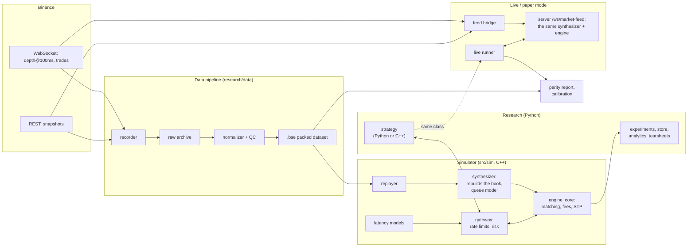

# BlockSprint

**A market-microstructure-aware backtesting and execution simulator for crypto, built around an exact C++17 matching engine.**

[](https://en.cppreference.com/w/cpp/17)
[](https://www.python.org/)
[](#)
[](#)

Most backtests fill an order as soon as the price touches it. BlockSprint replays the recorded order book event by event and puts the strategy's orders in the queue behind the liquidity that was already there. They fill only when trades and cancels reach them, after realistic latency. The same strategy code then runs in paper mode against Binance's live order book, and a parity report checks the simulator against what actually happened.

- **Exact.** Prices and quantities are fixed-point integers (1e-8). There are no floats in matching, fees or PnL.
- **Deterministic.** A seeded run produces the same output hash on Windows/MSVC and Linux/GCC; CI pins golden scenarios.
- **Queue-aware.** The simulator rebuilds the venue's book from L2 deltas and trades, then models where the strategy's orders sit in each level's queue (`cancel_from_back`, `pro_rata`, `prob_power:n`, ...).
- **Latency-aware.** Feed, order entry and ack delays come from seeded distributions. Presets are measured, and can vary with market activity.
- **Checked against reality.** Paper sessions and their simulator replays are compared on fill ratio, time to fill, markouts and PnL split; calibration fits the simulator to them.

> **Branch note:** `v2` is the 2.0 development branch. It merges into `main` as `v2.0.0` at the end of Phase 8 ([plan](blocksprint_2.0_implementation_plan.md)). 1.0 lives at tag `v1.0.0`.

---

## Quickstart (about 10 minutes)

**Needs:** Visual Studio 2022 (MSVC) or GCC 13+ (tested with 13 and 15), CMake 3.15+, Python 3.13, [uv](https://docs.astral.sh/uv/).

```powershell
# 1. Clone and build (asio and websocketpp are submodules)
git clone --recursive https://github.com/Rishav123raj/BlockSprint.git
cd BlockSprint
cmake -B build
cmake --build build --config Release            # engine, simulator (bs_sim), server, tests

# 2. Python environment; this also compiles the simulator into the blocksprint_sim module (2-3 min the first time)
uv sync

# 3. The sample dataset: one hour of BTCUSDT and ETHUSDT order book data (9 MB download, 62 MB unpacked)
uv run python -m research.data.sample get

# 4. A C++ strategy on the sample: an hour of BTC in about 3 s
.\build\Release\bs_sim.exe run configs/sim/sample_quoter.json

# 5. A Python market maker, three settings in parallel, then tearsheets and a comparison report
uv run python -m research.run research/experiments/configs/sample_mm.yaml
start results\experiments\sample_mm\report.html
```

On Linux the binaries are in `build/` (`./build/bs_sim`) and the report opens with `xdg-open`.

Step 4 prints the run's fills, fees, PnL and output hash, and writes its tables (orders, execution reports, refused requests, sampled BBO, positions) as CSV to `results/sample_quoter/`. Step 5 writes one tearsheet per run (PnL and inventory over time, fills, markouts, TCA) and a report comparing them.

### Your own strategy in Python

```python
import blocksprint_sim as bs
from research.strategies import Context, Strategy


class JoinTheBid(Strategy):
    """Rests one post-only buy at the best bid, re-pricing it every second, up to a position limit."""
    callback_mode = "timer_only"

    def __init__(self, size: str = "0.001", limit: str = "0.01"):
        self.size, self.limit = bs.to_fixed(size), bs.to_fixed(limit)

    def on_start(self, ctx: Context) -> None:
        ctx.set_timer(1_000_000_000)                       # ns

    def on_timer(self, ctx: Context, timer_id: int) -> None:
        book = ctx.book()                                  # the book as the strategy sees it, after feed latency
        if ctx.can_trade() and book.valid() and (bid := book.best_bid()):
            for oid, o in ctx.open_orders().items():
                if o.price != bid.price:
                    ctx.cancel(oid)
            if not ctx.open_orders() and ctx.account().position + self.size <= self.limit:
                ctx.send(bs.Side.BUY, bs.OrderType.LIMIT_MAKER, bid.price, self.size)
        ctx.set_timer(1_000_000_000)


config = {"dataset": "data/sample/binance_spot_btc_eth_sample", "symbol": "BTCUSDT",
          "latency_preset": "binance_spot_tokyo_vps", "queue_model": "prob_power:2",
          "strategy": {"name": "null"}, "output": {"dir": "results/join_the_bid"}}
res = JoinTheBid().run(config)
print(res.meta["sessions"][0]["exchange_account"])         # fills, volume, fees, PnL
positions = res.to_polars("positions", fixed="float")     # polars frames, or numpy via res.positions
```

The same class runs unchanged in paper mode (below). Reference strategies (market making, TWAP/POV execution, ...) are in [research/strategies/](research/strategies/), described in [docs/strategies.md](docs/strategies.md).

---

## Architecture



| Layer | What it does | Docs |
| :--- | :--- | :--- |
| `src/core` | The matching engine: price-time priority, anti-trade-through, LIMIT/MARKET/IOC/FOK/LIMIT_MAKER, amend and replace, self-trade prevention, Binance symbol rules and fees, execution reports. No networking, no wall clock. | [explanations/](explanations/) |
| `research/data` | Records Binance depth and trades, normalizes them with Binance's sync rules, runs QC, and packs replay files (`.bse`). It can also download Binance's public archives. | [data_pipeline.md](docs/data_pipeline.md), [recorder_ops.md](docs/recorder_ops.md) |
| `src/sim` | Replays a `.bse` file and rebuilds the book. Models queue position, latency, impact, rate limits, risk and gaps; runs multiple symbols; produces deterministic output. `bs_sim` is its CLI. | [simulator_architecture.md](docs/simulator_architecture.md) |
| `src/bindings` | The `blocksprint_sim` Python module. Python strategies run inside the C++ loop, with the GIL released between callbacks; results come back as numpy or polars. | [dev_setup.md](docs/dev_setup.md) |
| `research/experiments`, `research/analytics` | YAML experiments with sweeps, run in parallel through a cached results store. Markouts, TCA, PnL attribution, risk, tearsheets. | [experiments.md](docs/experiments.md), [analytics.md](docs/analytics.md) |
| `src/api`, `research/live` | The live server and paper trading: Binance's feed goes through the simulator's own synthesizer, and strategies run unchanged. Paper sessions, parity report, calibration. | [live_platform_architecture.md](docs/live_platform_architecture.md), [parity_protocol.md](docs/parity_protocol.md), [calibration.md](docs/calibration.md) |

---

## Recording your own data

```powershell
uv run python -m research.data.recorder --symbols BTCUSDT ETHUSDT --out data/raw --duration 3600
uv run python -m research.data.normalize --symbols BTCUSDT ETHUSDT
uv run python -m research.data.qc --symbols BTCUSDT ETHUSDT
uv run python -m research.data.pack pack --symbols BTCUSDT ETHUSDT --from 2026-11-10 --to 2026-11-10 --allow-partial --name my_day
```

A run config then points at `data/packed/my_day`. Running the recorder unattended for days, with restarts and disk checks, is covered in [docs/recorder_ops.md](docs/recorder_ops.md). No API key is needed anywhere: everything uses Binance's public market data.

---

## Live and paper mode

```powershell
.\build\Release\crypto_matching_engine.exe          # 1. the server, port 8080
uv run scripts/binance_connector.py                 # 2. Binance's live book into it (v2 feed bridge)
uv run python -m research.live.runner --strategy research.strategies.passive_quoter:PassiveQuoter `
    --params '{"size": "0.001"}' --symbols BTC-USDT --duration 600 --out results/paper/run1   # 3. paper trading
```

- **The server** keeps Binance's book exactly, using the same synthesizer as the simulator. It also serves REST (`/api/orders`, `/api/depth`, `/api/bbo`, ...) and WebSocket feeds (market data, trades, order entry).
- **Paper orders** queue behind real liquidity and fill when real trades reach them. No order is ever sent to Binance: the repository contains no code that signs a Binance request, apart from a testnet-only latency tool, and CI enforces that.
- **The paper-vs-simulator loop:**
  - `research.live.paper_session run` records the market while paper trading, and `replay` reruns the same window in the simulator.
  - `research.analytics.parity` compares the two.
  - `research.calibration.calibrate` fits the simulator to them.

  See [docs/parity_protocol.md](docs/parity_protocol.md) and [docs/calibration.md](docs/calibration.md).
- **`scripts/interactive_test.py`** places one order against the live book and checks every fill against the price-time rules. **`scripts/run_all.py`** builds the project and starts the server, the connector and the interactive test in one go.

---

## Results

| | |
| :--- | :--- |
| **Engine** | 2.5–3.2 M operations/s single-threaded by workload, 1.8–2.3 M including building each order ([bench_core.md](docs/baseline/bench_core.md)) |
| **Replay** | 16.3 M records/s; an hour of BTCUSDT in about 3 s with a C++ strategy ([bench_sim.md](docs/baseline/bench_sim.md)) |
| **Determinism** | pinned output hashes, identical on MSVC and GCC, for every simulator feature |
| **Paper vs simulator** | three 15-minute BTCUSDT sessions: fill ratio within 6.1% of paper (target ±15%) |
| **Calibration** | `prob_power:1.5` at the measured latency, chosen on held-out seeds; the home PC preset's order legs measured from the round trip to Binance |
| **Live book** | the server's top 10 levels match Binance's REST depth at a median of 100% over a 26 h soak test (95% for BTCUSDT), never crossed; reconnects recovered on their own ([details and limits](docs/baseline/soak_2026-11-14.md)) |

The release figures, all measured on one laptop and set against 1.0: [docs/baseline/v2.0.0.md](docs/baseline/v2.0.0.md).

---

## Tests

```powershell
.\build\Release\unit_tests.exe       # engine: invariants, STP, fees, characterization of 1.0, a 10^6-operation fuzz
.\build\Release\sim_tests.exe        # simulator: reconstruction, queue models, latency, golden determinism hashes
uv run pytest -q                     # Python: data pipeline, bindings, strategies, experiments, analytics, live
```

CI builds and tests on Windows/MSVC and Linux/GCC, runs the Python suite against both an editable build and a built wheel, fuzzes the engine, and checks that no Binance request-signing code has crept in.

---

## Repository layout

```
BlockSprint/
├── src/
│   ├── core/            engine_core: types, order book, matching engine, fees, symbol rules, reports
│   ├── sim/             simulator library, queue and latency models, reference C++ strategies, bs_sim
│   ├── api/             live REST/WebSocket server
│   ├── bindings/        blocksprint_sim Python module
│   └── main.cpp         server entry point
├── research/
│   ├── data/            recorder, normalizer, QC, packer, catalog, downloader, sample dataset
│   ├── sim/             Results (numpy/polars), validation scripts
│   ├── strategies/      Strategy base class and reference strategies
│   ├── experiments/     experiment schema, runner, results store, configs/
│   ├── analytics/       markouts, TCA, PnL, risk, tearsheets, parity report
│   ├── calibration/     grid search against paper sessions
│   ├── live/            feed bridge, live runner, paper sessions, soak test, testnet latency
│   └── notebooks/       walkthroughs
├── configs/sim/         run configs, calibrated profiles
├── bench/               bench_core, bench_sim
├── tests/               core/ (doctest), sim/ (doctest + golden data), python/ (pytest)
├── scripts/             run_all, binance_connector, interactive_test, perf_test, client_demo
├── docs/                design docs, operations, baselines
└── explanations/        component-by-component explanations of the engine
```

---

## Libraries

All C++ dependencies are vendored under `external/`, so the build works offline: [nlohmann/json](https://github.com/nlohmann/json) 3.11.3, [asio](https://think-async.com/Asio/) 1.30.2, [websocketpp](https://github.com/zaphoyd/websocketpp) 0.8.2, [doctest](https://github.com/doctest/doctest), and [pybind11](https://github.com/pybind/pybind11) 2.13.6. The Python dependencies are in `pyproject.toml`, managed with uv; the module builds with scikit-build-core.
