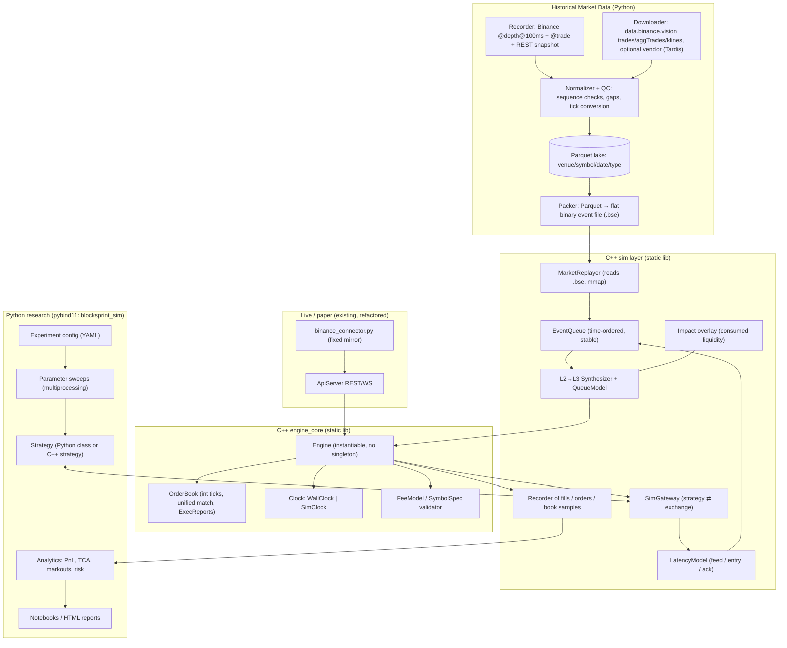

# BlockSprint → Market Microstructure-Aware Backtesting & Execution Simulator

### Codebase Analysis and Integration Guide

> **Code references** in sections 2–3 point at the **v1.0.0** layout (tag `v1.0.0`, e.g. `src/order_book.cpp`). On the `v2` branch those files live under `src/core/` and `src/api/`.
>
> **Scope:** This is a study and design document. It contains no implementation. It covers (1) a detailed analysis of the current BlockSprint codebase as of commit `f1fc45f`, (2) a gap analysis against the target system, and (3) a phased plan, with design decisions, for turning BlockSprint into a **C++ execution engine + Python quantitative research + historical market data** backtesting and execution simulator.

---

## Table of Contents

0. [Urgent: Security & Repo Hygiene](#0-urgent-security--repo-hygiene)
1. [Executive Summary](#1-executive-summary)
2. [Current Codebase Analysis](#2-current-codebase-analysis)
3. [Defects & Limitations That Matter for Backtesting](#3-defects--limitations-that-matter-for-backtesting)
4. [What the Target System Is](#4-what-the-target-system-is)
5. [Gap Analysis](#5-gap-analysis)
6. [Target Architecture](#6-target-architecture)
7. [The Central Design Decision: L2 Data on an L3 Engine](#7-the-central-design-decision-l2-data-on-an-l3-engine)
8. [Historical Market Data Layer](#8-historical-market-data-layer)
9. [C++ Engine Refactors (Prerequisites)](#9-c-engine-refactors-prerequisites)
10. [C++ Simulation Layer](#10-c-simulation-layer)
11. [Microstructure Models](#11-microstructure-models)
12. [Python ↔ C++ Bridge](#12-python--c-bridge)
13. [Python Quantitative Research Layer](#13-python-quantitative-research-layer)
14. [Validation & Calibration](#14-validation--calibration)
15. [Phased Roadmap](#15-phased-roadmap)
16. [Proposed Directory Layout](#16-proposed-directory-layout)
17. [Pitfalls & Biases Checklist](#17-pitfalls--biases-checklist)
18. [Open Decisions](#18-open-decisions)
19. [References](#19-references)

---

## 0. Urgent: Security & Repo Hygiene

| Issue | Evidence | Action |
| :--- | :--- | :--- |
| **Live Binance API key and secret are committed and pushed** | `.env` is tracked by git (added in `f5d4b49`), and `origin` = `github.com/Rishav123raj/BlockSprint`. Both values are 64 characters long, which is the length of real keys. | **Revoke the key in the Binance console now.** Then `git rm --cached .env`, commit, and consider rewriting history (`git filter-repo`). Revoking is what actually fixes it, because the old commit is already public. |
| `logs/` is tracked despite `.gitignore` | `git ls-files` lists `logs/*.log` (one is ~25k lines). | `git rm --cached -r logs/`. |
| Connector doesn't need keys at all | `binance_connector.py` only calls public endpoints (`/exchangeInfo`, `/depth`, public WS streams). | Remove the key requirement from the connector and README. The historical data downloader won't need keys either. |

---

## 1. Executive Summary

**What BlockSprint is today:** a single-process C++17 **L3 price-time (FIFO) limit order book matching engine** (Limit / Market / IOC / FOK, O(1) cancel), with a REST + WebSocket API (websocketpp/asio). A Python connector **mirrors live Binance top-10 depth** into the book as synthetic resting orders, so users can trade against real liquidity.

**What you want:** a **backtesting and execution simulator** that replays **historical** order book and trade data through a deterministic, event-driven engine. It should model what decides real fill quality: **latency, queue position, partial fills, fees, slippage, market impact, and adverse selection**. Strategies are written and analysed in Python.

**Key findings:**

1. **The matching core is reusable.** A FIFO L3 book with O(1) cancel is exactly the exchange model a microstructure simulator needs. You don't need to rewrite it, but you do need to refactor it.
2. **The engine is not deterministic yet.** It reads the wall clock (`getCurrentTimestampNs()`), uses a process-global trade-ID counter, is a singleton, and builds JSON on the hot path. All four must change before it can replay history.
3. **The live connector's modeling approach can't carry over to backtesting.** Each L2 level becomes one order that is **re-submitted every 100 ms**. Every re-submit sends that liquidity to the back of the queue, so a user's order jumps ahead of real liquidity, and liquidity the user consumed reappears on the next update. Backtests built this way would be badly over-optimistic.
4. **The recommended approach is L2→L3 synthesis.** Historical L2 deltas are converted into synthetic FIFO orders: size increases join the back of the queue, unexplained decreases are cancelled according to a configurable queue model, and trades consume from the front. Strategy orders then get realistic queue positions **from the existing matching code**, with no separate fill model needed.
5. **The bridge should be pybind11, not the WebSocket API.** Driving a backtest over WebSocket would be slow (your own benchmark shows ~1.7k orders/s and ~49 ms p50 RTT) and non-deterministic. The API server stays for **live/paper mode**, which becomes the validation target for the simulator.

---

## 2. Current Codebase Analysis

### 2.1 Inventory

| Area | Files | LOC | Role |
| :--- | :--- | ---: | :--- |
| Domain model | [src/models.hpp](src/models.hpp) | 124 | `Order`, `Trade`, enums, timestamp helpers, JSON serializer |
| Order book | [src/order_book.hpp](src/order_book.hpp), [src/order_book.cpp](src/order_book.cpp) | 714 | Per-symbol L3 book and all matching logic |
| Engine manager | [src/matching_engine.hpp](src/matching_engine.hpp), [src/matching_engine.cpp](src/matching_engine.cpp) | 173 | Singleton symbol→book router, mutex, event callbacks |
| Network API | [src/api_server.hpp](src/api_server.hpp), [src/api_server.cpp](src/api_server.cpp) | 367 | REST + WS on port 8080 (websocketpp) |
| Infra | [src/logger.hpp](src/logger.hpp), [src/main.cpp](src/main.cpp) | 134 | File logger singleton; process entry/signals |
| Tests | [tests/main_test.cpp](tests/main_test.cpp), [tests/test_harness.hpp](tests/test_harness.hpp) | 372 | 6 unit tests, home-made harness |
| Python | `scripts/*.py` | ~780 | Binance mirror, interactive validator, perf test, demo, launcher |
| Build | [CMakeLists.txt](CMakeLists.txt), [pyproject.toml](pyproject.toml) | — | Two executables; Python ≥3.13 via `uv` |
| Vendored | `external/` | — | nlohmann/json 3.11.3, asio 1.30.2, websocketpp 0.8.2 (header-only) |

### 2.2 Runtime architecture (as-is)

```
 Binance REST /depth (limit=5) ──┐
 Binance WS @depth10@100ms ──────┤
                                 ▼
                    scripts/binance_connector.py
                    (one synthetic order per L2 level,
                     id = BINANCE_<SYM>_<SIDE>_<PRICE>)
                                 │  WS /ws/orders  {"action": submit|cancel}
                                 ▼
 ┌──────────────────────── crypto_matching_engine.exe ─────────────────────────┐
 │  ApiServer (1 asio thread)                                                   │
 │    on_http: POST/DELETE /api/orders, POST /api/reset, GET /api/bbo|depth     │
 │    on_message: /ws/orders submit/cancel                                      │
 │          │                                                                   │
 │          ▼                                                                   │
 │  MatchingEngineManager (singleton, recursive_mutex)                          │
 │    books_: unordered_map<symbol, unique_ptr<OrderBook>>                      │
 │    callbacks → broadcast_bbo / broadcast_depth / broadcast_trade             │
 │          │                                                                   │
 │          ▼                                                                   │
 │  OrderBook                                                                   │
 │    bids_: map<double, PriceLevel, greater>   asks_: map<double, ..., less>   │
 │    PriceLevel: list<shared_ptr<Order>> (FIFO) + total_quantity               │
 │    orders_lookup_: unordered_map<id, shared_ptr<Order>>  (O(1) cancel)       │
 └──────────────────────────────────────────────────────────────────────────────┘
          │ /ws/market-data (bbo, depth)      │ /ws/trades
          ▼                                   ▼
   client_demo.py / any subscriber     interactive_test.py (REST)
```

### 2.3 Component deep-dive

#### `models.hpp`
- `Order` holds `price`, `quantity` and `remaining_quantity` as **`double`**, plus a `uint64_t timestamp`, an `is_cancelled` flag, and a `std::list` iterator back-pointer (`list_it`, `has_iterator`). The back-pointer is what makes O(1) cancel work ([models.hpp:58-73](src/models.hpp#L58-L73)).
- `Trade` holds price, qty, aggressor side, maker/taker IDs and a timestamp. There is no fee, liquidity flag (maker/taker per participant), or sequence number.
- `getCurrentTimestampNs()` reads `system_clock` ([models.hpp:86-90](src/models.hpp#L86-L90)). It's called inside matching, so **trade timestamps are wall-clock**.
- JSON serialization emits numbers as `std::to_string` strings (6 decimal places fixed). That's fine for an API, lossy for research.

#### `order_book.*`
- **Data structures:** `std::map` keyed by `double` for each side. Best price is `begin()`, so top-of-book is O(1) and level insert/erase is O(log L). Per-level FIFO is a `std::list<shared_ptr<Order>>`.
- **`submit_order`** ([order_book.cpp:11-38](src/order_book.cpp#L11-L38)): if the ID already exists it **silently cancels the old order first**. The connector depends on this behavior to "update" a level. The function then dispatches by type.
- **Four match functions** (`match_limit_order`, `match_market_order`, `match_ioc_order`, `match_fok_order`) at [order_book.cpp:160-543](src/order_book.cpp#L160-L543). They are about 95% copy-paste: the same sweep loop is repeated for BUY and SELL in three of them, so the core loop exists six times. The only differences are whether a limit price is checked and whether the remainder rests.
- **FOK** runs a dry-run liquidity scan (`can_fok_be_fully_filled`), then reuses limit matching. That's correct, since the remainder is zero by construction.
- **Self-trade prevention (STP)** is hard-coded as *"two orders whose IDs start with `BINANCE_` must not match"* ([order_book.cpp:182-188](src/order_book.cpp#L182-L188) and five copies).
- **`modify_order`** ([order_book.cpp:53-106](src/order_book.cpp#L53-L106)): same price with smaller qty keeps priority, which is standard exchange behavior. Anything else is cancel and re-submit, which loses priority.
- **`get_bbo` / `get_l2_depth`** build `nlohmann::json` objects every time they're called.

#### `matching_engine.*`
- A Meyers singleton ([matching_engine.hpp:11-14](src/matching_engine.hpp#L11-L14)) with one `recursive_mutex` covering every book.
- On each submit it **builds JSON for the BBO before and after, compares the fields as strings**, and fires callbacks. Every LIMIT submit also triggers a depth snapshot ([matching_engine.cpp:20-51](src/matching_engine.cpp#L20-L51)). This is the main hot-path cost that has nothing to do with matching.
- `reset()` clears every book, and is used by the connector and perf test.

#### `api_server.*`
- A single websocketpp/asio thread handles both HTTP and WS. Broadcasts happen **synchronously inside the engine lock**, through callbacks.
- Order IDs default to the current nanosecond timestamp ([api_server.cpp:90](src/api_server.cpp#L90)).
- Numeric fields must be JSON strings (`std::stod(get<std::string>())`). A JSON number throws, and the client gets a 400 with the exception text.
- Query string parsing is plain substring matching with no URL decoding.

#### `logger.hpp`
- A singleton that opens the hard-coded path `logs/matching_engine.log` in append mode, flushes with `std::endl` on every line, and has no level filter. Tests write to this same file.

#### Tests
- Six tests cover FIFO priority, multi-level sweep, IOC, FOK, cancel and modify. Each test uses a unique symbol to work around the singleton (see the comment at [main_test.cpp:6-11](tests/main_test.cpp#L6-L11)).
- Results go **only to the log file**. The process exit code is correct, but nothing is printed to stdout.
- The README test matrix names `order_cancel_constant_time` and `matching_engine_routing`. Those tests don't exist; the real ones are `order_cancellation` and `order_modification`, and there is no routing test.

#### Python scripts
- **`binance_connector.py`:** discovers symbols, loads a REST snapshot (`limit=5`), then subscribes to the **partial depth** stream `@depth10@100ms`. For every message it cancels levels that left the top 10, then **re-submits every level**, which means ~20 engine operations per symbol per 100 ms. Engine responses are drained and discarded.
- **`interactive_test.py`:** predicts fills by walking `/api/depth` and compares them with actual fills. It's useful as a parity check, but it ignores STP and queue order.
- **`perf_test.py`:** sends 5k random limit orders over WS with 100 in flight. It reports **1,760 orders/s, p50 RTT 49 ms**. That number is dominated by Python and queueing (Little's law: 100 in flight / 1,760/s ≈ 57 ms), so it isn't a measure of engine latency.
- **`run_all.py`:** builds, launches the engine and connector, runs the interactive test, and tears everything down.

### 2.4 Strengths worth keeping

- A correct, well-understood **FIFO L3 matching semantic**, which is the right exchange model.
- **O(1) cancel** via the iterator back-pointer, which matters when replaying millions of cancel events.
- **Priority-preserving size reduction** in `modify_order`. This is exactly the primitive L2→L3 synthesis needs (§7).
- **Header-only vendored dependencies** and a simple CMake build.
- A **live Binance mirror** that can serve as a forward-test / paper environment for validating the simulator (§14).
- A **parity-check mindset** (`interactive_test.py` compares predicted and actual fills). The same idea scales up to simulator validation.

---

## 3. Defects & Limitations That Matter for Backtesting

Each item is marked with how much it matters for the simulator: 🔴 blocker, 🟠 accuracy risk, 🟡 hygiene/perf.

| # | Sev | Issue | Where | Why it matters |
| :-- | :-- | :--- | :--- | :--- |
| D1 | 🔴 | Wall-clock time inside matching | [order_book.cpp:102](src/order_book.cpp#L102), every `Trade{...getCurrentTimestampNs()}`, `get_bbo` | A replay must run on **simulated time**. Without it, results aren't reproducible and latency can't be modeled. |
| D2 | 🔴 | Process-global `static std::atomic g_trade_id_counter` | [order_book.cpp:7](src/order_book.cpp#L7) | It's never reset, so trade IDs differ between runs and between parallel simulations. |
| D3 | 🔴 | Singleton `MatchingEngineManager` | [matching_engine.hpp:11](src/matching_engine.hpp#L11) | You can't run N independent backtests in one process (parameter sweeps), and it's awkward to bind to Python. |
| D4 | 🔴 | No execution reports (**fixed in v2 by P1.10**) | `submit_order` returns only `vector<Trade>` | A strategy needs **ACK / REJECT / PARTIAL / FILLED / CANCELLED / EXPIRED** events. Today an IOC remainder, a FOK kill, or a market order on an empty book disappears silently. |
| D5 | 🟠 | `double` prices as `std::map` keys; `==` on doubles (**fixed in v2 by P1.6**) | [order_book.hpp:45-48](src/order_book.hpp#L45-L48), [order_book.cpp:63](src/order_book.cpp#L63) | `0.1+0.2` and `0.3` become **two different levels**. Historical CSV prices parsed differently can split one level into two. Use integer **ticks**. |
| D6 | 🟠 | **Missing price defaults to 0.0 for LIMIT/IOC/FOK** (**fixed in v2 by P1.12**) | [api_server.cpp:95](src/api_server.cpp#L95), [api_server.cpp:230](src/api_server.cpp#L230) | A **SELL LIMIT/IOC sent without `price` sweeps the whole bid side**, because `0 > best_bid` is false, and any remainder rests at 0. A BUY rests at 0. The API should reject the order instead. |
| D7 | 🟠 | STP can leave the book **crossed** (**fixed in v2 by P1.9**) | `else { break; }` at [order_book.cpp:217-221](src/order_book.cpp#L217-L221) and copies | If a `BINANCE_` order crosses a level that contains only `BINANCE_` orders, every maker is skipped, the level isn't empty, the loop breaks, and the order **rests through the opposite side**. The connector processes bids before asks, so this can happen briefly on every update. |
| D8 | 🟠 | STP based on an ID prefix (**fixed in v2 by P1.9**: owners and policies) | 6 copies of the `rfind("BINANCE_", 0)` check | Anyone can spoof the prefix. The simulator needs an `owner_id`/`participant` field and a proper STP policy (cancel-newest, cancel-oldest, cancel-both, or skip, as Binance offers). |
| D9 | 🟠 | Duplicate ID silently cancels the existing order (**fixed in v2 by P1.9**) | [order_book.cpp:12-14](src/order_book.cpp#L12-L14) | It hides client bugs. It's convenient for the mirror, but it should be an explicit `replace` operation. |
| D10 | 🟠 | Connector re-submits every level every 100 ms | [binance_connector.py:175-196](scripts/binance_connector.py#L175-L196) | Queue priority resets each tick, so **user orders at the same price jump ahead of real liquidity**, and consumed liquidity regenerates. Fine for a demo, but the model is wrong for a simulator (§7.1). |
| D11 | 🟠 | `modify_order` qty semantics are ambiguous (**fixed in v2 by P1.14**: `amend_order` takes the new total; `modify_order` documented as open quantity) | [order_book.cpp:101](src/order_book.cpp#L101) | It's unclear whether `new_qty` means the new *remaining* or the new *total*. For partially filled orders this matters, so define it explicitly (Binance's amend-keep-priority uses the new total qty). |
| D12 | 🟠 | No validation of qty/price ≤ 0, NaN, tick size, lot size, or min notional (**fixed in v2 by P1.12**) | API and book | Real exchanges reject these (Binance `PRICE_FILTER`, `LOT_SIZE`, `NOTIONAL`). A simulator that accepts them is over-optimistic. |
| D13 | 🟡 | JSON on the hot path (BBO before/after on every submit, depth on every limit) (**fixed in v2 by P1.11**: 15-85x faster) | [matching_engine.cpp:21-51](src/matching_engine.cpp#L21-L51) | Replaying around 10⁷ events per day per symbol would spend most of its time in JSON. Use POD structs and serialize only at the boundary. |
| D14 | 🟡 | Matching logic duplicated six times | [order_book.cpp:160-534](src/order_book.cpp#L160-L534) | Adding fees, liquidity flags, STP policy, owner IDs and event emission would mean editing six places. **Unify this first.** |
| D15 | 🟡 | `shared_ptr<Order>` and `std::list` per order | book | Lots of allocation and cache misses. Acceptable for v1, but an intrusive list plus an object pool is the usual next step. |
| D16 | 🟡 | `recursive_mutex` around everything | [matching_engine.hpp:48](src/matching_engine.hpp#L48) | The simulator runs single-threaded per run, so the lock is pure overhead there. |
| D17 | 🟡 | Dead lazy-delete branch (`is_cancelled` check in match loops) | e.g. [order_book.cpp:177-180](src/order_book.cpp#L177-L180) | Cancel already erases the order immediately, so this branch can never run. |
| D18 | 🟡 | `GET /api/bbo?symbol=anything` creates a book (**fixed in v2 by P1.12**) | `get_or_create_book` in getters | Arbitrary queries make the books map grow without limit. |
| D19 | 🟡 | Logger: hard-coded path, no levels, flushes every line (**fixed in v2 by P1.15**: configurable path and level, buffered, one file per run, off unless opened) | [logger.hpp:59-60](src/logger.hpp#L59-L60) | Backtests need a log per run and a level threshold, and must not flush on hot paths. |
| D21 | 🟠 | FOK can partially fill and **rest** (found on 2026-11-01 by the P1.3 golden workload; **fixed in v2 by P1.9**) | `match_fok_order` → `match_limit_order` | The dry run counts liquidity on deeper levels past self-trade makers, but the sweep stops at the level holding them. The FOK fills partially, and the remainder rests as a limit order, crossing the book. |
| D22 | 🔴 | **The repo can't build from a fresh clone** (found on 2026-11-02 by the first CI run; fixed on `v2`) | `external/asio`, `external/websocketpp` | Both are committed as submodule pointers (mode 160000) with no `.gitmodules`, so clones get empty folders and the server fails to build. Fixed by registering them as submodules pinned to the same release commits (asio-1-30-2, websocketpp 0.8.2). |
| D20 | 🟡 | Doc drift: README says Python 3.12 (project uses 3.13); test names wrong; `binance_integration_guide.md` uses `python-binance`/pandas, which aren't dependencies | docs | Confusing for anyone reading the repo. |

---

## 4. What the Target System Is

A **market microstructure-aware backtesting & execution simulator** answers this question: *"If my strategy had sent these orders at these times, what would have happened, given the real order book, real trade flow, my latency, my place in the queue, and the fees?"*

It differs from a bar-based or "fill at close" backtester in six ways:

| Concern | Naive backtester | Microstructure-aware simulator |
| :--- | :--- | :--- |
| Market data | OHLCV bars | L2 book deltas plus trade prints, often tick by tick |
| Passive (maker) fills | Filled when the price touches | Filled only after the **queue ahead of you** has been consumed |
| Aggressive (taker) fills | At mid or last price | **Walk the book**, paying spread and slippage, with partial fills |
| Time | Bar index | **Event time** with **feed latency** and **order entry latency** |
| Costs | Flat bps | Maker/taker fee schedule, tick/lot rounding, rejects |
| Evaluation | PnL, Sharpe | Plus **implementation shortfall, markouts / adverse selection, fill ratio, queue stats, inventory risk** |

The three pieces you named map to:

- **C++ execution engine:** the deterministic exchange simulator, i.e. the refactored BlockSprint core, plus the replay loop, latency and queue models, and the fee engine.
- **Python quantitative research:** strategy authoring, experiment configuration, parameter sweeps, analytics, notebooks and reports.
- **Historical market data:** acquisition, normalization, quality control and storage of L2 deltas, snapshots and trades.

---

## 5. Gap Analysis

| Capability | Today | Needed | Effort |
| :--- | :--- | :--- | :--- |
| Matching semantics (FIFO, types) | ✅ | Keep; add post-only / GTX, STP policies, amend | S |
| Deterministic simulated clock | ❌ | `Clock` interface (wall vs sim) | S |
| Integer price/qty (ticks/lots) | ❌ | `int64` ticks and lots per symbol spec | M |
| Execution reports / order lifecycle | ❌ | `ExecReport` event stream | M |
| Instantiable engine (no singleton) | ❌ | `Engine` class; the server owns one | S |
| Fee model | ❌ | Maker/taker bps per tier | S |
| Exchange filters (tick, lot, notional) | ❌ | `SymbolSpec` + validator | S |
| Historical data (L2 deltas + trades) | ❌ | Recorder plus downloader, normalizer, Parquet store | L |
| Event-driven replay loop | ❌ | Priority queue of timestamped events | M |
| Latency model | ❌ | Feed, entry and ack latencies (const/empirical) | M |
| Queue position model | ❌ (wrong in live mirror) | L2→L3 synthesis with configurable cancel model | L |
| Market impact / liquidity depletion | ❌ | Consumed-liquidity overlay | M |
| Strategy API | ❌ | C++ interface plus Python binding | M |
| Python bridge | Only WS/REST | pybind11 module | M |
| Research analytics | ❌ | PnL, TCA, markouts, risk, reports | M |
| Live/paper parity | Partial (mirror) | The same strategy runs against the live engine | M |
| Test coverage | 6 unit tests | Property tests, golden replays, determinism tests | M |

---

## 6. Target Architecture



**Principles:**

1. **One matching core, two drivers.** `engine_core` is shared by `crypto_matching_engine.exe` (live: wall clock, network) and the simulator (sim clock, replay). This avoids the classic problem where backtest and live use different engines and quietly diverge.
2. **Determinism by construction.** The same data, config and seed always produce bit-identical outputs. Simulation is single-threaded; parallelism comes from running many independent simulations.
3. **Explicit models.** Every assumption (latency, queue, cancel model, impact, fees) is a pluggable component named in the run config, and is saved alongside the results.
4. **Data as an immutable lake.** Raw data is never mutated. Normalized data is versioned, and runs record the dataset hash.

---

## 7. The Central Design Decision: L2 Data on an L3 Engine

This is the most important part of the guide.

**The problem:** BlockSprint is an **L3** engine, meaning it tracks individual orders in FIFO queues. Historical crypto data is almost always **L2**: aggregated quantity per price level, plus a separate trade tape. Binance doesn't publish per-order (L3) data. You have to decide how aggregated levels become something the FIFO engine can match against, while keeping your own orders' queue positions realistic.

### 7.1 Option A: "Level-as-one-order" mirroring (what the connector does today)

Each level is a single synthetic order, re-submitted whenever its size changes.

- ✅ Simple, and it already exists.
- ❌ **Queue priority is destroyed on every update.** A re-submit cancels and re-adds the order, so your order at that price jumps ahead of the whole level.
- ❌ If you consume liquidity, the next data update **restores it**, so there's no impact.
- ❌ You can't tell trades from cancels when a level shrinks.
- **Verdict:** unusable for passive strategies such as market making. Results would be heavily over-optimistic.

### 7.2 Option B: Shadow book + analytic queue model (the hftbacktest approach)

Keep a pure L2 book from the data, and track your orders **separately** with a `queue_ahead` estimate. Trades at your price reduce `queue_ahead`. Level decreases reduce it according to a probabilistic model. You fill when `queue_ahead` reaches 0 and further volume trades at your price.

- ✅ Well studied, fast, and the standard in open-source HFT backtesting.
- ❌ It **wouldn't use BlockSprint's matching engine** for passive fills. You'd end up with two fill logics, and the C++ engine would only handle aggressive orders.

### 7.3 Option C: L2→L3 synthesis (recommended)

Convert each L2 delta into **synthetic L3 operations** on the existing FIFO book, so the engine's own matching produces realistic queue dynamics:

| Historical event | Synthetic L3 operation | Engine primitive |
| :--- | :--- | :--- |
| Level qty **increases** by Δ | New synthetic order of size Δ joins the **back** of the queue | `add_resting_order` |
| **Trade** of size *q* at price *p* (from the tape) | Synthetic aggressive order of size *q* consumes from the **front** of the queue at *p*. **Your order fills if it's ahead.** | unified `match` with a limit of *p* |
| Level qty **decreases** by Δ **not explained** by trades | Cancel Δ of synthetic qty from **somewhere in the queue**, as chosen by the **QueueModel** (§11.2) | `reduce_qty` (priority-preserving, as in `modify_order`'s fast path) |
| Level **removed** (qty 0) | Cancel all remaining synthetic orders at that level. Your orders stay. | `cancel` |
| Snapshot | Reconcile: diff against the current synthetic book and apply as deltas, so your queue positions survive | — |

**Why it fits BlockSprint:**
- The matching engine produces fills, partial fills, multi-level sweeps and FIFO allocation **for both synthetic and strategy orders, with no special cases**.
- `modify_order` already contains the priority-preserving size-reduction primitive this needs.
- STP becomes a feature: synthetic ("market") orders never match each other (participant = `MARKET`), which is exactly what the current `BINANCE_` prefix is a crude version of.

**Reconciliation rules (the subtle part):**

1. **Avoid double counting trades.** On Binance, a trade print and the depth update that reflects it arrive as **separate streams**. When a trade of *q* at *p* is applied, record `pending_trade_qty[p] += q`. When the next depth delta at *p* shows a decrease Δ, first net it against `pending_trade_qty[p]`. Only the residual counts as a cancel.
2. **Trades through your own order.** If a historical trade at *p* would have been matched against your resting order (because you were ahead in the queue), the real market didn't contain your order. That means the real trade **also consumed someone else's liquidity**, and the data will show that decrease. With rule 1, after your fill the residual decrease is applied to synthetic orders, so the level size ends up matching the data. This is consistent with the standard **"your order has no impact on others' behavior"** assumption, which you should document.
3. **Your aggressive orders.** When your taker order consumes synthetic liquidity that the historical market still shows, keep an **impact overlay** (§11.4) so the next delta doesn't simply restore it.
4. **Price-level crossing.** If data shows a level on the opposite side of your resting order (for example, the data's best ask drops below your bid), the real market would have traded with you. Treat it as an implied trade and fill your order. This "crossing fill" rule matches what hftbacktest does.
5. **Trade-side inference.** The Binance `@trade` stream gives `m` (buyer is maker). `m=true` means the aggressor was the **seller**, which consumes **bids**.

**Verdict:** Option C reuses your engine as the single source of fill truth and gives realistic, configurable queue dynamics. Option B is a reasonable fallback if performance becomes a problem. You could even run both and compare.

---

## 8. Historical Market Data Layer

### 8.1 What data you need

| Dataset | Use | Granularity |
| :--- | :--- | :--- |
| **L2 order book deltas** (diff depth) | Rebuild the book, queue dynamics | Every change (Binance spot: 100 ms batched diffs) |
| **Periodic snapshots** | Starting points, reconciliation, QC | e.g. every 5–15 min, plus at session start |
| **Trades** (tick by tick, with aggressor side) | Trade-driven fills, markouts, VWAP benchmarks | Every trade |
| Symbol metadata | Tick size, lot size, min notional, fee tier | Per symbol and date |
| *(Optional)* klines / aggTrades | Long-horizon features, sanity checks | 1 s – 1 m |

### 8.2 Sources: tradeoffs

| Source | L2 deltas? | Trades? | Cost | Notes |
| :--- | :--- | :--- | :--- | :--- |
| **Self-recorded from Binance WS** (extend the existing connector) | ✅ `<sym>@depth@100ms` (diff stream, not `depth10`) | ✅ `<sym>@trade` | Free | Only from the day you start recording onward. Needs a robust 24/7 recorder with gap handling. |
| **data.binance.vision** (public dumps) | ❌ for spot (futures has aggregated `bookDepth` / `bookTicker`, not full deltas) | ✅ `trades`, `aggTrades`, `klines` | Free | Good for years of trade history, but no historical L2 for spot. |
| **Tardis.dev** (vendor) | ✅ `incremental_book_L2`, `book_snapshot_25` | ✅ `trades` | Paid (sample days free) | Exchange-native, normalized CSV, years of history, local timestamps. |
| Kaiko / CoinAPI / Amberdata | ✅ | ✅ | Paid | Enterprise-grade. |

**Recommendation:** start by **recording your own** data (it's free, and you control the format and timestamps), plus **data.binance.vision trades** for trade-only research. If you need L2 history from before you started recording, buy a few days of Tardis data for validation.

### 8.3 Recorder design (extends `binance_connector.py`'s role)

Follow Binance's documented procedure for maintaining a local order book from the diff stream:

1. Open WS `<sym>@depth@100ms` **and** `<sym>@trade` and **buffer** the events.
2. Fetch the REST snapshot `/api/v3/depth?symbol=X&limit=5000` and note `lastUpdateId`.
3. Drop buffered depth events with `u <= lastUpdateId`. The first applied event must satisfy `U <= lastUpdateId+1 <= u`.
4. After that, each event's `U` must equal the previous event's `u + 1`. **If not, there's a gap:** mark it, re-snapshot, and start a new segment.
5. Persist **raw** messages, each with a **local receive timestamp** (`time.time_ns()` taken as soon as the frame arrives), before any parsing. Raw first means you can re-normalize later.
6. Rotate files hourly. Use gzip or zstd. Write gap and segment markers.

Engineering notes:
- Run one asyncio process per group of symbols, with WS reconnect and backoff. Binance disconnects WS connections every 24 h, so you have to handle planned reconnects.
- Keep the host clock NTP/PTP-synchronized and record clock-offset samples. You need them to estimate feed latency (§11.1).
- Snapshot periodically (e.g. every 10 min) even when there's no gap. That gives you replay entry points and reconstruction QC.

### 8.4 Normalized event schema

The same schema serves every source, so the C++ replayer only ever sees one format:

| Field | Type | Notes |
| :--- | :--- | :--- |
| `ts_exch` | int64 ns | Exchange event time (`E`, or trade time `T` for trades) |
| `ts_local` | int64 ns | Local receive time. **Use this to drive the simulation clock** (§17). |
| `seq` | int64 | Exchange update ID (`u`) or trade ID |
| `type` | uint8 | `SNAPSHOT_BEGIN`, `SNAPSHOT_LEVEL`, `SNAPSHOT_END`, `DELTA`, `TRADE`, `GAP` |
| `side` | uint8 | BID/ASK for book events; aggressor side for trades |
| `price_ticks` | int64 | `round(price / tick_size)` |
| `qty_lots` | int64 | `round(qty / lot_size)`. For deltas this is the **new absolute level qty** (Binance semantics), not the change. |
| `flags` | uint16 | e.g. `LAST_IN_BATCH` so the book is only evaluated at consistent points |

- **Storage:** Parquet, partitioned `venue=binance/symbol=BTCUSDT/date=2026-10-30/type=book|trade/`, for research in Python (polars / pyarrow / duckdb).
- **Replay format:** a Python **packer** merges book and trade events in `(ts_local, seq, type-priority)` order into a **flat binary file** of fixed-size little-endian records (~48 bytes each), plus a header containing the symbol spec and dataset hash. C++ then memory-maps it, with no Arrow dependency in C++. If you'd rather not maintain your own format, Arrow C++ is the alternative, but it's a heavy dependency for a project that is header-only today.

### 8.5 Data quality checks (run in the normalizer)

- Sequence gaps (`U != prev_u + 1`), counted and duplicated in the dataset manifest.
- Crossed or locked book after a batch (best bid ≥ best ask), which should never happen.
- Rebuilt book compared against the next periodic snapshot: the top-N levels must match exactly.
- Non-monotonic timestamps, and the distribution of `ts_local - ts_exch`.
- Trades printed outside the current BBO, which hints at ordering problems between streams.
- Coverage per day (hours recorded, gap minutes).

---

## 9. C++ Engine Refactors (Prerequisites)

Do these **before** building the simulator. Each one is independently testable, and the live server keeps working throughout.

### R1: Extract a library target
Split CMake into `engine_core` (models, book, engine, fees, spec), `api` (server), executables, and tests. The simulator and the Python module then link `engine_core` without pulling in websocketpp.

### R2: Clock abstraction (fixes D1)
Define an `IClock` interface with `now_ns()`. `WallClock` is for live and `SimClock` is for replay; the replayer advances `SimClock`. Pass the clock into `Engine` and `OrderBook`, and replace every `getCurrentTimestampNs()` call inside the core. `formatIsoTimestamp` stays at the API boundary.

### R3: Integer prices and quantities (fixes D5)
Add a `SymbolSpec { tick_size, lot_size, min_notional, price_scale, qty_scale }`. Internally use `int64 price_ticks` and `int64 qty_lots`, and convert at the boundaries (API JSON, data packer, Python). Map keys become `int64`. This fixes level splitting and makes equality exact.

### R4: Unify matching (fixes D14, D17)
Collapse the six sweep loops into **one** routine parameterized by:
- `side` (iterate asks for BUY, bids for SELL; template on a comparator or use a side-indexed array of books),
- `limit` (optional; MARKET has none),
- `time_in_force` (GTC rests the remainder, IOC cancels it, FOK runs the pre-check then IOC),
- `post_only` (reject or slide if it would cross; needed for market making),
- STP policy (R6).

Do this **first** among the core changes, because every later feature touches the matching loop.

### R5: Execution reports (fixes D4)
Replace `vector<Trade>` returns with an event sink that emits, in order:
`ACK(order)`, `REJECT(order, reason)`, `FILL(order, trade, liquidity=MAKER|TAKER, fee)`, `CANCELLED(order, reason=USER|IOC_REMAINDER|FOK_KILL|STP|NO_LIQUIDITY)`, `AMENDED(order)`, plus a `BookUpdate(side, price, new_qty)` stream for market-data consumers. The live server's callbacks become one consumer of this stream; the simulator's `SimGateway` becomes another.

### R6: Participants and STP (fixes D7, D8, D9)
- Add an `owner_id` (or `participant_id`) to `Order`. Synthetic market liquidity gets owner `MARKET`; each strategy gets its own ID.
- Add an STP policy enum. For `MARKET` vs `MARKET` the rule is "skip, but **keep scanning deeper and never rest crossed**". Fix the `else break` problem so a skipped level doesn't leave a crossed book.
- Split behavior: `submit` with an existing ID is **rejected**. Add an explicit `replace` / `amend` operation.

### R7: Instantiable `Engine` (fixes D2, D3, D16)
- Make `MatchingEngineManager` a normal class (keep a thin `getInstance()` wrapper only in `main.cpp` if you want). Give each instance its own trade-ID and order-ID counters.
- Make locking a policy: the live build takes a mutex, the sim build takes none.

### R8: Hot-path data types (fixes D13)
`get_bbo()` returns a POD `Bbo { bid_px, bid_qty, ask_px, ask_qty }`. BBO change detection compares integers. JSON conversion only happens in `ApiServer`. Depth snapshots are produced on demand or throttled.

### R9: Validation (fixes D6, D12, D18)
Reject: qty ≤ 0, price ≤ 0 on priced types, a missing price on LIMIT/IOC/FOK, prices that aren't a tick multiple, quantities that aren't a lot multiple, and notional below the minimum. Getters on unknown symbols return 404 instead of creating a book.

### R10: Fees
Add a `FeeModel` that computes `fee(liquidity, notional, participant)` and attaches the result to `FILL` reports. Start with Binance spot's default tier (0.10% maker / 0.10% taker), make it configurable per tier, and optionally model the BNB discount.

### R11: Testing infrastructure
Either print to stdout as well as the log, or switch to Catch2/doctest (both are header-only, which fits the vendored model). Add:
- **Invariant tests:** after any operation, the book isn't crossed, `level.total_qty == sum(order.remaining)`, and the lookup map and lists are consistent.
- **Property/fuzz tests:** random operation sequences checked against a naive reference book.
- **Determinism test:** running the same input twice produces an identical event-stream hash.

---

## 10. C++ Simulation Layer

### 10.1 Event loop

```
SimClock t
EventQueue Q   // min-heap on (time, seq_no), stable tie-break → determinism

seed Q with: first market-data event; strategy on_start at t0

while Q not empty and t < t_end:
    e = Q.pop(); t = e.time
    switch e.kind:
      MARKET_DATA      → Synthesizer.apply(e)  (L2→L3 into engine; §7.3)
                          → schedule STRATEGY_MD at t + feed_latency   (strategy sees it later)
                          → if batch end: enqueue next market-data record from replayer
      STRATEGY_MD      → strategy.on_book / on_trade (strategy may call gateway.send/cancel)
      ORDER_ARRIVE     → engine.submit / cancel / amend at exchange time t
                          → exec reports → schedule STRATEGY_EXEC at t + ack_latency
      STRATEGY_EXEC    → strategy.on_exec_report
      TIMER            → strategy.on_timer
```

Key properties:
- The strategy **never sees the true exchange state directly**. It sees an **observed book** that is delayed by `feed_latency`. Its orders reach the exchange `entry_latency` after it sends them. Together these produce realistic **latency-induced adverse selection** and **stale-quote fills**.
- The replayer streams records lazily from the mmap file, so memory stays O(book size) and doesn't grow with dataset size.
- **Tie-breaking:** market data at time *t* is processed before strategy orders arriving at *t*. That's the conservative choice; make it configurable.

### 10.2 Components

| Component | Responsibility |
| :--- | :--- |
| `MarketReplayer` | mmap the `.bse` file, iterate records, expose a batch boundary, handle `GAP` (flush the book, re-sync from the next snapshot, and notify the strategy) |
| `Synthesizer` | Implements §7.3: maintains the synthetic order pool per level, `pending_trade_qty`, and the crossing-fill rule |
| `QueueModel` | Decides **where** in a level's queue unexplained cancels are taken from (§11.2) |
| `LatencyModel` | Samples feed, entry and ack latency (§11.1) |
| `ImpactOverlay` | Tracks liquidity consumed by strategy taker orders and how it recovers (§11.4) |
| `SimGateway` | Strategy-facing API: `send(order)`, `cancel(id)`, `amend(id, qty, px)`, `position()`, `open_orders()`, and enforcement of **rate limits** (Binance order-count limits) |
| `RiskGuard` *(optional)* | Pre-trade limits: max position, max notional, kill-switch on drawdown |
| `ResultRecorder` | Writes orders, exec reports, sampled BBO/mid, and positions/PnL to Parquet or Arrow IPC, or hands them to Python as numpy arrays |

### 10.3 Strategy interface (conceptual)

Callbacks: `on_start(ctx)`, `on_book(observed_book_view)`, `on_trade(trade)`, `on_exec_report(report)`, `on_timer(t)`, `on_end()`.
Context: `now()`, `send/cancel/amend`, `position`, `cash`, `open_orders`, `set_timer(dt)`.

Implement it in C++ for speed, or in **Python through pybind11 trampolines** for research speed (§12). Strategies that need to be both fast and written in Python can be vectorized "signal → target quote" functions that are called less often (on a timer instead of on every book update).

### 10.4 Performance targets (rough)

- Replay only (no strategy): **≥ 5–10 M events/s** single-threaded, once JSON and `shared_ptr` churn are gone. A busy BTCUSDT day is roughly 10–30 M book events, so one day should replay in seconds.
- With a Python strategy called on every event: expect a **10–50× slowdown**, which is why callbacks are throttled or batched.
- Measure with a C++ microbenchmark of `engine_core`, not through the WebSocket perf test.

---

## 11. Microstructure Models

### 11.1 Latency model

Three separate latencies:

| Latency | Meaning | How to estimate |
| :--- | :--- | :--- |
| **Feed** (exchange → strategy) | When the strategy sees an event | `ts_local - ts_exch` distribution from your recordings (corrected for clock offset) |
| **Entry** (strategy → matching) | When the order actually hits the book | Live: timestamp at send vs exchange `transactTime` in order responses |
| **Ack / response** (matching → strategy) | When the strategy learns of a fill or cancel | Live: order response RTT minus entry |

Model types: `Constant(μ)`, `Empirical(histogram)` (resampled with a seeded RNG), and `Regime` (latency rises when message rate is high, mimicking exchange congestion during volatility). Keep the order of a strategy's own orders **FIFO** (no overtaking), even when sampled latencies would reorder them.

### 11.2 Queue position / cancel-location models

When a level shrinks by Δ (after netting out trades), where in the FIFO queue did the cancel happen?

| Model | Rule | Bias |
| :--- | :--- | :--- |
| `CancelFromBack` (LIFO) | Remove from the newest synthetic orders first | **Pessimistic**: cancels never happen ahead of you, so you only move up the queue when trades consume the orders in front |
| `CancelFromFront` | Remove from the oldest first | **Optimistic**: you move up the queue as fast as possible |
| `ProRata` | Remove proportionally from every synthetic order ahead of and behind you | Neutral baseline |
| `ProbabilisticPower(n)` | Probability the cancel falls ahead of you is `f(ahead)/(f(ahead)+f(behind))` with `f(x)=xⁿ` (or `log(1+x)`) | Tunable, the hftbacktest family. Calibrate *n* (§14). |

Because Option C keeps real synthetic orders, "ahead of you" is simply the synthetic quantity in front of your order in the level's list. You don't need a separate `queue_ahead` estimate. Run a **sensitivity sweep across models**. If the strategy is only profitable under `CancelFromFront`, it isn't profitable.

### 11.3 Fill model for taker orders

Taker orders already work, because the engine walks the book: slippage, partial fills and multi-level sweeps all come out naturally. To add:
- **Latency slippage:** the order matches against the book as it is at **arrival** (`t_send + entry_latency`), not the book the strategy saw when it decided.
- Exchange behavior for **market orders**: Binance spot market orders fully execute or partially execute against the available book. Also model `quoteOrderQty`-style market buys if you need them.

### 11.4 Market impact

- **Mechanical, temporary impact:** the `ImpactOverlay` records liquidity your taker orders removed, per price. Subsequent data deltas at that price are reduced by the outstanding consumed amount, which then **decays** (exponentially with half-life τ, or resets on the next snapshot). τ = 0 is the "no impact" assumption; larger τ is more conservative.
- **Permanent and statistical impact** (for parent orders or large size): an optional overlay that shifts the observed mid after your trades, e.g. the square-root law `Δp ≈ Y·σ·√(Q/V)`. Use it for execution-algorithm research (TWAP/VWAP/POV, Almgren–Chriss) more than for HFT.
- **Passive impact** (your quotes changing others' behavior) **is not modeled**. State this explicitly.

### 11.5 Fees, rebates, filters

Fees are charged per `FILL` according to liquidity flag and tier. Filters (tick, lot, min notional, max open orders, rate limits) cause `REJECT`. Rate-limit rejections matter more than expected for market makers who re-quote on every tick.

### 11.6 Adverse selection

Not a model input but a **measured output** (§13.3): markouts show whether your passive fills are systematically followed by the price moving against you. That's the core weakness of naive passive backtests, and the reason queue and latency modeling are worth the effort.

---

## 12. Python ↔ C++ Bridge

| Option | Throughput | Determinism | Effort | Use |
| :--- | :--- | :--- | :--- | :--- |
| **pybind11 module** (`blocksprint_sim`) | High: in-process, numpy zero-copy for results | ✅ | Medium | **Primary: research and backtests** |
| CLI + files (C++ binary reads YAML, writes Parquet) | High (no per-event Python) | ✅ | Low | C++-only strategies and batch sweeps on a cluster |
| Existing REST/WS API | Low (~10³ msg/s, ms RTT) | ❌ | None | **Live/paper only** |

pybind11 is header-only and can be vendored like your other dependencies. Build the module with **scikit-build-core** so that `uv pip install -e .` compiles the C++ code. This fits your existing `pyproject.toml` and `uv` workflow, but `pyproject.toml` needs a `[build-system]` section added.

Bridge surface (conceptual):
- `SimConfig` (dataset path, symbol spec, latency/queue/impact/fee model params, seed, time window)
- `Simulator(config).run(strategy) -> Results`
- `Strategy` base class for Python subclasses (trampoline). C++ strategies are registered by name.
- `Results` exposes numpy/Arrow arrays: `orders`, `exec_reports`, `bbo_samples`, `positions`.
- **GIL handling:** release it during pure-C++ replay; take it only on Python callbacks.

---

## 13. Python Quantitative Research Layer

### 13.1 Packages to add (when you get to coding)

`numpy`, `polars` (or `pandas`), `pyarrow`, `duckdb` (SQL over Parquet), `matplotlib`/`plotly`, `pyyaml`/`pydantic` (configs), `scipy`/`statsmodels` (calibration), `jupyter`. For the recorder: `websockets` (already a dependency) and `zstandard`.

### 13.2 Research workflow

```
data catalog ─► choose dataset (symbol, dates) ─► experiment YAML
     │                                               │
     ▼                                               ▼
QC report                               sweep runner (multiprocessing,
                                        one Simulator per process)
                                                     │
                                                     ▼
                                   results store (run_id/…parquet + config + dataset hash + git sha)
                                                     │
                                                     ▼
                                   analytics ─► tearsheet (HTML/notebook)
```

Each run is identified by `hash(config + dataset_manifest + engine_git_sha)`, so results are reproducible and cacheable.

### 13.3 Analytics to implement

**Execution quality (TCA):**
- **Implementation shortfall** relative to arrival mid (the mid when the decision was made)
- **Effective spread** `2·side·(fill_px − mid_at_fill)` and **realized spread** at a horizon
- Slippage relative to arrival, VWAP over the interval, and TWAP
- Fill ratio, time to fill, cancel-to-fill ratio, reject counts by reason

**Microstructure / market making:**
- **Markouts:** `side·(mid(t_fill + h) − fill_px)` for h ∈ {100 ms, 1 s, 5 s, 30 s, 60 s}, averaged by liquidity type. Negative passive markouts mean adverse selection.
- Queue statistics: queue position at entry, time in queue, fill probability against queue position
- Inventory path, time at inventory limits, and PnL split into **spread capture**, **inventory (directional) PnL**, and **fees**

**Strategy performance:**
- PnL curve, Sharpe/Sortino (on time-bucketed returns), max drawdown, turnover, PnL per trade, PnL per unit of volume, and capacity analysis (PnL against order size)

**Robustness:**
- Sensitivity heatmaps across latency × queue model × fee tier
- Walk-forward and out-of-sample splits across dates and volatility regimes
- Parameter-stability plots (avoid overfit peaks)

### 13.4 Example strategies to validate the stack

1. **TWAP/POV executor** (taker-heavy). Checks book walking, slippage and fees.
2. **Avellaneda–Stoikov style market maker** (passive). Checks queue, latency and adverse selection.
3. **Order-book imbalance taker** (signal-driven). Checks latency sensitivity and look-ahead hygiene.

---

## 14. Validation & Calibration

A simulator is only useful if it matches reality. Validate it in layers:

| Level | Test | Pass criterion |
| :--- | :--- | :--- |
| V0 | **Reconstruction:** replay deltas with no strategy, then compare against recorded snapshots | Top-N levels identical at every snapshot |
| V1 | **Determinism:** run the same config twice | Identical output hashes |
| V2 | **Invariants:** fuzz the engine | Never crossed; quantities conserved |
| V3 | **Bounds:** zero latency + `CancelFromFront` (best case) vs high latency + `CancelFromBack` (worst case) | Real results should fall between them, and the gap shows how sensitive the strategy is to these assumptions |
| V4 | **Trade-tape consistency:** synthetic trades reproduce historical volume per price | Volume error ≈ 0 when there's no strategy |
| V5 | **Live parity (forward test):** run the same strategy (a) in **paper mode** on the live BlockSprint mirror (after fixing D10 with the Synthesizer in live mode), or with tiny size on the real exchange, and (b) in the simulator on the data **recorded during the same period** | Fill ratio, markouts and slippage distributions agree within tolerance. **Use this to calibrate the QueueModel exponent and the latency distributions.** |

V5 is where the existing live infrastructure pays off. With the Synthesizer, the live mirror becomes the same code path as the backtest, just fed by WebSocket instead of a file.

---

## 15. Phased Roadmap

| Phase | Goal | Main deliverables | Exit criteria |
| :--- | :--- | :--- | :--- |
| **0. Hygiene** (½ day) | Safe repo | Revoke the key, untrack `.env` and `logs/`, fix doc drift | No secrets in the tree |
| **1. Core refactor** (1–2 wk) | Deterministic, reusable engine | R1–R11 | All existing tests plus new invariant, fuzz and determinism tests pass; the live server still works with `run_all.py` |
| **2. Data layer** (1–2 wk, recorder runs in parallel from day 1) | Historical data | Recorder (diff depth + trades), downloader (binance.vision), normalizer + QC, Parquet lake, packer | ≥ 3 clean days for 2–3 symbols; V0 passes |
| **3. Simulator core** (2–3 wk) | Replay with models | Event loop, replayer, Synthesizer + QueueModels, LatencyModel, SimGateway, FeeModel, ResultRecorder, C++ example strategy | V1–V4 pass; ≥ 5 M events/s replay-only |
| **4. Python bridge** (1 wk) | Research usability | pybind11 module via scikit-build-core, Python Strategy base class, numpy results | A Python strategy runs a full day end to end |
| **5. Research toolkit** (1–2 wk) | Insight | TCA, markouts, PnL attribution, sweeps, tearsheets, 3 reference strategies | Reproducible tearsheet from one YAML |
| **6. Impact & realism** (1 wk) | Conservatism | ImpactOverlay, rate limits, post-only, STP policies, regime latency | Sensitivity report |
| **7. Live parity** (ongoing) | Trust | Synthesizer in the live connector path (fixes D10), paper-trading strategy runner, V5 calibration loop | Sim vs paper metrics within tolerance |

**Start the recorder as early as possible.** Historical L2 data you didn't record can't be recovered for free, and every day you record is another day you can test on.

---

## 16. Proposed Directory Layout

```
BlockSprint/
├── CMakeLists.txt                 # targets: engine_core, sim, api, exe, tests, python module
├── pyproject.toml                 # + [build-system] scikit-build-core, research deps
├── src/
│   ├── core/                      # refactored engine (no networking)
│   │   ├── types.hpp              # ticks/lots, ids, enums, SymbolSpec
│   │   ├── clock.hpp              # IClock, WallClock, SimClock
│   │   ├── order_book.{hpp,cpp}   # unified matching, ExecReports
│   │   ├── engine.{hpp,cpp}       # instantiable Engine (was MatchingEngineManager)
│   │   ├── fees.{hpp,cpp}
│   │   └── events.hpp             # ExecReport, BookUpdate, sinks
│   ├── sim/
│   │   ├── event_queue.hpp
│   │   ├── replayer.{hpp,cpp}     # mmap .bse reader
│   │   ├── synthesizer.{hpp,cpp}  # L2→L3 (§7.3)
│   │   ├── queue_models.hpp
│   │   ├── latency_models.hpp
│   │   ├── impact.hpp
│   │   ├── gateway.{hpp,cpp}      # SimGateway, rate limits, risk guard
│   │   ├── recorder.{hpp,cpp}
│   │   └── simulator.{hpp,cpp}    # the event loop
│   ├── api/                       # existing ApiServer, now uses core::Engine + WallClock
│   ├── bindings/pybind_module.cpp # blocksprint_sim
│   ├── logger.hpp
│   └── main.cpp
├── tests/
│   ├── core/                      # existing + invariants + fuzz
│   ├── sim/                       # golden replays, determinism, reconstruction
│   └── python/                    # pytest for bindings & analytics
├── research/                      # Python package (importable)
│   ├── data/                      # recorder.py, downloader.py, normalize.py, qc.py, pack.py, catalog.py
│   ├── strategies/                # base.py, twap.py, market_maker.py, imbalance.py
│   ├── analytics/                 # tca.py, markouts.py, pnl.py, risk.py, report.py
│   ├── experiments/               # runner.py, sweep.py, configs/*.yaml
│   └── notebooks/
├── scripts/                       # existing live tools (connector → uses Synthesizer semantics)
├── data/                          # gitignored: raw/, normalized/, packed/
└── results/                       # gitignored: run_id/…
```

---

## 17. Pitfalls & Biases Checklist

- [ ] **Clock choice:** drive simulation time by `ts_local` (when *you* would have known), not `ts_exch`. Using exchange time gives your strategy information before it could have had it.
- [ ] **Stream ordering:** depth and trade streams can arrive in either order. Merge deterministically and net trades against depth decreases (§7.3, rule 1).
- [ ] **Look-ahead in features:** compute signals only from the **observed** (delayed) book.
- [ ] **Queue-model optimism:** always report results under at least two queue models.
- [ ] **Zero-latency fantasy:** never report results at zero latency except as an upper bound.
- [ ] **Self-impact:** consumed liquidity must not immediately reappear (ImpactOverlay).
- [ ] **Gaps:** flat or halt the strategy across data gaps. Never fill orders across one.
- [ ] **Fees and filters:** include tick/lot rounding and min-notional rejects.
- [ ] **Float drift:** integer ticks and lots everywhere inside C++.
- [ ] **Selection bias:** don't pick only volatile or quiet days. Use contiguous date ranges and walk-forward.
- [ ] **Overfitting sweeps:** prefer flat parameter plateaus to sharp optima, and hold out dates.
- [ ] **Capacity:** check that PnL scales sensibly with size. Small-size passive edge often disappears at size.
- [ ] **Reproducibility:** every result is tied to the config, dataset hash, engine git SHA and seed.

---

## 18. Open Decisions

These are yours to make before coding. Recommendations are in **bold**.

1. **Data source:** self-record only, or also buy vendor L2 history? → **Self-record now. Buy a few Tardis days only if you need older history for validation.**
2. **Market:** spot only, or USDⓈ-M futures too? Futures add funding, mark price, leverage and liquidations, but their public dumps include `bookTicker` and `bookDepth`. → **Spot first; keep the schema venue- and market-agnostic.**
3. **Queue approach:** Option C (L2→L3 synthesis in the engine) vs Option B (shadow book). → **C**, with B kept as a cross-check later.
4. **Bridge:** pybind11 vs CLI + files. → **pybind11** for research; the CLI comes almost free on top.
5. **C++ data reader:** custom flat binary vs Arrow C++. → **Custom flat binary** (stays header-light).
6. **Strategy language:** Python-first or C++-first? → **Python-first** for research, with C++ for latency-sensitive production candidates.
7. **Test framework:** keep the in-house harness or vendor doctest/Catch2? → **doctest** (single header, matches your vendoring style).

---

## 19. References

- Binance Spot API docs: *"How to manage a local order book correctly"*, diff depth stream (`@depth@100ms`), trade stream (`@trade`), exchange filters (`PRICE_FILTER`, `LOT_SIZE`, `NOTIONAL`), STP modes.
- Binance public data: `data.binance.vision` (spot `trades` / `aggTrades` / `klines`; futures `bookDepth` / `bookTicker`).
- Tardis.dev documentation: `incremental_book_L2`, `book_snapshot_*`, `trades` datasets and their local-timestamp semantics.
- **hftbacktest** (open-source, Rust/Python): queue position models (`RiskAverse`, `PowerProbQueueModel`, `LogProbQueueModel`), feed and order latency modeling. It's the closest open-source analogue to this design and a good benchmark for your results.
- Cont, Stoikov & Talreja (2010), *A Stochastic Model for Order Book Dynamics*.
- Moallemi & Yuan (2016), *A Model for Queue Position Valuation in a Limit Order Book*.
- Avellaneda & Stoikov (2008), *High-frequency trading in a limit order book*.
- Almgren & Chriss (2000), *Optimal Execution of Portfolio Transactions*.
- Bouchaud, Bonart, Donier & Gould (2018), *Trades, Quotes and Prices: Financial Markets Under the Microscope* (impact, square-root law).
- Hasbrouck (2007), *Empirical Market Microstructure* (effective/realized spreads, markouts).
