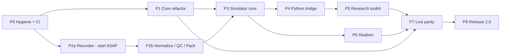
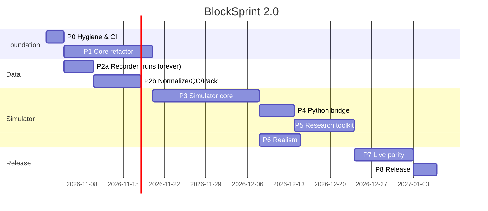

# BlockSprint 2.0: Phase-Wise Implementation Plan

> **Companion document:** [backtesting_simulator_integration_guide.md](backtesting_simulator_integration_guide.md). That guide explains **what** to build and **why**. This plan covers **how and in what order**: phases, tasks, files, dependencies, tests, acceptance criteria and estimates.
>
> Defect IDs (`D1`–`D20`) and refactor IDs (`R1`–`R11`) refer to sections 3 and 9 of the guide.

---

## Progress Log

| Date | Work | Notes |
| :--- | :--- | :--- |
| 2026-11-01 | 1.0 frozen: tag `v1.0.0` + branch `release/v1` at `f1fc45f`; development branch `v2` created | Local only, not pushed yet |
| 2026-11-01 | P0.2–P0.9 done (P0.1 is yours: revoke the key) | `.env` and `logs/` untracked; connector needs no keys, so no `.env.example`; `dotenv` dependency dropped; baseline in [docs/baseline/v1.0.0.md](docs/baseline/v1.0.0.md); CI written but unverified until pushed; secret scan deferred until the history-rewrite decision |
| 2026-11-01 | P1.1–P1.4 done | Layout `src/core` + `src/api`; doctest 2.4.11; test target is **`unit_tests`** (`run_tests` collides with Visual Studio's built-in `RUN_TESTS` on case-insensitive Windows); 22 characterization cases incl. a golden hash verified against the original v1.0.0 sources; matching unified (`order_book.cpp` 647 → ~320 lines) with an identical golden hash on MSVC and GCC |
| 2026-11-01 | **New defect D21** found by the golden workload | FOK dry run counts liquidity past self-trade makers, but the sweep stops at them, so a FOK can partially fill and **rest** the remainder. Preserved in P1.4 (pure refactor) and pinned as a v1-quirk test; fix scheduled with P1.9 |
| 2026-11-02 | P1.5 done | `OrderBook::check_invariants()` + `is_crossed()`; checked after every operation of 20 seeded workloads; mutation-tested (a removed bookkeeping line is caught at op 5) |
| 2026-11-02 | P1.6 done (**design change**) | One fixed-point scale for every symbol: `int64` in **1e-8 units** (Binance's finest precision) instead of per-symbol tick scales; tick/lot sizes stay validation rules for P1.12. Exact decimal parser at the API (`parse_fixed`, accepts `1e-05`, rejects values finer than 1e-8). JSON output keeps the 1.0 `"%f"` format until P1.11. D5 fixed with a regression test. Golden hash unchanged |
| 2026-11-02 | P1.7 + P1.8 done | `IClock` / `WallClock` / `SimClock`; `MatchingEngineManager` → **`MatchingEngine`** (still in `matching_engine.hpp`): instantiable, injected clock, per-engine trade IDs from 1, optional locking. API server receives the engine. Two `SimClock` runs are bit-identical including trade IDs and timestamps (part of P1.17). 48 tests / 280 assertions on MSVC + GCC; live Binance mirror verified |
| 2026-11-02 | P2.0–P2.5 done, P2.6 documented | Recorder, raw archive I/O, inspector, 12 pytest tests. Live runs: zero sequence/trade gaps, all snapshots syncable, seamless 3-connection rollover. Found and fixed a shutdown-order bug. **Latency finding:** 1–2.5 s receive bursts from this PC come from the network path (a bare probe sees the same), which supports the Tokyo VPS recommendation. See [docs/recorder_ops.md](docs/recorder_ops.md) |
| 2026-11-02 | Committed and pushed | 4 commits on `v2`; pushed `v2`, `release/v1` and tag `v1.0.0` (history kept as is, by decision). `main` untouched |
| 2026-11-02 | **D22** found by the first CI run | `asio`/`websocketpp` were submodule pointers without `.gitmodules`, so no clone (1.0 included) could build the server. Registered as submodules pinned to the same release tags; CI checks out submodules |
| 2026-11-02 | P1.9 done | STP by `owner_id` + per-order `StpPolicy` (none / skip / cancel_taker / cancel_maker (default, as Binance) / cancel_both) replaces the spoofable `BINANCE_` prefix. **D7** fixed (a remainder that would cross is cancelled), **D21** fixed (FOK dry run uses the same rules; FOK never rests), **D9** fixed (duplicate ID rejected; explicit `replace` in engine, `PUT /api/orders`, WS `replace`). Reserved owner `MARKET` accepted only from loopback. Two goldens: no-STP hash unchanged since 1.0 (`6980882564197707180`), STP-mixed re-pinned (`937915414169173351`). 54 tests / 351 assertions on MSVC + GCC; 17 live API checks |
| 2026-11-02 | Connector found to be the source of live D7 | It applied all bids before removing stale asks, so a rising market briefly crossed the book. Now removes stale levels on both sides first, sends only changed levels (`replace`), and mirrors as owner `MARKET`/`skip`. Live: 0 crossed in 1,017 depth samples, full 10x10 books 99% of samples |
| 2026-11-02 | P1.10 done | Execution reports (`src/core/events.hpp`): `ack`, `fill` (maker/taker, cum/leaves, trade_id), `amended`, `cancelled` (user, replaced, ioc_remainder, no_liquidity, fok_kill, would_cross, stp_taker, stp_maker), `rejected` (duplicate_order_id, invalid_quantity). Business rejects no longer throw. Engine: optional `reports` out-parameter on every mutating call plus a callback. API: `reports[]` in responses, rejected -> 400, new `/ws/executions` stream. Lifecycle contract checked on every report of 20 random workloads with all STP policies; two mutation tests confirm the checker catches missing terminal reports. 65 tests / 608 assertions on MSVC + GCC; both golden hashes unchanged; 11 + 17 live API checks |
| 2026-11-02 | Connector bootstrap bug found (pre-existing, 1.0) | REST snapshots were fetched with blocking `requests.get` inside the async loop, so orders already handed to `ws.send()` sat unsent and books stayed half-built (0x0 / 1x0) for as long as Binance REST took (seconds from this PC). Fetch moved to a worker thread: 99.5% full 10x10 books, 0 crossed |
| 2026-11-03 | Recorder keep-awake | The PC slept at 23:41 on 2026-11-02 and ~24 h of data were lost (1 h 43 min clean recording before that). The recorder now holds a Windows `SetThreadExecutionState` request against idle sleep while it runs (`research/data/keep_awake.py`, `--no-keep-awake` to disable; 4 tests). It cannot block user-initiated sleep, lid close or update restarts: see docs/recorder_ops.md |
| 2026-11-04 | P1.18 (bench_core) built first, then P1.11 done | `bench_core`: passive / matching / mirror workloads, `sim` and `live` configs. P1.11: POD `Bbo` / `Depth` (`src/core/market_data.hpp`) on the hot path, BBO change detection by integer comparison, callbacks take the structs, JSON only at the boundary (`get_bbo` / `get_l2_depth` keep the 1.0 format). API: JSON built only when someone is subscribed; depth coalesced per symbol, at most every 100 ms. **Engine throughput 15-85x higher** (e.g. matching/sim 39k -> 639k ops/s on MSVC), see docs/baseline/bench_core.md. Plan target of 3M ops/s not met yet (allocation-bound, D15). perf_test 1,923 -> 6,207 orders/s. Tests unchanged: 65 / 608 |
| 2026-11-04 | P1.12 done | `SymbolSpec` (tick, lot, min/max qty, min notional; exact 128-bit notional check) + `validate_order`: positive quantity, positive price for LIMIT/IOC/FOK (**D6 fixed**), Binance filters (**D12 fixed**). Rejections are `rejected` reports with reasons `invalid_price`, `price_tick`, `quantity_lot`, `quantity_range`, `min_notional`; an invalid modify is rejected and the order is unchanged. `Order::market_data_liquidity` exempts mirrored/replayed levels (real books hold levels below the minimum notional). Read-only queries, cancel and modify never create books (**D18 fixed**; cancel/modify still did, caught by a test). API: numbers or strings, 404 for unknown symbols, `POST /api/symbols` (loopback only) / `GET /api/symbols`. The connector loads Binance's real filters. 74 tests / 682 assertions on MSVC + GCC; 17 live checks; live mirror 0 crossed, 99.7% full |
| 2026-11-05 | P1.13 done | Fee schedules per owner plus a default (`src/core/fees.hpp`); rates in 1e-8 fractions, negative = rebate. `fee` on every fill and `cum_fee` on every report, in quote currency, exact 128-bit arithmetic (shared `int128.hpp`); notionals above ~92 billion per fill saturate (Binance's largest BTC order is ~9 billion even at 1M USDT/BTC). Market-data liquidity pays nothing; fees never appear in the public trade feed. Live server defaults to Binance regular tier 0.10% / 0.10%; `POST /api/fees` (loopback) / `GET /api/fees`. Lifecycle checker now recomputes every fill's fee under real schedules (mutation-tested). 82 tests / 725 assertions on MSVC + GCC; 16 live checks; no measurable throughput cost |
| 2026-11-05 | P1.14 done | Post-only orders: `OrderType::LIMIT_MAKER` (`limit_maker` / `post_only`), rejected with `post_only_would_take` if it would trade on arrival (also when amended to a crossing price). `amend_order(id, new_total, new_price?)`: Binance semantics, the new TOTAL quantity, priority kept only when reduced at the same price, total <= filled cancels the rest (**D11 fixed**); `modify_order` keeps the 1.0 open-quantity meaning (golden tests unchanged). API: `PATCH /api/orders`, WS `"amend"`. The random workload got an opt-in post-only + amend mode, so the lifecycle (fees included) and invariant checks cover them. A test helper ranged over part of a temporary JSON (read freed memory); fixed. 95 tests / 799 assertions on MSVC + GCC; 12 live checks plus all earlier ones |
| 2026-11-05 | P1.15 done | Logger rewritten (**D19 fixed**): off until `open(LoggerOptions{path, level, flush_level, append})`, so tests, the benchmark and backtests write no files; `'\n'` instead of `std::endl`, flushed only at `flush_level` or on close; macros skip building the message when the level is off (one atomic load); ISO-8601 UTC timestamps; `Logger::run_log_path` gives each run its own file. Server flags `--log-file`, `--log-dir`, `--log-level`, `--no-log`, `--help`. 11 new tests (threads, buffering, truncation, unopenable paths); 106 tests / 857 assertions on MSVC + GCC; live: two runs gave two files, lines present after a hard kill |
| 2026-11-05 | P1.16 done | `tests/core/fuzz_test.cpp`: seeded random operations (all 5 order types, replace, cancel, modify, amend, 3 owners + mirrored liquidity with all STP policies, per-owner fees incl. a rebate, invalid and duplicate orders, unknown IDs and symbols, 2 books sharing trade/report counters) run in lockstep through the engine and a naive reference book (one flat vector, priority re-sorted on every use). After every op: return values, trades and exec-report streams compared field by field, full depth of both books compared, `check_invariants()`. Asserts every report type/reason actually occurs. 10^5 ops in the unit tests (~2.5 s), 10^6 in a new CI job on every push (`BLOCKSPRINT_FUZZ_OPS`, `BLOCKSPRINT_FUZZ_SEED` to replay). Mutation check: 8 of 8 injected engine bugs caught, each reported with seed, op and first differing field. No engine bug found. 108 tests / 888 assertions on MSVC + GCC |
| 2026-11-05 | P1.17 done | `tests/core/determinism_test.cpp`: a seeded operation script (times included; 3 symbols, one with tick/lot/range/notional rules; all order types, replace, cancel, modify, amend, STP owners, mirrored liquidity, a maker rebate) is replayed into fresh `SimClock` engines. FNV-1a over the canonical JSON of every exec report (seq, timestamp and rejection text included), trade, BBO and depth callback, every return value and the final books: two replays and a lock-free engine give the same hash. **Golden stream hash 2815580882014666384, identical on MSVC and GCC**, pinned so CI checks it on Windows and Linux. Sensitivity checked (another seed, a 1 ns time shift, one op fewer; a one-word change in a rejection text also breaks it). 111 tests / 1409 assertions |
| 2026-11-06 | P1.18 done | Hot path: one clock read per engine call (was 4–8 at ~39 ns each), no `ExecReport` built when nobody receives it, reused report buffer, **intrusive FIFO per level** instead of `std::list<shared_ptr>` (D15, first half), a per-book `std::pmr` pool for the price maps and the order lookup (keyed by `string_view` into the order's ID), fewer shared_ptr copies. Duplicate submissions are now rejected before the order is touched (with intrusive links, resubmitting the resting object would have unlinked it); regression test added. `bench_core` now separates engine time from order creation (~210 ns per heap order) and uses `SimClock` for `sim`. **2.0–2.6x faster in sim, 1.6–1.8x in live** (GCC, same benchmark). MSVC engine ops/s in sim: passive 2.79 M, matching 2.71 M, mirror 3.20 M: **3 M target met by mirror only, the others at 90–95%**; 2.0–2.3 M including order creation. The rest needs integer handles and an engine-owned order pool (P3.18 path). LTO tried, no gain. Determinism hash and golden hashes unchanged; 10^6 fuzz ops pass; 74 live API checks pass. 112 tests / 1421 assertions |
| 2026-11-06 | P1.19 done, **Phase 1 complete** | `explanations/` brought up to the 2.0 core. Rewritten: `order_book.md` (fixed-point levels, intrusive FIFO, pmr pool, flow diagram, STP, amend vs modify, fees, invariants), `models.md`, `main.md`. Updated: `matching_engine.md`, `events.md`, `api_server.md`. New: `types.md`, `clock.md`, `market_data.md`, `symbol_spec.md`, `fees.md`, `tests.md`. README tree updated |
| 2026-11-06 | P2.7–P2.14 done | Normalizer (`research/data/normalize.py`, schema in `schema.py`): Binance book sync, duplicate drop, GAP + segments, ticks/lots per date's spec, day-start synthetic snapshots, monotonic ts_local (clamped + flagged), bulk conversion via Arrow (identical output to a per-row first version). Parquet partitions `venue=/market=/symbol=/date=` with book/trade/snapshot + meta.json. Reference book (`refbook.py`). QC (`qc.py`): exact top-20 snapshot reconstruction (levels of the spanning event excluded), crossed/locked, grid, ts monotonicity, latency, coverage, trades-vs-BBO by exchange time; qc.json + qc.html; pass/partial/fail. Downloader (`downloader.py`): data.binance.vision trades/aggTrades/klines, SHA-256 verified, ms/µs timestamps. Packer (`pack.py`): `.bse` v1 per §14.2, stable merge, refuses failed/unchecked/changed/mixed-spec data. Catalog (`catalog.py`): list/show/verify. 23 new pytest tests (golden output, gap, old snapshot, overlap duplicates, clamp, off-grid, tick change across days, QC corruption, pack refusals, catalog tamper, offline downloader); 40 total. **Real data: 10 symbol-dates normalized, 361/361 snapshots match, never crossed; all dates `partial` (best 61.5%) because of recording gaps. Recorded Nov 4 trades = public aggTrades 100%. Nov 5 packed, round trip identical.** Command guide: docs/data_pipeline.md. New deps: pyarrow, numpy, orjson |
| 2026-11-06 | Phase 3 started: P3.1–P3.5 done, P3.14 in part | Architecture of record: `docs/simulator_architecture.md`. CMake `sim` / `bs_sim` / `sim_tests`. `src/sim/rng.hpp`: SplitMix64 + xoshiro256** (pinned against an independent Python implementation), own `det_log` (+ − × ÷ only, so it's bit-identical across libms), polar-method normal, exponential, empirical inverse CDF. `event_queue.hpp`: (time, class, seq) heap. `mmap_file.*` (Windows/POSIX), `bse.*` (header parse/validate/encode, fixture writer), `replayer.*` (batches: depth/snapshot/trade/gap; malformed input reported by record index). `l2_book.hpp`, `reconstruct.*`: oracle semantics, top-N checkpoint dumps. `bs_sim info` / `reconstruct`. **V0 PASS on real data: BTCUSDT 108/108 and ETHUSDT 264/264 checkpoints identical to the Python oracle on 2026-11-05 (gaps and resyncs included); a 1-lot change is caught.** Replay 3.4–4.6 M records/s (std::map; 5 M target is P3.18). 16 sim tests on MSVC + GCC; `research/sim/check_reconstruct.py` + pytest (41 Python tests) |

---

## Table of Contents

1. [What BlockSprint 2.0 Is](#1-what-blocksprint-20-is)
2. [Goals, Non-Goals, Success Metrics](#2-goals-non-goals-success-metrics)
3. [Working Agreements](#3-working-agreements)
4. [Phase Map & Timeline](#4-phase-map--timeline)
5. [Phase 0: Hygiene, Baseline & CI](#phase-0-hygiene-baseline--ci)
6. [Phase 1: Core Engine Refactor](#phase-1-core-engine-refactor)
7. [Phase 2: Historical Data Layer](#phase-2-historical-data-layer)
8. [Phase 3: C++ Simulator Core](#phase-3-c-simulator-core)
9. [Phase 4: Python Bridge](#phase-4-python-bridge)
10. [Phase 5: Research Toolkit](#phase-5-research-toolkit)
11. [Phase 6: Realism Extensions](#phase-6-realism-extensions)
12. [Phase 7: Live Parity & Calibration](#phase-7-live-parity--calibration)
13. [Phase 8: Release 2.0](#phase-8-release-20)
14. [Cross-Cutting Specifications](#14-cross-cutting-specifications)
15. [Risk Register](#15-risk-register)
16. [Master Tracking Checklist](#16-master-tracking-checklist)

---

## 1. What BlockSprint 2.0 Is

| | BlockSprint 1.x (today) | BlockSprint 2.0 |
| :--- | :--- | :--- |
| Identity | Live L3 matching engine + Binance mirror | **Market microstructure-aware backtesting & execution simulator**, with a live/paper mode on the same core |
| Clock | Wall clock | Pluggable: `WallClock` (live) / `SimClock` (replay) |
| Prices | `double` | `int64` ticks / lots per `SymbolSpec` |
| Market data | Live top-10 depth only | Recorded diff depth + trades, a Parquet lake, and a binary replay format |
| Queue realism | Reset every 100 ms | L2→L3 synthesis with configurable queue models |
| Latency | None | Feed, entry and ack models |
| Costs | None | Maker/taker fees, exchange filters, rate limits |
| Strategy | Manual orders over REST/WS | C++ or Python `Strategy` API, the same in sim and live |
| Research | None | Experiments, sweeps, TCA, markouts, tearsheets |
| Interfaces | REST/WS | REST/WS (live) + `bs_sim` CLI + `blocksprint_sim` Python module |

---

## 2. Goals, Non-Goals, Success Metrics

### Goals
1. Deterministic replay of historical Binance spot L2 + trade data through the BlockSprint matching core.
2. Realistic passive and aggressive fills: queue position, latency, partial fills, fees, filters, impact.
3. Python-first strategy research with C++ speed.
4. **One** matching core for both backtest and live/paper.
5. A measurable gap between simulation and reality (live parity validation).

### Non-Goals (explicitly out of scope for 2.0)
- Futures/perpetuals (funding, margin, liquidations). The schema stays venue-agnostic so they can be added in 2.x.
- L3 (per-order) venues.
- Real-money order routing to Binance. Paper/testnet only.
- Distributed or cluster execution (multiprocessing on one machine is enough).
- A GUI or web dashboard. Static HTML tearsheets only.
- Multi-venue or cross-exchange strategies.

### Success metrics (2.0 release gate)

| Metric | Target |
| :--- | :--- |
| Determinism | Same config + data + seed ⇒ identical output hash, on Windows/MSVC **and** Linux/GCC |
| Reconstruction (V0) | 100% top-20 match against every recorded snapshot on clean segments |
| Replay throughput (no strategy) | ≥ 5 M events/s single-threaded, Release build |
| One-day BTCUSDT backtest with a Python strategy on a 1 s timer | < 2 min |
| Data coverage | ≥ 30 clean recorded days for BTCUSDT and ETHUSDT |
| Sim-vs-paper parity (V5) | Fill ratio within ±15% relative; 1 s markout mean within 1 tick |
| Test suite | All green in CI; core line coverage ≥ 80% |

---

## 3. Working Agreements

### Branching & versioning
- Tag the current `main` as **`v1.0.0`** before any change.
- Use a long-lived integration branch **`v2`**, with one feature branch per task: `p1/unify-matching`, `p2/recorder`, and so on.
- Merge a feature into `v2` only when CI is green and its acceptance criteria are met.
- Tag the end of each phase on `v2`: `v2.0.0-p1`, `v2.0.0-p2`, and so on.
- `v2` merges into `main` at Phase 8 as `v2.0.0`.

### Definition of Done (every task)
- [ ] Code builds warning-free at `/W4` (MSVC) and `-Wall -Wextra` (GCC/Clang).
- [ ] Tests are added or updated and pass locally and in CI.
- [ ] Docs are updated: `explanations/*.md` for changed components, and this plan's checklist.
- [ ] No behavior change to the live server unless the task says so. If it does, `run_all.py` + `interactive_test.py` still pass.
- [ ] Benchmarks are re-run if the task touches the hot path, and the result is noted in the PR.

### Estimation convention
Estimates are **ideal developer-days for one person**. Multiply by about 1.5 for calendar time.

---

## 4. Phase Map & Timeline

### Dependencies



### Indicative timeline (solo, ~14 weeks)



> **The most important scheduling rule:** the **recorder (P2a) starts as soon as P0 is done** and runs continuously from then on. Every phase after it needs recorded data, and recording time can't be compressed later.

### Phase summary

| Phase | Name | Est. (days) | Key output | Gate |
| :--- | :--- | ---: | :--- | :--- |
| P0 | Hygiene, baseline & CI | 2–3 | Clean repo, `v1.0.0` tag, CI | No secrets; CI green |
| P1 | Core engine refactor | 13–17 | `engine_core` lib: deterministic, int ticks, exec reports | Determinism + fuzz tests; live still works |
| P2 | Historical data layer | 11–14 | Recorder, Parquet lake, `.bse` packer, QC | ≥ 3 clean days; Python oracle reconstruction |
| P3 | C++ simulator core | 16–20 | `sim` lib + `bs_sim` CLI | V0–V4 pass; ≥ 5 M ev/s |
| P4 | Python bridge | 5–7 | `blocksprint_sim` module | C++/Python strategy parity |
| P5 | Research toolkit | 9–12 | Experiments, analytics, tearsheets, 3 strategies | Reproducible tearsheet from YAML |
| P6 | Realism extensions | 6–8 | Impact, rate limits, risk guard | Sensitivity report |
| P7 | Live parity & calibration | 9–12 | Live Synthesizer, live strategy runner, V5 | Parity within targets |
| P8 | Release 2.0 | 3–4 | Docs, README, `v2.0.0` | Release checklist |
| | **Total** | **~74–97** | | |

---

## Phase 0: Hygiene, Baseline & CI

**Objective:** a safe, reproducible starting point, with a recorded baseline to compare 2.0 against.

### Tasks

| ID | Task | Files | Est. |
| :-- | :--- | :--- | ---: |
| P0.1 | **Revoke the exposed Binance API key** in the Binance console | — | 0.1 |
| P0.2 | Untrack `.env` and `logs/`; add `.env.example`; optionally purge history with `git filter-repo` and force-push (coordinate first, since it rewrites public history) | `.gitignore`, `.env.example` | 0.3 |
| P0.3 | Remove the API key requirement from the connector and docs (only public endpoints are used) | `scripts/binance_connector.py`, `README.md`, `command.md` | 0.2 |
| P0.4 | Fix doc drift (D20): Python 3.13 badge, real test names, remove `python-binance`/pandas from `binance_integration_guide.md` or mark it historical | docs | 0.3 |
| P0.5 | Make `run_tests` print PASS/FAIL to **stdout** as well as the log (CI needs it) | `tests/main_test.cpp` | 0.1 |
| P0.6 | Tag **`v1.0.0`**; create the `v2` branch | git | 0.1 |
| P0.7 | **Baseline capture:** save `perf_test.py` output and unit test output to `docs/baseline/v1.0.0.md` | new | 0.2 |
| P0.8 | **CI:** GitHub Actions matrix `windows-latest` (MSVC, Release) + `ubuntu-latest` (GCC, Release): configure, build, run `run_tests` | `.github/workflows/ci.yml` | 0.7 |
| P0.9 | Add `.clang-format` (match the current style: 4 spaces, braces on the same line) and `.editorconfig` | new | 0.2 |

### Acceptance criteria
- [ ] The key is revoked, and `git ls-files` shows no `.env` and no `logs/`.
- [ ] CI is green on both OSes for `v2`.
- [ ] `v1.0.0` tag exists; the baseline doc is committed.

### Notes
- The Linux CI job will probably expose non-portable code. For example, `uint64_t` in `models.hpp` relies on a transitive `<cstdint>` include. Fix these in this phase.

---

## Phase 1: Core Engine Refactor

**Objective:** turn the matching engine into a **deterministic, instantiable, integer-priced library** (`engine_core`) that emits a complete execution-report stream, while the live server keeps working on top of it.

**Strategy:** write characterization tests first, then refactor behind them, one concern per PR, in this order. Unifying the matching loop comes early because every later change touches it.

### Task order & breakdown

| ID | Task | Fixes | Files | Depends | Est. |
| :-- | :--- | :--- | :--- | :--- | ---: |
| P1.1 | CMake split into targets: `engine_core` (static), `api` (static), `crypto_matching_engine` (exe), `run_tests` (exe) | R1 | `CMakeLists.txt` | P0 | 0.5 |
| P1.2 | Vendor **doctest** (single header); port the 6 existing tests; keep the old harness until the port is done, then delete it | R11 | `external/doctest/`, `tests/` | P1.1 | 1 |
| P1.3 | **Characterization tests** that pin current matching behavior (multi-level sweep, partial maker fill, FIFO across levels, IOC remainder, FOK kill, modify-keeps-priority, modify-loses-priority, STP skip). These are the safety net for P1.4. | — | `tests/core/characterization_test.cpp` | P1.2 | 1 |
| P1.4 | **Unify matching:** one sweep routine parameterized by side, optional limit, TIF (GTC/IOC/FOK) and STP policy; remove the dead lazy-delete branch | R4, D14, D17 | `src/core/order_book.*` | P1.3 | 2 |
| P1.5 | `OrderBook::check_invariants()` (debug/test only): not crossed; `level.total == Σ remaining`; lookup ↔ lists consistent; no empty levels | R11 | `order_book.*` | P1.4 | 0.5 |
| P1.6 | **Fixed-point prices/quantities:** `int64` in 1e-8 units for every symbol (decided 2026-11-02, replacing per-symbol tick scales); `int64` map keys; exact decimal parsing and formatting at the boundaries. `SymbolSpec` tick/lot sizes move to P1.12 as validation rules | R3, D5 | `src/core/types.*`, `order_book.*`, `api_server.cpp` | P1.4 | 2 |
| P1.7 | **Clock abstraction:** `IClock`, `WallClock`, `SimClock`, injected into `Engine`/`OrderBook`; remove `getCurrentTimestampNs()` from core | R2, D1 | `src/core/clock.hpp`, core files | P1.4 | 0.5 |
| P1.8 | **Instantiable `MatchingEngine`** (renamed from `MatchingEngineManager`); per-instance trade ID counter; `EngineOptions::thread_safe` (mutex for live, none for sim); `main.cpp` owns the instance | R7, D2, D3, D16 | `src/core/matching_engine.*`, `main.cpp`, `api_server.*` | P1.7 | 1 |
| P1.9 | **Participants and STP:** `owner_id` on `Order`; `StpPolicy` {`SKIP`, `CANCEL_TAKER`, `CANCEL_MAKER`, `CANCEL_BOTH`}; **never rest crossed** (fix D7); FOK never rests (fix D21); duplicate ID ⇒ `REJECT`; explicit `replace` | R6, D7, D8, D9, D21 | core, `api_server.cpp`, `binance_connector.py` | P1.8 | 1.5 |
| P1.10 | **Execution reports:** `ExecReport` stream (`ACK`, `REJECT`, `FILL`, `CANCELLED{reason}`, `AMENDED`) + `BookUpdate` stream via an `IEventSink`; the live server becomes a sink | R5, D4 | `src/core/events.hpp`, core, `api_server.*` | P1.9 | 2 |
| P1.11 | **Hot-path types:** POD `Bbo`; integer change detection; JSON only in `api/`; throttled depth broadcasts | R8, D13 | core, `api_server.*` | P1.10 | 0.5 |
| P1.12 | **Validation:** qty/price ≤ 0, missing price on priced types (fixes D6), tick/lot multiples, min notional, unknown symbol on getters ⇒ 404 | R9, D6, D12, D18 | `src/core/validator.*`, `api_server.cpp` | P1.6, P1.10 | 1 |
| P1.13 | **Fee model:** `FeeSchedule {maker_bps, taker_bps}` per participant; fee on `FILL` | R10 | `src/core/fees.*` | P1.10 | 0.5 |
| P1.14 | **Order features:** `POST_ONLY` (reject if crossing); `amend` with the semantics fixed as **new total qty** (keeps priority only if reduced at the same price) | D11 | core | P1.10 | 1 |
| P1.15 | **Logger:** configurable path and level; `'\n'` instead of `std::endl`; one log per run | D19 | `src/logger.hpp` | P1.8 | 0.3 |
| P1.16 | **Fuzz/property test:** random op sequences (seeded) against a naive reference book (O(n) vectors); compare exec-report streams; run `check_invariants()` after every op | R11 | `tests/core/fuzz_test.cpp` | P1.10 | 1 |
| P1.17 | **Determinism test:** the same op script run twice ⇒ identical exec-report hash (FNV-1a/xxHash over a canonical serialization) | R11 | `tests/core/determinism_test.cpp` | P1.10 | 0.3 |
| P1.18 | **Micro-benchmark** `bench_core`: synthetic workloads (add/cancel/match mix) and ops/s with no network | — | `bench/bench_core.cpp` | P1.11 | 0.5 |
| P1.19 | Update `explanations/*.md` for the new core | — | docs | all | 0.5 |

### Specification details

**`SymbolSpec` fields:** `symbol`, `base`, `quote`, `tick_size` (decimal string, stored as a scaled integer), `lot_size`, `min_qty`, `max_qty`, `min_notional`, `price_decimals`, `qty_decimals`.
- Source for live: Binance `GET /api/v3/exchangeInfo` filters (`PRICE_FILTER.tickSize`, `LOT_SIZE.stepSize`, `NOTIONAL.minNotional`).
- Source for sim: embedded in the `.bse` header (P2).
- Never derive ticks with floating-point division. Parse decimal strings into integers directly.

**`ExecReport` fields:** `seq` (per engine, monotonic), `ts` (engine clock), `type`, `order_id`, `owner_id`, `symbol`, `side`, `price_ticks`, `last_qty`, `last_px`, `cum_qty`, `leaves_qty`, `liquidity` (MAKER/TAKER), `fee`, `trade_id`, `reason`.

**`CANCELLED` reasons:** `USER`, `IOC_REMAINDER`, `FOK_KILL`, `STP`, `NO_LIQUIDITY`, `POST_ONLY_WOULD_CROSS`, `REPLACED`.

**Live API compatibility (keep 1.x clients working)**

| Endpoint / message | 1.x behavior | 2.0 behavior |
| :--- | :--- | :--- |
| `POST /api/orders` | `{status, order_id, trades[]}` | Same fields, **plus** `reports[]` (done, P1.10); a rejected order is a 400 with the report's `message`. Missing price on LIMIT/IOC/FOK ⇒ 400 `invalid_price` (was: silently 0; done, P1.12). Symbols with trading rules reject off-tick/lot, out-of-range and below-min-notional orders (done, P1.12). |
| Duplicate `order_id` | Silently replaces | **400 duplicate** (done, P1.9). Use `action: "replace"` / `PUT /api/orders`. |
| `/ws/orders` submit/cancel | Same | + `"replace"` (done, P1.9), `"amend"` (done, P1.14; also `PATCH /api/orders`); response includes `reports[]` (P1.10). Error responses echo `order_id` when known (done, P1.9) |
| Numbers | Strings only, parsed with `std::stod` | Strings **or** numbers accepted (done, P1.12); responses keep strings. Since P1.6, values are parsed exactly and anything finer than 1e-8 is a 400 (1.x silently rounded it) |
| `GET /api/bbo?symbol=X` on unknown X | Creates an empty book | **404** (done, P1.12; also `/api/depth`) |
| `POST /api/symbols`, `GET /api/symbols` | — | **New** (P1.12): per-symbol trading rules; `POST` from localhost only |
| `/ws/market-data` depth events | One per limit order (and per trade or BBO change) | Coalesced per symbol: at most one every 100 ms, always the latest book (done, P1.11). BBO events are still sent on every change |
| `/ws/executions` | — | **New:** stream of exec reports (done, P1.10) |
| Connector participant | `BINANCE_` id prefix | `"owner": "MARKET"` + `"stp": "skip"` (done, P1.9; `MARKET` accepted only from loopback). Any client may send `owner` / `stp` for its own orders |

### Tests added in P1
Characterization (P1.3), invariants (P1.5), validator unit tests, fee tests, STP policy matrix (4 policies × maker/taker owners), the "never rest crossed" regression test for D7, the D6 regression test (sell without price ⇒ 400), fuzz (P1.16, ≥ 10⁶ ops in CI nightly and 10⁴ per PR), and determinism (P1.17).

### Acceptance criteria
- [ ] All old + new tests are green on Windows and Linux.
- [ ] No `getCurrentTimestampNs()`, `system_clock`, `static` counters or singletons remain in `src/core/`.
- [ ] No `double` in the core order book data path.
- [ ] Every order receives exactly one terminal report: `FILL` with leaves = 0, `CANCELLED`, or `REJECT`. This is enforced by the fuzz test.
- [~] `bench_core` ≥ 3 M ops/s mixed workload (recorded in `docs/baseline/`). P1.18: engine-only sim 2.7–3.2 M (mirror meets it, matching/passive at 90–95%); 2.0–2.3 M including order creation. Closing the gap needs integer order handles and an engine-owned order pool.
- [ ] `run_all.py` + `interactive_test.py` pass against the live Binance mirror.
- [ ] Tag `v2.0.0-p1`.

### Risks
- **Unifying matching changes subtle behavior.** Mitigation: the characterization tests are written before P1.4.
- **Integer conversion edge cases** (e.g. a `1e-8` tick on small-cap symbols). Mitigation: use per-symbol scale, parse decimal strings directly, and add tests for 8-decimal assets.

---

## Phase 2: Historical Data Layer

**Objective:** a reliable pipeline from Binance into **raw archive → normalized Parquet → packed `.bse` replay files**, with quality control and a Python reference book that acts as an oracle.

It's split into **P2a (recorder, started immediately after P0)** and **P2b (everything else)**.

### Python project restructure (do first)

| ID | Task | Est. |
| :-- | :--- | ---: |
| P2.0 | Create the importable package `research/` (`research/data`, `research/strategies`, `research/analytics`, `research/experiments`); update `pyproject.toml` dependencies: `pyarrow`, `polars`, `duckdb`, `zstandard`, `pydantic`, `pyyaml`, `pytest`; add `data/` and `results/` to `.gitignore` | 0.5 |

### P2a: Recorder

| ID | Task | Files | Est. |
| :-- | :--- | :--- | ---: |
| P2.1 | **Raw recorder:** asyncio; one combined WS per symbol group with `<sym>@depth@100ms` + `<sym>@trade`; capture `ts_local = time.time_ns()` **before** JSON parsing; write envelope lines `{ts_local, conn_id, stream, raw}` | `research/data/recorder.py` | 1.5 |
| P2.2 | **Snapshots:** REST `/api/v3/depth?limit=5000` at start, after every reconnect or gap, and every 10 min; stored as `SNAPSHOT` envelopes with `lastUpdateId`. Respect REST weight limits (limit=5000 has weight 250; stagger symbols). | same | 0.5 |
| P2.3 | **Rotation & durability:** hourly files `data/raw/binance/spot/{SYMBOL}/{YYYY-MM-DD}/{HH}.jsonl.zst`; flush every N seconds; atomic close (write `.part`, then rename) | same | 0.5 |
| P2.4 | **Resilience:** backoff reconnect; proactive reconnect before the 24 h WS limit, with overlap (open the new connection before closing the old) so nothing is missed; heartbeat log; write a `GAP` marker on any discontinuity | same | 1 |
| P2.5 | **Metadata capture:** daily `exchangeInfo` snapshot → `data/raw/binance/spot/_meta/exchangeInfo_{date}.json.zst`; record NTP offset samples hourly (e.g. via `ntplib`) | `research/data/meta.py` | 0.5 |
| P2.6 | **Deployment:** run 24/7. On Windows use Task Scheduler / NSSM, or (recommended) a small Linux VPS **near Binance's matching engine (AWS Tokyo, ap-northeast-1)** so `ts_local` latencies are realistic. Disk estimate: ~1–3 GB/day/symbol raw-zstd for BTCUSDT; plan retention. | `docs/recorder_ops.md` | 1 |

**P2a acceptance:** the recorder runs for 72 h unattended with zero unhandled crashes; a coverage report shows ≥ 99% of minutes captured per symbol.

### P2b: Normalize, QC, pack, catalog

| ID | Task | Files | Est. |
| :-- | :--- | :--- | ---: |
| P2.7 | **Normalizer:** raw → normalized events (schema below). Apply Binance's local book sync rules: drop `u ≤ lastUpdateId`, check the first event `U ≤ lastUpdateId+1 ≤ u`, then `U == prev_u + 1`, otherwise emit `GAP` and start a new **segment**. Convert to ticks/lots using the spec in force **on that date**. | `research/data/normalize.py` | 2 |
| P2.8 | **Parquet writer:** partitioned `data/normalized/venue=binance/market=spot/symbol=X/date=D/{book,trade}.parquet`; zstd; row groups sorted by `(ts_local, seq)` | same | 0.5 |
| P2.9 | **Python reference book** (the oracle): applies normalized events and produces top-N at any time. Not fast; correct and simple. | `research/data/refbook.py` | 1 |
| P2.10 | **QC suite:** gaps per segment, crossed/locked book after batches, reconstruction vs the next periodic snapshot (top-20 exact), non-monotonic `ts_local`, `ts_local − ts_exch` distribution, trades outside BBO, coverage. Output: `qc.json` + an HTML summary per day. | `research/data/qc.py` | 1.5 |
| P2.11 | **Public data downloader:** `data.binance.vision` spot `trades`/`aggTrades`/`klines` (daily zips + `.CHECKSUM` SHA256 verification) → normalized trade Parquet (no book) | `research/data/downloader.py` | 1 |
| P2.12 | **Packer:** merge book and trade events for one `(symbol, date-range)` into a `.bse` file (format in §14.2), with a stable sort key `(ts_local, source_order, seq)` | `research/data/pack.py` | 1 |
| P2.13 | **Catalog/manifest:** per dataset `manifest.json` (symbols, range, segments, gap minutes, QC verdict, SHA256 of every file, schema version, spec snapshot); `catalog.py` lists and queries datasets | `research/data/catalog.py` | 0.5 |
| P2.14 | **Tests:** pytest with small fixture raw files covering a normal stream, an injected sequence gap, a reconnect overlap with duplicates, a snapshot boundary, and a tick-size change across days; golden normalized output | `tests/python/data/` | 1.5 |

### Normalized event schema (Parquet / packer input)

| Column | Type | Description |
| :--- | :--- | :--- |
| `ts_local` | int64 ns | Recorder receive time (**the simulation drives on this**) |
| `ts_exch` | int64 ns | Exchange event time (`E`; trades use `T`) |
| `seq` | int64 | Depth: `u` (final update ID). Trade: trade ID `t`. |
| `seg` | int32 | Segment ID (increments after each gap) |
| `kind` | uint8 | 0 SNAP_BEGIN, 1 SNAP_LEVEL, 2 SNAP_END, 3 DELTA, 4 TRADE, 5 GAP |
| `side` | uint8 | Book: 0 bid / 1 ask. Trade: aggressor 0 buy / 1 sell (from `m`: `m=true` ⇒ seller aggressor) |
| `px` | int64 | Price in ticks |
| `qty` | int64 | Delta: **new absolute level qty** in lots (0 = remove). Trade: traded lots. |
| `flags` | uint16 | bit0 `LAST_IN_BATCH`, bit1 `FROM_SNAPSHOT`, bit2 `DUPLICATE_SUSPECT` |

### Acceptance criteria
- [ ] ≥ 3 full clean days for BTCUSDT and ETHUSDT normalized, QC green, and packed. (Pipeline ready; waiting on complete recording days: best so far 61.5% coverage.)
- [x] The Python reference book matches 100% of periodic snapshots on clean segments (361/361 on Nov 2–6).
- [x] `catalog.py list` shows the datasets with hashes.
- [ ] Tag `v2.0.0-p2`.

### Risks
- **Recorder downtime loses data permanently.** Mitigation: deploy on a VPS, add alerting (e.g. an hourly health file check), and consider running two recorders in different locations later.
- **Binance API changes** (field or limit changes). Mitigation: store raw data and keep the normalizer versioned.

---

## Phase 3: C++ Simulator Core

**Objective:** an event-driven, deterministic exchange simulator that replays `.bse` data through `engine_core` using L2→L3 synthesis, latency and queue models, and a strategy gateway. It's exposed as a `sim` library and a `bs_sim` CLI.

### Tasks

| ID | Task | Files | Depends | Est. |
| :-- | :--- | :--- | :--- | ---: |
| P3.1 | `sim` static library target; `bs_sim` executable target | `CMakeLists.txt` | P1 | 0.3 |
| P3.2 | **Deterministic RNG:** `SplitMix64`/`xoshiro256**` + **own distribution implementations** (uniform, exponential, empirical inverse-CDF). `std::*_distribution` output differs between MSVC and libstdc++, which would break cross-platform determinism. | `src/sim/rng.hpp` | P3.1 | 0.5 |
| P3.3 | **EventQueue:** binary heap keyed by `(time, priority_class, insertion_seq)` | `src/sim/event_queue.hpp` | P3.1 | 0.5 |
| P3.4 | **`.bse` reader:** memory-mapped (Windows `CreateFileMapping`/`MapViewOfFile`, POSIX `mmap`, behind one small wrapper); header validation (magic, version, spec, hash); record iterator; batch boundaries | `src/sim/replayer.*`, `src/sim/mmap_file.*` | P2.12 | 1.5 |
| P3.5 | **Reconstruction mode:** apply deltas directly as level replacements (no synthesis, no strategy) and dump top-N at snapshot times. **Compare against the Python oracle (V0).** | `src/sim/reconstruct.*`, `tests/sim/` | P3.4, P2.9 | 1 |
| P3.6 | **Synthesizer (L2→L3):** synthetic order pool per level with owner `MARKET`; increases → append; trades → synthetic IOC at the trade price for the trade size (matches strategy orders ahead in the queue); `pending_trade_qty` netting; residual decreases → `QueueModel`; level removal; **crossing-fill** (data's opposite side crosses a resting strategy order ⇒ implied fill); snapshot reconciliation; `GAP` ⇒ flush synthetic liquidity and notify the strategy | `src/sim/synthesizer.*` | P3.5, P1.10 | 4 |
| P3.7 | **QueueModels:** `CancelFromBack`, `CancelFromFront`, `ProRata`, `ProbPower(n)`, `ProbLog`. Interface: given the level's synthetic orders and the positions of strategy orders, choose which synthetic quantity to remove. | `src/sim/queue_models.hpp` | P3.6 | 1.5 |
| P3.8 | **LatencyModels:** `Constant`, `Empirical(file)`, `Normal/LogNormal(clamped)`; separate feed, entry and ack instances; enforce FIFO per strategy connection (no overtaking) | `src/sim/latency_models.hpp` | P3.2 | 1 |
| P3.9 | **Observed book:** per-strategy L2 view built from `BookUpdate`s **delayed by feed latency**. The strategy only reads this, never the true book. | `src/sim/observed_book.*` | P3.6, P3.8 | 1 |
| P3.10 | **SimGateway + Strategy interface:** `send/cancel/amend/replace`, `open_orders`, `position`, `cash`, `set_timer`; callbacks `on_start/on_book/on_trade/on_exec/on_timer/on_gap/on_end`; per-participant accounts (position, cash, fees, volume) | `src/sim/gateway.*`, `src/sim/strategy.hpp` | P3.9 | 2 |
| P3.11 | **Simulator loop** (as in guide §10.1) with configurable tie-breaking (market data first at equal time by default); time window; warm-up period with no strategy orders | `src/sim/simulator.*` | P3.3–P3.10 | 1.5 |
| P3.12 | **Run config (JSON)** parsed with nlohmann: dataset, window, seed, latency/queue/fee params, strategy name + params, output dir | `src/sim/config.*` | P3.11 | 0.5 |
| P3.13 | **ResultRecorder:** append-only binary or CSV outputs (`orders`, `exec_reports`, `bbo_samples@Δt`, `positions@Δt`, `run_meta.json` with config hash, dataset hash, git SHA and seed). Python converts these to Parquet (P4/P5). | `src/sim/recorder.*` | P3.11 | 1 |
| P3.14 | **`bs_sim` CLI:** `bs_sim run config.json`, `bs_sim reconstruct file.bse --at ...`, `bs_sim info file.bse` | `src/sim/main.cpp` | P3.12 | 0.5 |
| P3.15 | **Reference C++ strategies:** `NullStrategy`, `PassiveQuoter` (joins best bid/ask with fixed size), `TwapTaker` | `src/sim/strategies/` | P3.10 | 1 |
| P3.16 | **Golden scenario tests:** hand-written tiny `.bse` fixtures with **hand-computed expected fills**: (a) queue ahead consumed by trades ⇒ fill; (b) cancels ahead under each QueueModel; (c) trade/depth double-count netting; (d) crossing fill; (e) latency makes a quote stale and it gets picked off; (f) IOC through 3 levels with fees; (g) gap handling | `tests/sim/golden/` | P3.6–P3.15 | 2.5 |
| P3.17 | **Determinism & cross-platform test:** the same run on Windows and Linux CI ⇒ identical output hash | CI | P3.16 | 0.5 |
| P3.18 | **Benchmarks:** replay-only and replay + `PassiveQuoter`, events/s on a 1-day file | `bench/bench_sim.cpp` | P3.11 | 0.5 |

### Validation gates (from guide §14)
- **V0** reconstruction matches the oracle on all snapshots.
- **V1** determinism (P3.17).
- **V2** fuzz invariants still hold under synthetic load.
- **V3** bounds: best case (zero latency + `CancelFromFront`) ≥ realistic case ≥ worst case (high latency + `CancelFromBack`) for `PassiveQuoter` PnL and fill count.
- **V4** with `NullStrategy`, synthetic trade volume per price equals historical volume exactly.

### Acceptance criteria
- [ ] All golden scenarios pass; V0–V4 pass.
- [ ] Replay-only ≥ 5 M events/s; a one-day BTCUSDT `PassiveQuoter` run finishes in < 30 s (Release).
- [ ] `bs_sim run` produces a complete output directory with `run_meta.json`.
- [ ] Tag `v2.0.0-p3`.

### Risks
- **Synthesizer complexity** is the riskiest component in the project. Mitigation: build it last within P3, after reconstruction mode works, and drive it entirely by the golden scenarios (write each scenario's expected outcome **before** the code).
- **Stream ordering ambiguity** between depth and trade events with close timestamps. Mitigation: keep the netting logic, and make the ordering rule a config option with a sensitivity test.

---

## Phase 4: Python Bridge

**Objective:** run simulations from Python, with Python strategies, with results as numpy/Arrow, installable with `uv`.

| ID | Task | Files | Est. |
| :-- | :--- | :--- | ---: |
| P4.1 | Vendor **pybind11** (header-only) under `external/`; add the `blocksprint_sim` module target | `CMakeLists.txt`, `src/bindings/` | 0.5 |
| P4.2 | `pyproject.toml`: `[build-system]` = **scikit-build-core**, so `uv sync` / `uv pip install -e .` builds the extension (MSVC on Windows). Document the developer loop. | `pyproject.toml`, `docs/dev_setup.md` | 1 |
| P4.3 | Bind `SimConfig` (constructed from a Python dict or pydantic model), `Simulator`, `run()` | `src/bindings/pybind_module.cpp` | 1 |
| P4.4 | **Strategy trampoline:** Python subclasses override `on_book/on_trade/on_exec/on_timer`; the **GIL is released** during C++ replay and acquired only for callbacks; option `callback_mode = every_event | on_change | timer_only` | same | 1.5 |
| P4.5 | **Results to numpy:** structured arrays (zero-copy where possible) for orders, exec reports, BBO samples and positions; `Results.to_polars()` helper on the Python side | same + `research/sim/results.py` | 1 |
| P4.6 | Python `Strategy` base class + typed `Context` facade + docstrings | `research/strategies/base.py` | 0.5 |
| P4.7 | **Parity test:** the Python port of `PassiveQuoter` and the C++ `PassiveQuoter` produce **identical** exec-report hashes | `tests/python/test_parity.py` | 0.5 |
| P4.8 | CI: build the wheel and run pytest on Windows and Linux | `.github/workflows/ci.yml` | 0.5 |

### Acceptance criteria
- [ ] `uv sync` on a clean machine builds and imports `blocksprint_sim`.
- [ ] P4.7 parity passes.
- [ ] A one-day BTCUSDT run with a Python strategy on a 1 s timer finishes in < 2 min.
- [ ] Tag `v2.0.0-p4`.

### Risks
- **Windows build friction** (MSVC + Python headers + scikit-build). Mitigation: pin the CMake and scikit-build-core versions, and document the "x64 Native Tools" requirement.
- **Python callback overhead.** Mitigation: the callback modes above, and keep heavy strategies in C++.

---

## Phase 5: Research Toolkit

**Objective:** go from a YAML file to a reproducible tearsheet, with sweeps, analytics and reference strategies.

| ID | Task | Files | Est. |
| :-- | :--- | :--- | ---: |
| P5.1 | **Experiment schema** (pydantic): dataset selector, window, seed(s), models, fees, strategy + params, sweep grid | `research/experiments/schema.py` | 0.5 |
| P5.2 | **Run identity & store:** `run_id = hash(config ∥ dataset manifest hash ∥ engine git SHA)`; `results/{run_id}/` with Parquet outputs + `run_meta.json`; skip (cache) if it already exists | `research/experiments/store.py` | 0.5 |
| P5.3 | **Runner & sweep:** `python -m research.run exp.yaml`; grid/random sweeps over a `ProcessPoolExecutor` (one `Simulator` per process, which works now that the engine is instantiable); progress and failure isolation | `research/experiments/runner.py` | 1.5 |
| P5.4 | **PnL & accounting:** mark-to-mid PnL; split into spread capture, inventory PnL and fees; time-bucketed returns | `research/analytics/pnl.py` | 1 |
| P5.5 | **TCA:** arrival-mid implementation shortfall, effective/realized spread, slippage vs VWAP/TWAP, fill ratio, time to fill, cancel/fill ratio, rejects by reason | `research/analytics/tca.py` | 1 |
| P5.6 | **Markouts:** horizons {100 ms, 1 s, 5 s, 30 s, 60 s}, split by maker/taker and side; markout curves | `research/analytics/markouts.py` | 0.5 |
| P5.7 | **Queue analytics:** queue position at entry, time in queue, fill probability vs queue position | `research/analytics/queue.py` | 0.5 |
| P5.8 | **Risk:** Sharpe/Sortino, max drawdown, inventory distribution, time at limits, turnover | `research/analytics/risk.py` | 0.5 |
| P5.9 | **Tearsheet:** a single self-contained HTML report per run, plus a comparison report across a sweep (heatmaps) | `research/analytics/report.py` | 1.5 |
| P5.10 | **Reference strategies (Python):** `TWAP/POV executor`, `Avellaneda–Stoikov market maker` (inventory-skewed quotes), `order-book imbalance taker` | `research/strategies/` | 2 |
| P5.11 | **Notebooks:** data exploration, a strategy walkthrough, a sensitivity study | `research/notebooks/` | 0.5 |
| P5.12 | **Sensitivity report** (standard experiment): latency {0, 5, 20, 50 ms} × queue model {Front, ProRata, Power(2), Back} for each reference strategy | `research/experiments/configs/sensitivity.yaml` | 0.5 |
| P5.13 | Tests: analytics on synthetic fills with known answers (e.g. a hand-computed markout) | `tests/python/analytics/` | 1 |

### Acceptance criteria
- [ ] `python -m research.run research/experiments/configs/mm_btc.yaml` produces a tearsheet; running it again hits the cache and gives identical numbers.
- [ ] A sensitivity sweep with ≥ 16 runs completes and produces a comparison report.
- [ ] Analytics unit tests pass.
- [ ] Tag `v2.0.0-p5`.

---

## Phase 6: Realism Extensions

**Objective:** close the remaining optimism gaps. This phase can run in parallel with P4/P5 after P3.

| ID | Task | Files | Est. |
| :-- | :--- | :--- | ---: |
| P6.1 | **ImpactOverlay:** track liquidity consumed by strategy taker fills per price; subtract the outstanding amount from subsequent data deltas; decay with half-life τ or reset on snapshot; τ = 0 means no impact | `src/sim/impact.*` | 1.5 |
| P6.2 | **Rate limits:** Binance-style order-count limits (per 10 s / per day) and request weight; exceeding them ⇒ `REJECT(RATE_LIMIT)` | `src/sim/gateway.*` | 1 |
| P6.3 | **Regime latency:** latency as a function of recent message rate (configurable curve) | `src/sim/latency_models.hpp` | 0.5 |
| P6.4 | **RiskGuard:** max position, max notional, max open orders, drawdown kill-switch; enforced before orders enter the latency pipe | `src/sim/risk_guard.*` | 1 |
| P6.5 | **Gap policies:** `halt` (cancel all and pause until resync), `flatten`, `continue` (for testing only) | `src/sim/simulator.*` | 0.5 |
| P6.6 | **Optional permanent impact:** square-root mid-shift overlay for execution-algo research (off by default) | `src/sim/impact.*` | 1 |
| P6.7 | **Multi-symbol runs:** one Simulator replaying several `.bse` files merged by time (needed for pairs and hedging strategies) | `src/sim/replayer.*` | 1.5 |
| P6.8 | Golden tests for each feature + an updated sensitivity report including τ | `tests/sim/` | 1 |

### Acceptance criteria
- [ ] For a TWAP of increasing size, slippage rises monotonically with size and τ (a sanity test).
- [ ] Rate-limit rejects appear in the `PassiveQuoter` run when re-quote frequency is unrealistic.
- [ ] Tag `v2.0.0-p6`.

---

## Phase 7: Live Parity & Calibration

**Objective:** make the live/paper mode run **the same code path** as the simulator, then measure and calibrate the sim-vs-reality gap.

| ID | Task | Files | Est. |
| :-- | :--- | :--- | ---: |
| P7.1 | **Live market feed endpoint:** a new WS `/ws/market-feed` on the C++ server that accepts normalized L2 delta + trade events and applies them through the **same `Synthesizer`** (with `WallClock`) | `src/api/`, `src/sim/synthesizer.*` | 2 |
| P7.2 | **Connector v2:** switch to `@depth@100ms` diff + `@trade`, apply the Binance sync rules (shared code with the normalizer), and send events to `/ws/market-feed`. **Remove per-level order re-submission (fixes D10).** Keep the v1 connector behind a flag until v2 has been verified. | `scripts/binance_connector.py` → `research/live/feed_bridge.py` | 2 |
| P7.3 | **Live strategy runner:** a Python `LiveContext` that implements the same `Strategy` API over `/ws/orders` + `/ws/executions` + `/ws/market-data`, so a research strategy runs unchanged in paper mode | `research/live/runner.py` | 2 |
| P7.4 | **Paper session protocol:** run a strategy in paper mode while the recorder captures the same period; then replay that period in the sim with the same params | `docs/parity_protocol.md` | 0.5 |
| P7.5 | **Parity report:** compare fill ratio, time to fill, markouts, slippage and PnL decomposition (sim vs paper) | `research/analytics/parity.py` | 1.5 |
| P7.6 | **Calibration:** fit the `ProbPower` exponent *n* and the latency distributions so sim matches paper (grid search on the parity metrics); save calibrated profiles as named presets (`binance_spot_tokyo_vps`, `binance_spot_home_pc`) | `research/calibration/` | 2 |
| P7.7 | *(Optional)* **Binance Spot Testnet** small-size runs as a second reference. Note that testnet liquidity isn't representative, so use it for latency calibration only. | `research/live/testnet.py` | 1 |
| P7.8 | Remove the v1 connector path after two weeks of stable v2 operation | scripts | 0.2 |

### Acceptance criteria
- [ ] `run_all.py` uses connector v2; `interactive_test.py` still passes (its fill predictor is updated to account for queue position).
- [ ] The same strategy file runs in sim and in paper without modification.
- [ ] With calibrated presets: fill ratio within ±15% relative, and 1 s markout mean within 1 tick, over ≥ 3 paper sessions.
- [ ] Tag `v2.0.0-p7`.

### Note on paper-mode limits
Paper trading against a **mirror** has the same "no impact on others" assumption as the sim. It validates **latency and queue modeling against live data timing**, not market impact. Only real small-size trading validates impact, and that's out of scope for 2.0.

---

## Phase 8: Release 2.0

| ID | Task | Est. |
| :-- | :--- | ---: |
| P8.1 | Rewrite `README.md` for 2.0: positioning, architecture diagram, a 10-minute quickstart (record → pack → run → tearsheet), live mode | 1 |
| P8.2 | Update `explanations/` for every new component (core, sim, data, research) | 1 |
| P8.3 | `CHANGELOG.md` covering 1.0 → 2.0, including breaking API changes (the table in P1) | 0.3 |
| P8.4 | Sample dataset: one small packed hour plus a manifest, for quickstart and CI (≤ 50 MB, or downloadable via a script) | 0.5 |
| P8.5 | Final benchmark and parity numbers in `docs/baseline/v2.0.0.md` | 0.3 |
| P8.6 | Merge `v2` → `main`; tag **`v2.0.0`**; GitHub release with notes | 0.2 |

### Release checklist
- [ ] All success metrics in §2 met, with evidence linked
- [ ] CI green on both OSes; nightly fuzz green for 7 consecutive days
- [ ] No secrets in the tree or history (`gitleaks` scan)
- [ ] Quickstart verified on a clean machine

---

## 14. Cross-Cutting Specifications

### 14.1 Target layout (end of 2.0)

```
BlockSprint/
├── CMakeLists.txt
├── pyproject.toml                  # scikit-build-core; research deps
├── .github/workflows/ci.yml
├── external/                       # nlohmann, asio, websocketpp, doctest, pybind11
├── src/
│   ├── core/                       # engine_core (no networking, no wall clock)
│   ├── sim/                        # sim lib + bs_sim CLI + reference C++ strategies
│   ├── api/                        # live REST/WS server
│   ├── bindings/                   # blocksprint_sim pybind11 module
│   ├── logger.hpp
│   └── main.cpp                    # live server entry
├── bench/                          # bench_core, bench_sim
├── tests/
│   ├── core/   sim/golden/   python/
├── research/
│   ├── data/  sim/  strategies/  analytics/  experiments/  calibration/  live/  notebooks/
├── scripts/                        # run_all.py, interactive_test.py, perf_test.py, client_demo.py
├── docs/                           # baseline/, recorder_ops.md, dev_setup.md, parity_protocol.md
├── explanations/
├── data/      # gitignored
└── results/   # gitignored
```

### 14.2 `.bse` replay file format (v1)

All integers are little-endian. The file is memory-mapped and read sequentially.

**Header (fixed 512 bytes)**

| Offset | Size | Field |
| ---: | ---: | :--- |
| 0 | 8 | Magic `"BSEVENT\0"` |
| 8 | 4 | Format version (`1`) |
| 12 | 4 | Record size (`40`) |
| 16 | 8 | Record count |
| 24 | 8 | `ts_local` first |
| 32 | 8 | `ts_local` last |
| 40 | 32 | SHA-256 of the source Parquet manifest |
| 72 | 32 | Symbol (ASCII, zero-padded) |
| 104 | 8 | Tick size as scaled integer |
| 112 | 8 | Lot size as scaled integer |
| 120 | 1 | Price decimals |
| 121 | 1 | Qty decimals |
| 122 | 8 | Min notional (scaled) |
| 130 | — | Reserved (zero) to 512 |

**Record (40 bytes)**

| Offset | Size | Field |
| ---: | ---: | :--- |
| 0 | 8 | `ts_local` (ns) |
| 8 | 8 | `ts_exch` (ns) |
| 16 | 8 | `px` (ticks) |
| 24 | 8 | `qty` (lots) |
| 32 | 4 | `seq` low 32 bits (full seq isn't needed for replay; the manifest keeps the mapping) |
| 36 | 1 | `kind` |
| 37 | 1 | `side` |
| 38 | 2 | `flags` |

> If you need a full 64-bit `seq` in replay, bump the record size to 48 bytes and the version to 2. The reader rejects unknown versions.

### 14.3 Determinism rules (enforced in code review)
1. No wall clock, `rand()`, `std::random_device` or `std::*_distribution` inside `core/` or `sim/`.
2. No iteration over `std::unordered_map` where order affects output. Use sorted containers or sort before emitting.
3. Every tie gets a deterministic tie-breaker (insertion sequence).
4. No floating-point arithmetic in matching or accounting. Floats are allowed only in models (latency sampling, queue probabilities), where they are seeded and produced by the custom RNG.
5. Outputs are written in a canonical order; the output hash is computed over the canonical serialization.

### 14.4 Configuration precedence
CLI flags > experiment YAML > named preset (`latency_profile: binance_spot_tokyo_vps`) > built-in defaults. The fully resolved config is always written to `run_meta.json`.

### 14.5 CI pipeline (end state)

| Job | Trigger | Steps |
| :--- | :--- | :--- |
| `build-test` | Every PR | Windows MSVC + Linux GCC: build all targets; doctest; pytest; golden sims; 10⁴-op fuzz |
| `determinism` | Every PR | Run the sample dataset sim on both OSes; compare hashes |
| `bench` | Merge to `v2` | `bench_core` + `bench_sim`; fail if > 15% regression vs the stored baseline |
| `nightly-fuzz` | Nightly | 10⁶–10⁷-op fuzz with random seeds; report the seed on failure |
| `secrets` | Every PR | `gitleaks` |

---

## 15. Risk Register

| # | Risk | Likelihood | Impact | Mitigation | Phase |
| :-- | :--- | :--- | :--- | :--- | :--- |
| K1 | Exposed API key is abused before revocation | Med | High | Revoke immediately (P0.1) | P0 |
| K2 | Not enough recorded data when P3 starts | Med | High | Start the recorder right after P0; VPS deployment; optionally buy Tardis sample days | P2a |
| K3 | Synthesizer logic bugs give silently wrong fills | High | High | Golden scenarios written first; V0–V4 gates; parity in P7 | P3 |
| K4 | Matching unification changes behavior | Med | Med | Characterization tests before refactor | P1 |
| K5 | Cross-platform nondeterminism | Med | Med | Custom RNG and distributions; dual-OS CI hash check | P3 |
| K6 | Windows Python extension build pain | Med | Low | Pinned toolchain; dev setup doc; CI wheel builds | P4 |
| K7 | Python strategies too slow | Med | Med | Callback modes; C++ strategies for hot loops | P4 |
| K8 | Binance stream/API changes | Low | Med | Raw archive + versioned normalizer | P2 |
| K9 | Over-optimistic results despite modeling | Med | High | Mandatory multi-model sensitivity in tearsheets; parity calibration | P5/P7 |
| K10 | Scope creep (futures, GUI, real trading) | Med | Med | Non-goals list; defer to 2.x backlog | All |

---

## 16. Master Tracking Checklist

Tick these off as phases complete.

**Phase 0: Hygiene, Baseline & CI**
- [ ] P0.1 Key revoked  - [x] P0.2 Untracked secrets/logs  - [x] P0.3 Keyless connector  - [x] P0.4 Docs fixed
- [x] P0.5 Test stdout (via doctest, P1.2)  - [x] P0.6 `v1.0.0` + `v2` branch  - [x] P0.7 Baseline  - [x] P0.8 CI (unverified until pushed)  - [x] P0.9 Format config

**Phase 1: Core Engine Refactor**
- [x] P1.1 CMake split  - [x] P1.2 doctest  - [x] P1.3 Characterization  - [x] P1.4 Unified matching
- [x] P1.5 Invariants  - [x] P1.6 Fixed-point  - [x] P1.7 Clock  - [x] P1.8 Instantiable engine
- [x] P1.9 STP/participants  - [x] P1.10 Exec reports  - [x] P1.11 POD hot path  - [x] P1.12 Validation
- [x] P1.13 Fees  - [x] P1.14 Post-only/amend  - [x] P1.15 Logger  - [x] P1.16 Fuzz
- [x] P1.17 Determinism  - [x] P1.18 bench_core + hot-path work (3 M ops/s: mirror yes, matching 2.7 M)  - [x] P1.19 Docs

**Phase 2: Historical Data Layer**
- [x] P2.0 Package  - [x] P2.1 Recorder  - [x] P2.2 Snapshots  - [x] P2.3 Rotation  - [x] P2.4 Resilience
- [x] P2.5 Metadata  - [x] P2.6 Deployment (Windows scheduled task "BlockSprint Recorder", running since 2026-11-02; Tokyo VPS still recommended for latency work)  - [x] P2.7 Normalizer  - [x] P2.8 Parquet  - [x] P2.9 Ref book
- [x] P2.10 QC  - [x] P2.11 Downloader  - [x] P2.12 Packer  - [x] P2.13 Catalog  - [x] P2.14 Tests

**Phase 3: C++ Simulator Core**
- [x] P3.1 Targets  - [x] P3.2 RNG  - [x] P3.3 EventQueue  - [x] P3.4 Reader  - [x] P3.5 Reconstruction (V0 PASS on 2026-11-05)
- [ ] P3.6 Synthesizer  - [ ] P3.7 QueueModels  - [ ] P3.8 Latency  - [ ] P3.9 Observed book
- [ ] P3.10 Gateway/Strategy  - [ ] P3.11 Loop  - [ ] P3.12 Config  - [ ] P3.13 Recorder  - [~] P3.14 CLI (info, reconstruct; run pending)
- [ ] P3.15 C++ strategies  - [ ] P3.16 Golden tests  - [ ] P3.17 Cross-OS determinism  - [ ] P3.18 Bench

**Phase 4: Python Bridge**
- [ ] P4.1 pybind11  - [ ] P4.2 scikit-build  - [ ] P4.3 Bindings  - [ ] P4.4 Trampoline/GIL
- [ ] P4.5 numpy results  - [ ] P4.6 Strategy base  - [ ] P4.7 Parity  - [ ] P4.8 CI wheels

**Phase 5: Research Toolkit**
- [ ] P5.1 Schema  - [ ] P5.2 Store  - [ ] P5.3 Runner/sweep  - [ ] P5.4 PnL  - [ ] P5.5 TCA
- [ ] P5.6 Markouts  - [ ] P5.7 Queue analytics  - [ ] P5.8 Risk  - [ ] P5.9 Tearsheet
- [ ] P5.10 Strategies  - [ ] P5.11 Notebooks  - [ ] P5.12 Sensitivity  - [ ] P5.13 Tests

**Phase 6: Realism Extensions**
- [ ] P6.1 Impact  - [ ] P6.2 Rate limits  - [ ] P6.3 Regime latency  - [ ] P6.4 RiskGuard
- [ ] P6.5 Gap policies  - [ ] P6.6 Permanent impact  - [ ] P6.7 Multi-symbol  - [ ] P6.8 Tests

**Phase 7: Live Parity & Calibration**
- [ ] P7.1 Market-feed endpoint  - [ ] P7.2 Connector v2  - [ ] P7.3 Live runner  - [ ] P7.4 Protocol
- [ ] P7.5 Parity report  - [ ] P7.6 Calibration  - [ ] P7.7 Testnet (opt)  - [ ] P7.8 Remove v1 connector

**Phase 8: Release 2.0**
- [ ] P8.1 README  - [ ] P8.2 Explanations  - [ ] P8.3 Changelog  - [ ] P8.4 Sample data
- [ ] P8.5 Final numbers  - [ ] P8.6 `v2.0.0` tag
