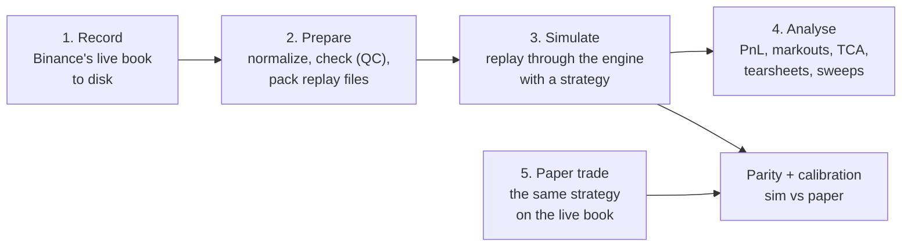
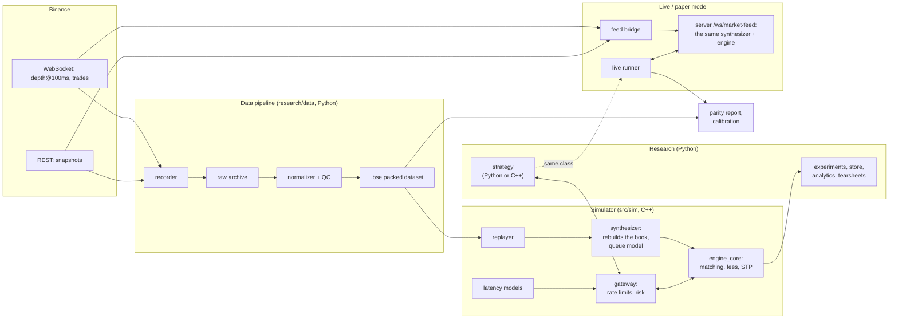
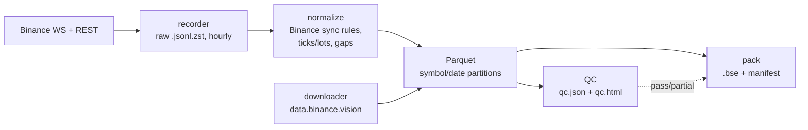
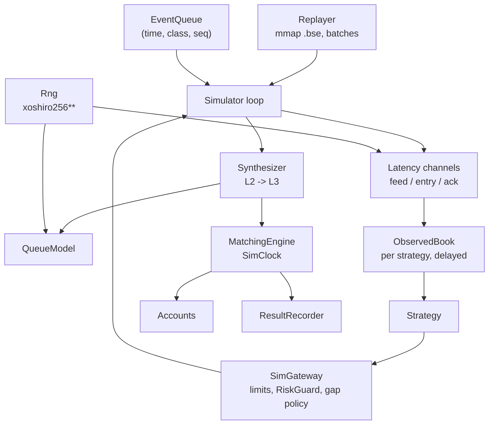
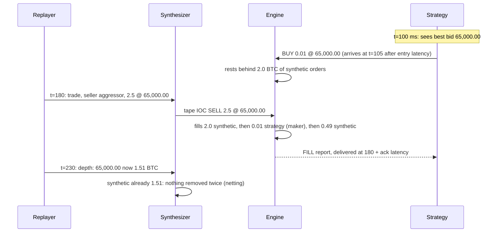

# BlockSprint: The Complete Guide

**From "what is a market?" to the internals of a deterministic, queue-aware exchange simulator.**

This guide explains BlockSprint end to end. It assumes no knowledge of markets, trading or programming at the start, and builds up to the level of detail an engineer needs to change the code. Each part builds on the one before; skip the parts you already know.

| Part | For | What you get |
| :--- | :--- | :--- |
| [1. Markets from zero](#part-1-markets-from-zero) | everyone | what a market, an order, an order book and a trade are |
| [2. Trading and testing strategies](#part-2-trading-strategies-and-how-to-test-them) | everyone | what a strategy is, and why testing one honestly is hard |
| [3. Technology from zero](#part-3-technology-from-zero) | non-programmers | the computing ideas the project rests on |
| [4. What BlockSprint is](#part-4-what-blocksprint-is) | everyone | the product in one picture: what it does, for whom, and what it answers |
| [5. The architecture](#part-5-the-architecture-end-to-end) | technical readers | every layer, and how data flows through them |
| [6. Component deep dives](#part-6-component-deep-dives) | engineers | how each part works inside |
| [7. How we know it's right](#part-7-how-we-know-its-right) | engineers, reviewers | tests, validation gates, determinism, CI |
| [8. Performance](#part-8-performance) | engineers | measured numbers and where the time goes |
| [9. Hands-on](#part-9-hands-on) | users | install, run, write a strategy, record data, paper trade |
| [10. Limits and what's next](#part-10-limits-and-whats-next) | everyone | what the simulator doesn't model, and open work |
| [11. Glossary](#part-11-glossary) | everyone | every term in one place |

Where this guide summarises, it links to the detailed document. The numbers quoted are from the 2.0.0 release (November 2026), measured on the development laptop; [docs/baseline/v2.0.0.md](baseline/v2.0.0.md) has the evidence.

---

## Part 1. Markets from zero

### 1.1 What a market is

A **market** is a place where people who want to **buy** something meet people who want to **sell** it. The **price** is whatever a buyer and a seller agree on.

A vegetable market works this way: one seller asks ₹40 a kilo for tomatoes, another asks ₹38; a buyer offers ₹35. Nothing happens until someone gives way. If the second seller agrees to ₹38 and a buyer accepts, a **trade** happens at ₹38, and ₹38 becomes "the price of tomatoes" for a while.

Financial markets do the same with shares, currencies or cryptocurrencies, except that:
- thousands of buyers and sellers act at the same time;
- they never meet: everyone sends instructions (**orders**) to a computer, the **exchange**, which decides who trades with whom;
- it happens fast: on a busy market, the situation changes thousands of times a second.

### 1.2 Crypto, Binance and trading pairs

**Bitcoin (BTC)** and **Ether (ETH)** are cryptocurrencies: digital assets that can be bought and sold. **Binance** is one of the largest exchanges where they are traded.

On an exchange, you always trade one asset **for another**. The combination is a **trading pair**, also called a **symbol**:

| Symbol | You buy or sell | You pay or receive |
| :--- | :--- | :--- |
| `BTCUSDT` | BTC (the **base** asset) | USDT (the **quote** asset) |
| `ETHUSDT` | ETH | USDT |

**USDT** (Tether) is a "stablecoin": a crypto token designed to stay worth about one US dollar. So "BTCUSDT at 65,000" means one bitcoin costs 65,000 USDT, roughly 65,000 dollars.

BlockSprint works with Binance's **spot** market: you buy the asset itself and own it (as opposed to futures or options, which are contracts about the asset's future price).

### 1.3 Orders: how you tell the exchange what you want

An **order** is an instruction: "buy 0.01 BTC, and I'll pay at most 65,000 USDT each". Every order has:

| Part | Meaning | Example |
| :--- | :--- | :--- |
| Side | buy or sell | buy |
| Quantity | how much of the base asset | 0.01 BTC |
| Price | the worst price you accept (for a limit order) | 65,000 USDT |
| Type | how the exchange should treat it | limit |

The two basic types:
- **Market order:** "buy 0.01 BTC now, at whatever price it takes". It executes immediately against the best prices available.
- **Limit order:** "buy 0.01 BTC, but only at 65,000 or less". If nobody sells that cheaply right now, the order **waits** in the exchange's list of orders until someone does, or until you cancel it.

A waiting limit order is said to **rest** on the book. Resting orders are how a market keeps prices available for others.

### 1.4 The order book

The exchange keeps all resting orders for a symbol in an **order book**: two lists, one per side.

- **Bids:** resting buy orders, highest price first (the most generous buyer on top).
- **Asks** (or offers): resting sell orders, lowest price first (the cheapest seller on top).

A small BTCUSDT book might look like this:

```
            ASKS (sellers)
   price        quantity (BTC)
   65,003.00    1.20
   65,002.00    0.50
   65,001.00    0.30      <- best ask: the cheapest anyone will sell
 ------------------------------ spread = 65,001 - 65,000 = 1.00 USDT
   65,000.00    0.80      <- best bid: the most anyone will pay
   64,999.00    2.10
   64,998.00    0.40
            BIDS (buyers)
```

Terms you will meet everywhere:
- **Best bid** and **best ask** together are the **BBO** (best bid and offer), or the "top of book".
- **Spread:** best ask − best bid. Here 1.00 USDT. A narrow spread means a liquid, cheap-to-trade market.
- **Mid price:** (best bid + best ask) / 2 = 65,000.50. It's the usual "fair value" reference.
- **Price level:** one price in the book. The quantity shown at a level is the **sum** of all the orders resting there.
- **Depth:** how much quantity sits at each level, and how far the book extends.
- **Tick size:** the smallest price step allowed (0.01 USDT on BTCUSDT). **Lot size:** the smallest quantity step (0.00001 BTC on BTCUSDT).

### 1.5 Matching: who trades with whom

When an order arrives that **crosses** the book (a buy at or above the best ask, or a sell at or below the best bid), the exchange **matches** it against resting orders. The rule nearly every exchange uses is **price-time priority**:

1. **Better price first.** A buyer is matched with the cheapest sellers first.
2. **At the same price, first come, first served.** Orders at one price form a **queue** (a FIFO: first in, first out). The order that arrived earliest fills first.

**Worked example.** The book above, and someone sends a **market buy of 0.6 BTC**:
- 0.30 BTC fill at 65,001 (the whole best ask level is used up);
- 0.30 BTC more fill at 65,002 (out of the 0.50 there);
- the buyer paid an average of 65,001.50; the new best ask is 65,002 with 0.20 left.

Going through several levels like this is called **walking the book** or a **sweep**.

**Queue example.** At 65,000 there are three resting buys, in arrival order: Alice 0.3, Bob 0.4, Carol 0.1 (total 0.8). A market sell of 0.5 arrives: Alice gets 0.3 (all of hers), Bob gets 0.2 (half of his); Carol gets nothing. Carol's order was at the right price but **behind in the queue**. This detail is the heart of BlockSprint, as Part 2 explains.

### 1.6 Trades, makers and takers, fees

Every match produces a **trade**: a price, a quantity, a buyer and a seller. Exchanges publish the list of trades (the **tape**) to everyone.

In each trade, one side **provided** liquidity and the other **took** it:
- The **maker** is the order that was resting on the book (Alice, Bob).
- The **taker** is the order that arrived and crossed (the market sell). The taker's side is the **aggressor side**.

Exchanges charge a **fee** on each fill, a small percentage of its value (its **notional**: price × quantity). On Binance's regular tier it's 0.10% for both makers and takers. Buying 0.01 BTC at 65,000 is a notional of 650 USDT and pays 0.65 USDT in fees. For a strategy that trades thousands of times a day, fees are often the largest cost.

### 1.7 Order types and order management

Beyond market and limit, exchanges offer variants. BlockSprint's engine supports Binance's spot set:

| Type | Behaviour |
| :--- | :--- |
| `LIMIT` | trade what crosses now; the rest rests on the book at the limit price |
| `MARKET` | trade immediately against the best prices; never rests |
| `IOC` (immediate-or-cancel) | trade what you can at your limit price right now; cancel the rest |
| `FOK` (fill-or-kill) | trade the whole quantity right now at your limit price, or nothing at all |
| `LIMIT_MAKER` (post-only) | rest on the book; if it would trade on arrival, reject it instead. Guarantees you're the maker |

And once an order rests, you can manage it:
- **Cancel:** remove it.
- **Amend:** change its quantity (or price). On Binance, reducing quantity at the same price **keeps** your queue place; anything else sends you to the back.
- **Replace** (cancel-replace): cancel and send a new order in one step. The new order joins the back of its queue.

**Self-trade prevention (STP).** A firm running several strategies might accidentally have its own buy and sell orders meet. STP rules decide what happens instead (cancel the new order, the old one, or both). It matters for the simulator too, as Part 6 shows.

### 1.8 Market data: what the exchange tells the world

Exchanges publish what's happening as **market data**. There are levels of detail:

| Level | Contents | BlockSprint's source |
| :--- | :--- | :--- |
| **L1** | best bid and ask only | derived |
| **L2** | total quantity at **each price level**, plus the tape of trades | **this is what Binance publishes**, and what BlockSprint records |
| **L3** | **every individual order** in each queue | not published by Binance; BlockSprint **rebuilds** an approximation of it (Part 6.3) |

Binance delivers L2 data in two forms:
- a **snapshot**: the whole book at one moment, fetched over the web (REST);
- **diff updates** (deltas): "level 65,000 now holds 0.8 BTC", streamed continuously over a WebSocket, batched every **100 ms**. Each update carries sequence numbers (update IDs), so a missed update can be detected.

To keep a correct book you take a snapshot, then apply every delta after it, in order, checking that no update was lost. Binance documents the exact rules; BlockSprint implements them in one shared module (Part 6.2). If an update is lost, the book is no longer trustworthy: this is a **gap**, and the book must be rebuilt from a new snapshot.

---

## Part 2. Trading strategies, and how to test them

### 2.1 What a strategy is

A **trading strategy** is a set of rules that decides which orders to send, when, and at what prices. Written as a program, it watches market data and reacts. Three families matter for BlockSprint:

| Family | Idea | Earns from | Main risk |
| :--- | :--- | :--- | :--- |
| **Market making** | rest a buy just below the mid and a sell just above it, all the time | the spread, when both sides fill | **adverse selection**: you get filled just before the price moves against you; inventory piling up on one side |
| **Execution** | buy or sell a large quantity gradually, e.g. **TWAP** (equal slices over time) or **POV** (a fixed share of market volume) | not profit, but a lower cost than doing it all at once | moving the price against yourself (**market impact**) |
| **Signals** (directional) | buy when an indicator says the price will rise, e.g. more buyers than sellers near the top of the book (**order book imbalance**) | price moves | the signal being noise; costs (spread, fees) eating the edge |

### 2.2 Measuring a strategy

Words you'll see in BlockSprint's reports:
- **Position** (inventory): how much of the base asset the strategy holds. Positive = long (owns BTC), negative = short.
- **PnL** (profit and loss): money made or lost. **Mark-to-market** PnL values the current position at the current mid.
- **PnL decomposition:** where the PnL came from. BlockSprint splits it into **spread capture** (the edge earned at each fill versus the mid), **inventory PnL** (gains or losses from holding a position while the price moved), and **fees**.
- **Fill ratio:** the share of the quantity a strategy offered that actually got filled.
- **Markout:** what a fill was worth some time later. If you bought at 65,000 and one second later the mid is 64,995, your 1-second markout is −5 USDT per BTC: the market moved against you right after you traded. Consistently negative markouts are the fingerprint of adverse selection.
- **Basis point (bps):** one hundredth of a percent (0.01%). Costs and markouts are often quoted in bps.
- **TCA** (transaction cost analysis): measuring what trading cost, e.g. **implementation shortfall** (your average price versus the mid when you decided to trade).
- **Drawdown:** the fall from the best PnL reached so far to a later low.

### 2.3 Backtesting: testing on the past

Before risking money, you want to know how a strategy would have done. A **backtest** replays historical market data and lets the strategy trade against it, as if it had been running back then.

### 2.4 Why naive backtests lie

Most backtesting tools fill an order as soon as the price touches it. For a strategy that rests limit orders, that is badly wrong, for three reasons.

**1. Queue position.** Go back to Carol in §1.5. She was at the best bid, a trade happened at her price, and she got nothing, because 0.7 BTC was ahead of her. A naive backtest would have filled her. Over thousands of trades, this turns a losing market maker into a winning one on paper.

**2. Latency.** Nothing is instant. Market data takes time to reach the strategy (**feed latency**); its orders take time to reach the exchange (**entry latency**); confirmations take time to come back (**ack latency**). In that time the book changes. A strategy may decide on a price that no longer exists by the time its order lands, or keep quoting after it has already been filled. Measured from a home PC in India, an order's round trip to Binance takes about 175 ms; from a server in Tokyo, a few ms.

**3. Adverse selection.** The fills a passive strategy does get are not random: it gets filled most when someone better informed trades through its price just before a move. A backtest that ignores queues fills you on every touch, including the many good ones you'd have missed, which hides this effect.

**An example of what's at stake.** A market maker quoting 0.001 BTC on each side of BTCUSDT for six hours on 5 November 2026: in BlockSprint, with realistic queues, latency and the 0.10% fee, it was filled 17,093 times and lost 346 USDT, 309 of it in fees. A touch-fill backtest would have filled it on every touch of its price, including the fills it would really have missed at the back of the queue, and so would have answered a different question. Whether the strategy works depends on getting these details right.

### 2.5 Paper trading and live trading

- **Live trading:** real orders, real money, on the real exchange.
- **Paper trading:** the strategy runs in real time against the **live** market data, but its orders are simulated: nobody's money moves. It's the honest middle step between backtest and live.

BlockSprint's paper mode keeps an exact copy of Binance's live book on your machine, puts the strategy's orders in the right queues, and fills them when real trades reach them. And because the same strategy can run both in the simulator and in paper mode, BlockSprint can **compare** them on the same minutes of market (a **parity** check), and adjust the simulator until they agree (**calibration**).

> **BlockSprint never sends an order to Binance.** It uses only Binance's public market data, which needs no account or API key. The repository contains no code that signs a request to Binance's real exchange (CI checks this on every change), apart from one tool that measures latency on Binance's *testnet*, a practice exchange with fake money.

---

## Part 3. Technology from zero

This part explains the computing ideas BlockSprint is built on. Programmers can skip it.

### 3.1 Programs, languages and why two of them

A **program** is a list of instructions for a computer. People write programs in **programming languages**. BlockSprint uses two:

| Language | Used for | Why |
| :--- | :--- | :--- |
| **C++** (the 2017 standard, "C++17") | the matching engine, the simulator, the live server | speed and control: millions of operations per second, exact memory layout |
| **Python** (3.13) | the data pipeline, strategies, experiments, analytics, live tools | quick to write and read; a rich ecosystem for data analysis (numpy, polars) |

C++ code must be **compiled**: a **compiler** translates it into machine instructions, producing an **executable** (a `.exe` on Windows). BlockSprint is compiled with two compilers, Microsoft's **MSVC** on Windows and **GCC** on Linux, and must behave identically under both. **CMake** is the build tool that drives them.

The two languages meet through **bindings**: the simulator is also compiled into a Python **module** (`blocksprint_sim`), so Python code can call the C++ simulator, and a strategy written in Python can run inside the C++ simulation loop.

### 3.2 Talking to an exchange: REST, WebSocket, JSON

Programs talk over the network with **protocols**:
- **REST** (over HTTP, like web pages): ask a question, get one answer. "Give me the order book now." Used for snapshots.
- **WebSocket:** a connection that stays open, over which the server **pushes** messages as things happen. Used for the stream of book updates and trades.
- **JSON:** the text format most messages use, e.g. `{"symbol": "BTCUSDT", "price": "65000.00"}`.

BlockSprint's own live server speaks the same way: REST endpoints such as `/api/orders` and WebSocket channels such as `/ws/market-data`, on port 8080 of your machine.

### 3.3 Why the engine counts in integers

Computers store most decimal numbers in **floating point**, which is approximate: in most languages, `0.1 + 0.2` is `0.30000000000000004`. For money, small errors pile up, and two computers can round differently.

BlockSprint therefore stores every price and quantity as a **whole number of 1e-8 units** (one hundred-millionth): 65,000.12 USDT is stored as the integer 6,500,012,000,000. Integer arithmetic is exact and identical on every machine. This is called **fixed point**. Fees and PnL are computed exactly too, with 128-bit integers where products get large.

### 3.4 Determinism, random numbers, seeds and hashes

A program is **deterministic** if the same inputs always give the same outputs. BlockSprint's simulator is, down to the last byte, on Windows and Linux alike. That lets anyone reproduce a result, and lets a test catch any unintended change.

But a realistic simulator needs randomness (network delays vary). The answer is a **pseudo-random number generator**: an algorithm that produces numbers that look random but are completely determined by a starting value, the **seed**. Same seed, same "random" sequence; change the seed to see another plausible outcome. BlockSprint writes its own generator (xoshiro256\*\*) and its own math functions, because the standard libraries of MSVC and GCC produce different numbers.

To check that two runs are identical without comparing gigabytes, BlockSprint computes a **hash** of the outputs: a short fingerprint (SHA-256, 64 hex characters) that changes completely if a single byte changes. Tests **pin** the expected hashes.

### 3.5 Events and simulation time

A simulator doesn't wait for real time to pass. It keeps a list of **events** ("a book update at 02:00:00.103", "the strategy's order arrives at 02:00:00.108"), always takes the earliest, processes it, and jumps the clock to it. That's **discrete-event simulation**: an hour of market history replays in about 2 seconds.

### 3.6 Tests, CI and version control

- **Tests** are programs that check other programs: "after this sequence of orders, the book must look like this". BlockSprint has 484 test cases across C++ and Python, plus millions of generated operations (fuzzing, Part 7).
- **Git** records every change to the code (a **commit**), so any past state can be recovered. **GitHub** hosts the repository.
- **CI** (continuous integration): on every change pushed to GitHub, machines in the cloud build the project on Windows and Linux and run every test. A change that breaks something is caught within minutes.

---

## Part 4. What BlockSprint is

### 4.1 In one paragraph

BlockSprint is a **market-microstructure-aware backtesting and execution simulator** for crypto, built around an **exact matching engine**. It records Binance's order book, replays it event by event through its own matching engine, puts a strategy's orders in the queue behind the liquidity that was really there, and fills them only when real trades and cancels reach them, after realistic delays. The same strategy code then runs in paper mode against Binance's live book, and BlockSprint measures how closely the simulator matched what actually happened.

("Microstructure" means the mechanics of how trading happens: queues, spreads, latency, order types. "Microstructure-aware" means the simulator models them instead of pretending fills are free and instant.)

### 4.2 Who it's for and what it answers

It is for someone who designs or studies trading strategies (a quant researcher, a student of market microstructure, an engineer building trading systems) and wants answers they can trust:

- *If this market maker had quoted on 10 November, how often would it have been filled, where in the queue, with what markouts and what PnL after fees?*
- *How much worse does it get with 50 ms more latency, or if cancels happen in front of my order rather than behind it?*
- *Executing 5 BTC over an hour: what will it cost me against the mid, TWAP or POV, passive or aggressive?*
- *Does my simulator agree with reality?* (paper versus replay of the same minutes)

### 4.3 What it can do, in five modes



| Mode | Command (abbreviated) | Output |
| :--- | :--- | :--- |
| Record | `python -m research.data.recorder` | raw archive of every depth update, trade and snapshot |
| Prepare | `research.data.normalize`, `qc`, `pack` | checked Parquet tables, QC reports, `.bse` replay files |
| Simulate | `bs_sim run config.json` or `Strategy.run(config)` in Python | orders, execution reports, positions, a run hash |
| Analyse | `python -m research.run experiment.yaml` | many runs in parallel, cached; HTML tearsheets and a comparison report |
| Paper | `crypto_matching_engine` + `binance_connector.py` + `research.live.runner` | live paper session; then `paper_session replay`, `analytics.parity`, `calibration.calibrate` |

### 4.4 What makes it different

| Property | Meaning | How |
| :--- | :--- | :--- |
| **Exact** | no rounding anywhere in matching, fees or PnL | fixed-point integers (1e-8 units), 128-bit fee arithmetic |
| **Deterministic** | same data + config + seed → byte-identical outputs on Windows and Linux | own random generator and math, no wall clock, explicit tie-breaks; pinned hashes in CI |
| **Queue-aware** | resting orders wait behind real liquidity | historical L2 levels become synthetic orders in the engine's FIFO queues; five models of where cancels happen |
| **Latency-aware** | the strategy sees the market late and reaches it late | seeded delay distributions per channel, presets measured from real connections, optional busy-market scaling |
| **One engine everywhere** | the simulator, paper mode and the server share one matching core | the live book is built by the simulator's own synthesizer |
| **Checked against reality** | the simulator is compared with paper trading on the same minutes | parity report and calibration |

### 4.5 History: 1.0 and 2.0

- **1.0** (July 2026) was a live matching engine with a REST/WebSocket API and a connector that mirrored the top 10 levels of Binance's book as orders. A review found 22 defects (D1–D22), among them floating-point prices, a global singleton engine, queue positions reset every 100 ms by the mirror, and a Binance API key committed to the repository.
- **2.0** (released 15 November 2026) rebuilt it in eight phases: an exact deterministic engine (Phase 1), a data pipeline (2), the simulator (3), Python bindings (4), experiments and analytics (5), realism extensions (6), live parity and calibration (7), and the release (8). [CHANGELOG.md](../CHANGELOG.md) lists every change; [blocksprint_2.0_implementation_plan.md](../blocksprint_2.0_implementation_plan.md) has the plan and its day-by-day progress log.

---

## Part 5. The architecture end to end

### 5.1 The big picture



Read it left to right: Binance's data is **recorded** and **prepared** into replay files; the **simulator** replays them through the **engine core** while a **strategy** trades through a **gateway** that adds latency and limits; **research** tools run many simulations and analyse them. At the bottom, the **live path** feeds Binance's live data into the **same** synthesizer and engine inside a server, where the **same** strategy class trades on paper; **parity** compares the two paths.

### 5.2 The layers

| Layer | Language | What it does | Detailed docs |
| :--- | :--- | :--- | :--- |
| `src/core` (`engine_core`) | C++ | the matching engine: order book, price-time priority, order types, amend/replace, STP, symbol rules, fees, execution reports. No networking, no wall clock | [explanations/](../explanations/README.md) |
| `research/data` | Python | records Binance, normalizes with Binance's sync rules, QC, packs `.bse` replay files, downloads public archives, the sample dataset | [data_pipeline.md](data_pipeline.md), [recorder_ops.md](recorder_ops.md) |
| `src/sim` (`sim`, `bs_sim`) | C++ | replays `.bse` files, rebuilds the book as queues, models queue position, latency, impact, rate limits, risk and gaps; runs strategies; writes deterministic outputs | [simulator_architecture.md](simulator_architecture.md) |
| `src/bindings` (`blocksprint_sim`) | C++/Python | the Python module: runs, Python strategies inside the C++ loop, zero-copy results | [dev_setup.md](dev_setup.md), [explanations/bindings.md](../explanations/bindings.md) |
| `research/strategies` | Python | the `Strategy` base class and reference strategies | [strategies.md](strategies.md) |
| `research/experiments`, `research/analytics` | Python | YAML experiments with sweeps, a cached results store, PnL attribution, TCA, markouts, queue and risk analytics, tearsheets | [experiments.md](experiments.md), [analytics.md](analytics.md) |
| `src/api`, `src/main.cpp` | C++ | the live server: REST and WebSocket API, the live market feed | [explanations/api_server.md](../explanations/api_server.md) |
| `research/live`, `research/calibration` | Python | feed bridge, live runner, paper sessions, parity, calibration, soak test, testnet latency | [live_platform_architecture.md](live_platform_architecture.md), [parity_protocol.md](parity_protocol.md), [calibration.md](calibration.md) |

### 5.3 The life of one market event

Follow a single Binance depth update, "BTCUSDT bid 65,000.00 now holds 0.8 BTC", through both paths.

**Recorded path (backtest):**
1. The **recorder** receives it on the WebSocket and writes it, with the local receive time (`ts_local`) and Binance's time (`ts_exch`), to an hourly compressed file.
2. Later, the **normalizer** checks it against Binance's sequence rules (no gap since the last update), converts the price to ticks and the quantity to lots, and writes it to a Parquet table.
3. **QC** rebuilds the book from these rows and checks it against Binance's snapshots, exactly.
4. The **packer** writes it as one 40-byte record into a `.bse` file.
5. In a simulation, the **replayer** reads that record from the memory-mapped file and hands it, as part of a batch, to the **synthesizer** at simulation time `ts_local`.
6. The synthesizer compares 0.8 with the quantity its synthetic orders hold at 65,000.00 and adds or removes the difference through the **engine**, choosing with the **queue model** where a decrease comes out of the queue.
7. The update is delivered to each strategy after its **feed latency**; the strategy's **observed book** changes, and its `on_book` callback runs. Any order it sends reaches the engine after **entry latency**.

**Live path (paper):**
1. The **feed bridge** receives the same kind of update from Binance, applies the **same** sync rules (shared code), and forwards it to the server's `/ws/market-feed`.
2. Inside the server, **`LiveFeed`** passes it to the **same synthesizer** and engine; a paper strategy's resting order moves up its queue exactly as it would in the simulator.

### 5.4 Repository layout

```
BlockSprint/
├── src/
│   ├── core/            engine_core: types, order book, matching engine, fees, symbol rules, reports
│   ├── sim/             simulator library, queue and latency models, reference C++ strategies, bs_sim
│   ├── api/             live REST/WebSocket server
│   ├── bindings/        blocksprint_sim Python module
│   └── main.cpp         server entry point
├── research/
│   ├── data/            recorder, normalizer, QC, packer, catalog, downloader, sample dataset
│   ├── sim/             Results (numpy/polars), validation scripts
│   ├── strategies/      Strategy base class and reference strategies
│   ├── experiments/     experiment schema, runner, results store, configs/
│   ├── analytics/       markouts, TCA, PnL, risk, tearsheets, parity report
│   ├── calibration/     grid search against paper sessions
│   ├── live/            feed bridge, live runner, paper sessions, soak test, testnet latency
│   └── notebooks/       walkthroughs
├── configs/sim/         run configs, calibrated profiles
├── bench/               bench_core, bench_sim
├── tests/               core/ (doctest), sim/ (doctest + golden data), python/ (pytest)
├── scripts/             run_all, binance_connector, interactive_test, perf_test, client_demo
├── docs/                design docs, operations, baselines (this guide)
├── explanations/        one page per source file or component
└── external/            vendored C++ libraries (nlohmann/json, asio, websocketpp, doctest, pybind11)
```

---

## Part 6. Component deep dives

### 6.1 The matching engine (`src/core`)

The engine is a C++ library, `engine_core`, with no networking and no wall clock. The simulator, the live server and the Python module all use the same compiled code: there is exactly one implementation of "what fills".

**Numbers** ([explanations/types.md](../explanations/types.md)):
- `Price` and `Quantity` are `int64_t` in 1e-8 units. `parse_fixed` and `format_fixed` convert decimal strings at the edges; a value finer than 1e-8 is rejected, never rounded.
- Notionals and fees use 128-bit intermediate products (`int128.hpp`), so a price × quantity never overflows.

**The order book** ([explanations/order_book.md](../explanations/order_book.md)), one per symbol:
- Each side is an ordered map from price to a **price level**. A level holds its orders in an **intrusive FIFO**: each order carries its own previous/next links, so joining or leaving a queue allocates nothing.
- An **order lookup** maps order IDs to orders for cancel and amend, keyed by a view into the order's own ID string (no copy).
- The maps live in a per-book **memory pool** (`std::pmr`), so they don't contend for the global heap.
- **Matching** walks the opposite side from the best price, filling the front of each queue first (price-time priority), and never lets an order trade through a better resting price (**anti-trade-through**).
- `check_invariants()` verifies the structure: the book is never crossed, quantities and links agree, every lookup entry is in a queue.

**Order types and management:** `LIMIT`, `MARKET`, `IOC`, `FOK`, `LIMIT_MAKER` (§1.7); `cancel_order`; `replace_order` (cancel and new, back of the queue); `amend_order(id, new_total, new_price?)` with Binance's rule: priority is kept only when quantity is reduced at the same price, and a total at or below the filled quantity cancels the rest.

**Self-trade prevention** (per order, `stp`):

| Policy | When an order would trade with one of its owner's own resting orders |
| :--- | :--- |
| `none` | the trade happens |
| `skip` | the resting order is passed over; matching continues with others |
| `cancel_taker` | the rest of the incoming order is cancelled (Binance `EXPIRE_TAKER`) |
| `cancel_maker` (default) | the resting order is cancelled, matching continues (Binance `EXPIRE_MAKER`) |
| `cancel_both` | both are cancelled (Binance `EXPIRE_BOTH`) |

`skip` is what makes the simulator possible: historical liquidity is held by synthetic orders owned by `MARKET` with `skip`, so they never trade with each other, only with strategy orders.

**Symbol rules** ([explanations/symbol_spec.md](../explanations/symbol_spec.md)): tick size, lot size, quantity range and minimum notional, loaded from Binance's `exchangeInfo`. An order off the grid or too small is rejected with the reason (`price_tick`, `quantity_lot`, `quantity_range`, `min_notional`). Synthetic market liquidity is exempt.

**Fees** ([explanations/fees.md](../explanations/fees.md)): a maker and a taker rate per owner, plus a default (0.10% / 0.10%, Binance's regular tier). Negative rates are rebates. Every fill report carries its `fee` and the order's cumulative fee, exactly.

**Execution reports** ([explanations/events.md](../explanations/events.md)): every state change of every order produces a report with a sequence number, a timestamp, a type and a reason.

| Type | Meaning | Example reasons |
| :--- | :--- | :--- |
| `ACK` | accepted (resting, unless fills follow) | |
| `FILL` | a partial or complete fill, with price, quantity, maker/taker, fee | |
| `AMENDED` | price or quantity changed | |
| `CANCELLED` | terminal: removed or remainder discarded | `user`, `replaced`, `ioc_remainder`, `no_liquidity`, `fok_kill`, `stp_taker`, `stp_maker` |
| `REJECTED` | terminal: refused before entering the book | `duplicate_order_id`, `invalid_price`, `post_only_would_take`, `price_tick`, `min_notional`, and the simulator's `rate_limit`, `risk_*`, `gap_halted` |

**Clocks** ([explanations/clock.md](../explanations/clock.md)): time comes from an injected `IClock`. The server uses a `WallClock`; the simulator a `SimClock` that it sets to each event's time. That's why the engine is deterministic: it never reads the real time.

**`MatchingEngine`** routes requests to the right book, owns the clock, fee schedules and sequence numbers, and calls the registered callbacks (execution reports, trades, BBO and depth changes). Each instance is independent; `EngineOptions` turn off the mutex for single-threaded simulation and skip building reports nobody receives.

### 6.2 The data pipeline (`research/data`)



| Step | Module | What it does |
| :--- | :--- | :--- |
| **Record** | `recorder.py` | subscribes to `<symbol>@depth@100ms` and `<symbol>@trade`, takes REST snapshots, and writes everything with both timestamps to append-only, hourly-rotated, zstd-compressed JSON-lines files. It also records clock quality and venue metadata, and can keep Windows awake. Long-running operation: [recorder_ops.md](recorder_ops.md) |
| **Sync rules** | `binance_sync.py` | Binance's rules for joining a snapshot to the delta stream and detecting a lost update, in one place. The normalizer (recorded data) and the live feed bridge both call it, so an event is judged the same way in both |
| **Normalize** | `normalize.py`, `schema.py` | raw files → Parquet partitions per venue, symbol and UTC date: book rows, trades, snapshots. Drops duplicates, marks **gaps** (and a stream silent for more than 10 s), converts to integer ticks and lots per the date's symbol rules, and starts each day with a synthetic snapshot |
| **Reference book** | `refbook.py` | a deliberately simple Python order book: the **oracle** every C++ reconstruction is checked against |
| **QC** | `qc.py` | rebuilds the book with the oracle and checks: every REST snapshot taken while in sync equals the rebuilt top 20 levels exactly; never crossed; everything on the grid; time never goes backwards; coverage of the day. Writes `qc.json` and an HTML report with a `pass` / `partial` / `fail` verdict |
| **Pack** | `pack.py` | turns partitions into one `.bse` file per symbol and a dataset manifest (with SHA-256 of each file). Refuses failed or unchecked data unless told otherwise |
| **Catalog** | `catalog.py` | lists, inspects and verifies datasets |
| **Download** | `downloader.py` | Binance's public daily trade files (`data.binance.vision`), verified by checksum |
| **Sample** | `sample.py` | `get` downloads one packed hour of BTCUSDT and ETHUSDT from the GitHub release `sample-data-v1` and checks its SHA-256 and every file in its manifest; `make` rebuilds the archive byte for byte |

**The `.bse` file** ("BlockSprint events"): a 512-byte header (magic `BSEVENT`, version, record count, first and last time, the SHA-256 of the source manifest, the symbol, tick and lot sizes), then fixed 40-byte little-endian records:

| Bytes | Field |
| :--- | :--- |
| 0–7 | `ts_local` (ns): when the recorder received it |
| 8–15 | `ts_exch` (ns): Binance's timestamp |
| 16–23 | price in ticks |
| 24–31 | quantity in lots (absolute: the level's new total, or the trade's size) |
| 32–35 | sequence (low 32 bits) |
| 36, 37 | kind (depth, snapshot, trade, gap), side |
| 38–39 | flags |

Fixed-size records sorted by time mean the simulator can **memory-map** the file (the operating system pages it in on demand) and read it with no parsing and no copying. A full day of BTCUSDT is about 34 million records.

### 6.3 The simulator (`src/sim`)

The simulator is the core of BlockSprint. Its design document is [simulator_architecture.md](simulator_architecture.md); this section explains the ideas.

**Principles:**
1. **One source of fill truth.** Every fill comes from the matching engine. The simulator has no fill logic of its own; it only turns market data into engine operations.
2. **Deterministic,** byte for byte, across platforms.
3. **The strategy can't see the truth.** It reads a delayed copy of the book and learns about its fills late.
4. **Conservative defaults.** At equal timestamps, market data is processed before strategy orders; the default queue model is the pessimistic one.
5. **Streaming.** Memory depends on the book's size, not the dataset's length.

#### 6.3.1 Components



#### 6.3.2 Events and the loop

Everything that happens is an **event** in a priority queue ordered by `(time, class, insertion sequence)`:

| Class (priority at equal time) | Event |
| :--- | :--- |
| 0 `MARKET_DATA` | one data batch (depth, snapshot, trade or gap) |
| 1 `ORDER_ARRIVE` | a strategy request reaches the exchange (after entry latency) |
| 2 `STRATEGY_MD` | the strategy sees a book or trade update (after feed latency) |
| 3 `STRATEGY_EXEC` | the strategy receives an execution report (after ack latency) |
| 4 `TIMER` | a strategy timer fires |

```
open .bse, seed the Rng, build the engine (SimClock, symbol rules from the file header)
push the first data batch; push on_start
while events remain and t < end:
    e = pop earliest; clock = e.time
    MARKET_DATA:   synthesizer applies it to the engine (may fill strategy orders)
                   for each strategy: push STRATEGY_MD at t + feed latency
                   push the next data batch
    ORDER_ARRIVE:  engine submit / cancel / amend; push STRATEGY_EXEC at t + ack latency per report
    STRATEGY_MD:   update the strategy's observed book; call on_book / on_trade / on_gap
    STRATEGY_EXEC: call on_exec
    TIMER:         call on_timer
    (requests made inside callbacks are pushed as ORDER_ARRIVE at t + entry latency)
on_end; write the results
```

Only one data batch sits in the queue at a time, so memory doesn't grow with the file. A run has phases: **fast-forward** (data before the window's start goes straight into the books, no callbacks, so the run starts with a correct book), the **window** itself, an optional **warm-up** at its start (callbacks run but trading is refused), and the **end** (later events are dropped and counted).

**Simulation time** is the data's `ts_local`, the moment the recorder received each event. The recording machine's own network delay is therefore already inside the replay; the feed latency models the remaining delay to the strategy.

#### 6.3.3 The synthesizer: rebuilding queues from L2 data

The engine works with individual orders (L3); Binance publishes only totals per level (L2). The **synthesizer** bridges the gap: it represents the historical liquidity at each level as **synthetic orders** owned by `MARKET` (STP `skip`, exempt from rules and fees), and keeps their total equal to the data's total. Strategy orders sit in the same FIFO queues, between them.

| Data event at price p | What the synthesizer does |
| :--- | :--- |
| **Trade** of q at p | sends a **tape IOC** of q at p from the aggressor side. It consumes the queue from the front, **including strategy orders that are ahead**, and strategy orders priced better than p. Whatever the strategy orders took is then also removed from the front of the synthetic queue, because the real trade consumed real liquidity |
| Depth: level **grew** | the difference joins the **back** of the queue |
| Depth: level **shrank** (more than trades explain) | an **unexplained cancel**: the **queue model** decides which synthetic quantity goes (front, back, in between). Strategy orders are never cancelled by data |
| Level removed | all synthetic quantity there goes |
| Snapshot | every level is reconciled with these rules |
| Gap | all synthetic orders are removed; no matching until the next snapshot |

**Netting.** Binance publishes a trade immediately and the matching depth change up to 100 ms later, so a trade shows up twice. Because the synthesizer always drives a level towards the data's **absolute** quantity, the second sighting finds the level already right, and nothing is removed twice. Only decreases beyond the trades reach the queue model.

**Crossing fill.** If the data adds liquidity at a price that crosses a resting strategy order (a new bid above the strategy's ask), they trade at the strategy order's price.

**Within a batch, all decreases are applied before increases,** so a growing level never meets a stale one on the other side.

**Worked example** (a passive fill):



**Market impact.** In reality, a strategy's own taker fill removes liquidity the historical data never knew about. By default that liquidity stays gone until the data next changes the level. With `impact.half_life_ms` > 0 it returns gradually (an `ImpactOverlay` decays each take with a half-life). An optional **permanent impact** shifts the whole market by the square-root law, for execution research. Both are off by default.

**Measured fidelity** (no strategy, 2026-11-05): the engine's top 20 levels were identical to the data after 99.91% (BTCUSDT) and 99.97% (ETHUSDT) of half a million depth events each, with zero consistency violations. The remaining differences are trades not yet reflected by depth.

#### 6.3.4 Queue models

When a level shrinks without a trade, someone cancelled, but L2 data doesn't say **who**. If the cancel was ahead of the strategy's order, it moves up the queue; if behind, it doesn't. The choice changes fill rates a lot, so it's a parameter:

| Model (config name) | Removes cancelled quantity from | Bias |
| :--- | :--- | :--- |
| `cancel_from_back` (default) | the newest synthetic orders | **pessimistic**: the queue ahead shrinks only by trades |
| `cancel_from_front` | the oldest | **optimistic** |
| `pro_rata` | every synthetic order in proportion to its size | neutral |
| `prob_power:n` | the part ahead with probability a^n / (a^n + b^n) (a = quantity ahead, b = behind) | tunable; calibrated to n = 1.5 on BTCUSDT paper sessions |
| `prob_log` | the same with log(1 + x) | tunable |

The probabilistic models use the **expected** split rather than a random draw, and their powers are computed with BlockSprint's own deterministic math functions, so results are identical across compilers. Reports should show a **sensitivity sweep** over models, not one model's number.

#### 6.3.5 Latency, channels and the observed book

| Latency | From → to | Effect |
| :--- | :--- | :--- |
| feed | exchange event → strategy sees it | decisions on a stale book |
| entry | strategy sends → exchange receives | orders meet the book as it is on arrival |
| ack | exchange → strategy learns of a report | the strategy keeps quoting on fills it doesn't know about yet |

Each is a **model**: `constant`, `normal`, `lognormal` (right-skewed, like real networks) or `empirical` (sampled from recorded values), with optional bounds. Each direction of each strategy's connection is a **channel** with its own random stream, and messages on a channel never overtake each other, as on a TCP connection.

**Presets:** `zero`, `binance_spot_tokyo_vps` (a server near Binance; an estimate) and `binance_spot_home_pc` (measured from the development PC: lognormal order legs with median 87 ms, from a 175 ms median round trip). **Regime latency** optionally scales delays with the market's message rate, since exchanges slow down when busy.

Each strategy reads only its **observed book**: an L2 copy updated when its feed events are delivered. It shows the market, not the strategy's own orders, exactly like a live feed. The strategy also has two **accounts**: the exchange's (updated at the fill: the run's result) and its own (updated when the report arrives: what `ctx.account()` returns), so it can't learn of a fill early.

#### 6.3.6 The gateway: limits, risk and gaps

The `SimGateway` stands between strategies and the engine and enforces what Binance would:
- **Rate limits:** request weight per minute (default 6,000), orders per 10 seconds (100) and per day (200,000), open orders per symbol (200). Breaches are rejected with `rate_limit` / `max_open_orders`.
- **Routing:** every execution report goes to the strategy that owns the order, whatever caused it (its own request, a data trade, another strategy).
- **RiskGuard** (the strategy's own pre-trade limits, config `risk`): maximum position, maximum order notional, maximum open orders, and a **drawdown kill switch** that cancels everything and allows only position-reducing orders after a set loss from the peak.
- **Gap policy** (what to do when the feed loses updates): `halt` (default: cancel all and refuse new orders until the book is resynced), `flatten` (halt, then close the position at the resync), or `continue` (leave it to the strategy).

#### 6.3.7 Strategies, configs, outputs

**The strategy interface** (C++ and Python alike): callbacks `on_start`, `on_book`, `on_trade`, `on_exec`, `on_reject`, `on_timer`, `on_gap`, `on_end`, and a `Context` to act: `send(side, type, price, qty, stp?)`, `cancel`, `amend`, `replace`, `set_timer`, `book()`, `account()`, `open_orders()`, `now()`, `can_trade()`. Built-in C++ strategies: `null`, `passive_quoter`, `twap_taker` ([explanations/sim_strategies.md](../explanations/sim_strategies.md)).

**The run config** is JSON (or a Python dict), layered: defaults < latency preset < file < `--set key=value` overrides. Unknown keys are errors. The main keys: `dataset`, `symbol` (one or several), `window`, `seed`, `tie_break`, `latency_preset` / `latency`, `latency_regime`, `queue_model`, `impact`, `fees`, `limits`, `risk`, `gap_policy`, `strategy`, `output`. Details: [explanations/sim_run.md](../explanations/sim_run.md).

**Outputs** of a run (`ResultRecorder`):

| File | Contents |
| :--- | :--- |
| `orders.csv` | every request when sent, with its arrival time |
| `exec_reports.csv` | every report, with exchange time and delivery time |
| `request_rejects.csv` | requests refused by the gateway |
| `bbo_samples.csv` | sampled data BBO, engine BBO and the strategy's observed BBO |
| `positions.csv` | sampled position, cash, fees, PnL at the mid |
| `queue_positions.csv` | optional (`output.queue_positions: true`): each resting order's quantity ahead, its own and behind in its queue, whenever it changes, with the cause (trade, depth change, order) |
| `run_meta.json` | the resolved config, input hashes, counts, accounts, per-file SHA-256 and the **`output_hash`** |

**The `bs_sim` command:** `info` (a file's header), `reconstruct` (the pure L2 book at checkpoints, for validation), `synth` (the synthesizer with no strategy, with fidelity statistics), `latency` (measured delays from the data), `slice` (cut a time window into a new `.bse`), `config` (print the resolved config) and `run`.

**Multi-symbol:** a run can replay several symbols at once, merged by time, with one account per symbol in its quote asset.

### 6.4 Python bindings (`blocksprint_sim`)

`uv sync` compiles the simulator into a Python extension module ([explanations/bindings.md](../explanations/bindings.md)):
- `bs.run(config)` does what `bs_sim run` does; `bs.SimConfig` and `bs.Simulator(cfg, strategy)` give finer control.
- **Python strategies run inside the C++ loop.** The interpreter's global lock (the GIL) is released while C++ replays data and taken only when a Python callback runs; callbacks a strategy doesn't define cost nothing. A `callback_mode` (`every_event`, `on_change`, `timer_only`) filters calls in C++.
- **Zero-copy results:** output rows are kept as fixed-width records and returned as numpy arrays that view them directly; `Results.to_polars()` gives DataFrames equal to the CSVs.
- `bs.to_fixed("0.001")` / `bs.from_fixed(...)` convert decimals; `bs.data_bbo`, `data_trades`, `data_level_qty` read the market itself for analytics.

A Python port of the passive quoter produces **byte-identical** output to the C++ one (`tests/python/test_parity.py`), which proves the bindings add nothing and lose nothing.

### 6.5 Strategies (`research/strategies`)

All derive from `Strategy` ([strategies.md](strategies.md)); a misspelt callback name is an error when the class is defined.

| Strategy | Family | How it decides |
| :--- | :--- | :--- |
| `PassiveQuoter` | market making | joins the best bid and ask with post-only quotes of `size`, re-quoting every `refresh_ms`, up to `max_position`; cancels on a gap |
| `AvellanedaStoikov` | market making | quotes around a **reservation price** r = m − q·γ·σ²·τ that leans against inventory q, with spread δ = γ·σ²·τ + (2/γ)·ln(1 + γ/k), volatility σ estimated online (Avellaneda & Stoikov, 2008) |
| `ImbalanceTaker` | signal | imbalance I = (bid qty − ask qty) / (bid + ask) over the top levels; buys at market above a threshold, sells below, exits after a hold time or when I turns |
| `Executor` | execution | works a parent order by **TWAP** (quantity × elapsed / duration) or **POV** (a share of market volume), aggressively (market slices) or passively (one post-only order, crossing only when behind schedule) |

### 6.6 Experiments and analytics (`research/experiments`, `research/analytics`)

**Experiments** ([experiments.md](experiments.md)): one YAML file describes a set of runs: base config, window, strategy (C++ or `module:Class`), **sweeps** (a grid, or random draws from distributions over any config path) and seeds. `python -m research.run exp.yaml` runs them in parallel processes and writes tearsheets and a comparison report.

**The results store** names each run by the SHA-256 of everything that determines its result: the resolved config, the data's hash, the compiled module's hash and a Python strategy's source. Running the same thing again is a **cache hit**; changing one line of a strategy is not. Runs are written to a temporary directory and renamed into place, so a crash never leaves half a result.

**Analytics** ([analytics.md](analytics.md)):

| Module | Measures |
| :--- | :--- |
| `market.py` | the market the run saw: the data's BBO and trades at any time |
| `pnl.py` | PnL = spread capture + inventory PnL − fees, with a residual against the engine of 0; also per time bucket |
| `tca.py` | per order and fill: implementation shortfall against the arrival mid, opportunity cost of the unfilled part, effective and realized spread, price impact, slippage against VWAP and TWAP |
| `markouts.py` | each fill's value after 1 s, 5 s, 30 s (configurable), in ticks and bps |
| `queue.py` | where passive orders joined the queue, how long they waited, how often they filled |
| `risk.py` | risk-adjusted returns, drawdown, inventory, time at limits, turnover |
| `report.py` | a self-contained HTML **tearsheet** per run and a comparison page per experiment |
| `parity.py` | paper versus simulator (§6.7) |

### 6.7 The live platform: server, feed, paper trading

**The server** (`crypto_matching_engine`, port 8080) wraps the engine in a REST and WebSocket API ([explanations/api_server.md](../explanations/api_server.md)):

| Endpoint | Purpose |
| :--- | :--- |
| `POST/PUT/PATCH/DELETE /api/orders` | new order, replace, amend, cancel |
| `GET /api/depth`, `GET /api/bbo` | the book and its top |
| `POST/GET /api/symbols`, `/api/fees` | symbol rules, fee schedules |
| `POST /api/reset` | clear everything |
| `GET /api/market-feed` | the live feed's fidelity statistics |
| `/ws/orders` | order entry over WebSocket |
| `/ws/executions` | a client's own execution reports |
| `/ws/market-data`, `/ws/trades` | book changes (coalesced to one per 100 ms) and trades |
| `/ws/market-feed` | where the feed bridge sends Binance's data (local connections only) |

**The live feed.** `research/live/feed_bridge.py` (connector v2) keeps one connection to Binance with depth and trade streams for each symbol, syncs each book with the shared Binance rules, and streams snapshots, deltas and trades to `/ws/market-feed`. Inside the server, `LiveFeed` feeds them to the **simulator's synthesizer**, so the server's book is built exactly as in a backtest, and a paper order waits in the same kind of queue. A gap, 10 s of silence or a lost connection sends `gap` and resyncs from a fresh snapshot. `scripts/binance_connector.py` starts it for five symbols.

**Paper trading.** `research/live/runner.py` runs any research strategy class **unchanged** against the server: a `LiveContext` implements the same `Context` over the server's WebSockets and records the session.

**Parity and calibration** ([parity_protocol.md](parity_protocol.md), [calibration.md](calibration.md)):
1. `paper_session run` records the market while the strategy paper-trades.
2. `paper_session replay` turns that recording into a dataset and runs the same strategy, with the same parameters, in the simulator over exactly the same minutes, for several seeds, with latency measured during the session.
3. `analytics.parity` compares fill ratio, fill counts and volume, time to fill, spread at the fill, markouts and the PnL split.
4. `calibration.calibrate` grid-searches the queue model's exponent and latency scale against the paper results, checking the best points on held-out seeds so a point that only fits noise loses. The result is a profile like `configs/sim/calibrated/paper_btcusdt.json`.

**The soak test** (`research/live/soak.py`) runs the server and the bridge for a day or more, comparing the server's top 10 levels with Binance's REST book every minute and checking resyncs, crossed books, memory growth and reconnects ([baseline/soak_2026-11-14.md](baseline/soak_2026-11-14.md)).

### 6.8 Security model

- **No mainnet keys, no signed requests.** Everything uses Binance's public data. A CI job fails any change that adds request-signing code outside `research/live/testnet.py`, which only talks to Binance's testnet (practice exchange) and reads only testnet keys.
- **`.env` is not tracked.** A Binance key committed in 1.0 remains in the git history; it was deleted on Binance on 2026-11-17 and no longer works.
- **Secret scanning:** CI scans the whole git history with gitleaks on every push; only that 1.0 commit and Binance's public documentation example (used by a signing test) are exempt.
- **The server's privileged inputs** (the market feed, the `MARKET` owner, fee changes) are accepted only from the local machine.

---

## Part 7. How we know it's right

A simulator is only useful if its answers can be trusted. BlockSprint checks itself in layers, each layer resting on the one below.

### 7.1 Validation gates

| Gate | Question | How it's checked | Result |
| :--- | :--- | :--- | :--- |
| **QC** | Is the recorded data itself correct? | the Python oracle book against every Binance REST snapshot, top 20 levels, exactly | 361 of 361 snapshots matched on the first archive; never crossed |
| **V0** | Does the C++ reconstruction equal the oracle? | `bs_sim reconstruct` vs `refbook.py` at checkpoints across whole days, gaps and resyncs included | BTCUSDT 108/108 and ETHUSDT 264/264 checkpoints identical; a one-lot change is caught |
| **V1** | Is it deterministic? | the same run twice, and on Windows/MSVC vs Linux/GCC | identical output hashes, pinned in CI |
| **V2** | Is the engine sound under load? | invariants after every operation; fuzzing against a reference book | never crossed, quantities conserved |
| **V3** | Do the knobs push results the right way? | fills with zero latency + optimistic queue ≥ realistic ≥ high latency + pessimistic queue | 6.47 ≥ 4.56 ≥ 3.25 BTC filled on a 6-hour test |
| **V4** | With no strategy, does the synthesizer reproduce history? | synthetic book vs data after every batch; trade volume per price | top 20 identical after 99.91% / 99.97% of depth events |
| **V5** | Does the simulator match reality? | paper trading vs replay of the same minutes | fill ratio within 6.1% in all three sessions (target ±15%); 1 s markout within the simulator's seed range in 2 of 3 |

### 7.2 Tests

| Suite | Size | Covers |
| :--- | :--- | :--- |
| `unit_tests` (C++, doctest) | 114 cases, 1,434 assertions | every order type, amend and replace, STP, fees, symbol rules, invariants, the logger, characterization of 1.0's behaviour, a 10⁵-operation fuzz |
| `sim_tests` (C++, doctest) | 121 cases, about 2.9 million assertions | the `.bse` format, replayer, L2 book (differential test against a simple map), synthesizer, queue models, latency, gateway, golden scenarios, determinism |
| `pytest` (Python) | 249 tests | the data pipeline, bindings, strategies, the Python–C++ parity, experiments, analytics, live tools, notebooks |

Three kinds of test deserve a closer look:

- **Fuzzing** (`tests/core/fuzz_test.cpp`): random sequences of every operation (all order types, replace, cancel, amend, several owners with every STP policy, fees and rebates, invalid input) run in lockstep through the real engine and a naive reference book that re-sorts everything on every use. After each operation, return values, trades, every report field and the full depth of both books must agree. Eight injected engine bugs were all caught. CI runs 10⁶ operations on every push, plus 20 **new** seeds every night.
- **Golden scenarios** (`tests/sim/golden/`): small hand-written market situations with every expected report, queue state and final account worked out by hand, then run through the whole simulator. For example, scenario (e): with 5 ms latency a stale quote is picked off at 22 ms, the strategy learns of it at 27 ms, and its cancel arriving at 35 ms is refused; with zero latency the cancel wins and nothing fills.
- **Pinned determinism hashes** (`tests/sim/determinism_test.cpp`): nine scenarios on a committed one-minute slice of real BTCUSDT data, one for each realism feature, each with its output hash pinned. A test also checks that a different seed **changes** the hash, so the pins can't be trivially stable.

### 7.3 Determinism rules

1. No hidden time or randomness: no wall clock in `core/` or `sim/`; all randomness from the run's seeded generator; none of the standard library's random distributions, which differ between compilers.
2. No iteration over unordered containers where order matters.
3. Every tie has an explicit tie-breaker (an insertion sequence).
4. No floating point in matching or accounting; floats only in models, and computed with BlockSprint's own functions built from + − × ÷.
5. Outputs in canonical order, hashed.

A hash that changes on one platform only is, by definition, a bug.

### 7.4 Continuous integration

On every push (`.github/workflows/ci.yml`):

| Job | Checks |
| :--- | :--- |
| Windows / MSVC, Linux / GCC | build, all C++ tests, print the determinism hashes |
| Fuzz | 10⁶ operations against the reference book |
| Python / Windows, Python / Linux | the whole Python suite on the developer build, then again on a built wheel installed into a clean environment |
| No Binance request signing | no signing code outside the testnet tool |
| Secret scan | gitleaks over the whole git history |

Every night (`.github/workflows/nightly.yml`): 20 new fuzz seeds, and the README's quickstart on fresh Windows and Linux machines, checking the sample run's exact output hash.

---

## Part 8. Performance

Measured on the development laptop (Intel Core i5-6300U, 2 cores, 2016), Windows, MSVC Release ([baseline/v2.0.0.md](baseline/v2.0.0.md)):

| Measure | 1.0 | 2.0 |
| :--- | ---: | ---: |
| Engine operations per second, simulator mode | 40–58 thousand | **2.47–3.09 million** |
| Engine operations per second, server mode (locking, all callbacks) | 10–13 thousand | **0.98–1.08 million** |
| Server end to end over WebSocket (Python client) | 1,923 orders/s | **5,821 orders/s** |
| Replay of recorded data (book reconstruction only) | — | **16.2 million records/s** |
| One full day of BTCUSDT with a market maker (34 M records, 122,085 fills) | — | **32.7 s** |
| One hour of the sample with a market maker | — | **1.9 s** |

What made the engine 40–110× faster than 1.0: integers instead of floats and strings, one clock read per call instead of several, no report built when nobody listens, the intrusive per-level queue (no allocation per resting order), memory pools for the price maps, and a dense array window around the best price for the simulator's L2 books.

**Where the time goes now:** in a full simulation, about 85% is the synthesizer driving the engine (submit, amend and cancel of synthetic orders, queue lookups). The next step would be integer order handles and an engine-owned order pool instead of string IDs and a heap allocation per order; that changes the core shared with the live server, so it's a separate decision.

---

## Part 9. Hands-on

### 9.1 Install and first run (about 10 minutes)

**You need:** Visual Studio 2022 (Windows) or GCC 13+ (Linux), CMake 3.15+, Python 3.13 and [uv](https://docs.astral.sh/uv/) (a Python project manager).

```powershell
git clone --recursive https://github.com/Rishav123raj/BlockSprint.git
cd BlockSprint
cmake -B build
cmake --build build --config Release                  # engine, simulator, server, tests
uv sync                                               # Python environment + the blocksprint_sim module
uv run python -m research.data.sample get             # one hour of BTCUSDT + ETHUSDT (9 MB download)
.\build\Release\bs_sim.exe run configs/sim/sample_quoter.json
uv run python -m research.run research/experiments/configs/sample_mm.yaml
start results\experiments\sample_mm\report.html
```

On Linux the binaries are in `build/` (`./build/bs_sim`) and `xdg-open` opens the report.

**What you'll see** from the `bs_sim run` step (shortened):

```
window    2026-11-10T02:00:00Z .. 2026-11-10T02:59:59.927Z
data      111899 batches in the window (234766 events); 1.28 s
orders    501 sent, 1 cancels, 0 amends, 478 replaces; 0 rate-limited, 0 refused
fills     1332 (1332 maker, 0 taker), volume 0.49927 BTCUSDT
result    position 0.00385, cash -292.23, fees 37.41, PnL -41.41 at mark 74863.955
output    results/sample_quoter  (output_hash b7cb4014a47b...)
```

Reading it: the passive quoter was filled 1,332 times in an hour, always as the maker; it ended almost flat (0.00385 BTC); it lost 41.41 USDT, of which 37.41 was fees. Run it again and the hash is the same; that is determinism.

### 9.2 Write your own strategy

```python
import blocksprint_sim as bs
from research.strategies import Context, Strategy


class JoinTheBid(Strategy):
    """Rests one post-only buy at the best bid, re-pricing it every second, up to a position limit."""
    callback_mode = "timer_only"

    def __init__(self, size: str = "0.001", limit: str = "0.01"):
        self.size, self.limit = bs.to_fixed(size), bs.to_fixed(limit)

    def on_start(self, ctx: Context) -> None:
        ctx.set_timer(1_000_000_000)                       # every second (nanoseconds)

    def on_timer(self, ctx: Context, timer_id: int) -> None:
        book = ctx.book()                                  # the book as the strategy sees it, after feed latency
        if ctx.can_trade() and book.valid() and (bid := book.best_bid()):
            for oid, o in ctx.open_orders().items():
                if o.price != bid.price:
                    ctx.cancel(oid)                        # the bid moved: cancel the stale quote
            if not ctx.open_orders() and ctx.account().position + self.size <= self.limit:
                ctx.send(bs.Side.BUY, bs.OrderType.LIMIT_MAKER, bid.price, self.size)
        ctx.set_timer(1_000_000_000)


config = {"dataset": "data/sample/binance_spot_btc_eth_sample", "symbol": "BTCUSDT",
          "latency_preset": "binance_spot_tokyo_vps", "queue_model": "prob_power:2",
          "strategy": {"name": "null"}, "output": {"dir": "results/join_the_bid"}}
res = JoinTheBid().run(config)
print(res.meta["sessions"][0]["exchange_account"])         # fills, volume, fees, PnL
positions = res.to_polars("positions", fixed="float")
```

Things to try: change `queue_model` to `cancel_from_front` and `cancel_from_back` and compare the fills (that's the queue-model sensitivity); change `latency_preset` to `binance_spot_home_pc`; run `research.analytics` on `res`.

### 9.3 Sweep parameters

An experiment file (see `research/experiments/configs/sample_mm.yaml`) names a base config, a strategy and a sweep, for example a grid over the Avellaneda–Stoikov risk aversion γ. `python -m research.run` runs every combination in parallel, skips runs already in the store, and writes one tearsheet per run plus a comparison report. Details: [experiments.md](experiments.md).

### 9.4 Record your own data

```powershell
uv run python -m research.data.recorder --symbols BTCUSDT ETHUSDT --out data/raw --duration 3600
uv run python -m research.data.normalize --symbols BTCUSDT ETHUSDT
uv run python -m research.data.qc --symbols BTCUSDT ETHUSDT
uv run python -m research.data.pack pack --symbols BTCUSDT ETHUSDT --from 2026-11-10 --to 2026-11-10 --allow-partial --name my_day
```

Then point a config's `dataset` at `data/packed/my_day`. Recording for days unattended: [recorder_ops.md](recorder_ops.md).

### 9.5 Paper trade

```powershell
.\build\Release\crypto_matching_engine.exe          # 1. the server, port 8080
uv run scripts/binance_connector.py                 # 2. Binance's live book into it
uv run python -m research.live.runner --strategy research.strategies.passive_quoter:PassiveQuoter `
    --params '{"size": "0.001"}' --symbols BTC-USDT --duration 600 --out results/paper/run1
```

The strategy trades on paper for ten minutes against the live book. For a full parity check, use `research.live.paper_session run` and `replay`, then `research.analytics.parity` ([parity_protocol.md](parity_protocol.md)).

### 9.6 Common problems

| Symptom | Cause and fix |
| :--- | :--- |
| `bs_sim run` refuses to write | the output directory already has a run; add `--force` or change `output.dir` |
| A config key error | keys are checked; the message names the key and the allowed values |
| `uv sync` takes minutes | the first build compiles the C++ module; later builds reuse `build-py/` |
| The bridge logs `gap` and `resyncing` | normal after a network hiccup; it resyncs from a fresh snapshot on its own |
| A test fails with new determinism hashes | a change altered results; if intended, update the pinned hashes and say why in the commit |
| Results differ between runs | they shouldn't: check the seed, the dataset hash in `run_meta.json`, and whether `impact.half_life_ms` > 0 (its decay uses floating point) |

---

## Part 10. Limits and what's next

**What the simulator doesn't model** (by design or not yet):
- **Others don't react to you.** A strategy's quotes don't change other participants' behaviour; its taker fills remove liquidity only until the data changes the level (or with the optional impact models).
- **Queue positions are modelled, not observed:** Binance publishes L2, so where cancels happen inside a queue is a choice (the queue model), calibrated but not known.
- **100 ms depth batches:** changes inside 100 ms are invisible; liquidity that appears and vanishes within one batch is lost.
- **Recording delay:** `ts_local` includes the recording PC's network delay; recordings from a server near Binance give more realistic timing.
- **Gaps:** no matching during a data gap.
- **Paper mode** simulates fills against a mirrored book; it never sends orders, so it can't measure real order-entry behaviour.

**Known results that miss their targets** (2.0.0):
- A full day with a market maker takes 32.7 s against a 30 s target.
- The 1 s markout is within the simulator's own seed range in 2 of 3 paper sessions, before and after calibration; more and longer sessions would tighten it.
- The 26-hour soak test passed four of five criteria; resync time failed only while the test PC's network was down, Binance's own 24-hour reconnect wasn't observed, and the live server's memory grew about 2.3 MB/h until a reset (to investigate).

**Open work:** the live server's memory growth; engine handles and an order pool for speed; more paper sessions for calibration; a Tokyo-VPS latency profile measured rather than estimated.

---

## Part 11. Glossary

| Term | Meaning |
| :--- | :--- |
| **Ack** | the exchange's confirmation that it accepted an order |
| **Adverse selection** | getting filled mostly when the price is about to move against you |
| **Aggressor** | the side of a trade that crossed the book (the taker) |
| **Amend** | changing a resting order's quantity or price; reducing quantity at the same price keeps queue priority |
| **Ask / offer** | a resting sell order; the asks are the sell side of the book |
| **Backtest** | testing a strategy by replaying historical data |
| **Base / quote asset** | in BTCUSDT, BTC is bought or sold (base), USDT pays (quote) |
| **Basis point (bps)** | 0.01% |
| **Batch** | the records of one market change, applied together |
| **BBO** | best bid and offer: the top of the book |
| **Bid** | a resting buy order; the bids are the buy side of the book |
| **Bindings** | code that lets Python call the C++ simulator |
| **`.bse` file** | BlockSprint's packed replay file: a header and fixed 40-byte records |
| **Calibration** | tuning the simulator's models until it matches paper trading |
| **CI** | continuous integration: automatic build and tests on every change |
| **Crossing fill** | a fill when new data liquidity crosses a resting strategy order |
| **Depth** | the quantities at each price level |
| **Determinism** | same inputs → byte-identical outputs |
| **Drawdown** | the fall from the best PnL so far |
| **Execution report** | the engine's record of an order event: ack, fill, amend, cancel, reject |
| **Fast-forward** | replaying data before the window's start straight into the books, to begin with a correct book |
| **Feed / entry / ack latency** | delays from exchange to strategy, strategy to exchange, and back |
| **FIFO** | first in, first out: the queue order at a price level |
| **Fill** | (part of) an order executed in a trade |
| **Fill ratio** | quantity filled ÷ quantity offered |
| **Fixed point** | numbers stored as integers of a fixed unit (here 1e-8) |
| **FOK** | fill-or-kill: all now, or nothing |
| **Fuzzing** | testing with large numbers of random operations against a reference |
| **Gap** | lost market-data updates; the book can't be trusted until a new snapshot |
| **GIL** | Python's global interpreter lock; released while C++ replays data |
| **Golden scenario** | a hand-computed test case run through the whole simulator |
| **Hash (SHA-256)** | a short fingerprint of data that changes completely if any byte changes |
| **Implementation shortfall** | what an execution cost against the mid when the decision was made |
| **Inventory** | the position a strategy holds |
| **IOC** | immediate-or-cancel: fill what you can now, cancel the rest |
| **L1 / L2 / L3** | top of book / quantity per level / every individual order |
| **Latency** | delay |
| **Limit order** | an order with a worst acceptable price; may rest |
| **LIMIT_MAKER (post-only)** | a limit order rejected if it would trade on arrival |
| **Liquidity** | resting orders others can trade against |
| **Lot size** | the smallest quantity step |
| **Maker / taker** | the resting side / the crossing side of a trade |
| **Market data** | what the exchange publishes: book updates, trades, snapshots |
| **Market impact** | the price moving because of your own trading |
| **Market making** | quoting both sides to earn the spread |
| **Market order** | an order that trades immediately at the best available prices |
| **Markout** | a fill's value some time later, against the mid |
| **Matching engine** | the program that matches orders and keeps the book |
| **Mid price** | (best bid + best ask) ÷ 2 |
| **Netting** | not counting a trade twice when the depth update that reflects it arrives |
| **Notional** | price × quantity |
| **Observed book** | the strategy's delayed copy of the book |
| **Oracle** | a simple, trusted implementation that a fast one is checked against |
| **Order book** | all resting orders for a symbol, by side and price |
| **Paper trading** | simulated orders against live market data |
| **Parity** | agreement between simulator and paper trading on the same period |
| **PnL** | profit and loss |
| **POV** | percentage of volume: trading a fixed share of market volume |
| **Price-time priority** | better price first; at one price, earlier first |
| **Queue model** | the rule for where unexplained cancels happen in a queue |
| **Queue position** | how much quantity is ahead of an order at its price |
| **Replace** | cancel and resubmit in one step; loses queue priority |
| **REST** | request/response web API |
| **Seed** | the starting value of a pseudo-random generator |
| **Self-trade prevention (STP)** | rules that stop an owner's orders trading with each other |
| **Slippage** | the difference between the expected and the achieved price |
| **Snapshot** | the whole book at one moment |
| **Soak test** | running a system for a long time to find slow failures |
| **Spot market** | buying and selling the asset itself |
| **Spread** | best ask − best bid |
| **Symbol / trading pair** | what's traded, e.g. BTCUSDT |
| **Synthetic order** | an engine order owned by `MARKET` that stands for historical liquidity |
| **Synthesizer** | the component that turns L2 data into synthetic orders in FIFO queues |
| **Tape** | the published list of trades |
| **Tape IOC** | the synthetic order that replays a historical trade into the engine |
| **TCA** | transaction cost analysis |
| **Tearsheet** | a one-page HTML report of a run |
| **Tick size** | the smallest price step |
| **Trade-through** | trading at a worse price while a better one rests; the engine never allows it |
| **TWAP** | time-weighted average price: trading in equal slices over time |
| **WebSocket** | a connection over which the server pushes messages continuously |

---

## Where to go next

| You want to | Read |
| :--- | :--- |
| run it | [README.md](../README.md) |
| understand one source file | [explanations/](../explanations/README.md) |
| the simulator's full design | [simulator_architecture.md](simulator_architecture.md) |
| the live platform's design | [live_platform_architecture.md](live_platform_architecture.md) |
| record and prepare data | [data_pipeline.md](data_pipeline.md), [recorder_ops.md](recorder_ops.md) |
| strategies, experiments, analytics | [strategies.md](strategies.md), [experiments.md](experiments.md), [analytics.md](analytics.md) |
| paper parity and calibration | [parity_protocol.md](parity_protocol.md), [calibration.md](calibration.md) |
| the numbers | [baseline/v2.0.0.md](baseline/v2.0.0.md) |
| what changed since 1.0 | [CHANGELOG.md](../CHANGELOG.md) |
| how it was built, step by step | [blocksprint_2.0_implementation_plan.md](../blocksprint_2.0_implementation_plan.md) |
