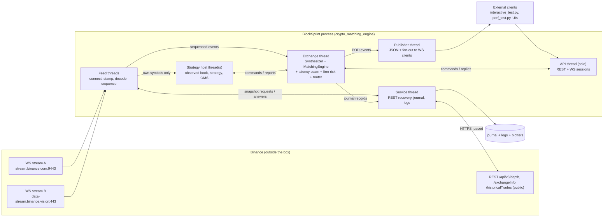
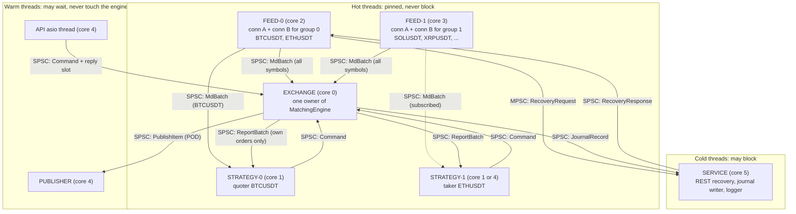
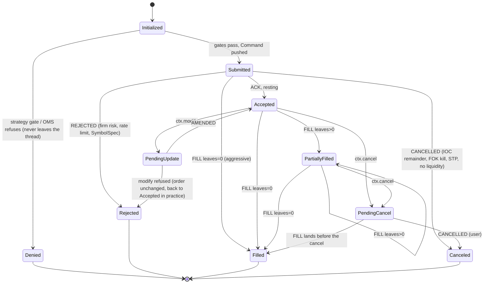
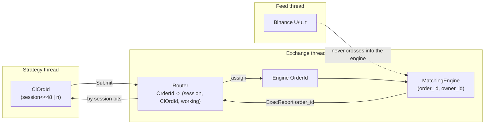
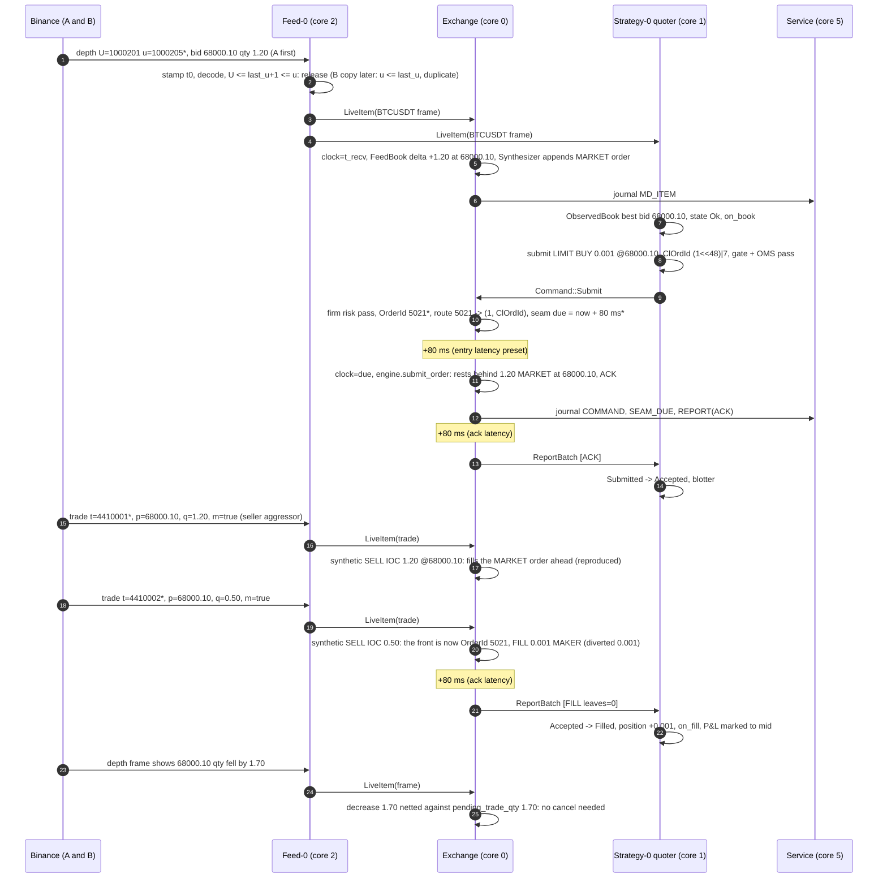
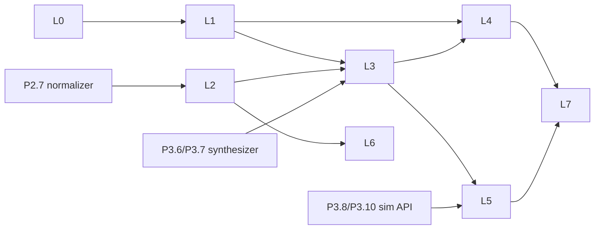

# BlockSprint Live Platform: Architecture (HLD + LLD)

> **Status:** design proposal, November 2026, not yet implemented. It builds on [blocksprint_2.0_implementation_plan.md](../blocksprint_2.0_implementation_plan.md) and [backtesting_simulator_integration_guide.md](../backtesting_simulator_integration_guide.md), and doesn't replace them. Task IDs `P1.x`–`P7.x` refer to the plan. New tasks in this document are numbered `L0`–`L7` (section 11).
>
> **Origin:** the design ideas come from a production NSE F&O live platform (internally "NNF"/qtrade). That platform reads NSE's tick-by-tick multicast feed, rebuilds order books order by order, runs several strategies, and sends their orders through one session to a **simulated exchange that matches them against the real live market**. This document turns that architecture into its Binance spot equivalent for BlockSprint.

---

## Table of Contents

1. [The idea in one paragraph](#1-the-idea-in-one-paragraph)
2. [The seven principles and what they mean here](#2-the-seven-principles-and-what-they-mean-here)
3. [Where BlockSprint stands today](#3-where-blocksprint-stands-today)
4. [HLD: system context and topology](#4-hld-system-context-and-topology)
5. [HLD: the three data flows](#5-hld-the-three-data-flows)
6. [HLD: one core, three drivers (sim, paper, venue)](#6-hld-one-core-three-drivers-sim-paper-venue)
7. [LLD: components](#7-lld-components)
   - 7.1 [Module layout and CMake targets](#71-module-layout-and-cmake-targets)
   - 7.2 [Normalized market-data event](#72-normalized-market-data-event)
   - 7.3 [Feed ingress: A/B connections](#73-feed-ingress-ab-connections)
   - 7.4 [Sequencer: two connections become one exact stream](#74-sequencer-two-connections-become-one-exact-stream)
   - 7.5 [Recovery worker](#75-recovery-worker)
   - 7.6 [Channels and fan-out](#76-channels-and-fan-out)
   - 7.7 [Exchange thread](#77-exchange-thread)
   - 7.8 [Live synthesizer (L2 to L3) and fidelity](#78-live-synthesizer-l2-to-l3-and-fidelity)
   - 7.9 [Latency seam](#79-latency-seam)
   - 7.10 [Strategy host](#710-strategy-host)
   - 7.11 [Order state machine](#711-order-state-machine)
   - 7.12 [Risk layers](#712-risk-layers)
   - 7.13 [Identifiers](#713-identifiers)
   - 7.14 [API server as a session](#714-api-server-as-a-session)
   - 7.15 [Journal and deterministic replay](#715-journal-and-deterministic-replay)
   - 7.16 [Clocks](#716-clocks)
   - 7.17 [Threads, cores and waiting policy](#717-threads-cores-and-waiting-policy)
   - 7.18 [Configuration](#718-configuration)
   - 7.19 [Observability](#719-observability)
8. [Worked example: a depth update becomes a quote, then a passive fill](#8-worked-example-a-depth-update-becomes-a-quote-then-a-passive-fill)
9. [Failure modes and edge cases](#9-failure-modes-and-edge-cases)
10. [Testing strategy](#10-testing-strategy)
11. [Integration roadmap](#11-integration-roadmap)
12. [What not to copy from NNF](#12-what-not-to-copy-from-nnf)
13. [Glossary and mapping table](#13-glossary-and-mapping-table)

---

## 1. The idea in one paragraph

Treat the live Binance market as an **exact, ordered stream of events**. Every update is accounted for, a gap is detected and repaired, and a book that might be wrong is labelled as such and never traded on. Give every piece of state **exactly one owner thread**: the feed thread owns its sequencers, the exchange thread owns the matching engine, and each strategy thread owns its book, OMS and P&L. Threads talk only through queues. **Never let anything slow or blocking touch that path**: network recovery, JSON for clients, disk and logging all live on other threads. Then run **the same strategy code** that the simulator runs against BlockSprint's own engine fed with that live stream, behind a latency model, so that a live paper session and a backtest are the same program with different inputs. Because the exchange thread is single-threaded and deterministic, **journaling its inputs makes every live session replayable bit for bit**. That gives you the parity check (P7.4–P7.5) almost for free.

---

## 2. The seven principles and what they mean here

| # | NNF principle | NNF mechanism | BlockSprint equivalent | Existing work it builds on |
|---|---|---|---|---|
| 1 | **Exactness before speed** | Per-stream sequencer merges feed A and B by `seq_no`, parks messages after a hole, 20 ms grace, then TCP tick recovery, then a snapshot. Book state is `Ok`/`Recovering`/`Stale`, and strategies trade only on `Ok`. | Per-symbol `DepthSequencer` on Binance `U`/`u` update IDs and `TradeSequencer` on trade ID `t`. Two WebSocket connections (A and B), first copy wins. Repair is a REST snapshot. The same three feed states, and the same rule. | Recorder (P2.1–P2.4), normalizer sync rules (P2.7), gap policies (P6.5) |
| 2 | **One owner per piece of state** | Hardware steering puts each multicast group into its owner thread's ring. A single-threaded strategy thread needs no locks. The gateway owns everything that exists once per firm. | The feed thread owns its connections and sequencers. The **exchange thread owns `MatchingEngine` with `thread_safe = false`**. Each strategy thread owns its observed book, OMS and P&L. The API server becomes a client that posts commands. | `EngineOptions::thread_safe` (P1.8) |
| 3 | **Never block the hot path** | Pinned spinning cores. Blocking work (TCP recovery, disk) quarantined to one core. Unbounded channels, so a slow consumer costs memory, never data. | Matching, sequencing and strategy threads never do JSON serialization, socket sends or disk I/O. A publisher thread does client JSON, and a service thread does REST recovery, journal and logs. Queues never block the producer. | POD `Bbo`/`Depth`, JSON only at the boundary (P1.11) |
| 4 | **A realistic exchange, not a toy fill model** | A copy of NSE's matching engine fed with the live market. Our orders queue among real ones, hidden aggressors are inferred from trades, a 250 µs + 250 µs latency model is applied, and fidelity is measured (97.6–99.3%). | BlockSprint's FIFO engine fed through the **L2→L3 Synthesizer** (guide §7.3), with strategy orders queued among synthetic `MARKET` orders, trades applied as synthetic IOCs, the `LatencyModel` applied, and **fidelity metrics measured live**. | Synthesizer (P3.6), QueueModels (P3.7), LatencyModels (P3.8), P7.1 |
| 5 | **Several independent safety layers** | Engine gate, then strategy OMS, then firm limits, then exchange rules. Each can refuse on its own. | Strategy gate (local `validate_order`), then strategy OMS, then firm risk (aggregate position, cross-strategy self-trade, Binance rate limits), then engine rules (`SymbolSpec`, `ExecReason`). | `validate_order` (P1.12), STP (P1.9), RiskGuard (P6.4), rate limits (P6.2) |
| 6 | **Each layer has its own ID, mapped at the boundary** | Client order ID (session in the top bits), venue order ID, NSE order number, LAR. `by_no` maps unsolicited fills back to their order. | Client order ID `u64` (session in the top bits), engine order ID `u64`, trade ID `u64`. The gateway maps between them. Binance IDs (`lastUpdateId`, `U`/`u`, `t`) live only on the feed side. | `ExecReport.seq`, `trade_id` counters (P1.10) |
| 7 | **Safe by construction, observable byte-exact** | No code path can send an order to NSE. A byte-exact journal in both directions, with a viewer and a checker. | **No signed-endpoint code in the repository.** Keyless connector (P0.3). A binary journal of every input to and output from the exchange thread, and a replay tool that reproduces the report hash. | Golden hashes (P1.3), determinism test (P1.17) |

---

## 3. Where BlockSprint stands today

### 3.1 Already consistent with the principles

| Area | Evidence |
|---|---|
| Exact arithmetic | `int64` fixed-point in 1e-8 units, exact decimal parsing ([types.hpp](../src/core/types.hpp)) |
| Injectable time | `IClock`, `WallClock`, `SimClock` ([clock.hpp](../src/core/clock.hpp)) |
| Instantiable engine, lock optional | `MatchingEngine(clock, EngineOptions{thread_safe})` ([matching_engine.hpp](../src/core/matching_engine.hpp)) |
| Complete order lifecycle | `ExecReport` contract: ACK, then FILL/AMENDED, then exactly one terminal report ([events.hpp](../src/core/events.hpp)) |
| Participants | `owner_id`, `StpPolicy`, reserved `MARKET` owner accepted only from loopback ([models.hpp](../src/core/models.hpp)) |
| Exchange rules | `SymbolSpec` mirrors Binance's PRICE_FILTER / LOT_SIZE / NOTIONAL ([symbol_spec.hpp](../src/core/symbol_spec.hpp)) |
| Timestamp before parse | The recorder stamps `time.time_ns()` before decoding JSON ([recorder.py](../research/data/recorder.py)) |
| Connection overlap | The recorder's 24 h rollover keeps two connections live for a window. That is already an A/B feed. |
| Gaps explicit in data | Recorder `event` envelopes and normalizer `GAP` segments (P2.4, P2.7) |
| Determinism pinned | Golden hashes over seeded workloads ([characterization_test.cpp](../tests/core/characterization_test.cpp)) |

### 3.2 Where the current code breaks a principle

| # | Finding | Where | Principle | Consequence |
|---|---|---|---|---|
| V1 | Engine callbacks (`trade`, `bbo`, `depth`, `exec_report`) run **inside the engine's recursive mutex**. In the server they serialize JSON and call `server_.send` for each subscriber while holding `connection_mutex_`. | [matching_engine.cpp](../src/core/matching_engine.cpp) `deliver` / `publish_after_execution`; [api_server.cpp](../src/api/api_server.cpp) `broadcast_*` | 3 | One slow subscriber or socket stalls matching. The latency of the matching path depends on the number of WebSocket clients. |
| V2 | The engine is called directly from websocketpp's asio thread (`engine_.submit_order` in `on_http` and `on_message`). The mutex is what makes this safe. | [api_server.cpp](../src/api/api_server.cpp) | 2 | Several writers on the engine. Live order processing isn't reproducible, because the order of inputs isn't recorded anywhere. |
| V3 | The connector mirrors each level as one order (`replace`) from `@depth10@100ms` **partial book** frames. Those frames carry no sequence range, so gaps can't be detected. It also keys levels by `float` and resets the whole engine on reconnect. | [binance_connector.py](../scripts/binance_connector.py) | 1, 4 | No exactness (a missed frame can't be detected). Queue priority is destroyed on every update (D10). A reconnect wipes user orders. |
| V4 | The order ID defaults to `std::to_string(now_ns)` when the client omits one, and IDs are `std::string` keys. | [api_server.cpp](../src/api/api_server.cpp) `parse_order` | 6 | Two orders in the same clock tick collide. Routing a report back to its session needs string work. |
| V5 | No record of the engine's inputs. | — | 7 | A live session can't be replayed or compared against the simulator. |

V1 and V2 can be fixed now, independently of the simulator work (task **L1**). V3 is already planned (P7.1 and P7.2). This document gives it a precise design.

---

## 4. HLD: system context and topology

### 4.1 System context



**Safety boundary:** the only bytes that leave the process for Binance are WebSocket subscriptions and public REST GETs. No component holds an API key or can sign a request (section 7.12).

### 4.2 Thread topology (single process)



Each arrow is a dedicated queue with exactly **one producer and one consumer**, except `RecoveryRequest`, which all feed threads share. No component reads another component's memory.

---

## 5. HLD: the three data flows

### 5.1 Market data (top to bottom)

1. **Read.** The feed thread polls both connections of its group. Each frame is stamped with `t_recv` (wall clock) and `t_mono` (steady clock) before anything else.
2. **Decode.** JSON becomes a POD `MdEvent`. Prices and quantities go through `parse_fixed` and never pass through a `double`.
3. **Sequence.** The per-symbol sequencer releases each depth range or trade **exactly once, in Binance's order**, whichever connection delivered it first. After a hole it parks later events, waits a grace period, then asks for recovery.
4. **Fan-out.** One copy goes to the exchange thread (every symbol). Each strategy receives only the symbols it subscribed to. Feed state changes (`Ok`, `Recovering`, `Stale`) go to everyone subscribed to that symbol.
5. **Exchange thread.** It keeps an L2 "feed book" per symbol, computes level deltas, and feeds them to the Synthesizer, which turns them into L3 operations on `MatchingEngine` (section 7.8).
6. **Strategy thread.** It applies events to its `ObservedBook`. A changed top of book triggers `on_book`.

### 5.2 Orders (strategy to exchange)

1. `ctx.submit(...)`: the `ExecutionEngine` assigns a `ClOrdId` and runs the strategy gate and OMS. A refusal becomes `Denied` and never leaves the thread.
2. `GatewayLink` turns the call into `Command::Submit` and pushes it onto the strategy's SPSC queue.
3. The exchange thread drains each session's queue in FIFO order. It runs firm risk, assigns the engine `OrderId`, records the route, and puts the order in the **latency seam** (`due = now + entry_latency`).
4. When the order is due, the engine clock is set to `due` and `engine.submit_order(...)` runs.

### 5.3 Reports (exchange to the strategy that owns the order)

1. The engine appends `ExecReport`s to a vector. No callbacks fire inside a lock, because there is no lock.
2. The router maps `OrderId` to `(session, ClOrdId)`. Reports for synthetic `MARKET` orders are counted, not routed.
3. Each report goes into the latency seam (`due = now + ack_latency`), FIFO per session, so a FILL can never overtake its ACK.
4. When due, the report is pushed to the owning session's `ReportBatch` queue. The strategy's state machine updates, then `on_order_update` or `on_fill` runs.
5. In parallel, POD trade/BBO/depth items go to the publisher, and journal records go to the service thread.

---

## 6. HLD: one core, three drivers (sim, paper, venue)

The guide's principle 1, "one matching core, two drivers", extends to three. All three share `engine_core`, the Synthesizer, the latency models and the strategy API. Only the **source of inputs** and the **clock driver** differ.

| | **Sim** (P3) | **Paper** (this document) | **Venue** (BlockSprint 1.0 role) |
|---|---|---|---|
| Market data | `.bse` replay (mmap) | Live Binance via the feed threads | Live Binance via the feed threads |
| Who trades | In-process strategies | In-process strategies | External clients over REST/WS |
| Clock | `SimClock` advanced by the event queue | `SimClock` advanced to each input's `t_recv` (section 7.16) | Same as paper |
| Latency seam | Sampled `LatencyModel` | Sampled `LatencyModel` (calibrated preset) | Off (0), or a model for "remote client" realism |
| Event loop | Single thread, `EventQueue` | Exchange thread, inputs from queues | Same as paper |
| Reproducible? | Yes (seed) | **Yes, from the journal** | Yes, from the journal |

The key design choice: **in live modes the engine never reads the wall clock.** The exchange thread sets its `SimClock` to the timestamp of the input it is about to process. Matching is then a pure function of (ordered inputs with timestamps, config, seed), which is exactly what the simulator computes. Live is a simulation whose inputs arrive in real time.

---

## 7. LLD: components

### 7.1 Module layout and CMake targets

```
src/
├── core/                    # engine_core (exists): types, clock, models, events, order_book, matching_engine
├── sim/                     # sim lib (P3): event_queue, rng, synthesizer, queue_models, latency_models, ...
├── live/                    # NEW: live_core static lib (no websocketpp dependency in its headers)
│   ├── md_event.hpp         #   POD normalized market-data event (7.2)
│   ├── spsc_queue.hpp       #   bounded lock-free SPSC ring + spill (7.6)
│   ├── sequencer.hpp/.cpp   #   DepthSequencer, TradeSequencer (7.4)
│   ├── feed_book.hpp/.cpp   #   L2 book used to compute level deltas
│   ├── fanout.hpp           #   per-consumer subscription filter (7.6)
│   ├── exchange_thread.hpp/.cpp  # owner of MatchingEngine + Synthesizer + seam + router (7.7)
│   ├── latency_seam.hpp     #   delay queue keyed (due_ns, seq) (7.9)
│   ├── firm_risk.hpp/.cpp   #   cross-strategy limits, rate limits (7.12)
│   ├── router.hpp           #   OrderId <-> (session, ClOrdId) (7.13)
│   ├── journal.hpp/.cpp     #   BSJRNL01 writer + reader (7.15)
│   └── affinity.hpp         #   thread pinning, Windows + Linux (7.17)
├── feed/                    # NEW (L6): native C++ Binance feed handler (TLS WebSocket client)
│   ├── binance_ws.hpp/.cpp  #   connection A/B, ping/pong, 24 h rollover
│   └── binance_decode.cpp   #   JSON -> MdEvent (simdjson or nlohmann)
├── strategy/                # NEW: StrategyHost, Ctx, ExecutionEngine, Oms, GatewayLink (7.10)
├── api/                     # exists: ApiServer becomes a session + publisher (7.14)
└── main.cpp                 # wires threads from config
tools/
└── bs_journal.cpp           # NEW: check / dump / replay a journal (7.15)
research/live/
└── feed_bridge.py           # P7.2 + L2: Python feed with the same sequencer rules (stage A)
```

CMake: `live_core` depends on `engine_core` and `sim` (for Synthesizer and LatencyModel). `crypto_matching_engine` links `live_core`, `api` and, from L6, `feed`. Tests go in `tests/live/`.

### 7.2 Normalized market-data event

One POD type crosses every thread boundary. It has no strings, no heap memory and no `shared_ptr`.

```cpp
// src/live/md_event.hpp
enum class MdKind : uint8_t { DepthLevel, DepthEnd, Trade, Snapshot, State, Heartbeat };
enum class FeedState : uint8_t { Ok, Recovering, Stale };
enum class Origin : uint8_t { ConnA, ConnB, Recovery };

using SymbolId = uint16_t;  // index into the symbol table, loaded from exchangeInfo at start-up

struct MdEvent {
    uint64_t t_recv;      // ns since the Unix epoch, wall clock, taken at frame read
    uint64_t t_exch;      // Binance E (depth) or T (trade), in ms, converted to ns
    uint64_t seq_first;   // depth: U, trade: t
    uint64_t seq_last;    // depth: u, trade: t
    Price price;          // DepthLevel / Trade
    Quantity qty;         // DepthLevel: ABSOLUTE new level qty (0 = remove); Trade: traded qty
    SymbolId symbol;
    MdKind kind;
    Side side;            // DepthLevel: book side; Trade: AGGRESSOR side (m=true => SELL)
    Origin origin;
    FeedState state;      // State events only
};
static_assert(std::is_trivially_copyable_v<MdEvent>);
```

A Binance diff-depth frame with *n* bid and ask entries becomes *n* `DepthLevel` events and one `DepthEnd` (which carries `U`/`u`). That keeps the event fixed-size, and the consumer applies the batch atomically when it sees `DepthEnd`. This is the counterpart of NNF's "one MTBT message is one event". A snapshot is carried out-of-band as a `std::vector<MdEvent>` inside a `Snapshot` item (section 7.6), because it can hold 10,000 levels.

### 7.3 Feed ingress: A/B connections

NSE sends every stream twice over UDP, and loss is per packet. Binance's WebSocket runs over TCP, so the failure modes are different: **disconnects, stalls, server-side restarts and the 24 h forced close**, not single lost frames. Two connections still pay off:

- **Continuity.** When A disconnects (or reaches its 24 h limit), B keeps the sequence going, so most "gaps" never need a snapshot. Your recorder already does this during rollover.
- **Tail latency.** First copy wins, so a stall on one TCP path doesn't stall the book.

| Item | Design |
|---|---|
| Endpoints | A: `wss://stream.binance.com:9443/stream?streams=...`; B: `wss://data-stream.binance.vision/stream?streams=...` (market data only). Different hostnames reduce correlated failures. |
| Streams | `<sym>@depth@100ms` and `<sym>@trade` for every symbol in the group. **Both connections must subscribe to identical streams**, so their update ranges line up. |
| Ownership | **One feed thread owns both connections of its group** and all sequencers for those symbols. Sequencing then needs no locks, just as one NNF feed thread owns both port rings of its stream. |
| Stamping | `t_recv` and `t_mono` are taken the moment the frame is complete, before the JSON parse (the recorder's rule). |
| Liveness | Answer pings (Binance pings every 20 s and drops the connection if no pong arrives within a minute). Watchdog: no frame for `stall_ms` (for example 3 s) on a connection means reconnect that connection only. |
| Rollover | Reconnect A at `rollover_after` (for example 23 h), and B 30 minutes later, so the two are never down together. |
| Limits | Connection-attempt and stream-count limits come from Binance's documentation and are kept in config. Reconnects back off with jitter. |

**Stage A (Python, P7.2):** `research/live/feed_bridge.py` implements exactly this with asyncio. It uses one event loop per group (one owner) and the same sequencer rules, written once and shared with the normalizer (P2.7). It sends `MdEvent` records in binary over loopback to `/ws/market-feed`. **Stage B (C++, L6):** the same design natively, which removes Python's per-frame cost.

### 7.4 Sequencer: two connections become one exact stream

#### 7.4.1 Depth rules (Binance spot)

Each diff-depth event carries a range `[U, u]` and **absolute** level quantities. Two facts make A/B merging simple:

1. Quantities are absolute, so an event that overlaps what was already applied is safe to apply: its levels are newer. The only rule is **`U ≤ last_u + 1 ≤ u`**. That is the same rule Binance gives for the first event after a snapshot.
2. If `u ≤ last_u`, every change in the event has already been applied. It is a duplicate, so drop it.

```cpp
// src/live/sequencer.hpp (shape)
class DepthSequencer {
public:
    enum class Verdict { Released, Duplicate, Parked, NeedSnapshot };

    // ev is one complete frame (levels + DepthEnd). Released frames go to `out` in order.
    Verdict on_frame(const DepthFrame& ev, uint64_t now_mono, std::vector<DepthFrame>& out);

    // Called on every poll pass: grace expiry turns a hole into a snapshot request
    std::optional<RecoveryRequest> on_tick(uint64_t now_mono);

    // Snapshot with lastUpdateId L. Releases a Snapshot item, then the parked frames that follow it.
    Verdict on_snapshot(Snapshot&& s, std::vector<LiveItem>& out);

    FeedState state() const;

private:
    std::optional<uint64_t> last_u_;                 // nullopt until synced
    std::map<uint64_t, DepthFrame> parked_;          // key U (ordered), frames after a hole
    uint64_t hole_since_mono_ = 0;                   // 0 = no open hole
    bool snapshot_requested_ = false;
    FeedState state_ = FeedState::Recovering;
    SequencerCounters counters_;                     // released, dup_a, dup_b, parked, holes, snapshots
};
```

```
on_frame(ev):
    if last_u is none:                              # bootstrapping: buffer until snapshot
        park(ev); request snapshot once; return Parked
    if ev.u <= last_u:          counters.dup[ev.origin]++; return Duplicate
    if ev.U <= last_u + 1:      release(ev); last_u = ev.u; drain_parked(); return Released
    # ev.U > last_u + 1: hole (last_u+1 .. ev.U-1) not seen on either connection yet
    park(ev); if hole_since == 0: hole_since = now; return Parked

drain_parked():
    while parked not empty:
        f = parked.first
        if f.u <= last_u: drop f; continue
        if f.U <= last_u + 1: release(f); last_u = f.u; continue
        break                                       # still a hole
    if parked empty: hole_since = 0; set_state(Ok)

on_tick(now):
    if hole_since and now - hole_since > gap_grace (default 250 ms = 2.5 frames):
        set_state(Recovering); return RecoveryRequest::Snapshot{symbol}   (once)
    if parked.size > max_parked or bytes > max_parked_bytes:
        set_state(Stale); clear parked; request snapshot

on_snapshot(S with lastUpdateId L):
    drop parked frames with u <= L
    first = parked.first
    if first exists and first.U > L + 1:           # snapshot older than the stream: retry later
        retry snapshot after snapshot_retry (1 s); stay Recovering
    else:
        emit Snapshot(S); last_u = L; drain_parked(); set_state(Ok) if no hole remains
```

The **grace period** plays the same role as NNF's 20 ms wait. Most holes on A are filled by B a few milliseconds later. Because Binance batches every 100 ms, a grace of 2–3 frame intervals is the natural setting.

#### 7.4.2 Trade rules

Trade IDs `t` on the spot `@trade` stream increase per symbol. **Check with the QC suite (P2.10) that they are strictly consecutive** before you rely on that. Then:

- If `t ≤ last_t`, it's a duplicate. If `t == last_t + 1`, release it. If `t > last_t + 1`, park it, wait the grace period for the other connection, then ask the recovery worker for `historicalTrades?fromId=last_t+1` (check that endpoint's current security type in Binance's documentation; `aggTrades` is the public fallback, but its IDs differ).
- A trade gap doesn't corrupt the book, which comes from depth. It **does** corrupt the Synthesizer's `pending_trade_qty` netting, so a trade gap marks the symbol `Recovering` for the Synthesizer until the gap is filled, or until the next snapshot reconciles the book.

#### 7.4.3 Feed states and who reacts

| State | Meaning | Strategy host | Exchange thread |
|---|---|---|---|
| `Ok` | Book is exact | May trade | Synthesizer applies deltas |
| `Recovering` | A hole is open, or bootstrapping | **No new orders**; cancels allowed | Freeze synthetic liquidity changes. Apply the gap policy (P6.5): `halt` cancels strategy orders on that symbol, `hold` keeps them. |
| `Stale` | Data was lost, so the book may be wrong | No new orders; optionally cancel all | Same as `Recovering`, and count it in the fidelity report |

On a snapshot, the exchange thread **reconciles** synthetic liquidity against the snapshot (guide §7.3) and **keeps strategy and client orders where they are**. That's NNF's `begin_snapshot` rule ("market orders dropped, ours kept").

### 7.5 Recovery worker

This is the only component that makes REST calls, and it runs on the service thread, which is allowed to block.

| Item | Design |
|---|---|
| Requests | `Snapshot{symbol, limit}` → `GET /api/v3/depth?symbol=&limit=5000`; `Trades{symbol, from_id}` → `GET /api/v3/historicalTrades` |
| Order | FIFO, one request in flight at a time |
| Pacing | A request-weight budget read from `exchangeInfo.rateLimits` at start-up (do not hardcode it; the 5,000-level depth snapshot is one of the heaviest public calls). Keep a 50% safety margin and space requests by `min_spacing` (1 s, as the recorder does). |
| Responses | Each goes to the requesting feed thread's own response queue, never to a shared one |
| Failure | Exponential backoff. HTTP 429 or 418 means stop all requests until `Retry-After`, and mark every waiting symbol `Stale`. |
| Start-up | Every symbol starts with `Snapshot`. Symbols are staggered so the weight budget isn't spent at once. |

### 7.6 Channels and fan-out

#### 7.6.1 Queue type

```cpp
// src/live/spsc_queue.hpp: bounded lock-free ring, one producer, one consumer
template <typename T, size_t N>       // N power of two
class SpscQueue {
    alignas(64) std::atomic<size_t> head_{0};   // written by the consumer
    alignas(64) std::atomic<size_t> tail_{0};   // written by the producer
    alignas(64) T buf_[N];
public:
    bool try_push(const T&);           // producer; false when full
    size_t pop_batch(T* out, size_t max);   // consumer; returns the count popped
};
```

**Backpressure policy, following NNF's reasoning.** For NNF, a blocked reader gets lapped by the network card. Here, a blocked feed thread stops reading its TCP socket, and Binance eventually disconnects it. **A producer therefore never blocks:**

- When a market-data queue is full, the producer appends to a per-consumer **spill vector** (unbounded) and raises a `lagging` counter. It flushes the spill first on the next pass. Memory and latency grow, and both are measured. Nothing is lost and the feed thread never stalls. This is the C++ form of NNF's unbounded mpsc.
- Above a **hard watermark** (configurable, for example 1 s of backlog), the consumer is declared `Stale` for those symbols and gets a fresh snapshot instead of the backlog.

#### 7.6.2 Items

```cpp
struct LiveItem {                       // what a consumer pops (batched)
    enum class Kind : uint8_t { Events, Snapshot, State } kind;
    SymbolId symbol;
    std::vector<MdEvent> events;        // Events: one or more complete frames; Snapshot: all levels
    FeedState state;                    // State
};
```

Batching follows NNF: one queue operation per *batch*, not per level. At 100 ms per frame, a batch is normally one frame, but during recovery a batch carries hundreds of parked frames.

#### 7.6.3 Subscriptions

```cpp
struct Consumer {
    SpscQueue<LiveItem, 1024>* queue;
    std::vector<LiveItem> spill;
    std::bitset<kMaxSymbols> symbols;   // all bits set for the exchange thread
};
```

| Consumer | Symbols | Why |
|---|---|---|
| 0: exchange thread | all | It mirrors every symbol it can match |
| *k*: strategy *k* | its own | A strategy's queue carries only its own symbols, so a busy symbol can't delay a quiet one |
| Snapshots | cut to each consumer's symbols | as in NNF |
| States | each consumer subscribed to the symbol | |

**Which book a strategy sees.** Like NNF, strategies build their book **from the feed**, which is the real Binance book. They don't see the engine's book, which also holds other sessions' orders and the synthetic remainders after impact. That keeps strategy logic identical to the simulator's *observed book* (P3.9). API market-data clients, on the other hand, see the **engine's** book, the venue view.

### 7.7 Exchange thread

This is the heart of the platform, the counterpart of NNF's order gateway on CPU 0. It is the **only** thread that touches `MatchingEngine`, which is constructed with `EngineOptions{.thread_safe = false}` and a `SimClock`.

#### 7.7.1 What it owns

| Object | Role |
|---|---|
| `SimClock clock` | Engine time. Set from inputs, never read from the wall. |
| `MatchingEngine engine` | Matching, no mutex |
| `FeedBook feed_books[symbol]` | L2 per symbol from the sequenced feed. Turns absolute quantities into deltas. |
| `Synthesizer synth[symbol]` | L2→L3 (P3.6), plus `pending_trade_qty` |
| `LatencySeam seam` | Delayed commands (entry) and delayed reports (ack), FIFO per session |
| `FirmRisk risk` | Cross-session limits, Binance order-rate limits, kill file |
| `Router router` | `OrderId` ↔ `(session, ClOrdId)`, working quantity per order |
| `Session sessions[]` | Command queue in, report queue out, per strategy host or API client |
| `FidelityStats stats[symbol]` | Section 7.8 |
| Output queues | Publisher (POD trade/BBO/depth), journal |

#### 7.7.2 Main loop

```cpp
void ExchangeThread::run() {
    pin_to_core(cfg_.cores.exchange);
    while (!stop_.load(std::memory_order_relaxed)) {
        bool work = false;
        uint64_t now = wall_ns();                       // used only to decide what is due

        // 1. Market data first (conservative tie-break, as in the sim, guide §10.1)
        for (auto& q : md_queues_) work |= drain_md(q);           // sets clock to item.t_recv

        // 2. Delayed items that are due, in (due_ns, seq) order
        work |= seam_.release_due(now, [&](const Delayed& d) {
            clock_.set(std::max(clock_.now_ns(), d.due_ns));
            d.is_command ? execute(d.command) : deliver(d.report);
        });

        // 3. New commands from every session, FIFO per session, sessions round-robin
        for (auto& s : sessions_) work |= drain_commands(s, now); // risk, route, put in seam

        // 4. Housekeeping every 100 ms: kill file, rate-window roll, stats, publisher snapshots
        work |= housekeeping(now);

        if (!work) waiter_.idle();                      // spin, then yield (7.17)
    }
}
```

The ordering in this loop is part of the design:

- **Market data before strategy orders at equal time.** This matches the simulator's default and NNF's single-strategy rule ("a fill it causes is already in flight before the strategy reacts"). Neither mode can trade on information it couldn't have had.
- **Clock monotonicity.** `clock_.set(max(...))` never moves backwards (`SimClock` would throw). When a seam item is released, its *due* time becomes the engine time, so a latency of 5 ms really is 5 ms in engine time even if the thread was busy.
- **Every input is journaled before it is executed** (section 7.15).

#### 7.7.3 Executing a command

```
execute(Submit cmd):
    order = make_order(cmd)                  # engine OrderId already assigned at routing
    reports.clear()
    trades = engine.submit_order(order, &reports)
    for r in reports:
        if router.is_market(r.order_id): stats.count(r); continue
        route = router.lookup(r.order_id)     # (session, ClOrdId)
        router.apply(r)                       # working qty, terminal => erase
        risk.apply(r)                         # firm position on FILL
        seam.push_report(route.session, r, clock.now + ack_latency.sample())
    publish(trades, bbo_if_changed, depth_dirty)
    journal(reports)
```

### 7.8 Live synthesizer (L2 to L3) and fidelity

The Synthesizer is the one specified in guide §7.3 and P3.6, unchanged. Live use adds three things:

1. **Delta source.** `FeedBook::apply(frame)` returns `(side, price, old_qty, new_qty)` for each level, and the Synthesizer consumes those deltas: `increase` appends a synthetic order, `decrease` is netted against `pending_trade_qty` and the residual goes to the `QueueModel`, and `0` removes the level.
2. **Trades as hidden aggressors.** A Binance `@trade` with `m=true` (the buyer is the maker) becomes a synthetic SELL IOC at price `p` for quantity `q`, owner `MARKET`, STP `SKIP`. It matches from the **front** of the bid queue at `p`, so a strategy order ahead in the queue fills. This is the NNF case where "the second trade fills US".
3. **Fidelity, measured continuously.** This is the number that gives NNF credibility (97.6–99.3%).

| Metric | Definition | Target |
|---|---|---|
| `trade_reproduced` | Share of Binance trades whose synthetic IOC filled the full `q` at `p` | ≥ 98% on BTCUSDT and ETHUSDT |
| `trade_diverted` | Share of a trade's quantity that filled a strategy or client order instead of synthetic liquidity | reported, not a defect: this is your passive-fill rate |
| `book_match_top20` | After each snapshot, top-20 levels of the synthetic book vs the snapshot, exact match | 100% outside recovery |
| `crossing_fills` | Fills from the crossing rule (the data's opposite side moved through a resting order) | reported |
| `recovering_ms` | Time per day in `Recovering` or `Stale` | reported |

These metrics go to `summary.txt` at the end of a session and to the metrics endpoint (section 7.19).

**As built (P7.1, `src/sim/live_feed.*`).** The first cut runs on the existing server, without L1's exchange thread: websocketpp runs every handler on one asio thread, so the feed, the order paths and the stats never interleave.
- **`/ws/market-feed`** (loopback connections only, like the `MARKET` owner) takes JSON frames, one message or an array of them. Prices and quantities are decimal strings on the symbol's grid (set it first through `POST /api/symbols`); `ts` is optional exchange time in ns.
  - `{"type": "snapshot", "symbol": S, "bids": [[price, qty], ...], "asks": [...]}`: the whole book.
  - `{"type": "depth", ...}`: the same with absolute quantities, `"0"` removes a level.
  - `{"type": "trade", "symbol": S, "price": P, "qty": Q, "side": "buy"|"sell"}`: `side` is the aggressor's (a Binance `@trade` with `m: true` is a `sell`).
  - `{"type": "gap", "symbol": S}`: updates were lost.
- **`LiveFeed`** turns each message into exactly the records the replayer reads from a `.bse` file and applies them through the simulator's `Synthesizer`, one per symbol, on the engine's clock (the server's `WallClock`). Depth before the first snapshot (or after a gap) is ignored and trades aren't matched until one comes, as in a replay. Sequencing and gap detection stay the connector's (P7.2).
- **Same path, tested:** the committed slice sent as JSON messages builds the same engine book (top 20 compared every 100 batches) and the same synthesizer counters as the Synthesizer fed from the file; golden (a) sent as messages gives the hand-computed queue and the client's fill.
- **Replies only on an error** (`{"status": "error", "message": ...}`, naming the message's index in an array); the connector streams thousands of events a second.
- **Gaps** are logged and passed on to `/ws/market-data` subscribers as `{"event": "gap", "symbol": S}`: until the next snapshot that symbol's book is empty.
- **Fidelity:** `GET /api/market-feed` gives, per symbol, `synced`, message, snapshot, depth, gap and trade counts, `trade_reproduced` (synced trades whose tape IOC took exactly their quantity at their price), `trade_diverted_qty` (taken from client orders: their passive fills), `trade_through_qty`, `trade_short_qty`, `crossing_fills`, the impact overlay's take and the data's top of book. On the committed BTCUSDT slice `trade_reproduced` is about 0.65 (stale and iceberg levels, P3.18's gate V4), below this section's 98% target: the target needs the live A/B feed of L2 to judge.
- **Options:** `crypto_matching_engine --feed-queue-model M --feed-seed N --feed-impact-ms T` (default `cancel_from_back`, 0, 0); `--port N`.
- **Around it:** `POST /api/reset` also forgets the feed (each symbol needs a snapshot again); a symbol whose tick or lot changes starts over; client taker fills feed the impact overlay when T > 0; `MARKET_TAPE` is reserved; the mirror's own reports (`MARKET`, `MARKET_TAPE`) are no longer broadcast on `/ws/executions`.
- **Still to come:** L1 (callbacks and JSON off the engine's lock) and a binary frame format.

**As built (P7.2, connector v2, `research/live/feed_bridge.py`).** The stage-A bridge of L2 without the A/B pair yet: one Binance connection carries `<sym>@depth@100ms` and `<sym>@trade` for every symbol.
- **One rule set:** `research/data/binance_sync.py` (`classify`, `sync_from_snapshot`) holds Binance's sync decisions; the normalizer (recorded data) and the bridge (live) both call it, so an event is judged the same way in both. The normalizer's tests, golden output included, are unchanged.
- **Per symbol, `BookSync`** (pure, unit-tested on crafted events): depth events are buffered until a REST snapshot (`limit=1000`, weight 50, one a second at most); the server then gets the snapshot and the buffered events that continue it; afterwards each event goes on with absolute quantities, a duplicate is dropped, and a gap sends `gap` and waits for the next snapshot. No depth update for 10 s, or a lost Binance connection, also sends `gap`. Trades go on as they come (deduplicated by ID, missing IDs counted); `m: true` (the buyer is the maker) is a `sell`.
- **The engine side:** it resets the engine (unless `--no-reset`) and registers each symbol's Binance filters under the 1.0 names (`BTC-USDT`; `--plain-names` for `BTCUSDT`); errors the server sends back are logged; a status line every 30 s combines the bridge's counts with `GET /api/market-feed`.
- **`scripts/binance_connector.py` runs v2 by default** (the same five symbols); `--v1` runs the 1.0 per-level mirror until P7.8 removes it. `run_all.py` therefore uses v2. This removes D10: no level is ever re-submitted, so no queue is rebuilt.
- **Live check (2026-11-14):** BTCUSDT and ETHUSDT synced within 3 s of connecting, no gaps over a minute, the engine's top of book tracking Binance's. All five symbols synced within 10 s. `scripts/interactive_test.py` (now also scriptable: `--symbol --side --type --price --qty`) passed for a market buy walking ten levels, a market sell, an IOC, a passive limit and a killed FOK; its check now compares quantity per price level, because a level is a queue of synthetic orders and fills in one trade per order it meets.
- **Fidelity on live data:** `trade_reproduced` is about 0.5 (BTCUSDT over 45 s: 0.73 BTC traded through better levels, 0.32 BTC short). Trades arrive as they happen but depth only every 100 ms, so a trade often meets a level the next depth update would have changed; the recorded data shows the same (about 0.65 on the committed slice). The 98% target above assumes an unbatched book feed; with `@depth@100ms` it isn't reachable, and the parity work (P7.5) should measure fills against this baseline.

**As built (P7.3, live strategy runner, `research/live/runner.py`).** The Python counterpart of L5's strategy host, as an external session: a research strategy class, unchanged, in paper mode.
- **`LiveContext`** implements `research.strategies.base.Context` over the server's sockets as the simulator's gateway session does over its queue: `/ws/orders` for requests and replies, `/ws/executions` for the owner's reports (they change the strategy's open orders and per-symbol accounts, then reach `on_exec`), `/ws/market-data` for the book and `gap`, `/ws/trades` for the market's trades (the feed's tape: taker IDs starting with `~`; the strategy's own taker trades aren't data trades). Order states, account arithmetic (`notional_for`'s rounding), timers, `can_trade` with a warm-up, `callback_mode` (every_event, on_change, timer_only) and multi-symbol calls follow the simulator.
- **The book** is the server's top 10 levels (broadcast at most every 100 ms) minus the strategy's own acknowledged resting orders, since the simulator's observed book shows the data, not the strategy. It is seeded from `GET /api/depth` once the sockets are open (depth is only broadcast on a change), is valid with both sides present, and turns invalid on `gap` until the feed resyncs.
- **Refusals as in the simulator:** a cancel the server can't find and an amend it refuses (a `REJECTED` report for a live order) become `on_reject`; a replace of an order not known as open is refused locally (the server would make it a new order; the simulator's gateway refuses it).
- **Recorded for parity (P7.4):** `session.jsonl` (start, every request, report and refusal, gaps, a per-second sample of each symbol's top of book and account, end) and `session_meta.json` (owner, symbols, strategy, times, counters, accounts). Orders still open at the end are cancelled unless `--keep-orders`.
- **Run:** `uv run python -m research.live.runner --strategy research.strategies.passive_quoter:PassiveQuoter --params '{"size": "0.001"}' --symbols BTC-USDT --duration 600 --out results/paper/run1`, with the server and the feed bridge running.
- **Tested:** the conversions, the account arithmetic against the simulator's accounts test, the book without the strategy's orders and across a gap, replies and reports into callbacks (`tests/python/test_live_runner.py`); the research `PassiveQuoter`, the class the simulator runs, against the real server with a scripted feed: it joins both sides behind 5, gets both maker fills and ends flat (10 runs out of 10 after seeding the book; before, a snapshot sent before the sockets opened left it blind).
- **Live (2026-11-14):** the same quoter (0.001 a side, 500 ms) on BTC-USDT for 2 minutes with the v2 bridge and `prob_power:2`: 101 maker fills, 0.0341 BTC traded, no gaps or refusals, every order cancelled at the end.
- **Measured delays (P7.4):** `session_meta.json` gains `measured_latency`: the depth delay from the server's book change to the strategy (`md_delay_ms`, about uniform on 0-100 ms from the depth batching) and each new order's round trip to its first report (`order_rtt_ms`). The parity protocol ([parity_protocol.md](parity_protocol.md)) replays a session with them.

### 7.9 Latency seam

```cpp
// src/live/latency_seam.hpp
struct Delayed {
    uint64_t due_ns;
    uint64_t seq;            // insertion number: stable order among equal due times
    SessionId session;
    bool is_command;
    Command command;         // when is_command
    ExecReport report;       // otherwise
};

class LatencySeam {
public:
    void push_command(SessionId s, Command c, uint64_t due);
    void push_report(SessionId s, ExecReport r, uint64_t due);
    template <typename F> bool release_due(uint64_t now_wall, F&& f);
private:
    // Binary heap on (due_ns, seq). FIFO per session is enforced at push time:
    // due = max(due, last_due[session][direction]), so a later item can never overtake an earlier one.
    std::vector<Delayed> heap_;
    std::unordered_map<SessionId, std::array<uint64_t, 2>> last_due_;
    uint64_t next_seq_ = 0;
};
```

**Invariants** (tested):

1. No overtaking within a session and direction. An ACK is always delivered before the FILL that follows it, and a cancel arrives after the submit it refers to.
2. Latency is sampled from the same `LatencyModel` objects the simulator uses (P3.8), with a seeded RNG, so a journal replay samples the same values.
3. Venue mode with zero latency still goes through the seam with `due = now`, so there is a single code path.

Suggested presets, calibrated in P7.6:

| Preset | Entry | Ack | Notes |
|---|---|---|---|
| `binance_spot_tokyo_vps` | about 2–5 ms* | about 2–5 ms* | AWS ap-northeast-1 |
| `binance_spot_home_pc` | about 60–150 ms* | about 60–150 ms* | your development PC; measure it |
| `zero` | 0 | 0 | venue mode, unit tests |

\* Placeholders until P7.6 measures them.

### 7.10 Strategy host

There is one thread per strategy, or one thread hosting several light strategies when cores are scarce. Each thread is single-threaded internally and uses no locks. The strategy-facing interface is **exactly the simulator's** (P3.10), so the same class runs in both.

```cpp
// src/strategy/strategy.hpp (shared with src/sim)
class Strategy {
public:
    virtual ~Strategy() = default;
    virtual void on_start(Ctx&) {}
    virtual void on_book(Ctx&, SymbolId, const ObservedBook&) {}
    virtual void on_trade(Ctx&, const MdEvent& trade) {}
    virtual void on_feed_state(Ctx&, SymbolId, FeedState) {}
    virtual void on_order_update(Ctx&, const OrderView&) {}
    virtual void on_fill(Ctx&, const FillView&) {}
    virtual void on_timer(Ctx&, uint64_t timer_id) {}
    virtual void on_end(Ctx&) {}
};

class Ctx {                                    // implemented by SimContext and LiveContext
public:
    virtual uint64_t now_ns() const = 0;
    virtual std::optional<ClOrdId> submit(const NewOrder&) = 0;   // nullopt => Denied (reason in log)
    virtual bool cancel(ClOrdId) = 0;
    virtual bool modify(ClOrdId, Quantity, Price) = 0;
    virtual const Position& position(SymbolId) const = 0;
    virtual void set_timer(uint64_t id, uint64_t delay_ns) = 0;
};
```

What a strategy thread owns, from NNF's strategy box:

| Object | Role |
|---|---|
| `Scheduler` | Heap on `(timestamp, class, insertion)`. Merges feed items, report batches and timers into one deterministic order. |
| `ObservedBook[symbol]` | L2 from the feed (not the engine's book) and the feed state |
| `ExecutionEngine` | `ClOrdIdGen`, gate, order records, `OrderState` machine, fills, position, average price, realized and unrealized P&L, fees |
| `Oms` | Pre-trade rules, kill switch, blotter |
| `GatewayLink` | Looks like a venue to `ExecutionEngine`, but pushes `Command`s and pops `ReportBatch`es |

Rules carried over from NNF:

- `submit` is allowed only from `on_book`, `on_trade` or `on_timer`, and **only when `ObservedBook.state() == Ok`**.
- `GatewayLink` with the exchange gone means the order is answered `Rejected{GATEWAY_DOWN}` locally.
- Python strategies run through the P7.3 `LiveContext` over WebSocket, so they are an *external session* (section 7.14). That path is slower but uses the same `Strategy` API.

### 7.11 Order state machine



Every transition writes an `OrderEventRecord {cl_ord_id, strategy, t, state, reason, price, last_px, last_qty}`. `orders.csv`, `fills.csv` and the blotter are generated from those records by the service thread, never written on the strategy thread.

The engine's `ExecReport` contract ([events.hpp](../src/core/events.hpp)) already guarantees the shape this machine relies on: ACK first, then exactly one terminal report.

### 7.12 Risk layers

| Layer (thread) | Checks, in order | Refusal |
|---|---|---|
| **1. Strategy gate** (strategy) | Feed state `Ok`, known symbol, `validate_order` with the local `SymbolSpec` (tick, lot, min/max quantity, min notional), local message rate | `Denied{reason}`; never sent |
| **2. Strategy OMS** (strategy) | Kill switch → `max_order_qty` → `max_position` (position + same-side working + this order) → `max_open_orders` → `max_orders_per_sec` → `allow_market_orders` → `price_band_bps` around the mid → `max_loss` (marked to mid every 100 ms) | `Denied{RMS, text}` |
| **3. Firm risk** (exchange) | Kill file → firm `max_open_orders` → firm `max_position` per symbol across all strategies → **cross-strategy self-trade** (one strategy's order would trade with another's) → **Binance order-rate limits** read from `exchangeInfo.rateLimits` (orders per 10 s and per day) | `REJECTED{FIRM_RISK \| RATE_LIMIT}`, logged as `FIRM_REFUSED` |
| **4. Engine rules** (exchange) | `validate_order` (already in the engine), duplicate ID, STP by `owner_id` | `REJECTED{PRICE_TICK, ...}` (existing `ExecReason`s) |

`FIRM_RISK`, `RATE_LIMIT`, `FEED_NOT_OK` and `GATEWAY_DOWN` are the new `ExecReason` values.

**On cross-strategy self-trade:** the engine's STP works per `owner_id`. If all strategies use the firm's owner ID, the engine applies Binance's STP between them, which is how a real account behaves. If each strategy has its own owner, they can trade with each other, and layer 3 must refuse it. Make this an explicit config choice (`stp_scope = "account" | "strategy"`). The default should be `account`, because that matches Binance.

**Safety by construction:**

- The repository contains **no code that signs a Binance request** (no HMAC, no API key loading). CI fails if `X-MBX-APIKEY`, `signature=` or `/api/v3/order` appears under `src/`, `scripts/` or `research/`. That check takes one grep line in `ci.yml`.
- The kill file (`/tmp/blocksprint_kill`, or `%TEMP%\blocksprint_kill` on Windows) is checked every 100 ms by the exchange thread and by every strategy's OMS. Once tripped, it stays tripped for the run, cancels all open orders and doesn't flatten positions.

### 7.13 Identifiers

#### 7.13.1 The IDs and where each one is created

| ID | Created by | Format | Stored in | Why it matters |
|---|---|---|---|---|
| `lastUpdateId`, `U`, `u` | Binance | u64, per symbol | Sequencer only | A/B arbitration and hole detection |
| Trade ID `t` | Binance | u64, per symbol | Sequencer; `MdEvent.seq_first` | Trade gap detection; joins fidelity stats to the Binance tape |
| `SymbolId` | Start-up | u16 index from `exchangeInfo` | Everywhere on the hot path | No string keys on the hot path |
| `t_recv` | Feed thread | ns since 1970 UTC | `MdEvent`; engine clock in live modes | Latency = handling time − `t_recv` |
| `SessionId` | Config / API connect | u16 | Router | Owner of a command stream |
| **`ClOrdId`** | Strategy `ClOrdIdGen` | `(session << 48) \| counter` (u64) | Strategy orders, blotter, router | **The strategy routes by it, and the exchange can tell the session from the ID alone.** |
| **Engine `OrderId`** | Exchange thread at routing | u64. Bit 63 = 0 for sessions; bit 63 = 1 for synthetic `MARKET` orders. | Engine book, router | One namespace, so synthetic and session orders can never collide |
| `ExecReport.seq` | Engine | u64 from 1 | Reports, journal | Total order of everything the engine did |
| `trade_id` | Engine | u64 from 1 | Reports, trades | Pairs taker and maker FILLs |
| Journal record number | Journal writer | u64 | Journal | Replay position |

#### 7.13.2 Mapping



This is NNF's `by_no` lesson. A report for a *resting* order arrives long after the submit, when it is filled by a trade nobody on the strategy side asked for. The router's `OrderId → (session, ClOrdId)` map is what brings it home. An **unrouted report** (a session `OrderId` that the router doesn't know) is a bug counter that must stay at 0.

**Migration from string IDs:** `Order.order_id` stays a `std::string` in `engine_core` for now (to keep the golden hashes). The exchange thread formats `OrderId` as decimal text once at submit. Moving the engine to `u64` keys is part of D15 (allocation work), and nothing in this design depends on it. External API clients keep their own string `client_order_id`, which the API session maps to a `ClOrdId`, and the server never generates IDs from `now_ns` (fixes V4).

### 7.14 API server as a session

Today the API thread calls the engine directly and sends JSON under locks (V1, V2). In this design:

| Concern | Thread | Mechanism |
|---|---|---|
| Parse REST/WS order requests | API (asio) | JSON → `Command`, with `ClOrdId` = `(api_session << 48) \| n` |
| Execute | Exchange | `Command` arrives through the API session's SPSC queue. The reply comes back through a per-request completion slot, and the asio handler is resumed with `asio::post`. |
| Read BBO/depth (`GET /api/orderbook/...`) | API | Reads the **publisher's** latest snapshot (copied per symbol, double-buffered). Never asks the engine. |
| Push trades, BBO, depth, exec reports to WS clients | Publisher | Pops POD items, builds JSON **only if there are subscribers**, coalesces depth to 100 ms (the existing P1.11 logic, moved here), and calls `server_.send` via `asio::post` onto the server's io_context |
| `/api/reset` | Exchange | `Command::Reset`, journaled like any other input |

Effect: **the matching path no longer depends on how many clients are connected or how fast they read.** That is NNF principle 3. `bench_core`'s `live` configuration should then approach its `sim` numbers, because the only remaining difference is queue handling.

### 7.15 Journal and deterministic replay

The exchange thread is deterministic given its inputs, so **journaling its inputs is enough to reproduce a live session exactly**. Outputs are journaled too, so the replay can be checked against them.

```
File: logs/live/<YYYYMMDD_HHMMSS>/exchange.bsj
Header: "BSJRNL01" | u32 version | u64 start_wall_ns | config JSON (u32 len + bytes) | git SHA (40 B)
Record: u8 kind | u64 engine_ns | u64 record_no | u32 len | payload (len bytes)
kind:  1 MD_ITEM    (LiveItem as applied: symbol, frames or snapshot)
       2 COMMAND    (session, Command, arrival wall_ns)
       3 SEAM_DUE   (seq of the released delayed item, due_ns)   <- the order the seam released things
       4 REPORT     (ExecReport, binary)
       5 STATE      (symbol, FeedState)
       6 TIMER      (housekeeping tick, kill-file result)
       7 RNG        (latency samples, if not re-derivable from the seed)
```

- **Writer:** the exchange thread pushes records onto an SPSC queue. The service thread writes them with a buffered writer and flushes every 100 ms. If the journal queue fills, the record goes to a spill vector, never blocking (section 7.6).
- **`bs_journal check file.bsj`:** structural checks, monotonic `engine_ns`, every REPORT sequence contiguous, no unrouted reports. It prints `ALL CHECKS PASSED`, NNF's audit gate.
- **`bs_journal replay file.bsj`:** feeds the kinds 1, 2, 3 and 6 into a fresh `ExchangeThread` driven by a `SimClock` and compares the produced reports with the kind 4 records via FNV-1a hash. **Equal hashes mean the live session was deterministic.** That is the strongest parity statement you can make, and it is cheap.
- **`bs_journal dump --symbol BTCUSDT --from ... --to ...`:** human-readable records, the counterpart of NNF's browser viewer. Later, the same data can be published as an HTML viewer.

This also feeds P7.4–P7.5. Replaying a paper session through `bs_sim` with the **recorded** data rather than the journaled items measures the gap between the recorder pipeline and the live feed pipeline.

### 7.16 Clocks

| Clock | Unit and origin | Used for |
|---|---|---|
| `t_recv` (wall) | ns since 1970 UTC: `std::chrono::system_clock` (MSVC uses the precise system time) | Event timestamps, engine time in live modes, journal |
| `t_mono` (steady) | ns, arbitrary origin: `std::chrono::steady_clock` (QueryPerformanceCounter on Windows) | **Durations**: grace timers, latency histograms, watchdogs |
| Binance `E`, `T` | ms since 1970 UTC | Exchange time; `t_recv − E` is the feed-latency distribution (P3.8 input) |
| Engine `SimClock` | ns since 1970 UTC, forward only | Matching, report timestamps |
| NTP offset | ns, sampled hourly (recorder `clock` envelopes) | Correcting `t_recv − E`. NNF found its box 4.77 s fast, so measure yours before you trust latency numbers. |

**Rule:** compare `t_recv` values only with each other or with the corrected `E`, never across machines. Use `t_mono` for everything that is a timeout.

### 7.17 Threads, cores and waiting policy

#### 7.17.1 Plan for an 8-logical-core machine (adjust in config)

| Thread | Core | Does | May block? |
|---|---|---|---|
| Exchange | 0 | Synthesizer, engine, seam, firm risk, router | Never |
| Strategy host(s) | 1 | Books, strategies, OMS | Never |
| Feed group 0 | 2 | A + B connections, decode, sequencers | Never (non-blocking sockets) |
| Feed group 1 | 3 | Same | Never |
| API asio + publisher | 4 | Client I/O, JSON | Waits on I/O |
| Service | 5 | REST recovery, journal, logs, CSVs | Yes, on purpose |
| Free | 6–7 | OS, builds, the recorder process | — |

NNF's warning carries over directly: **don't build on the live cores** (a build caused 73 overruns there). Use `start /affinity C0 cmake --build ...` on Windows or `taskset -c 6,7 cmake --build ...` on Linux.

#### 7.17.2 Pinning

```cpp
// src/live/affinity.hpp
inline void pin_to_core(int core) {
#if defined(_WIN32)
    SetThreadAffinityMask(GetCurrentThread(), DWORD_PTR(1) << core);
    SetThreadPriority(GetCurrentThread(), THREAD_PRIORITY_TIME_CRITICAL);
#else
    cpu_set_t set; CPU_ZERO(&set); CPU_SET(core, &set);
    pthread_setaffinity_np(pthread_self(), sizeof(set), &set);
#endif
}
```

#### 7.17.3 Waiting policy

NNF spins all the time on dedicated server cores. On a development PC that wastes power and fights the OS, so the policy is configurable:

| Mode | Behaviour | Use |
|---|---|---|
| `spin` | Busy-poll with `_mm_pause()` | Linux VPS with `isolcpus` |
| `hybrid` (default) | Spin for `spin_us` (for example 50 µs), then `SwitchToThread` / `sched_yield`, then sleep 100 µs after `idle_ms` | Windows development PC |
| `block` | Wait on a condition or event signalled by producers | Laptops, CI |

Because Binance frames arrive every 100 ms, `hybrid` costs almost nothing in latency for paper mode.

### 7.18 Configuration

```json
{
  "mode": "paper",
  "symbols": ["BTCUSDT", "ETHUSDT", "SOLUSDT"],
  "feed": {
    "groups": [["BTCUSDT", "ETHUSDT"], ["SOLUSDT"]],
    "conn_a": "wss://stream.binance.com:9443/stream",
    "conn_b": "wss://data-stream.binance.vision/stream",
    "depth_stream": "@depth@100ms",
    "gap_grace_ms": 250,
    "stall_ms": 3000,
    "rollover_after_h": 23,
    "max_parked_frames": 2000
  },
  "recovery": { "snapshot_limit": 5000, "min_spacing_ms": 1000, "weight_margin": 0.5 },
  "exchange": {
    "latency_preset": "binance_spot_home_pc",
    "queue_model": "ProbPower(2)",
    "gap_policy": "halt",
    "stp_scope": "account",
    "seed": 42
  },
  "firm_risk": { "max_open_orders": 40, "max_position": { "BTCUSDT": "0.05" }, "kill_file": "auto" },
  "strategies": [
    { "name": "passive_quoter", "session": 1, "symbols": ["BTCUSDT"], "core": 1,
      "params": { "size": "0.001", "throttle_ms": 200 },
      "oms": { "max_order_qty": "0.001", "max_position": "0.002", "max_open_orders": 2,
               "max_orders_per_sec": 5, "price_band_bps": 50, "max_loss_usdt": "25" } }
  ],
  "cores": { "exchange": 0, "feed": [2, 3], "api": 4, "service": 5, "wait": "hybrid" },
  "api": { "port": 8080, "depth_interval_ms": 100 },
  "journal": { "dir": "logs/live", "flush_ms": 100 }
}
```

Parse it with nlohmann into structs, using the same loader as P3.12. Hash the canonical form and store it in the journal header and in `summary.txt`.

### 7.19 Observability

**Latency points.** Each point is stamped on `t_mono`, and the deltas go into HDR-style histograms (log-linear buckets, lock-free per thread, merged by the service thread every 10 s):

```
t0 frame complete ─► t1 decoded ─► t2 sequenced/released ─► t3 exchange applied
                                         └──────────────► t4 strategy on_book done ─► t5 command popped
                                                                                         ─► t6 engine executed
```

| KPI (session `summary.txt`) | NNF counterpart |
|---|---|
| p50 / p99 / p99.9 of `t0→t4` (frame to strategy decision) | 1.4 µs p50, 3.7–5.9 µs p99 |
| Duplicates per connection; parked frames; holes; snapshots; `recovering_ms` | Overruns, lost messages, resets |
| Queue high-water marks and spill bytes per consumer | Unbounded-channel backlog |
| Fidelity (section 7.8) | 97.6–99.3% trades reproduced |
| Firm refusals, OMS denials, unrouted reports (must be 0) | `FIRM_REFUSED`, unrouted |
| Journal `check` result | `ALL CHECKS PASSED` |

These are **targets to measure**, not promises. JSON decoding (nlohmann) will probably dominate `t0→t1` at tens of microseconds per frame. If the numbers justify it, simdjson in stage B (L6) is the fix. Binance's 100 ms batching means internal microseconds rarely decide outcomes in paper mode. The hot-path discipline is mostly what buys you **determinism, correctness under load, and simulator throughput**.

Expose a `GET /api/metrics` (JSON) and a once-per-minute log line, mirroring the recorder's status line.

---

## 8. Worked example: a depth update becomes a quote, then a passive fill

The `passive_quoter` (session 1) is flat on BTCUSDT with no working bid. A diff-depth frame raises the best bid. The quoter joins that bid with 0.001 BTC. The order rests behind synthetic liquidity, and later two Binance trades sell through the level. Because the quoter's order is now at the front of the queue, the second trade fills it. Values marked * are illustrative.



| # | Thread | What happens (IDs created or used) | Evidence |
|---|---|---|---|
| 1–2 | Feed-0 | The frame arrives on A first and is stamped `t0`. With `last_u = 1000200`, the frame `[1000201, 1000205]` is released and `last_u = 1000205`. The B copy is dropped as a duplicate. | `dup_b += 1` |
| 3–4 | Feed-0 | Fan-out sends one batch to the exchange (all symbols) and one to strategy 0 (BTCUSDT subscriber) | Two SPSC pushes |
| 5 | Exchange | The engine clock is set to `t_recv`. `FeedBook` returns the delta `+1.20` at 68000.10, and the Synthesizer appends a synthetic order (bit 63 set, owner `MARKET`, STP `SKIP`). | Journal `MD_ITEM` |
| 7–8 | Strategy 0 | The best bid changed, the book is `Ok`, the strategy is flat, so it submits. `ClOrdIdGen` returns `(1 << 48) \| 7`. Gate: tick 0.01 ✓, lot 0.00001 ✓, notional 68.0001 ≥ 5 ✓. OMS: size ✓, position 0 + 0 + 0.001 ≤ 0.002 ✓, open 0 < 2 ✓, rate ✓, band ✓. | `orders.csv` "Submitted" |
| 9–10 | Exchange | Firm risk passes. Engine `OrderId` 5021 is assigned and recorded in the router, and the order is held for the entry latency. | Journal `COMMAND` |
| 11–12 | Exchange | When due, the clock is set to the due time and `submit_order` runs. The order rests at 68000.10 behind 1.20 of synthetic quantity. The ACK goes into the seam. | Journal `SEAM_DUE`, `REPORT` |
| 13–14 | Strategy 0 | The ACK arrives. `Submitted → Accepted`. | Blotter "resting" |
| 15–16 | Exchange | The first trade becomes a synthetic IOC and consumes the 1.20 synthetic quantity ahead of us. It is reproduced exactly as Binance traded it. | `trade_reproduced += 1` |
| 17–18 | Exchange | The second trade: the front of the queue is now **our** order, so it fills 0.001 as MAKER and the rest consumes synthetic quantity behind us. The router maps 5021 to session 1. | `trade_diverted += 0.001` |
| 19–20 | Strategy 0 | The FILL arrives after the ack latency. Position +0.001, average price 68000.10, fee at maker bps (P1.13), `on_fill`. | `fills.csv` |
| 21–23 | Exchange | The next depth frame shows the level 1.70 lower. That is netted fully against `pending_trade_qty`, so the residual is 0 and no queue-model cancel happens. | Book matches Binance |

**IOC variant (taker):** the order is a `Command::Submit` of type IOC at the best ask. When due, it sweeps the synthetic asks as they are *at arrival time*. During the entry latency the ask may have moved, and then the IOC is cancelled unfilled (`CANCELLED{IOC_REMAINDER}`). The consumed synthetic liquidity goes into the `ImpactOverlay` (P6.1), so the next depth frame doesn't restore it immediately.

---

## 9. Failure modes and edge cases

| Situation | Detection | Response |
|---|---|---|
| Connection A drops | Socket error, or the watchdog (`stall_ms`) | B continues. A reconnects with backoff. The sequencer sees only duplicates or continuity, so no snapshot is needed. |
| Both connections drop | Both down for longer than `gap_grace` | `Recovering`, gap policy applied, snapshot after the first reconnect |
| Hole on one connection only | `U > last_u + 1` | Park. The other connection fills it within the grace period. |
| Hole on both connections | Grace period expires | Snapshot (section 7.4.1). Count it in `holes_both`. |
| Snapshot older than the first parked frame | `first.U > L + 1` | Retry after 1 s. Stay `Recovering`. |
| Snapshot rate-limited (429/418) | HTTP status | Stop requests until `Retry-After`. Waiting symbols become `Stale`. |
| 24 h forced close | Scheduled | A and B roll over 30 minutes apart, so there is no gap |
| Slow strategy | Queue high-water mark, spill bytes | Keeps memory and latency growth visible. Above the watermark the consumer goes `Stale` and gets a snapshot. Other consumers are unaffected. |
| Slow WS client | Publisher queue | Only the publisher lags. Matching is unaffected (fixes V1). |
| Trade gap | `t > last_t + 1` after the grace period | Ask `historicalTrades`. If that fails, mark Synthesizer netting suspect until the next snapshot reconcile. |
| Crossed book in the data after a batch | `FeedBook` check after each `DepthEnd` | Count it. Don't feed the cross to the Synthesizer: treat it as a hole and get a snapshot. |
| Symbol filter change (tick or lot) | Daily `exchangeInfo` refresh | Apply a new `SymbolSpec` at a safe point (no working orders on that symbol), and journal it |
| Clock jump on the host | `t_recv` goes backwards | The engine clock uses `max(prev, t_recv)`, so it never goes backwards. Count it. |
| Kill file appears | Exchange 100 ms tick | Cancel all session orders, refuse new ones, and keep the state for the rest of the run |
| Process crash | — | The journal is readable up to its last flush (rotate it like the recorder's `.part` files) |
| Binance maintenance or symbol `BREAK` status | `exchangeInfo` status, or no frames | Symbol state becomes `Stale`, with no new orders |

---

## 10. Testing strategy

| Test | What it proves | Where |
|---|---|---|
| **Sequencer property test** | For any interleaving of A and B frames with duplicates, overlaps and random drops on one side, every update range is applied **exactly once, in order**, and the resulting book equals the book built from a single perfect stream. This is NNF's property test, adapted to range semantics. | `tests/live/sequencer_test.cpp` (seeded, 10⁴ cases per PR, 10⁶ nightly) |
| Snapshot path | Bootstrapping, a snapshot older than the stream (retry), parked frames ≤ L dropped, the first frame straddling L | same |
| Latency seam | No overtaking per session; ACK before FILL; due-order stability among equal times | `tests/live/seam_test.cpp` |
| Exchange-thread determinism | A recorded fixture of inputs (MD, commands) run twice produces an identical report hash. **Journal round trip:** live → `.bsj` → `bs_journal replay` gives an identical hash. | `tests/live/exchange_replay_test.cpp` |
| Golden scenario parity | The P3.16 golden scenarios (queue ahead consumed, crossing fill, stale quote picked off) run through the **exchange thread** produce the same fills as through `bs_sim` | `tests/live/golden_parity_test.cpp` |
| Router | Every session report is routed; synthetic reports are never routed; the unrouted count is 0 under fuzz | `tests/live/router_test.cpp` |
| Risk layers | Each rule refuses at the right layer with the right reason | `tests/strategy/oms_test.cpp`, `tests/live/firm_risk_test.cpp` |
| Chaos (manual or scripted) | Kill A, kill B, block REST, stall a strategy, flood the API, and confirm states, recovery and that `check` passes | `scripts/chaos_live.py` |
| Soak | 24 h paper session over a rollover, with fidelity ≥ target and `bs_journal check` passing | `docs/live_ops.md` runbook |
| CI guard | grep for signing code (section 7.12) | `.github/workflows/ci.yml` |

---

## 11. Integration roadmap

Each task notes where it plugs into the existing plan. L1 doesn't depend on the simulator and can start now.

| ID | Task | Depends on | Builds on / replaces | Acceptance |
|---|---|---|---|---|
| **L0** | Write down the decisions in this document: string-to-`u64` ID mapping at the exchange boundary, `stp_scope`, the feed-book-vs-engine-book rule. Add `ExecReason` values `FIRM_RISK`, `RATE_LIMIT`, `FEED_NOT_OK`, `GATEWAY_DOWN`. | — | P1.10 | Docs + enum, golden hashes unchanged |
| **L1** | **Single-owner exchange thread for the existing venue mode:** `SpscQueue`, `ExchangeThread` with `thread_safe = false`, API as a session (commands + completion), a publisher thread doing the JSON and sends from `broadcast_*` and depth coalescing. Fixes **V1, V2, V4**. | L0 | P1.8, P1.11 | `perf_test.py` ≥ current 6,207 orders/s; `interactive_test.py` passes; `bench_core` gains a `live_threaded` configuration within 20% of `sim`; all 65 tests pass |
| **L2** | **Exact feed, stage A (Python):** `research/live/feed_bridge.py` with A/B connections, `DepthSequencer`/`TradeSequencer` (one implementation shared with the P2.7 normalizer), a recovery worker, feed states and a binary `MdEvent` sink. Property test in pytest. | P2.7 | **P7.2** (extends it with A/B and states) | Property test passes; a 24 h run with 0 unexplained holes; snapshots only after both-connection gaps |
| **L3** | **Live market feed into the exchange thread:** `/ws/market-feed` (binary), `FeedBook`, live Synthesizer, fidelity stats, gap policy. Retire the v1 connector behind a flag. Fixes **V3**. | L1, L2, P3.6, P3.7 | **P7.1**, P6.5 | Fidelity: trade_reproduced ≥ 98% and book_match_top20 = 100% outside recovery, over 3 sessions |
| **L4** | **Journal + `bs_journal check/replay/dump`.** Fixes **V5**. | L1 (L3 for MD records) | P1.17 | Replay hash equals the live hash on a 1 h paper session; `check` passes |
| **L5** | **In-process strategy host + latency seam + risk layers:** `Strategy`/`Ctx` shared with the simulator, `ExecutionEngine`, `Oms`, `GatewayLink`, `FirmRisk` with Binance rate limits, kill file, blotter and CSVs on the service thread | L3, P3.8, P3.10 | P6.2, P6.4, **P7.3** (Python runner stays as an external session) | The same `PassiveQuoter` (P3.15) runs unchanged in `bs_sim` and in paper mode; the golden-scenario parity test passes |
| **L6** | **Native C++ feed handler (stage B):** TLS WebSocket client (asio + OpenSSL via websocketpp's TLS config, or Boost.Beast), simdjson decoding if the profile justifies it, feed threads pinned, latency histograms | L2 | — | `t0→t2` p50 at least 10× lower than stage A; same property tests; the Python bridge stays as a fallback |
| **L7** | **Calibration and parity using the journal:** the P7.4 protocol, but comparing the journal against a `bs_sim` replay of the recorder's data for the same window; fitted latency and queue-model presets | L4, L5, P5 | **P7.4–P7.6** | Parity targets from P7 (fill ratio within ±15%, 1 s markout within 1 tick) |

Suggested order: **L0 → L1** (now, small, removes the worst hot-path violation) → **L2** (in parallel with P3) → **L3 + L4** (after P3.6) → **L5** → **L7**. **L6** only when the measurements call for it.



---

## 12. What not to copy from NNF

| NNF element | Why it doesn't carry over | What to do instead |
|---|---|---|
| ExaNIC kernel bypass, hardware flow steering, DMA rings | Binance arrives over TLS WebSocket on the internet, and no NIC can steer inside TLS. The bottleneck is JSON and network distance, not interrupts. | Keep the **principle** (each connection is owned by one thread, stamped at read, never shared). Locate near Binance (Tokyo) if latency matters. |
| UDP multicast A/B with per-packet loss | TCP doesn't lose single frames; it disconnects | A/B for continuity and tail latency (section 7.3); repair by snapshot, not by tick replay |
| Tick-recovery server (resend a sequence range) | Binance has no depth-range resend | REST snapshot plus parked frames (section 7.4.1) |
| TP_FO protocol, transcodes, LAR echoing, log-on sequence | Exchange-specific. BlockSprint *is* the venue, and its API is your own. | The `ExecReport` contract is your protocol. Keep it versioned and journaled. |
| Microsecond targets as the headline KPI | Binance depth is 100 ms batched. A paper strategy's edge is decided by the latency model, not the engine's µs. | Report the µs numbers, but gate releases on **fidelity, determinism and parity**. |
| L3 order-by-order book from the feed | Binance publishes L2 only | The L2→L3 Synthesizer (guide §7.3) provides the queue realism that NSE's order IDs give NNF |
| 24 cores, 16 feed threads | Development PC | Configurable core plan, `hybrid` waiting (section 7.17) |

---

## 13. Glossary and mapping table

| NNF term | BlockSprint term | Section |
|---|---|---|
| MTBT stream, `seq_no` | Diff-depth stream, `U`/`u`; trade stream, `t` | 7.4 |
| Feed A / feed B | Connection A / B | 7.3 |
| Sequencer, parking, gap grace | `DepthSequencer`, parked map, `gap_grace_ms` | 7.4 |
| Tick recovery / snapshot server | Recovery worker: REST `historicalTrades` / `depth` | 7.5 |
| `LiveItem`, Fanout | `LiveItem`, `Consumer` with a symbol bitset | 7.6 |
| Order gateway (CPU 0) | Exchange thread | 7.7 |
| Simulated NSE, `Owner::Market` / `Owner::Member` | `MatchingEngine` + Synthesizer, owner `MARKET` / session owners | 7.8 |
| Hidden aggressor | Synthetic IOC from a `@trade` print | 7.8 |
| `SimCore` latency seam (250 + 250 µs) | `LatencySeam` with `LatencyModel` presets | 7.9 |
| Strategy thread, Scheduler, `NseBook` | Strategy host, Scheduler, `ObservedBook` | 7.10 |
| ExecutionEngine gate, OMS, FirmLimits, NSE rules | Risk layers 1–4 | 7.12 |
| Client order ID `session<<40\|n` | `ClOrdId` `session<<48\|n` | 7.13 |
| Venue order ID, NSE order number, `by_no` | Engine `OrderId`, router map | 7.13 |
| Exchange journal `QTXJRNL1`, `--check` | `BSJRNL01`, `bs_journal check/replay` | 7.15 |
| Fidelity 97.6–99.3% | `trade_reproduced`, `book_match_top20` | 7.8 |
| Kill file `/tmp/qtrade_kill` | Kill file `blocksprint_kill` | 7.12 |
| "No order ever reaches NSE" | No signing code; CI guard | 7.12 |
