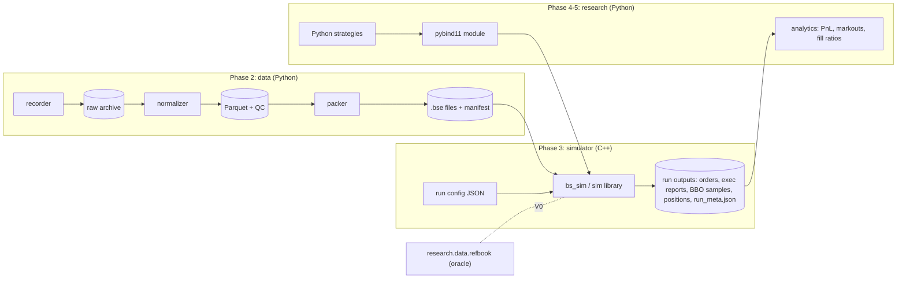
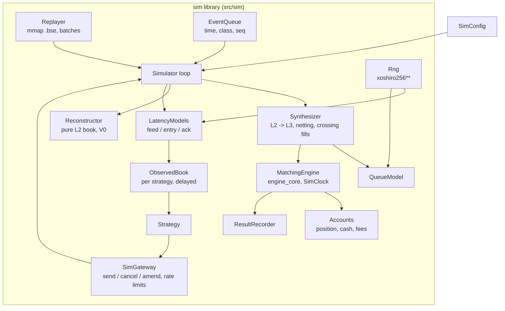
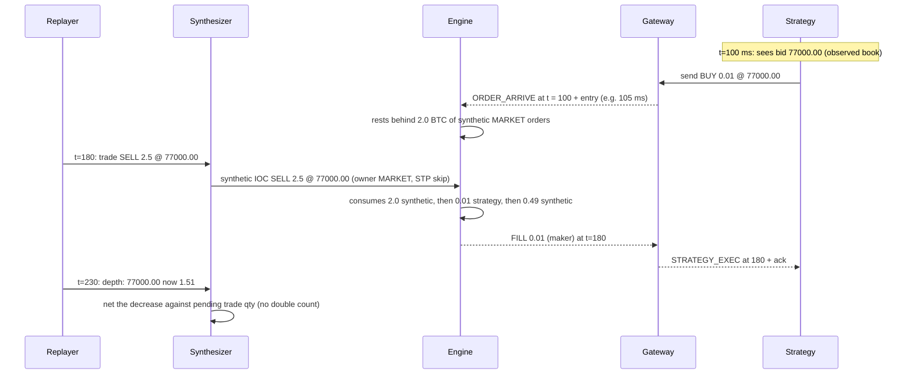

# BlockSprint Simulator: Architecture

**Status:** design of record for Phase 3. Implementation status is tracked in [§16](#16-implementation-status) and in the plan ([blocksprint_2.0_implementation_plan.md](../blocksprint_2.0_implementation_plan.md), P3.1–P3.18).
**Builds on:** the 2.0 engine core ([explanations/](../explanations/)), the data pipeline ([data_pipeline.md](data_pipeline.md)) and the design study ([backtesting_simulator_integration_guide.md](../backtesting_simulator_integration_guide.md), §7, §10, §11, §14).

---

## Contents

1. [What the simulator is](#1-what-the-simulator-is)
2. [Principles](#2-principles)
3. [System context](#3-system-context)
4. [Components](#4-components)
5. [Time, events and the main loop](#5-time-events-and-the-main-loop)
6. [Market data in: the replayer](#6-market-data-in-the-replayer)
7. [Two books: reconstruction and synthesis](#7-two-books-reconstruction-and-synthesis)
8. [The synthesizer (L2 → L3)](#8-the-synthesizer-l2--l3)
9. [Queue models](#9-queue-models)
10. [Latency models and the observed book](#10-latency-models-and-the-observed-book)
11. [Strategies, the gateway and accounts](#11-strategies-the-gateway-and-accounts)
12. [Outputs](#12-outputs)
13. [Configuration and the CLI](#13-configuration-and-the-cli)
14. [Determinism](#14-determinism)
15. [Validation](#15-validation)
16. [Implementation status](#16-implementation-status)
17. [Performance](#17-performance)
18. [Code layout](#18-code-layout)
19. [Assumptions and limitations](#19-assumptions-and-limitations)
20. [Extension points](#20-extension-points)
21. [Glossary](#21-glossary)

---

## 1. What the simulator is

An event-driven, deterministic **exchange simulator** for Binance spot. It replays recorded market data through BlockSprint's own matching engine and lets a **strategy** trade against it. The strategy sees the market late, its orders arrive late, and its passive orders wait in realistic queues.

It answers questions like:
- *If this market maker had quoted on 2026-11-05, how often would it have been filled, at what queue position, with what markouts and PnL after fees?*
- *How much worse does it get with 50 ms more latency, or with pessimistic queue assumptions?*

What makes it more than a replay of trades:

| Effect | How it's modelled |
| :--- | :--- |
| Queue position for passive orders | Historical L2 levels become **synthetic orders** in the engine's FIFO queues; strategy orders queue behind them (§8) |
| Where cancels happen in a queue | A pluggable **QueueModel**, from optimistic to pessimistic (§9) |
| Seeing the market late, reaching it late | **Feed, entry and ack latency**, and an **observed book** the strategy reads instead of the true one (§10) |
| Fills, partial fills, sweeps, fees, self-trade prevention, trading rules | The 2.0 **engine core**, unchanged: the same code as the live server |
| Gaps in the data | **Segments**: the book is flushed and the strategy is told (§6.3) |

---

## 2. Principles

1. **One source of fill truth.** Every fill, passive or aggressive, comes from `MatchingEngine`. The simulator has no fill logic of its own; it only translates market data into engine operations.
2. **Deterministic.** The same dataset and config give byte-identical outputs on Windows and Linux (§14).
3. **The strategy can't see the truth.** It reads a delayed, observed book and learns about its fills late.
4. **Conservative defaults.** At equal timestamps, market data is processed before strategy orders. Queue and latency defaults lean pessimistic. Optimistic settings exist for bounds, not for headline numbers.
5. **Validated in layers.** Reconstruction first, then synthesis with no strategy (it must reproduce historical volume), then golden scenarios with hand-computed fills (§15).
6. **Streaming.** Memory is O(book size + open orders), independent of dataset length; the replay file is memory-mapped.

---

## 3. System context



---

## 4. Components



| Component | Responsibility | File(s) | Plan |
| :--- | :--- | :--- | :--- |
| `Rng` | `SplitMix64` seeding, `xoshiro256**`, own uniform / exponential / normal / empirical distributions | `src/sim/rng.hpp` | P3.2 |
| `EventQueue` | Min-heap on `(time, priority class, insertion seq)` | `src/sim/event_queue.hpp` | P3.3 |
| `MmapFile` | Read-only memory mapping, Windows and POSIX behind one class | `src/sim/mmap_file.*` | P3.4 |
| `Replayer` | Validates the `.bse` header, iterates records, groups them into batches | `src/sim/replayer.*` | P3.4 |
| `L2Book` / `Reconstructor` | Pure level book from the data (no engine); top-N dumps for V0 | `src/sim/l2_book.hpp`, `src/sim/reconstruct.*` | P3.5 |
| `Synthesizer` | Turns data events into engine operations on synthetic `MARKET` orders | `src/sim/synthesizer.*` | P3.6 |
| `QueueModel`s | Choose which synthetic quantity an unexplained decrease removes | `src/sim/queue_models.hpp` | P3.7 |
| `LatencyModel`s | Feed, entry and ack delays; FIFO per connection | `src/sim/latency_models.hpp` | P3.8 |
| `ObservedBook` | The strategy's delayed L2 view | `src/sim/observed_book.*` | P3.9 |
| `SimGateway`, `Strategy` | Strategy API, order routing, accounts | `src/sim/gateway.*`, `src/sim/strategy.hpp` | P3.10 |
| `Simulator` | The loop: owns all of the above for one run | `src/sim/simulator.*` | P3.11 |
| `SimConfig` | JSON run config | `src/sim/config.*` | P3.12 |
| `ResultRecorder` | Append-only outputs and `run_meta.json` | `src/sim/recorder.*` | P3.13 |
| `bs_sim` | CLI: `info`, `reconstruct`, `run` | `src/sim/main.cpp` | P3.14 |
| Reference strategies | `NullStrategy`, `PassiveQuoter`, `TwapTaker` | `src/sim/strategies/` | P3.15 |

---

## 5. Time, events and the main loop

### 5.1 Clocks

| Time | Meaning |
| :--- | :--- |
| `ts_local` (data) | When the recorder received an event. **The simulation's exchange time is driven by it**: the engine's `SimClock` is set to each data event's `ts_local` before it is applied |
| `ts_exch` (data) | Binance's own timestamp; used for analysis and latency calibration, not for ordering |
| Simulation time `t` | Time of the event being processed; never decreases |
| Strategy time | `t` when a strategy callback runs; the strategy reads it from `ctx.now()` |

Using `ts_local` as exchange time means the data's own network delay is already inside the replay. The extra feed latency models the delay between *that* point and the strategy, which is why it's typically small when the recorder runs near the exchange (§10).

### 5.2 Events

| Class (priority at equal time) | Event | Source |
| :--- | :--- | :--- |
| 0 `MARKET_DATA` | One data batch (a depth event, a snapshot, a trade or a gap) | Replayer |
| 1 `ORDER_ARRIVE` | A strategy request reaches the exchange | Gateway, after entry latency |
| 2 `STRATEGY_MD` | The strategy sees a book or trade update | After feed latency |
| 3 `STRATEGY_EXEC` | The strategy receives an execution report | After ack latency |
| 4 `TIMER` | A strategy timer fires | `ctx.set_timer` |

Ties are broken by `(time, class, insertion seq)`. Market data before orders at equal times is the conservative default (`tie_break: data_first`); `orders_first` exists for sensitivity runs.

### 5.3 The loop

```
load config, open .bse, seed Rng(seed), build engine (SimClock, thread_safe = false, fees, spec from header)
Q.push(next data batch)                              // only one data batch is in the queue at a time
Q.push(strategy on_start at t0)
while Q not empty and t < t_end:
    e = Q.pop(); clock.set(e.time)
    switch e.class:
      MARKET_DATA:   synthesizer.apply(batch)         // engine ops; may fill strategy orders
                     reconstructor.apply(batch)       // optional: true L2 book for checks
                     for each strategy s: Q.push(STRATEGY_MD at t + feed_latency(s))
                     Q.push(next data batch)
      ORDER_ARRIVE:  engine.submit / cancel / amend at t (exec reports -> accounts, recorder)
                     Q.push(STRATEGY_EXEC at t + ack_latency) for each report
      STRATEGY_MD:   observed_book(s).apply(update); s.on_book / on_trade / on_gap
      STRATEGY_EXEC: s.on_exec(report)
      TIMER:         s.on_timer(t)
    strategy calls inside callbacks: gateway.send/cancel/amend -> Q.push(ORDER_ARRIVE at t + entry_latency)
on_end; recorder.close (run_meta.json)
```

Fills of resting strategy orders caused by market data (a trade consumed the queue ahead) produce exec reports during the `MARKET_DATA` event; those are routed with ack latency like any other.

### 5.4 Sequence of one passive fill



---

## 6. Market data in: the replayer

### 6.1 File

The `.bse` format (v1) is defined by the packer ([data_pipeline.md §4](data_pipeline.md), plan §14.2): a 512-byte header (magic, version, record size 40, count, first/last `ts_local`, source-manifest SHA-256, symbol, tick, lot, decimals, min notional) and 40-byte records (`ts_local`, `ts_exch`, `px` ticks, `qty` lots, `seq` low 32 bits, `kind`, `side`, `flags`).

`MmapFile` maps it read-only (`CreateFileMapping` / `MapViewOfFile` on Windows, `mmap` on POSIX). The `Replayer` rejects:
- a wrong magic;
- an unknown version or record size;
- a size that doesn't match the record count;
- non-zero reserved bytes.

### 6.2 Batches

The replayer hands out **batches**, the unit the market changes in:

| Batch | Records |
| :--- | :--- |
| Depth event | consecutive `DELTA` records up to the one flagged `LAST_IN_BATCH` |
| Snapshot | `SNAP_BEGIN`, `SNAP_LEVEL`…, `SNAP_END` |
| Trade | one `TRADE` record |
| Gap | one `GAP` record |

A batch is applied atomically, so no strategy ever sees a book in the middle of a depth event.

### 6.3 Segments and gaps

A `GAP` record means updates were lost. The book is flushed: synthetic orders are cancelled, while strategy orders stay resting. The strategy gets `on_gap`, and nothing is matched against the book until the next snapshot re-establishes it. Trades during the gap are still replayed into the tape, but they don't consume synthetic liquidity (there is none).

Day-start synthetic snapshots (`FLAG_SYNTHETIC_SNAPSHOT`) and resync snapshots are **reconciled** against the current synthetic book rather than replacing it, so strategy queue positions survive a day boundary (§8.5).

### 6.4 Units

Engine values are fixed-point in 1e-8 units. Conversion from the file's ticks and lots uses the header:

```
price_fixed = px  × tick_size
qty_fixed   = qty × lot_size
```

The engine's `SymbolSpec` (tick, lot, min/max qty, min notional) is built from the header too, so strategy orders are validated exactly as Binance would validate them.

---

## 7. Two books: reconstruction and synthesis

| | Reconstructor (`L2Book`) | Synthesizer + engine |
| :--- | :--- | :--- |
| Holds | price → quantity per side, exactly the data | synthetic `MARKET` orders + strategy orders in FIFO queues |
| Changed by | data only | data **and** strategy orders |
| Used for | V0 validation, reference "true market" for analytics, fast replay-only runs | everything a strategy experiences |
| Invariant | equals the Python oracle at every checkpoint | with no strategy, each level's total equals the reconstructor's |

The second invariant ties the two together: with `NullStrategy`, the synthetic book must equal the reconstructed book after every batch. That's checked continuously in debug builds, and in the V4 test.

---

## 8. The synthesizer (L2 → L3)

The engine is an L3 engine (individual orders in FIFO queues). Binance data is L2 (quantity per level plus a trade tape). The synthesizer turns each data event into engine operations on **synthetic orders** owned by `MARKET` (STP `SKIP`, `market_data_liquidity = true`: never matched with each other, exempt from symbol rules, no fees).

### 8.1 Operations

| Data event at price p | Synthetic operation |
| :--- | :--- |
| Level grows by Δ | New synthetic order of Δ at the **back** of the queue |
| Trade of q at p (aggressor side from the tape) | Synthetic **IOC** of q at limit p from the aggressor side: consumes the queue front first, **including strategy orders that are ahead**. `pending_trade[p] += q` |
| Level shrinks by Δ | First net against `pending_trade[p]` (the depth stream reflects trades a little later). Any residual is an **unexplained cancel**: the QueueModel picks which synthetic quantity to remove; strategy orders are never cancelled by data |
| Level removed (0) | Remove all synthetic quantity there |
| Snapshot | Reconcile: compute each level's target, apply the difference as the operations above |
| Gap | Remove all synthetic orders; clear pending trades |

### 8.2 Netting trades against depth

Binance publishes trades in real time and depth as 100 ms aggregates. A trade's effect therefore shows up twice: as the trade, and as a smaller level in the next depth event. Without netting, the level would shrink twice.

```
on trade (p, q):         pending[p] += q; synthetic IOC consumes q at p
on depth (p, new_qty):   current = synthetic_qty(p) + strategy_qty(p)   (strategy excluded, below)
                         target  = new_qty
                         if target < data_qty(p):              decrease = data_qty(p) - target
                             explained = min(decrease, pending[p]); pending[p] -= explained
                             cancel_unexplained(decrease - explained)
                         else if target > data_qty(p):          add_back(target - data_qty(p))
```

`data_qty(p)` is the reconstructor's quantity: what the data says, which excludes strategy orders. Pending quantities that the depth stream never confirms expire after a bounded time (configurable, default 1 s) and are logged, so they can't distort later levels.

### 8.3 Strategy orders and the data

"Your order has no impact on others' behaviour" is the documented assumption:
- **A trade reaching a strategy order that is ahead in the queue fills it.** The historical trade also consumed someone else's liquidity in reality, and the data will show that decrease. Netting (§8.2) applies the residual to synthetic orders, so the level's total converges to the data.
- **Crossing fill.** If the data's opposite side moves through a resting strategy order (e.g. the best ask drops below the strategy's bid), the real market would have traded with it. The synthesizer issues the implied trade at the strategy's price, for the crossed quantity.
- **Strategy taker orders.** They consume synthetic liquidity that the data will keep showing. The **impact overlay** remembers the consumed quantity per price and subtracts it from later depth targets, decaying with half-life τ (τ = 0: no memory; default 0 in P3, configurable).

### 8.4 Invariants

After every batch, with any strategy:
- synthetic quantity at each level = max(0, data quantity − consumed overlay);
- the engine's book is never crossed: the engine guarantees it, and a crossing fill resolves data moving through a strategy order;
- every strategy fill has a matching historical trade, or a crossing.

### 8.5 Snapshot reconciliation

A snapshot (resync after a gap, or the day-start synthetic snapshot) gives the full target book. Levels are diffed against the synthetic book and changed with the §8.1 operations: growth appends, shrinkage goes through the QueueModel, and missing levels are removed. Strategy orders keep their place.

---

## 9. Queue models

When a level shrinks without a trade, *where* in the FIFO queue did the cancel happen? It decides how fast a strategy order moves forward.

| Model | Removes from | Bias |
| :--- | :--- | :--- |
| `CancelFromBack` | newest synthetic orders first | **pessimistic**: the queue ahead only shrinks through trades |
| `CancelFromFront` | oldest first | **optimistic** |
| `ProRata` | every synthetic order in proportion to its size | neutral |
| `ProbPower(n)` | the part ahead of the strategy order with probability `a^n / (a^n + b^n)` (a = synthetic quantity ahead, b = behind) | tunable; calibrate n against live fills (V5) |
| `ProbLog` | same with `log(1 + x)` | tunable |

**Interface:**
- **Input:** the level's synthetic orders in queue order, the positions of the strategy orders among them, the quantity to remove, and the `Rng`.
- **Output:** (synthetic order, quantity) reductions, applied by the synthesizer through the engine's priority-preserving amend.

Default: `CancelFromBack`. Results must be reported with a sensitivity sweep over models (V3).

---

## 10. Latency models and the observed book

| Latency | From → to | Effect |
| :--- | :--- | :--- |
| feed | exchange event (`ts_local`) → strategy sees it | decisions are made on a stale book |
| entry | strategy sends → exchange receives | orders meet the book as it is on arrival |
| ack | exchange → strategy learns of a report | the strategy keeps quoting on fills it doesn't know about yet |

Models: `Constant(μ)`, `Normal(μ, σ)` and `LogNormal` (clamped at ≥ 0), and `Empirical(file)`, an inverse CDF sampled from recorded latencies. Each draws from the run's `Rng`. Requests from one strategy connection never overtake each other: `arrival = max(send + sample, previous arrival)`, and the same holds for acks.

**Observed book:** each strategy has its own L2 view, updated by `STRATEGY_MD` events. Each event carries the batch's level changes and is delivered at `t + feed`. The strategy reads only this view (`best_bid`, `best_ask`, `level(px)`, `top(n)`); it never touches the engine's book.

---

## 11. Strategies, the gateway and accounts

### 11.1 Strategy interface (C++)

```cpp
class Strategy {
public:
    virtual ~Strategy() = default;
    virtual void on_start(Context& ctx) {}
    virtual void on_book(Context& ctx, const ObservedBook& book) {}
    virtual void on_trade(Context& ctx, const TradeEvent& trade) {}
    virtual void on_exec(Context& ctx, const ExecReport& report) {}
    virtual void on_timer(Context& ctx, uint64_t timer_id) {}
    virtual void on_gap(Context& ctx) {}
    virtual void on_end(Context& ctx) {}
};

class Context {   // what a strategy may do
public:
    uint64_t now() const;
    OrderId send(Side, OrderType, Price, Quantity, StpPolicy = StpPolicy::CANCEL_MAKER);
    void cancel(OrderId);
    void amend(OrderId, Quantity new_total, std::optional<Price>);
    const Account& account() const;            // position, cash, fees, volume
    const OpenOrders& open_orders() const;     // as known to the strategy (acks applied)
    uint64_t set_timer(uint64_t delay_ns);
};
```

Python strategies implement the same callbacks through pybind11 trampolines (Phase 4). The GIL is released during replay, and callbacks can be throttled (`every_event | on_change | timer_only`).

### 11.2 Gateway

- Assigns order IDs (`S<strategy>-<n>`), the strategy's owner ID and STP policy.
- Enforces Binance's limits: orders per 10 s and per day, and open orders per symbol. A violation is rejected at once, as Binance would.
- Turns `send`, `cancel` and `amend` into `ORDER_ARRIVE` events after entry latency.

### 11.3 Accounts

Per strategy:
- base position and quote cash;
- fees paid (from the reports' `fee`, negative for rebates);
- traded volume;
- maker and taker counts.

Accounts are updated from `FILL` reports at exchange time, not when the strategy learns of them. The strategy's own view (`open_orders`) is updated when its acks arrive.

---

## 12. Outputs

One directory per run:

| File | Content |
| :--- | :--- |
| `orders.csv` | every strategy request: send time, arrival time, id, side, type, price, qty |
| `exec_reports.csv` | every report for strategy orders, at exchange time and at strategy receive time |
| `bbo_samples.csv` | true and observed BBO every Δt (configurable) |
| `positions.csv` | position, cash, fees and mark-to-market PnL every Δt |
| `run_meta.json` | the fully resolved config, its hash, the dataset manifest hash, the `.bse` SHA-256s, the git SHA, the seed, event counts and wall time |
| `output_hash` | a canonical hash over all outputs (for V1) |

CSV comes first because it's simple and diffable; Python converts it to Parquet (Phase 4). The record layouts are canonical, so the output hash is stable.

---

## 13. Configuration and the CLI

### 13.1 Run config (JSON)

```json
{
  "dataset": "data/packed/binance_spot_BTCUSDT-ETHUSDT_2026-11-05_2026-11-05",
  "symbol": "BTCUSDT",
  "window": {"from": "2026-11-05T00:00:00Z", "to": "2026-11-05T06:00:00Z", "warmup_s": 60},
  "seed": 42,
  "tie_break": "data_first",
  "latency": {"feed": {"model": "constant", "us": 2000}, "entry": {"model": "lognormal", "median_us": 3000, "sigma": 0.4},
              "ack": {"model": "constant", "us": 2000}},
  "queue_model": {"model": "cancel_from_back"},
  "impact": {"half_life_ms": 0},
  "fees": {"maker_rate": "0.001", "taker_rate": "0.001"},
  "limits": {"orders_per_10s": 100, "open_orders": 200},
  "strategy": {"name": "passive_quoter", "params": {"size": "0.001", "refresh_ms": 500}},
  "output": {"dir": "results/run_001", "sample_ms": 1000}
}
```

**Precedence:** CLI flags > config file > named presets > defaults. The resolved config is always written to `run_meta.json`.

### 13.2 `bs_sim`

| Command | Purpose |
| :--- | :--- |
| `bs_sim info FILE.bse` | header, record counts by kind, time range, batches, segments |
| `bs_sim reconstruct FILE.bse [--top N] [--every K] [--at TS]... [--out dump.csv]` | replay data only and dump top-N levels at checkpoints (V0) |
| `bs_sim run CONFIG.json [--set key=value]...` | a full simulation |

---

## 14. Determinism

The rules, enforced in review and by tests:
1. **No hidden sources of time or randomness:**
   - no wall clock in `core/` or `sim/`;
   - all randomness from the run's seeded `Rng`;
   - no `std::random_device`, `rand()` or `std::*_distribution` (their output differs between MSVC and libstdc++).
2. **No iteration over unordered containers where order matters.**
3. **Every tie has an explicit tie-breaker** (insertion sequence).
4. **No floating point in matching or accounting.** Floats only in models (latency samples, queue probabilities), seeded and produced by the custom `Rng`.
5. **Outputs in canonical order,** hashed (`output_hash`).

**Tests:** the same run twice in one process, and on MSVC/Windows vs GCC/Linux in CI, gives identical hashes (P3.17, gate V1).

---

## 15. Validation

| Gate | Test | Pass |
| :--- | :--- | :--- |
| **V0** | Reconstruction vs the Python oracle (`research.data.refbook`) at checkpoints across a full day; transitively vs Binance's REST snapshots, which QC already matched to the oracle | top-N identical at every checkpoint |
| **V1** | Determinism | identical output hashes across runs and platforms |
| **V2** | Engine invariants and fuzz under synthetic load | never crossed; quantities conserved |
| **V3** | Bounds: zero latency + `CancelFromFront` vs high latency + `CancelFromBack` | realistic results fall between them |
| **V4** | `NullStrategy`: synthetic trade volume per price equals historical volume; synthetic book equals the reconstructed book after every batch | exact |
| **V5** | Live parity: paper trading on the live mirror vs the simulator on the same period | fill ratio, markouts and slippage within tolerance; calibrates queue and latency models |

**V0 result (2026-11-06):** `bs_sim reconstruct` on 2026-11-05 matched the oracle at every checkpoint:
- BTCUSDT: 108 of 108, top 20 per side, across 530,466 book batches including 2 gaps and their resyncs;
- ETHUSDT: 264 of 264.

A one-lot change in a dump is caught (negative control). The full day replays at 3.4–4.6 M records/s with `std::map` levels; the 5 M target is P3.18 work.

**Golden scenarios (P3.16):** hand-written tiny `.bse` fixtures, each with expected fills computed by hand *before* the code:
- the queue ahead is consumed by trades;
- cancels ahead, under each queue model;
- trade/depth netting;
- a crossing fill;
- latency making a quote stale and getting it picked off;
- an IOC through 3 levels with fees;
- gap handling.

---

## 16. Implementation status

| Plan | Item | Status |
| :--- | :--- | :--- |
| P3.1 | `sim` library, `bs_sim`, `sim_tests` targets | done |
| P3.2 | Deterministic RNG | done |
| P3.3 | EventQueue | done |
| P3.4 | `.bse` reader (mmap) | done |
| P3.5 | Reconstruction mode + V0 vs oracle | done |
| P3.14 (part) | `bs_sim info`, `bs_sim reconstruct` | done |
| P3.6–P3.13 | Synthesizer, queue and latency models, observed book, gateway/strategy, loop, config, recorder | next, golden-scenario first |
| P3.15–P3.18 | Reference strategies, golden scenarios, cross-platform determinism, benchmarks | after |

---

## 17. Performance

| Target (plan) | Path |
| :--- | :--- |
| Replay-only ≥ 5 M events/s | Reconstruction runs over memory-mapped records with no allocation per record; the level book is a sorted structure keyed by tick |
| One BTCUSDT day with `PassiveQuoter` < 30 s | The synthesizer touches only levels that change. Synthetic orders use the engine's intrusive queues and per-book pool (P1.18). Strategy callbacks are throttled |

A busy day is about 20 M records (Nov 5: 21.6 M for BTCUSDT).

---

## 18. Code layout

```
src/sim/
  rng.hpp                 SplitMix64, Xoshiro256ss, distributions
  event_queue.hpp         EventQueue<T>
  mmap_file.hpp/.cpp      read-only file mapping
  bse.hpp                 .bse constants, header and record structs
  replayer.hpp/.cpp       header validation, record and batch iteration
  l2_book.hpp             pure L2 book (ticks/lots)
  reconstruct.hpp/.cpp    reconstruction mode: checkpoints, top-N dumps
  synthesizer.*           (P3.6)   queue_models.hpp (P3.7)   latency_models.hpp (P3.8)
  observed_book.*         (P3.9)   gateway.*, strategy.hpp (P3.10)
  simulator.*             (P3.11)  config.* (P3.12)          recorder.* (P3.13)
  strategies/             (P3.15)
  main.cpp                bs_sim CLI
tests/sim/                doctest: rng, event queue, replayer, reconstruction; golden/ (P3.16)
research/sim/check_reconstruct.py   V0: compares bs_sim reconstruct dumps with the Python oracle
bench/bench_sim.cpp       (P3.18)
```

CMake targets: `sim` (static library, links `engine_core`), `bs_sim` (executable), `sim_tests` (doctest).

---

## 19. Assumptions and limitations

- **No passive impact:** strategy quotes don't change other participants' behaviour.
- **L2 data:** queue positions inside a level are modelled, not observed (that's what the queue models are for).
- **Depth is 100 ms aggregates:** changes within 100 ms are invisible. Netting handles the trade/depth overlap, but very short-lived liquidity is lost.
- **`ts_local` includes this PC's network delay.** Recordings from a Tokyo VPS give more realistic timing (see [recorder_ops.md](recorder_ops.md)).
- **Gaps:** no matching against the book during a gap; trades during gaps are informational.
- **One symbol per run in P3.** Multi-symbol runs (shared account, cross-symbol strategies) are an extension (§20).

## 20. Extension points

- **More symbols per run:** one replayer per file merged through the EventQueue; accounts per asset.
- **Live mode (L-phases, [live_platform_architecture.md](live_platform_architecture.md)):** the same synthesizer fed by the WebSocket instead of the replayer turns the live mirror into the backtest's code path, which is the basis of V5.
- **Market impact models** beyond the overlay (square-root law) for execution research.
- **Regime latency** (latency grows with message rate).

## 21. Glossary

| Term | Meaning |
| :--- | :--- |
| Batch | the records of one market change, applied atomically |
| Segment | a run of data without lost updates; a `GAP` starts a new one |
| Synthetic order | an engine order owned by `MARKET` that represents historical liquidity |
| Netting | matching depth decreases against recent trades so they aren't counted twice |
| Crossing fill | an implied fill when the data's opposite side moves through a resting strategy order |
| Observed book | the strategy's delayed view of the market |
