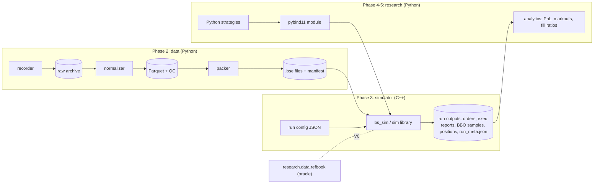
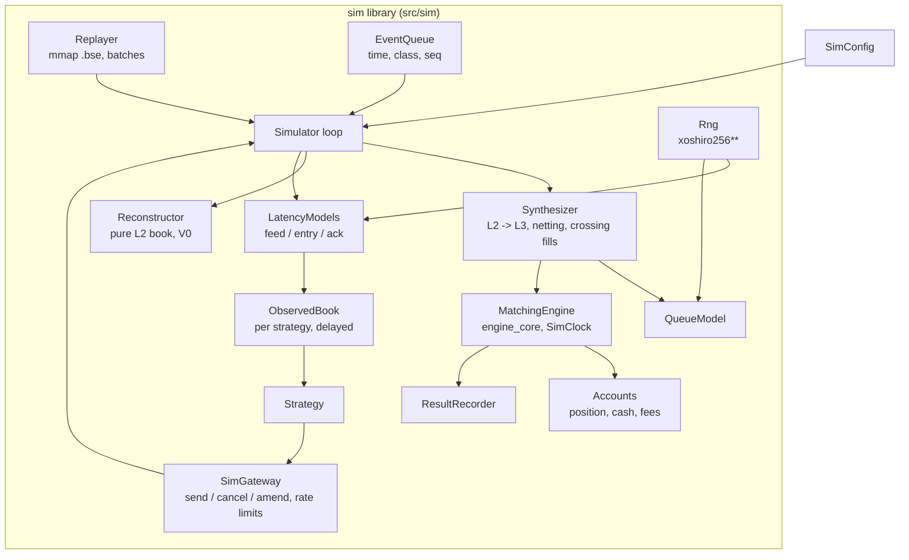
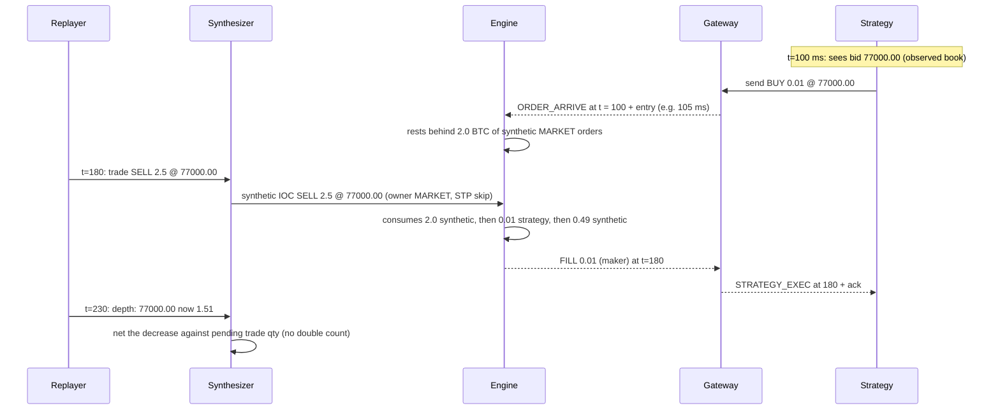

# BlockSprint Simulator: Architecture

**Status:** design of record for Phase 3. Implementation status is tracked in [§16](#16-implementation-status) and in the plan ([blocksprint_2.0_implementation_plan.md](../blocksprint_2.0_implementation_plan.md), P3.1–P3.18).
**Builds on:** the 2.0 engine core ([explanations/](../explanations/)), the data pipeline ([data_pipeline.md](data_pipeline.md)) and the design study ([backtesting_simulator_integration_guide.md](../backtesting_simulator_integration_guide.md), §7, §10, §11, §14).

---

## Contents

1. [What the simulator is](#1-what-the-simulator-is)
2. [Principles](#2-principles)
3. [System context](#3-system-context)
4. [Components](#4-components)
5. [Time, events and the main loop](#5-time-events-and-the-main-loop)
6. [Market data in: the replayer](#6-market-data-in-the-replayer)
7. [Two books: reconstruction and synthesis](#7-two-books-reconstruction-and-synthesis)
8. [The synthesizer (L2 → L3)](#8-the-synthesizer-l2--l3)
9. [Queue models](#9-queue-models)
10. [Latency models and the observed book](#10-latency-models-and-the-observed-book)
11. [Strategies, the gateway and accounts](#11-strategies-the-gateway-and-accounts)
12. [Outputs](#12-outputs)
13. [Configuration and the CLI](#13-configuration-and-the-cli)
14. [Determinism](#14-determinism)
15. [Validation](#15-validation)
16. [Implementation status](#16-implementation-status)
17. [Performance](#17-performance)
18. [Code layout](#18-code-layout)
19. [Assumptions and limitations](#19-assumptions-and-limitations)
20. [Extension points](#20-extension-points)
21. [Glossary](#21-glossary)

---

## 1. What the simulator is

An event-driven, deterministic **exchange simulator** for Binance spot. It replays recorded market data through BlockSprint's own matching engine and lets a **strategy** trade against it. The strategy sees the market late, its orders arrive late, and its passive orders wait in realistic queues.

It answers questions like:
- *If this market maker had quoted on 2026-11-05, how often would it have been filled, at what queue position, with what markouts and PnL after fees?*
- *How much worse does it get with 50 ms more latency, or with pessimistic queue assumptions?*

What makes it more than a replay of trades:

| Effect | How it's modelled |
| :--- | :--- |
| Queue position for passive orders | Historical L2 levels become **synthetic orders** in the engine's FIFO queues; strategy orders queue behind them (§8) |
| Where cancels happen in a queue | A pluggable **QueueModel**, from optimistic to pessimistic (§9) |
| Seeing the market late, reaching it late | **Feed, entry and ack latency**, and an **observed book** the strategy reads instead of the true one (§10) |
| Fills, partial fills, sweeps, fees, self-trade prevention, trading rules | The 2.0 **engine core**, unchanged: the same code as the live server |
| Gaps in the data | **Segments**: the book is flushed and the strategy is told (§6.3) |

---

## 2. Principles

1. **One source of fill truth.** Every fill, passive or aggressive, comes from `MatchingEngine`. The simulator has no fill logic of its own; it only translates market data into engine operations.
2. **Deterministic.** The same dataset and config give byte-identical outputs on Windows and Linux (§14).
3. **The strategy can't see the truth.** It reads a delayed, observed book and learns about its fills late.
4. **Conservative defaults.** At equal timestamps, market data is processed before strategy orders. Queue and latency defaults lean pessimistic. Optimistic settings exist for bounds, not for headline numbers.
5. **Validated in layers.** Reconstruction first, then synthesis with no strategy (it must reproduce historical volume), then golden scenarios with hand-computed fills (§15).
6. **Streaming.** Memory is O(book size + open orders), independent of dataset length; the replay file is memory-mapped.

---

## 3. System context



---

## 4. Components



| Component | Responsibility | File(s) | Plan |
| :--- | :--- | :--- | :--- |
| `Rng` | `SplitMix64` seeding, `xoshiro256**`, own uniform / exponential / normal / empirical distributions | `src/sim/rng.hpp` | P3.2 |
| `EventQueue` | Min-heap on `(time, priority class, insertion seq)` | `src/sim/event_queue.hpp` | P3.3 |
| `MmapFile` | Read-only memory mapping, Windows and POSIX behind one class | `src/sim/mmap_file.*` | P3.4 |
| `Replayer` | Validates the `.bse` header, iterates records, groups them into batches | `src/sim/replayer.*` | P3.4 |
| `L2Book` / `Reconstructor` | Pure level book from the data (no engine); top-N dumps for V0 | `src/sim/l2_book.hpp`, `src/sim/reconstruct.*` | P3.5 |
| `Synthesizer` | Turns data events into engine operations on synthetic `MARKET` orders | `src/sim/synthesizer.*` | P3.6 |
| `ImpactOverlay` | Holds back liquidity a strategy's taker fills took, decaying with half-life τ | `src/sim/impact.*` | P6.1 |
| `RiskGuard` | A strategy's own pre-trade limits and drawdown kill switch, before the latency pipe | `src/sim/risk_guard.*` | P6.4 |
| `QueueModel`s | Choose which synthetic quantity an unexplained decrease removes | `src/sim/queue_models.hpp` | P3.7 |
| `LatencyModel`s | Feed, entry and ack delays; FIFO per connection | `src/sim/latency_models.hpp` | P3.8 |
| `ObservedBook` | The strategy's delayed L2 view | `src/sim/observed_book.*` | P3.9 |
| `SimGateway`, `Strategy` | Strategy API, order routing, accounts | `src/sim/gateway.*`, `src/sim/strategy.hpp` | P3.10 |
| `Simulator` | The loop: owns all of the above for one run | `src/sim/simulator.*` | P3.11 |
| `SimConfig` | JSON run config | `src/sim/config.*` | P3.12 |
| `ResultRecorder` | Append-only outputs and `run_meta.json` | `src/sim/recorder.*` | P3.13 |
| `bs_sim` | CLI: `info`, `reconstruct`, `run` | `src/sim/main.cpp` | P3.14 |
| Reference strategies | `NullStrategy`, `PassiveQuoter`, `TwapTaker` | `src/sim/strategies/` | P3.15 |

---

## 5. Time, events and the main loop

### 5.1 Clocks

| Time | Meaning |
| :--- | :--- |
| `ts_local` (data) | When the recorder received an event. **The simulation's exchange time is driven by it**: the engine's `SimClock` is set to each data event's `ts_local` before it is applied |
| `ts_exch` (data) | Binance's own timestamp; used for analysis and latency calibration, not for ordering |
| Simulation time `t` | Time of the event being processed; never decreases |
| Strategy time | `t` when a strategy callback runs; the strategy reads it from `ctx.now()` |

Using `ts_local` as exchange time means the data's own network delay is already inside the replay. The extra feed latency models the delay between *that* point and the strategy, which is why it's typically small when the recorder runs near the exchange (§10).

### 5.2 Events

| Class (priority at equal time) | Event | Source |
| :--- | :--- | :--- |
| 0 `MARKET_DATA` | One data batch (a depth event, a snapshot, a trade or a gap) | Replayer |
| 1 `ORDER_ARRIVE` | A strategy request reaches the exchange | Gateway, after entry latency |
| 2 `STRATEGY_MD` | The strategy sees a book or trade update | After feed latency |
| 3 `STRATEGY_EXEC` | The strategy receives an execution report | After ack latency |
| 4 `TIMER` | A strategy timer fires | `ctx.set_timer` |

Ties are broken by `(time, class, insertion seq)`. Market data before orders at equal times is the conservative default (`tie_break: data_first`); `orders_first` exists for sensitivity runs.

### 5.3 The loop

```
load config, open .bse, seed Rng(seed), build engine (SimClock, thread_safe = false, fees, spec from header)
Q.push(next data batch)                              // only one data batch is in the queue at a time
Q.push(strategy on_start at t0)
while Q not empty and t < t_end:
    e = Q.pop(); clock.set(e.time)
    switch e.class:
      MARKET_DATA:   synthesizer.apply(batch)         // engine ops; may fill strategy orders
                     reconstructor.apply(batch)       // optional: true L2 book for checks
                     for each strategy s: Q.push(STRATEGY_MD at t + feed_latency(s))
                     Q.push(next data batch)
      ORDER_ARRIVE:  engine.submit / cancel / amend at t (exec reports -> accounts, recorder)
                     Q.push(STRATEGY_EXEC at t + ack_latency) for each report
      STRATEGY_MD:   observed_book(s).apply(update); s.on_book / on_trade / on_gap
      STRATEGY_EXEC: s.on_exec(report)
      TIMER:         s.on_timer(t)
    strategy calls inside callbacks: gateway.send/cancel/amend -> Q.push(ORDER_ARRIVE at t + entry_latency)
on_end; recorder.close (run_meta.json)
```

Fills of resting strategy orders caused by market data (a trade consumed the queue ahead) produce exec reports during the `MARKET_DATA` event; those are routed with ack latency like any other.

**As built (P3.11, `src/sim/simulator.*`).** `Simulator(bse_path, SimulatorOptions{from_ns, to_ns, warmup_ns, tie_break, queue_model, seed})` builds the engine (symbol spec from the file header, `thread_safe = false`, `report_market_data_liquidity = false`), the queue model (its RNG is the `queue` stream of the seed), the synthesizer and the gateway. Strategies are added with `add_strategy(strategy, SessionConfig)`, then `run()` (once):

| Phase | Data time | What happens |
| :--- | :--- | :--- |
| Fast-forward | before `from` | batches go to the synthesizer and straight into the observed books (`SimGateway::observe`): no latency, no callbacks. The run starts with a book already in sync, without replaying the hours before it through the strategy |
| Window | `[from, to)` | `on_start` at `from` (before any data at that time), then the event loop. Data is pushed one batch at a time at its `ts_local` |
| Warm-up | `[from, from + warmup)` | strategies get every callback but `ctx.can_trade()` is false: `send`/`cancel`/`amend`/`replace` throw `std::logic_error`. Timers are allowed |
| End | `to` | events at or after `to` are dropped (counted); `on_end` at `to` |

- Defaults: `from = 0` starts at the first batch; `to = 0` ends just after the last batch (the strategies' events at the last data time still run, later deliveries are dropped).
- `tie_break`: `EventQueue(TieBreak::ORDERS_FIRST)` swaps the first two classes, so an order arriving at the same nanosecond as data meets the old book. Tested with an IOC whose liquidity is pulled at its arrival time: data first, no fill; orders first, filled.
- A `ts_local` that goes backwards is clamped to the last data time, so simulation time never decreases.
- `set_sampler(every_ns, fn)` calls `fn(t)` at `from`, `from + every`, … before the events at that time, with the clock at `t` (the recorder's BBO and position samples, P3.13).
- `stats()`: window times, fast-forward and window batches, events by class, dropped events, whether data was left.

On the real data (BTCUSDT 2026-11-05, one strategy joining both sides with 0.001 BTC, 2 ms feed and ack, lognormal entry 3 ms):
- **02:00–03:00 UTC:** 354k batches fast-forwarded, 159k in the window, 332k events, 2,207 orders, 6,769 maker fills. Two runs gave identical results.
- **Whole day:** 2.95M batches, 6.1M events, 37 s.
- **10:00–11:00 UTC is empty:** the recorder has a gap there (the file has 2 gaps). The run correctly processes no events in that window.

### 5.4 Sequence of one passive fill



---

## 6. Market data in: the replayer

### 6.1 File

The `.bse` format (v1) is defined by the packer ([data_pipeline.md §4](data_pipeline.md), plan §14.2): a 512-byte header (magic, version, record size 40, count, first/last `ts_local`, source-manifest SHA-256, symbol, tick, lot, decimals, min notional) and 40-byte records (`ts_local`, `ts_exch`, `px` ticks, `qty` lots, `seq` low 32 bits, `kind`, `side`, `flags`).

`MmapFile` maps it read-only (`CreateFileMapping` / `MapViewOfFile` on Windows, `mmap` on POSIX). The `Replayer` rejects:
- a wrong magic;
- an unknown version or record size;
- a size that doesn't match the record count;
- non-zero reserved bytes.

### 6.2 Batches

The replayer hands out **batches**, the unit the market changes in:

| Batch | Records |
| :--- | :--- |
| Depth event | consecutive `DELTA` records up to the one flagged `LAST_IN_BATCH` |
| Snapshot | `SNAP_BEGIN`, `SNAP_LEVEL`…, `SNAP_END` |
| Trade | one `TRADE` record |
| Gap | one `GAP` record |

A batch is applied atomically, so no strategy ever sees a book in the middle of a depth event.

### 6.3 Segments and gaps

A `GAP` record means updates were lost, or the feed went silent (normalizer, data_pipeline.md). It sits at the last good update, so the book is never shown as live through an outage. The book is flushed: synthetic orders are cancelled, while strategy orders stay resting. The strategy gets `on_gap`, and nothing is matched against the book until the next snapshot re-establishes it. Trades during the gap are still replayed into the tape, but they don't consume synthetic liquidity (there is none). What the strategy's session does about it is its gap policy (§11.2, P6.5): by default it halts.

Day-start synthetic snapshots (`FLAG_SYNTHETIC_SNAPSHOT`) and resync snapshots are **reconciled** against the current synthetic book rather than replacing it, so strategy queue positions survive a day boundary (§8.5).

### 6.4 Units

Engine values are fixed-point in 1e-8 units. Conversion from the file's ticks and lots uses the header:

```
price_fixed = px  × tick_size
qty_fixed   = qty × lot_size
```

The engine's `SymbolSpec` (tick, lot, min/max qty, min notional) is built from the header too, so strategy orders are validated exactly as Binance would validate them.

---

## 7. Two books: reconstruction and synthesis

| | Reconstructor (`L2Book`) | Synthesizer + engine |
| :--- | :--- | :--- |
| Holds | price → quantity per side, exactly the data | synthetic `MARKET` orders + strategy orders in FIFO queues |
| Changed by | data only | data **and** strategy orders |
| Used for | V0 validation, reference "true market" for analytics, fast replay-only runs | everything a strategy experiences |
| Invariant | equals the Python oracle at every checkpoint | with no strategy, each level's total equals the reconstructor's |

The second invariant ties the two together: with `NullStrategy`, the synthetic book must equal the reconstructed book after every batch. That's checked continuously in debug builds, and in the V4 test.

---

## 8. The synthesizer (L2 → L3)

The engine is an L3 engine (individual orders in FIFO queues). Binance data is L2 (quantity per level plus a trade tape). The synthesizer turns each data event into engine operations on **synthetic orders** owned by `MARKET` (STP `SKIP`, `market_data_liquidity = true`: never matched with each other, exempt from symbol rules, no fees).

### 8.1 Operations

Every data level's synthetic quantity is driven towards the data's **absolute** quantity at that level. The table shows what each data event does at price p (as built, P3.6: `src/sim/synthesizer.*`):

| Data event | Synthetic operation |
| :--- | :--- |
| Trade of q at p (aggressor side from the tape) | A **tape IOC** (owner `MARKET_TAPE`, market-data liquidity, no fees) of q at limit p from the aggressor side. It consumes the queue front first, **including strategy orders that are ahead** at p, or that sit at a better price (a trade through them). The real trade consumed q of *real* liquidity at p, so whatever the synthetic queue at p didn't give (strategy orders or stale better levels took it) is then removed from the **front** of the synthetic queue at p |
| Depth: level above its synthetic quantity | The difference joins the **back** (merged into the last order when that one is synthetic too) |
| Depth: level below its synthetic quantity | The excess is an **unexplained cancel**; the QueueModel picks which synthetic quantity goes. Strategy orders are never cancelled by data |
| Level removed (0) | All synthetic quantity there goes |
| Snapshot | Every level the book had or the snapshot has is reconciled the same way (§8.5) |
| Gap | All synthetic orders are removed; until the next snapshot, depth events are ignored and trades aren't matched |

Within a batch, all decreases are applied before any increase: until every shrinking level has shrunk, an addition could meet a stale level on the other side.

### 8.2 Netting trades against depth

Binance publishes trades in real time and depth as 100 ms aggregates, so a trade's effect shows up twice: as the trade, and as a smaller level in the next depth event. Without netting, the level would shrink twice and a strategy order would jump forward.

The plan specified a `pending_trade_qty` map. Targeting the absolute quantity makes it unnecessary: the trade has already removed its q from the synthetic queue when the depth event that reflects it arrives, so the synthetic level already equals the new data quantity and nothing more is removed. Only a decrease *beyond* the trades (real cancels) reaches the QueueModel. Golden scenario (c) pins this.

```
on trade (p, q):     before = synthetic(p); tape IOC q at p; after = synthetic(p)
                     remove_from_front(p, q - (before - after))      // what others took instead
on depth (p, data):  s = synthetic(p)
                     if s > data: queue_model_cancel(p, s - data)    // real cancels only
                     if s < data: add_at_back(p, data - s)
```

If a depth event arrives *before* the trade it reflects, the decrease is treated as a cancel and the trade then removes q again; the next depth event at that price adds it back. Only queue position is affected, briefly; the level's total recovers. The `bs_sim synth` measurement below bounds how often the book differs from the data.

### 8.3 Strategy orders and the data

"Your order has no impact on others' behaviour" is the documented assumption:
- **A trade reaching a strategy order fills it:** one that is ahead in the queue at the trade price, or one at a better price (the aggressor would have hit it first). The historical trade also consumed someone else's liquidity in reality, so the same quantity is removed from the front of the synthetic queue at the trade price.
- **Crossing fill.** A synthetic order added at a price that crosses a resting strategy order (e.g. a new data bid above the strategy's ask) trades with it at the **strategy order's price**, for at most the added quantity; the rest rests. After a gap, the resync snapshot can fill strategy orders the market moved through. Golden scenarios (d) and (g).
- **Strategy taker orders** consume synthetic liquidity that the data keeps showing, because the real market never saw the fill. `impact.half_life_ms` (τ) sets how long that lasts:
  - **τ = 0 (the default):** the level is set back to the data the next time the data changes it; until then the consumed quantity stays gone.
  - **τ > 0 (P6.1, `src/sim/impact.*`):** the `ImpactOverlay` remembers, per level, what strategy taker fills took from synthetic liquidity. Each take q decays as q · 2^(−Δt/τ). When the data changes the level, it is driven to the data's quantity less what is still outstanding (in whole lots, never below 0), so the liquidity comes back gradually. Between data changes the level is left alone, as with τ = 0.
  - **Resets:** a level's entry goes when the data empties the level (new orders there owe nothing to the old take); every entry goes on a snapshot or a gap.
  - **What counts:** only liquidity a strategy took as the taker (a new order, a replace or an amend that crossed) from synthetic orders. Fills against another strategy's orders, and a strategy's resting orders being hit, don't.
  - The strategy's observed book never shows the impact: like a live feed, it shows the market's data.
  - `run_meta.json` records `simulator.impact_half_life_ms` and `synthesizer.impact_taken_qty`.
  - The decay uses floating point, so runs with τ > 0 may differ between compilers in rare last-lot roundings; the pinned determinism hashes (§14) are τ = 0 runs.

### 8.4 Invariants

Checked by `Synthesizer::check` (tests, `bs_sim synth --check-every`):
- synthetic quantity exists only at prices the data has, and never exceeds the data's quantity there;
- with no strategy orders, every data level equals its synthetic quantity after each book batch, provided every trade was confirmed by depth (random-stream tests, all five models);
- the engine's book is never crossed and passes `check_invariants`;
- every strategy fill has a historical trade or a crossing behind it.

### 8.5 Snapshot reconciliation

A snapshot (resync after a gap, or the day-start synthetic snapshot) gives the full target book. Every level of the old book and the snapshot is reconciled with the §8.1 rules: growth appends, shrinkage goes through the QueueModel, and missing levels are removed. Strategy orders keep their place.

### 8.6 Measured on real data (2026-11-05, no strategy)

`bs_sim synth` replays a file through the synthesizer into the engine and compares the engine's top 20 per side with the data after every depth event:

| | BTCUSDT | ETHUSDT |
| :--- | :--- | :--- |
| Depth events compared | 530,461 | 526,860 |
| Top 20 identical (whole book) | 99.91% | 99.97% |
| Levels identical | 99.990% | 99.998% |
| Consistency violations | 0 | 0 |
| Data crossed (synthetic dropped) | 0 | 0 |
| Throughput (MSVC, this PC) | 0.71 M records/s (30 s for the day) | 0.74 M records/s |

The remaining differences are trades not yet reflected by depth when the comparison runs (a level the tape has consumed before the data says so). Throughput is well below the replay-only figure: each change goes through the engine's order API (string IDs, shared orders, map lookups). Making it fast is P3.18.

---

## 9. Queue models

When a level shrinks without a trade, *where* in the FIFO queue did the cancel happen? It decides how fast a strategy order moves forward.

| Model | Removes from | Bias |
| :--- | :--- | :--- |
| `CancelFromBack` | newest synthetic orders first | **pessimistic**: the queue ahead only shrinks through trades |
| `CancelFromFront` | oldest first | **optimistic** |
| `ProRata` | every synthetic order in proportion to its size | neutral |
| `ProbPower(n)` | the part ahead of the strategy order with probability `a^n / (a^n + b^n)` (a = synthetic quantity ahead, b = behind) | tunable; calibrate n against live fills (V5) |
| `ProbLog` | same with `log(1 + x)` | tunable |

**Interface:**
- **Input:** the level's synthetic orders in queue order, the positions of the strategy orders among them, the quantity to remove, and the `Rng`.
- **Output:** (synthetic order, quantity) reductions, applied by the synthesizer through the engine's priority-preserving amend.

As built (P3.7, `src/sim/queue_models.hpp`; config names `cancel_from_back`, `cancel_from_front`, `pro_rata`, `prob_power:<n>`, `prob_log`):
- shares are in whole lots; `pro_rata` rounds by largest remainder, ties going to the newer order;
- `prob_power` / `prob_log` use the **expected split** (the share ahead times the cancel, rounded to a lot) rather than a random draw, as hftbacktest does, so they consume no random numbers. "Ahead" is relative to the first strategy order in the level; within each part, quantity is taken from the back. A level without a strategy order falls back to `cancel_from_back`;
- powers use `det_pow` (`rng.hpp`: `det_exp` and `det_log` from + − × ÷ only), so results are identical across compilers.

Merging adjacent synthetic orders (§8.1) changes nothing for any of these models: none of them can tell two adjacent synthetic orders from one.

Default: `CancelFromBack`. Results must be reported with a sensitivity sweep over models (V3).

---

## 10. Latency models and the observed book

| Latency | From → to | Effect |
| :--- | :--- | :--- |
| feed | exchange event (`ts_local`) → strategy sees it | decisions are made on a stale book |
| entry | strategy sends → exchange receives | orders meet the book as it is on arrival |
| ack | exchange → strategy learns of a report | the strategy keeps quoting on fills it doesn't know about yet |

Models (P3.8, `src/sim/latency_models.hpp`), configured in microseconds:

| Config | Delay |
| :--- | :--- |
| `{"model": "constant", "us": 2000}` | fixed |
| `{"model": "normal", "mean_us": 3000, "sd_us": 500}` | normal |
| `{"model": "lognormal", "median_us": 3000, "sigma": 0.4}` | median × e^(σ·N(0,1)): right-skewed, like network delay |
| `{"model": "empirical", "file": "lat.txt", "unit": "us"}` | inverse CDF of recorded values (one per line, `#` comments), interpolated |

Every model takes `min_us` (default 0) and `max_us`, and clamps to them.

**Channels.** A `LatencyChannel` is one direction of one strategy connection (feed, entry or ack). Messages on it never overtake each other: `arrival = max(send + sample, previous arrival)`, as on a TCP connection; `held_back()` counts how often that applied. Each channel draws from its **own** `Rng` stream, `stream_rng(seed, "entry/S1")` (the name hashed with FNV-1a, mixed with the seed through SplitMix64). Adding a strategy, or changing one channel's model, then leaves every other channel's samples unchanged. Streams are pinned against an independent Python implementation, and lognormal samples are pinned identically on MSVC and GCC.

**Regime latency (P6.3).** On a busy market Binance's feed and order entry slow down. `latency_regime` scales every delay drawn on the chosen channels by a multiplier that depends on the market's recent **message rate**: the data records (changed levels and trades; snapshots don't count) that reached the exchange in the last `window_ms` (default 1000), per second.
- The multiplier is piecewise linear through the `curve` points `[[rate, multiplier], ...]` (rates strictly increasing, multipliers > 0), flat below the first point and beyond the last.
- One meter per gateway, shared by every strategy: busyness is the exchange's, not a connection's. It also counts the fast-forwarded data, so it is warm at the window's start.
- `channels` picks the channels it applies to (default all three).
- The scaling follows the model's draw (`round(sample × m)`, before the no-overtaking rule), so it never shifts a channel's random samples. No curve (the default) is off, and a curve flat at 1 gives byte-identical results (tested).
- `run_meta.json` → `simulator.latency_regime`: the settings, `delays_scaled`, `mean_multiplier`, `max_multiplier` (null when off).

The rate on Nov 10 BTCUSDT, per second: median 189 records, p90 1,034, p99 2,276, max 20,040 (mean 393; 02:00-03:00 UTC was calm at 241). An example curve, until calibration (P7.6): `[[500, 1], [2000, 2], [10000, 5]]`. Over 02:00-03:00 it gave a mean multiplier of 1.12 (max 2.53); the passive quoter at home-PC latency filled 1,263 times instead of 1,344.

**Measuring delays: `bs_sim latency`.** It prints `ts_local − ts_exch` per trade or depth event. On this PC on 2026-11-05 the raw values ran from −300 ms to +1300 ms (BTCUSDT): the PC's clock drifts against Binance's by more than a second over the day, so raw values are not latencies. The command therefore also measures each message against the fastest one of its window (default 60 s) and writes those values for the empirical model:

| 2026-11-05 | p10 | p50 | p90 | p99 |
| :--- | :--- | :--- | :--- | :--- |
| BTCUSDT depth, above fastest | 0.7 ms | 1.4 ms | 4.2 ms | 107 ms |
| BTCUSDT trades, above fastest | 2.9 ms | 8.4 ms | 29 ms | 256 ms |

This is jitter above the best case; the best case itself (this PC to Binance in Tokyo) is unknown without a synchronized clock. The p99 tail mixes real stalls with clock steps inside a window. Calibrated profiles come from a VPS with a synchronized clock and from live parity (P7.6).

**Observed book** (P3.9, `src/sim/observed_book.*`): each strategy has its own L2 view. A `STRATEGY_MD` event carries the data batch itself (a pointer range into the memory-mapped file, so nothing is copied) and is delivered at `t + feed`. `ObservedBook::apply` uses the reconstruction rules, so after the same batches it equals the Reconstructor's book (tested). The strategy reads only this view: `valid()`, `best_bid()`, `best_ask()`, `qty(side, px)`, `top(side, n)`, `last_trade()`, `data_time()` (the market time it shows) and `seen_at()`; prices and quantities are in 1e-8 units. It never touches the engine's book, so it shows neither the strategy's own orders nor the impact of its taker fills, just as a live strategy sees the exchange feed.

---

## 11. Strategies, the gateway and accounts

### 11.1 Strategy interface (C++)

As built (P3.10, `src/sim/strategy.hpp`):

```cpp
class Strategy {
public:
    virtual std::string name() const = 0;
    virtual void on_start(Context&) {}
    virtual void on_book(Context&, const ObservedBook&) {}     // a depth event or snapshot reached the strategy
    virtual void on_trade(Context&, const TradeEvent&) {}      // a data trade
    virtual void on_exec(Context&, const ExecReport&) {}       // a report for one of its orders
    virtual void on_reject(Context&, const RequestReject&) {}  // a cancel / amend / replace the exchange refused
    virtual void on_timer(Context&, uint64_t timer_id) {}
    virtual void on_gap(Context&) {}                           // the book is invalid until the next snapshot
    virtual void on_end(Context&) {}
};

class Context {   // what a strategy may do and know
public:
    uint64_t now() const;  const std::string& symbol() const;  const std::string& owner() const;
    const ObservedBook& book() const;                               // delayed by feed latency
    bool can_trade() const;                                         // false during the warm-up (P3.11)
    OrderId send(Side, OrderType, Price, Quantity, StpPolicy = StpPolicy::CANCEL_MAKER);
    void cancel(const OrderId&);
    void amend(const OrderId&, Quantity new_total, std::optional<Price> = std::nullopt);
    void replace(const OrderId&, Price, Quantity);                  // same ID, back of the queue
    const Account& account() const;                                 // fills it has learned of
    const std::map<OrderId, OpenOrder>& open_orders() const;        // as it knows them
    uint64_t set_timer(uint64_t delay_ns);  void cancel_timer(uint64_t id);
};
```

`Context` is abstract so that the live platform can implement it too (L5). `on_reject` was added to the planned callbacks. A refused cancel or amend (the order already filled, an amend breaking a rule) isn't an order event, and reporting it as one would break the execution-report contract (one terminal report per order). Python strategies implement the same callbacks through pybind11 trampolines (Phase 4).

### 11.2 Gateway

`SimGateway` (`src/sim/gateway.*`) holds one **session** per strategy: its `Context`, its three latency channels (`feed/<owner>`, `entry/<owner>`, `ack/<owner>` RNG streams), what the strategy knows, and what the exchange knows about it. It pushes events onto the simulator's queue; the loop (P3.11) hands them back through `dispatch()`.

**Strategy side.**
- `send` assigns the ID `<owner>-<n>`, records the order as `PENDING_NEW` and queues an `ORDER_ARRIVE` at entry latency. `cancel` and `replace` mark the order `PENDING_CANCEL` / `PENDING_REPLACE`.
- Reports and rejects arrive after ack latency, and only then change the strategy's open orders and account. At equal times a data event is delivered before a report (event class order), so a strategy that is picked off sees the trade, then its fill.

**RiskGuard (P6.4, `src/sim/risk_guard.*`).** Each session can carry the strategy's own pre-trade limits (config `risk`, every limit off at 0). They are checked in the `Context`, before a request enters the entry latency, against what the strategy knows: its account, its open orders, its observed book.
- `max_position`: the position if this order and every other open order on its side filled (a replace or amend replaces its order's quantity) → `risk_position`.
- `max_order_notional`: price × quantity of one order; a MARKET order at the observed best opposite price → `risk_notional`.
- `max_open_orders`: open and pending orders, for a new order (a replace isn't one) → `risk_open_orders`.
- `max_drawdown`, the kill switch: after every book update and fill the strategy sees, its PnL at the observed mid (else the last trade) is compared with its running high, which starts at 0. When it falls `max_drawdown` below it, every open order is cancelled (through the normal latency) and from then on only orders that reduce the position pass: against it, and not past flat counting the open orders on their side. Anything else → `risk_killed`.
- A refused new order gets a `REJECTED` report, an amend or replace an `on_reject`, both **at once** (no latency; the order is recorded as sent with `arrive_ns = sent_ns`). Cancels always pass, and so does an amend that doesn't increase quantity or move the price.
- The four reasons are new in `ExecReason`. `run_meta.json` per session: `risk_rejects`, `risk_killed_at` (0: never), `max_drawdown` (the largest fall seen, when the kill switch is set). `risk.limits()` counts them as `rejects_risk_guard`.

**Gap policy (P6.5, config `gap_policy`).** What a session does when its feed reports lost updates. It acts when the strategy sees the `GAP` (after feed latency, as a feed handler noticing a sequence break would), before `on_gap`; it ends when a snapshot makes the strategy's book valid again, before that snapshot's `on_book`.
- `halt` (default): every open order is cancelled (through the normal latency), and new orders, replaces and amends that increase quantity or move the price are refused at once with `gap_halted` until the resync. Cancels pass.
- `flatten`: `halt`, and at the resync a MARKET order closes the position the strategy knows. It is sent at the resync, not at the gap: during a gap the simulator doesn't know the market, so nothing could price it. The RiskGuard doesn't check it (it is the risk system's own order).
- `continue`: nothing; the strategy's `on_gap` decides. For testing, and for the golden scenarios, which script every request.
- A strategy that handles gaps itself (the PassiveQuoter cancels its quotes on `on_gap` and quotes nothing while the book is invalid) runs the same under `halt` and `continue`: the policy's cancels go first and the strategy finds its orders already pending cancel.
- `run_meta.json` per session: `gap_halts`, `gap_rejects`, `halted_ms` (up to the end if still halted), `flatten_orders`. `risk.limits()` counts the refusals as `rejects_gap_halt`. On Nov 10, BTCUSDT loses updates three times (14:31:38, resync after 13.7 s; 15:44:15, 13.0 s; 15:44:36, 22.7 s); the committed fixture has no gap.

**Exchange side** (at the request's arrival time):
- **Request weight (P6.2):** every request pays its Binance REST weight against `limits.request_weight_per_min` (default 6000, in fixed UTC minutes, like the `X-MBX-USED-WEIGHT-1M` counter): new order 1, cancel 1, cancel-replace 1, amend keep-priority 4. A request that doesn't fit is refused before anything else and charges nothing: a new order gets a `REJECTED` report (`rate_limit`), a cancel / amend / replace an `on_reject` with reason `rate_limit`. It is counted in the session's `weight_limited`. Weight is per session (one connection), not per IP.
- **New orders and replaces** count against the session's limits: orders per 10 s (sliding window, default 100) and per day (UTC, default 200,000). An order over a limit gets a `REJECTED` report (`rate_limit`) without reaching the engine. A new order also needs a free slot: open orders per symbol (default 200), else `REJECTED` (`max_open_orders`). Both reasons are new in `ExecReason`. The gateway's own rejects carry `seq` 0.
- A **replace** whose order is no longer open is refused (`on_reject`) and sends no new order, like Binance's cancel-replace with `STOP_ON_FAILURE`.
- A **cancel or amend** of an order that isn't open is refused through `on_reject`, and so is an amend the engine rejects (e.g. off the tick grid). The order stays as it was.
- **Routing:** the gateway is the engine's execution-report callback, and sends every report to the session that owns the order, whatever caused it: the strategy's own request, a data trade (the tape IOC), a crossing, or another strategy's order. The engine runs with `report_market_data_liquidity = false`, so reports for synthetic orders are never even built.
- `set_listener(GatewayListener*)` shows every request, report and refused request when it is sent, with its delivery time (the result recorder, P3.13).

### 11.3 Accounts

Each session has **two** `Account`s:
- the **exchange's**, updated when a fill happens: this is the run's result;
- the **strategy's**, updated when the fill report reaches it: this is what `ctx.account()` returns.

The plan had the strategy read the exchange-time account. That would let it learn of a fill before its report arrives, which is look-ahead, so the two are kept apart. Golden (e) checks the gap: between the fill (22 ms) and its report (27 ms) the exchange shows the position and the strategy doesn't.

An account holds:
- `position` (base), and `cash` (quote: + sells, − buys);
- `fees` (from the reports' `fee`; negative for rebates);
- base and quote volume;
- fill, maker and taker counts;
- `pnl(mark) = cash + position × mark − fees`.

Notionals use `notional_for` (`fees.hpp`), exact for every Binance spot symbol.

### 11.4 Reference strategies (P3.15)

In `src/sim/strategies/`, registered by name for `strategy.name`:

| Name | What it does | Params (default) |
| :--- | :--- | :--- |
| `null` | never trades | none |
| `passive_quoter` | joins the observed best bid and ask with one post-only quote per side, re-quoting every `refresh_ms` | `size` ("0.001"), `refresh_ms` (500), `max_position` ("0.01"), `post_only` (true), `requote_always` (false: replace only a quote whose price moved) |
| `twap_taker` | buys or sells `quantity` in `slices` equal MARKET orders over `duration_ms` | `side` ("buy"), `quantity` ("0.01"), `slices` (10), `duration_ms` (600000) |

**PassiveQuoter**, every refresh:
- a quote at another price than the observed best is replaced (losing its queue place, as on Binance);
- a side whose next fill would take the position past `max_position` isn't quoted, and its quote is cancelled;
- while the book is invalid (a gap) both quotes are cancelled, immediately on `on_gap`;
- a quote with a request in flight is left alone until the answer comes.

It reacts only to its timer and to gaps, so it sends at most 2 requests per refresh.

**TwapTaker:**
- The schedule starts when the strategy may first trade (after the warm-up); slice *k* is due at start + *k* × duration / slices.
- By slice *k* the target is quantity × *k* / slices, rounded down to the lot, and the last slice takes the rest. Each slice sends the target minus what is filled or in flight.
- So quantity a MARKET order couldn't fill (no liquidity, a reject) is retried with the next slice, and after the last slice every interval until filled. Nothing is sent while the book is invalid.

**On the real data** (`configs/sim/example_btc.json`, BTCUSDT 2026-11-05 02:00–08:00, Tokyo latency preset, 0.1% fees):

| | `passive_quoter` (0.001, 500 ms) | `twap_taker` (buy 1 BTC, 60 slices, 1 h) |
| :--- | :--- | :--- |
| Orders | 3,847 new, 4,079 replaces, 4 cancels; 3 refused, 0 rate-limited | 60 MARKET |
| Fills | 17,093, all maker; 3.83 BTC traded | 60 taker; 1.0 BTC |
| Result at the 08:00 mark | PnL −346.18 USDT, of which fees 308.76 | PnL −403.05 USDT, fees 80.68 |
| Wall time | 25–28 s (including 2 h fast-forward) | 24 s |

The quoter's result is what a naive join-the-best quoter should show at a 0.1% maker fee: the fees are most of the loss. The MSVC and GCC builds give the same output hash for the quoter run (`1d7b134e…`), and a second run gives it again.

**Gateway fix found by the tests:** cancel and amend requests didn't carry their order's side and type, so `orders.csv` showed every cancel as a buy. They now take them from the order, as replace already did.

### 11.5 Golden scenario (e): latency picks off a stale quote

5 ms feed, entry and ack. Data:
- t=0: snapshot, bid 100.00 × 5, ask 100.10 × 2;
- t=20: the asks at 100.10 go, 3 lots appear at 100.20;
- t=22: a buyer lifts the data's best ask, 100.20, for 1 lot.

The strategy joins the best ask with 1 lot and cancels when it sees its ask below the market:

| ms | 5 ms each way | zero latency |
| :--- | :--- | :--- |
| 0 | | sees the book, sends; ACK |
| 5 / 10 / 15 | sees the book and sends / order rests behind 2 lots / ACK | |
| 20 | the asks ahead are pulled: the order is alone and stale | sees it, cancels: CANCELLED |
| 22 | the buyer's tape IOC takes our cheaper ask first: **filled at 100.10** | the buyer takes 1 of the 3 synthetic lots |
| 25 | sees the t=20 book, sends a cancel | |
| 27 | sees the trade, then the fill | |
| 30 / 35 | cancel arrives: order not open / `reject cancel` | |

---

## 12. Outputs

One directory per run:

| File | Content |
| :--- | :--- |
| `orders.csv` | every strategy request: send time, arrival time, id, side, type, price, qty |
| `exec_reports.csv` | every report for strategy orders, at exchange time and at strategy receive time |
| `bbo_samples.csv` | true and observed BBO every Δt (configurable) |
| `positions.csv` | position, cash, fees and mark-to-market PnL every Δt |
| `run_meta.json` | the fully resolved config, its hash, the dataset manifest hash, the `.bse` SHA-256s, the git SHA, the seed, event counts and wall time |
| `output_hash` | a canonical hash over all outputs (for V1) |

CSV comes first because it's simple and diffable; Python converts it to Parquet (Phase 4). The record layouts are canonical, so the output hash is stable.

**As built (P3.13, `src/sim/recorder.*`, `src/sim/sha256.hpp`).** `ResultRecorder(sim, dir, sample_ns)` attaches before `run()`. It becomes the gateway's `GatewayListener` (which replaced P3.10's report callback: it sees each request, report and refused request when it is sent, with its delivery time) and the simulator's sampler. `finish(meta)` after the run writes the final positions, hashes the files and writes `run_meta.json`.

| File | One row per | Columns |
| :--- | :--- | :--- |
| `orders.csv` | request, when sent | `sent_ns, arrive_ns, owner, request` (new/cancel/amend/replace)`, order_id, side, order_type, price, quantity, new_price, stp` |
| `exec_reports.csv` | report for a strategy order | `exchange_ns, deliver_ns, owner, seq, order_id, type, reason, side, order_type, price, quantity, last_px, last_qty, cum_qty, leaves_qty, liquidity, fee, cum_fee` |
| `request_rejects.csv` | refused cancel/amend/replace | `exchange_ns, deliver_ns, owner, request, order_id, reason, text` |
| `bbo_samples.csv` | sample × strategy | `ts_ns, owner`, then bid/ask price and quantity three times: the data (`data_*`), the engine book with strategy orders (`book_*`), what the strategy sees (`seen_*`), and `seen_data_ns` (the data time of its newest batch) |
| `positions.csv` | sample × strategy, and the end | `ts_ns, owner, position, cash, fees, mark, pnl, fills, maker_fills, taker_fills, open_orders, base_volume, quote_volume` (exchange-time account) |

- **Formats:** times are ns; prices, quantities and money are exact decimals.
- **Mark:** the data's mid (else the engine book's, else the last one).
- **Requests still in flight at the end are recorded:** each is written when sent, with its arrival time.
- **`run_meta.json`** holds:
  - the window, simulator options and the `.bse` header (with its source manifest hash);
  - event counts by class, synthesizer counts;
  - per strategy: both accounts, its gateway counters and its open orders;
  - per output file: rows and SHA-256, and the `output_hash`;
  - the caller's `meta`. `run_inputs(RunConfig)` supplies the resolved config, its SHA-256, the data file, its manifest and the manifest's SHA-256; `bs_sim run` (P3.14) will add the git SHA and wall time.
- **`output_hash`** is the SHA-256 over the five CSVs' names and hashes. Everything except caller-supplied wall time is a function of the inputs.
- **Tested:**
  - golden (e) row by row: the cancel at 25 → 30 refused at 35, the fill at 22 delivered at 27, the samples, and the end position −0.001 at cash 0.1001;
  - SHA-256 against the FIPS vectors;
  - the same seed gives identical files and hash, another seed a different hash.
- **On real data** (BTCUSDT 02:00–03:00 UTC, the two-sided quoter, 1 s samples): 3,676 requests, 10,049 reports, 396 refused requests, 3,600 samples, about 2.5 MB. Identical output hash twice, and the recorder adds under 2% to the run time.

**In memory (P4.5).** `recorder.keep_tables()` (or `run_simulation(..., keep_tables = true)`) also keeps every row as a fixed-width record: `OrderRow`, `ReportRow`, `RejectRow`, `BboRow`, `PositionRow` in `ResultTables`.
- Values are raw: ns, 1e-8 fixed and enum codes. Owners and order IDs are interned.
- A field the CSV leaves empty holds 0.
- Python views these as numpy structured arrays without copying, and `research/sim/results.py` turns them into polars DataFrames equal to the CSVs (`docs/dev_setup.md`).
- The CSVs and the output hash are unchanged.

---

## 13. Configuration and the CLI

### 13.1 Run config (JSON)

```json
{
  "dataset": "data/packed/binance_spot_btc_eth_1105_1107",
  "symbol": "BTCUSDT",
  "window": {"from": "2026-11-05T00:00:00Z", "to": "2026-11-05T06:00:00Z", "warmup_s": 60},
  "seed": 42,
  "tie_break": "data_first",
  "latency": {"feed": {"model": "constant", "us": 2000}, "entry": {"model": "lognormal", "median_us": 3000, "sigma": 0.4},
              "ack": {"model": "constant", "us": 2000}},
  "latency_regime": {"window_ms": 1000, "curve": [[500, 1], [2000, 2], [10000, 5]], "channels": ["feed", "entry", "ack"]},
  "queue_model": {"model": "cancel_from_back"},
  "impact": {"half_life_ms": 0},
  "fees": {"maker_rate": "0.001", "taker_rate": "0.001"},
  "limits": {"orders_per_10s": 100, "open_orders": 200},
  "risk": {"max_position": "0.01", "max_order_notional": "1000", "max_open_orders": 4, "max_drawdown": "50"},
  "gap_policy": "halt",
  "strategy": {"name": "passive_quoter", "params": {"size": "0.001", "refresh_ms": 500}},
  "output": {"dir": "results/run_001", "sample_ms": 1000}
}
```

**Precedence:** CLI flags > config file > named presets > defaults. The resolved config is always written to `run_meta.json`.

**As built (P3.12, `src/sim/config.*`; example in `configs/sim/example_btc.json`).** `load_run_config(path, overrides)` returns a `RunConfig`: the resolved JSON, the `.bse` path, symbol and SHA-256, `SimulatorOptions`, the strategy's name, params and owner, its three latency models, fees and limits, the output directory and sample interval. `session()` turns it into the gateway's `SessionConfig`.

- **Layers:** defaults < the preset named by `latency_preset` < the file < `--set key.path=value` overrides. The file plus overrides choose the preset, so `--set latency_preset=zero` works.
  - Objects merge key by key, so `--set latency.entry.median_us=2500` changes one parameter of the preset's model. An empty object clears: `--set strategy.params={}`.
  - A latency or queue model object that names its `model` replaces the previous model whole. A file's `{"model": "constant", "us": 500}` doesn't inherit a preset's `sigma`.
  - An override value is parsed as JSON when it is valid JSON, otherwise taken as a string (times, names, paths). `null` is taken as the string "null" (the `null` strategy).
- **Unknown keys are errors** (`unknown key 'window.form'`), including inside latency models. Every other error names its key too.
- **Defaults:**
  - fees 0.1% / 0.1% (Binance regular); limits 100 per 10 s, 200,000 per day, 200 open, request weight 6000 per minute; no risk limits; gap policy halt;
  - `cancel_from_back`, `data_first`, seed 0, the whole file, no warm-up;
  - owner `S1`, output `results/run` sampled every 1000 ms.
- **What a run must name:** a `dataset`, a `strategy.name`, and latency (a preset or all three models). Optimistic zero latency is never a silent default.
- **Latency presets:**

  | Preset | Feed | Entry and ack |
  | :--- | :--- | :--- |
  | `zero` | 0 | 0 |
  | `binance_spot_tokyo_vps` | 100 µs | lognormal, median 3 ms, σ 0.3, min 1 ms |
  | `binance_spot_home_pc` | 100 µs | lognormal, median 100 ms, σ 0.3, min 40 ms |

  The two Binance presets are placeholders until calibration (P7.6). The home PC feed is small because `ts_local` already contains this PC's network delay.
- **Dataset:** a packed dataset directory (its `manifest.json` gives the symbol's file and SHA-256; `symbol` is required when there are several) or a `.bse` file. The header is validated, and its symbol must match `symbol`.
- **Times:** ns, `"YYYY-MM-DD"` (midnight UTC) or `"YYYY-MM-DDTHH:MM:SS[.fffffffff]Z"`. The resolved config holds them at full ns precision, and it resolves to itself (tested), so a run's `run_meta.json` can be run again as is.
- **Fee rates** are exact decimal strings (or numbers); negative rates are rebates.
- **Impact:** `impact.half_life_ms` is τ ≥ 0 (§8.3); 0 is the default.
- **Queue models:** a name (`"prob_power:2"`) or `{"model": "prob_power", "n": 2}`.

### 13.2 `bs_sim`

| Command | Purpose |
| :--- | :--- |
| `bs_sim info FILE.bse` | header, record counts by kind, time range, batches, segments |
| `bs_sim reconstruct FILE.bse [--top N] [--every K] [--at TS]... [--out dump.csv]` | replay data only and dump top-N levels at checkpoints (V0) |
| `bs_sim synth FILE.bse [--model M] [--compare-every K] [--top N] [--check-every K]` | replay through the synthesizer into the engine with no strategy; compare its top N with the data, check invariants (§8.6) |
| `bs_sim latency FILE.bse [--kind trade\|depth] [--window-s S] [--out VALUES.txt]` | `ts_local − ts_exch` percentiles, raw and above the fastest of each window; writes values for the empirical latency model (§10) |
| `bs_sim config CONFIG.json [--set key=value]...` | print the resolved config, plus the data file, window and strategy; exits 1 with the key on an error |
| `bs_sim run CONFIG.json [--set key=value]... [--out DIR] [--force]` | a full simulation; writes the results directory (§12) and prints a summary |
| `bs_sim slice FILE.bse --from T --to T --out OUT.bse` | a self-contained piece of a file: the book at `--from` as one snapshot, then every record until `--to` (test fixtures, P3.17) |

**`bs_sim run` as built (P3.14):**
1. Resolves the config (§13.1). `--out DIR` is `--set output.dir=DIR`.
2. Builds the strategy from the registry (`src/sim/strategies/registry.*`). An unknown name or parameter is an error naming the key, before any data is read.
3. Refuses a directory that already holds a run's `run_meta.json`, unless `--force`.
4. Runs the simulator with the recorder attached.
5. Adds to `run_meta.json`:
   - `run_inputs` (config, hashes);
   - `git` (the commit of the source tree, via `git -C`, and whether tracked files were modified);
   - `run` (command, overrides, wall time, batches per second).
6. Prints the window, data, orders, fills and the result (position, cash, fees, PnL at the final mark) and the output hash. Exit code 1 on any error.

**Strategy registry:**
- `make_strategy(name, params)`. P3.14 registers `null`, which never trades: the full loop with no orders, for data checks and benchmarks. P3.15 adds `passive_quoter` and `twap_taker` (§11.4).
- Parameters are read through `StrategyParams` (`strategies/params.hpp`): decimals, integers, milliseconds, strings, flags, each with a default. A key no getter asked for is an error: `strategy.params.size: unknown parameter for 'null' (it takes none)`.

**Override fixes found while testing `bs_sim run`:**
- `--set strategy.name=null` used to parse as JSON `null`, so a JSON `null` value is now taken as the string `"null"`.
- `--set strategy.params={}` used to merge into the existing params and change nothing, so an empty object now clears.

**On the real data:** BTCUSDT 02:00–03:00 UTC with `null`, 1 s samples: 6.0–6.6 s, including fast-forwarding the 2 hours before. The MSVC and GCC builds of `bs_sim` give the **same output hash** (`805de2b3…`). This is a first cross-compiler check, ahead of P3.17.

---

## 14. Determinism

The rules, enforced in review and by tests:
1. **No hidden sources of time or randomness:**
   - no wall clock in `core/` or `sim/`;
   - all randomness from the run's seeded `Rng`;
   - no `std::random_device`, `rand()` or `std::*_distribution` (their output differs between MSVC and libstdc++).
2. **No iteration over unordered containers where order matters.**
3. **Every tie has an explicit tie-breaker** (insertion sequence).
4. **No floating point in matching or accounting.** Floats only in models (latency samples, queue probabilities), seeded and produced by the custom `Rng`.
5. **Outputs in canonical order,** hashed (`output_hash`).

**Tests:** the same run twice in one process, and on MSVC/Windows vs GCC/Linux in CI, gives identical hashes (P3.17, gate V1).

**As built (P3.17):** `tests/sim/determinism_test.cpp` runs three scenarios on a committed one-minute slice of real data, `tests/sim/data/btcusdt_2026-11-05_0200_1m.bse` (BTCUSDT 02:00–02:01 UTC, 29,513 records, 1.1 MB). It goes through `run_simulation` (`src/sim/run.*`), the same call `bs_sim run` makes. Each output hash must equal the value pinned in the test:

| Scenario | Exercises | Fills |
| :--- | :--- | :--- |
| quoter, random latency, `prob_power:2`, seed 7 | lognormal and normal latency, a random queue model, the quoter's replace path | 69 |
| TWAP seller, home-PC preset, `prob_log`, seed 11 | warm-up, `orders_first`, MARKET orders | 12 |
| quoter, Tokyo preset, `pro_rata`, seed 3 | a window inside the file (fast-forward), plain LIMIT quotes | 82 |

More checks:
- the fixture's SHA-256 is pinned;
- the same run twice in one process gives the same hash;
- **a different seed gives a different hash**, so the randomness reaches the results and the pinned hashes can't be trivially stable;
- `slice` itself is tested on a hand-built stream with a gap.

MSVC (Windows) and GCC (MinGW, Windows) gave identical hashes before they were pinned. CI runs the suite on Windows/MSVC and Linux/GCC, so both must reproduce them; a "Simulator determinism (V1)" step prints the hashes in each job's log.

When a change is meant to alter results, the failing test prints the new hashes; update them and say why in the commit. A hash that changes on one platform only is a determinism bug.

The fixture comes from `bs_sim slice` (§13.2), which writes the book at `--from` as one synthetic snapshot and then every record up to `--to`. A slice that starts where the book is unknown (before the first snapshot, or in a gap) starts at the data's own next snapshot, or is refused if a depth event comes first. On the real file, the slice rebuilds the full book (about 9,800 levels) identically at 4 times in the window. `.gitattributes` marks `*.bse` as binary.

---

## 15. Validation

| Gate | Test | Pass |
| :--- | :--- | :--- |
| **V0** | Reconstruction vs the Python oracle (`research.data.refbook`) at checkpoints across a full day; transitively vs Binance's REST snapshots, which QC already matched to the oracle | top-N identical at every checkpoint |
| **V1** | Determinism | identical output hashes across runs and platforms |
| **V2** | Engine invariants and fuzz under synthetic load | never crossed; quantities conserved |
| **V3** | Bounds: zero latency + `CancelFromFront` vs high latency + `CancelFromBack` | realistic **filled volume** falls between them (PnL doesn't have to: see below) |
| **V4** | `NullStrategy`: synthetic trade volume per price equals historical volume; synthetic book equals the reconstructed book after every batch | exact on consistent data; measured on real data (see below) |
| **V5** | Live parity: paper trading on the live mirror vs the simulator on the same period | fill ratio, markouts and slippage within tolerance; calibrates queue and latency models |

**V0 result (2026-11-06):** `bs_sim reconstruct` on 2026-11-05 matched the oracle at every checkpoint:
- BTCUSDT: 108 of 108, top 20 per side, across 530,466 book batches including 2 gaps and their resyncs;
- ETHUSDT: 264 of 264.

A one-lot change in a dump is caught (negative control). The full day replayed at 3.4–4.6 M records/s with `std::map` levels. Since P3.18's windowed L2 book it replays at 16.3 M records/s (`docs/baseline/bench_sim.md`).

**V3 result (2026-11-10).** `PassiveQuoter` (0.001, 500 ms) on BTCUSDT 2026-11-05 02:00–08:00:

| Case | Fills | Volume | Fees | PnL | PnL before fees |
| :--- | ---: | ---: | ---: | ---: | ---: |
| best: zero latency, `cancel_from_front` | 24,891 | 6.47 | 521 | −563 | −42 |
| realistic: Tokyo preset, `pro_rata` | 14,055 | 4.56 | 367 | −406 | −38 |
| worst: home-PC preset, `cancel_from_back` | 13,866 | 3.25 | 262 | −295 | −33 |

- **Filled volume** is ordered best ≥ realistic ≥ worst.
- **PnL is ordered the other way, even before fees.** The quoter has no edge: it joins the best price whatever is coming, so its fills are adversely selected, and optimistic assumptions just give it more of them. A PnL bound holds only for a strategy that earns per fill, so the gate is on filled volume.
- **Fill count isn't a good measure either.** On the test slice, home-PC latency with `pro_rata` gives fewer but larger partial fills than with `cancel_from_back`, for the same volume.

The test (`tests/sim/determinism_test.cpp`) runs the 3 latency presets × 3 queue models on the committed one-minute slice. Filled volume must never increase towards the worst case along either axis, and must fall strictly from best through realistic (Tokyo, `pro_rata`) to worst.

**V4 result (2026-11-10).** `bs_sim synth` reports, per data trade of quantity *q* at price *P*, whether the tape took exactly *q* of synthetic liquidity at *P*. If not, it records what was taken at better prices ("through": levels the data still showed) and what wasn't there ("short").
- **On consistent streams** (the random-stream test: trades at the best price, never more than the level, followed by the depth event that reflects them) it is exact under all five queue models: every synced trade, nothing through, nothing short. The test asserts this.
- **On real data**, Nov 5–7:

  | | BTCUSDT | ETHUSDT |
  | :--- | ---: | ---: |
  | synced trades exact | 51.4% | 56.6% |
  | volume through better levels | 11.6% | 14.3% |
  | volume short (not in the book) | 11.0% | 10.2% |

  The likely cause is the data, not the synthesizer: Binance's depth stream is one update per 100 ms, while every trade arrives as it happens. Orders placed and filled within an interval never appear in the depth data (short), and orders cancelled within one stay visible until the next update (through). Iceberg orders add to short. This explanation hasn't been verified trade by trade. It bounds how exactly any L2-based simulator can place historical trades. The synthesizer's handling (front removals after a trade, levels set to the data at each update) keeps the book equal to the data after every depth event (99.91% of BTCUSDT books identical in the top 20, §8.6).

**Golden scenarios (P3.16):** hand-written tiny `.bse` fixtures, each with expected fills computed by hand *before* the code:
- the queue ahead is consumed by trades;
- cancels ahead, under each queue model;
- trade/depth netting;
- a crossing fill;
- latency making a quote stale and getting it picked off;
- an IOC through 3 levels with fees;
- gap handling.

**As built (P3.16):** the scenarios first ran at the synthesizer level (P3.6) and the gateway level (P3.10). P3.16 runs them **end to end**: one text file per scenario in `tests/sim/golden/`, which the runner (`tests/sim/golden_test.cpp`) writes to a `.bse` file and runs through the whole `Simulator` (replayer, synthesizer, engine, latency, gateway, a scripted strategy).

A file holds:
- the market, as data lines (`data 5 depth bid 100.00 0.012`, `data 6 trade sell 100.00 0.003`, `data 3 gap`);
- the strategy's actions at fixed times (`send 2 o1 buy limit 100.00 0.002`, `cancel 25 o1`, `replace`, `amend`);
- the setup (`latency 5`, `queue <models>`, `fees`, `end`);
- what must come out, worked out by hand in the file's comments: every report and refused request with its exchange and delivery times (`expect 8 9 o1 fill 100.00 0.002 maker fee 0.0002 leaves 0.000`), the engine's queue at a price after a given time (`queue_at 7 bid 100.00 = syn 0.007 | S1 0.002 | syn 0.002`), and the final account.

A file can run under several queue models, with lines for one model only (`expect@pro_rata ...`).

| File | Scenario |
| :--- | :--- |
| `a_queue_ahead` | trades consume the queue ahead, then fill the strategy's bid |
| `b_cancels_ahead` | unexplained cancels under `cancel_from_back`, `cancel_from_front`, `pro_rata`, then a trade |
| `c_trade_depth_netting` | a trade and the depth event reflecting it are not counted twice |
| `d_crossing_fill` | the data moves through a resting ask: filled at the order's price |
| `e_stale_quote`, `e_stale_quote_zero_latency` | 5 ms latency gets a stale ask picked off and its cancel refused; with no latency it's cancelled in time |
| `f_ioc_three_levels` | an IOC through 3 levels, taker fee on each, the remainder cancelled |
| `g_gap` | a gap flushes the synthetic book; the resync snapshot fills the bid the market moved through |

All 8 matched their hand-computed results on the first run, on MSVC and GCC. A deliberately wrong expectation fails with the actual and expected lines side by side. The probabilistic queue models (`prob_power`, `prob_log`) are random by design; their hand-computed cases stay at the synthesizer level, with a fixed generator.

---

## 16. Implementation status

| Plan | Item | Status |
| :--- | :--- | :--- |
| P3.1 | `sim` library, `bs_sim`, `sim_tests` targets | done |
| P3.2 | Deterministic RNG | done |
| P3.3 | EventQueue | done |
| P3.4 | `.bse` reader (mmap) | done |
| P3.5 | Reconstruction mode + V0 vs oracle | done |
| P3.6 | Synthesizer (L2 → L3), golden scenarios (a), (b), (c), (d), (f), (g) at engine level | done |
| P3.7 | Queue models (five) | done |
| P3.8 | Latency models, FIFO channels, per-channel RNG streams | done |
| P3.9 | Observed book | done |
| P3.14 | `bs_sim info`, `reconstruct`, `synth`, `latency`, `config`, `run`; strategy registry (`null`) | done |
| P3.10 | Strategy interface, gateway (latency, Binance limits, routing), two accounts per strategy; golden (e) | done |
| P3.11 | Simulator loop: fast-forward, window, warm-up, tie-break, sampler | done |
| P3.12 | Run config: layers, latency presets, overrides, dataset resolution; `bs_sim config` | done |
| P3.13 | Result recorder: five CSVs, run_meta.json, output hash (SHA-256) | done |
| P3.15 | Reference strategies: `passive_quoter`, `twap_taker` (§11.4) | done |
| P3.16 | Golden scenarios end to end: `tests/sim/golden/*.golden` through the whole simulator | done |
| P3.17 | Cross-platform determinism: pinned output hashes on a committed slice, run in CI on MSVC and GCC (§14) | done |
| P3.18 | `bench_sim`; windowed L2 book; one queue read per changed level. Replay-only 16.3 M records/s; a `PassiveQuoter` day in 25 s (`docs/baseline/bench_sim.md`) | done |
| P6.1 | Impact overlay: taker fills' consumed liquidity decays with half-life τ (§8.3) | done |
| P6.2 | Rate limits: request weight per minute on top of the P3.10 order-count limits (§11) | done |
| P6.3 | Regime latency: delays scaled by the market's recent message rate (§10) | done |
| P6.4 | RiskGuard: position, order notional and open-order limits and a drawdown kill switch, before the latency pipe (§11.2) | done |
| P6.5 | Gap policies: halt (default), flatten at the resync, continue (§11.2) | done |

---

## 17. Performance

| Target (plan) | Path |
| :--- | :--- |
| Replay-only ≥ 5 M events/s | Reconstruction runs over memory-mapped records with no allocation per record; the level book is a sorted structure keyed by tick |
| One BTCUSDT day with `PassiveQuoter` < 30 s | The synthesizer touches only levels that change. Synthetic orders use the engine's intrusive queues and per-book pool (P1.18). Strategy callbacks are throttled |

A busy day is about 20 M records (Nov 5: 21.6 M for BTCUSDT).

---

## 18. Code layout

```
src/sim/
  rng.hpp                 SplitMix64, Xoshiro256ss, distributions
  event_queue.hpp         EventQueue<T>
  mmap_file.hpp/.cpp      read-only file mapping
  bse.hpp                 .bse constants, header and record structs
  replayer.hpp/.cpp       header validation, record and batch iteration
  l2_book.hpp             pure L2 book (ticks/lots): a dense window around the best price + a map for far levels (P3.18)
  reconstruct.hpp/.cpp    reconstruction mode: checkpoints, top-N dumps; slice (P3.17)
  queue_models.hpp        five cancel-placement models (P3.7)
  synthesizer.hpp/.cpp    L2 -> L3 into the engine; consistency checks (P3.6)
  impact.hpp/.cpp         ImpactOverlay: taker fills' consumed liquidity, decaying with half-life tau (P6.1)
  latency_models.hpp      constant/normal/lognormal/empirical, FIFO channels, stream_rng (P3.8)
  observed_book.hpp/.cpp  the strategy's delayed L2 view (P3.9)
  strategy.hpp            Strategy, Context, Account, OpenOrder, RequestReject (P3.10)
  gateway.hpp/.cpp        sessions: latency channels, limits, routing, accounts (P3.10)
  risk_guard.hpp/.cpp     RiskGuard: a strategy's pre-trade limits and drawdown kill switch (P6.4)
  simulator.hpp/.cpp      the event loop: fast-forward, window, warm-up, tie-break, sampler (P3.11)
  config.hpp/.cpp         run config: defaults, latency presets, overrides, dataset, times (P3.12)
  recorder.hpp/.cpp       CSV outputs, run_meta.json, output hash; run_inputs (P3.13)
  run.hpp/.cpp            run_simulation: one run from a resolved config, as bs_sim run (P3.17)
  sha256.hpp              SHA-256 for config, manifest and output hashes (P3.13)
  strategies/             registry.hpp/.cpp (make_strategy; null), params.hpp (StrategyParams) (P3.14);
                          passive_quoter.hpp/.cpp, twap_taker.hpp/.cpp (P3.15)
  main.cpp                bs_sim CLI
tests/sim/                doctest: rng, event queue, replayer, reconstruction, queue models, synthesizer
                          (golden scenarios, random-stream invariants), latency, observed book, gateway
                          (golden e, limits, amend/replace/cancel, timers, two strategies, FIFO), simulator
                          (window, warm-up, end of data, tie-break, determinism), config, recorder
                          (golden e rows, SHA-256 vectors, output hashes), strategies (registry, params,
                          quoter and TWAP runs);
                          sim_helpers.hpp; golden_test.cpp + golden/*.golden (P3.16: end-to-end scenarios);
                          determinism_test.cpp + data/btcusdt_2026-11-05_0200_1m.bse (P3.17: pinned hashes)
configs/sim/              example run configs
research/sim/check_reconstruct.py   V0: compares bs_sim reconstruct dumps with the Python oracle
bench/bench_sim.cpp       records/s through each layer: scan, reconstruct, synth, sim null, sim quoter (P3.18)
```

CMake targets: `sim` (static library, links `engine_core`), `bs_sim` (executable), `sim_tests` (doctest).

---

## 19. Assumptions and limitations

- **No passive impact:** strategy quotes don't change other participants' behaviour.
- **L2 data:** queue positions inside a level are modelled, not observed (that's what the queue models are for).
- **Depth is 100 ms aggregates:** changes within 100 ms are invisible. Netting handles the trade/depth overlap, but very short-lived liquidity is lost.
- **Taker impact** lasts until the data next changes the level (τ = 0, the default), or decays with half-life τ (P6.1; §8.3). It is temporary only: the mid never shifts because of a strategy's trades.
- **Trade-through fills:** a strategy order priced better than a historical trade is filled by it, up to the trade's quantity.
- **`ts_local` includes this PC's network delay.** Recordings from a Tokyo VPS give more realistic timing (see [recorder_ops.md](recorder_ops.md)).
- **Gaps:** no matching against the book during a gap; trades during gaps are informational.
- **Regime latency is a placeholder curve:** the delay multiplier depends on the data's message rate only, through a configured curve (off by default); its shape is not yet calibrated against measured latency (P7.6).
- **Fast-forward skips latency:** before the window's start the observed books are updated at once, so at `from` the strategy's book is current rather than one feed latency old.
- **The run stops at `to`:** orders still open stay open (they are part of the final state), and reports in flight are dropped.
- **One symbol per run in P3.** Multi-symbol runs (shared account, cross-symbol strategies) are an extension (§20).

## 20. Extension points

- **More symbols per run:** one replayer per file merged through the EventQueue; accounts per asset.
- **Live mode (L-phases, [live_platform_architecture.md](live_platform_architecture.md)):** the same synthesizer fed by the WebSocket instead of the replayer turns the live mirror into the backtest's code path, which is the basis of V5.
- **Market impact models** beyond the overlay (square-root law) for execution research.

## 21. Glossary

| Term | Meaning |
| :--- | :--- |
| Batch | the records of one market change, applied atomically |
| Segment | a run of data without lost updates; a `GAP` starts a new one |
| Synthetic order | an engine order owned by `MARKET` that represents historical liquidity |
| Netting | matching depth decreases against recent trades so they aren't counted twice |
| Crossing fill | an implied fill when the data's opposite side moves through a resting strategy order |
| Observed book | the strategy's delayed view of the market |
