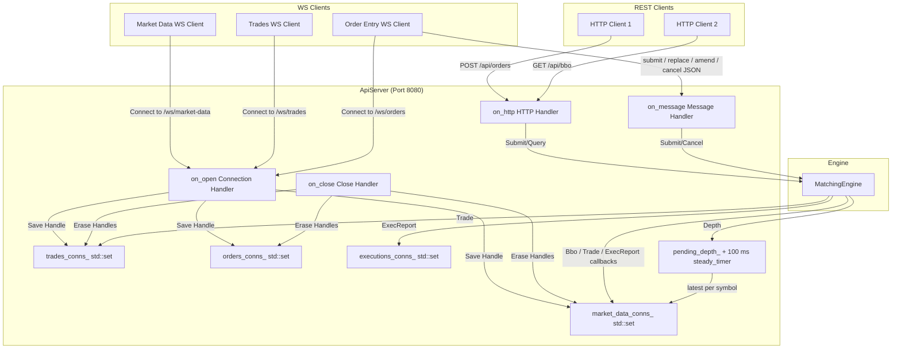

# File: src/api/api_server.hpp & src/api/api_server.cpp

This component implements the networking layer, hosting the HTTP REST endpoints and managing WebSocket clients subscribing to streaming feeds.

---

## What it Does

1. **Host REST Routes**: Runs on port `8080` (powered by WebSocket++ HTTP capabilities). The server is given the `MatchingEngine` it serves (2.0, P1.8). It parses requests:
   - `POST /api/orders`: submits an order. Fields: `symbol`, `order_type` (`limit`/`market`/`ioc`/`fok`), `side`, `quantity`, `price` (required for everything except `market`), and optional `order_id`, `owner` and `stp` (self-trade prevention policy, P1.9). Prices and quantities may be strings (`"0.5"`) or numbers (`0.5`) and are parsed exactly, up to 8 decimals. The response has the 1.x `trades` array plus `reports` (execution reports, P1.10). A rejected order returns `400` with the report's `message`.
   - `PUT /api/orders`: same body; replaces the resting order with that `order_id` (it joins the back of the queue).
   - `PATCH /api/orders` (P1.14): amends a resting order, `{"symbol", "order_id", "quantity", "price"?}`. `quantity` is the new **total** (filled + open, as on Binance); omit `price` to keep it. It keeps its queue position only when the quantity goes down at the same price. `404` if the order isn't resting, `400` if the amend is rejected.
   - Order types: `limit`, `market`, `ioc`, `fok` and `limit_maker` (alias `post_only`: rests or is rejected, never trades on arrival).
   - `DELETE /api/orders`: cancels a resting order (`symbol`, `order_id`); `404` if it isn't resting.
   - `GET /api/bbo?symbol=BTC-USDT`: the current Best Bid & Offer; `404` for a symbol without a book.
   - `GET /api/depth?symbol=BTC-USDT`: the top 10 L2 bids and asks; `404` for a symbol without a book.
   - `POST /api/symbols` (**localhost only**, P1.12): sets a symbol's trading rules (`tick_size`, `lot_size`, `min_qty`, `max_qty`, `min_notional`, matching Binance's filters). The Binance connector loads the real filters for the symbols it mirrors.
   - `GET /api/symbols?symbol=BTC-USDT`: the symbol's trading rules; `404` if none are set.
   - `POST /api/fees` (**localhost only**, P1.13): sets a fee schedule, `{"owner": "alice", "maker_rate": "0.0002", "taker_rate": "0.0004"}`. Rates are decimal fractions (`"0.001"` = 0.10%); a negative rate is a rebate. Without `owner` it sets the default for everyone. The server starts with Binance's regular tier, 0.10% / 0.10%.
   - `GET /api/fees?owner=alice`: the schedule that applies to that owner (`"source"`: `owner` or `default`).
   - `POST /api/reset`: clears all books (trading rules and fee schedules are kept).
2. **Order rules (P1.12):** every order needs a positive quantity, and every type but `market` needs a positive price. A missing price used to become 0, which made a sell sweep every bid (1.0 defect D6). Symbols with trading rules also check tick size, lot size, the quantity range and the minimum notional (limit price × quantity). Orders from the reserved owner `MARKET` (mirrored Binance levels, accepted only from localhost) are exempt from the symbol rules: real books contain levels below the minimum notional.
3. **Handles WebSocket Clients**:
   - Manages WebSocket endpoints based on the connection resource path:
     - `/ws/market-data`: BBO updates on every change, and depth updates coalesced per symbol to at most one every 100 ms (P1.11).
     - `/ws/trades`: trade events.
     - `/ws/orders`: submit (`"action": "submit"`), replace (`"replace"`), amend (`"amend"`, same fields as `PATCH`) or cancel (`"cancel"`) orders. Responses carry `reports`; errors echo the `order_id`.
     - `/ws/executions`: every execution report (P1.10).
4. **CORS Options**: Implements `OPTIONS` pre-flight headers (methods `POST, PUT, PATCH, GET, DELETE, OPTIONS`), enabling cross-origin browser testing.
5. **Subscriber Management**: Uses `std::set` to track active connection handles (`websocketpp::connection_hdl`). Separate sets are kept for `/ws/market-data`, `/ws/trades`, `/ws/orders` and `/ws/executions`, guarded by one `std::mutex`.
6. **Broadcasting** (P1.11):
   - The engine's callbacks pass plain structs (`Bbo`, `Depth`, `Trade`, `ExecReport`). JSON is built only if the matching set has subscribers.
   - Depth is coalesced: the latest `Depth` per symbol is kept in `pending_depth_` and an `asio::steady_timer` sends it at most every `depth_interval_ms` (100 ms by default, the constructor's second argument).
   - Events go out with `server_.send(hdl, payload)`.
7. **Localhost-only operations:** `POST /api/symbols` and `POST /api/fees` are accepted only from loopback addresses (IPv4-mapped IPv6 included); others get `403`. An order with the reserved owner `MARKET` from anywhere else is refused with `400`.

---

## Architectural Diagram

The diagram below shows the server structure and client connection routing:



---

## Data Message Contracts

### 1. Market Data Feed (`/ws/market-data`)
The server streams L2 updates and BBOs as they occur.
* **BBO Format**:
  ```json
  {
    "event": "bbo",
    "symbol": "BTC-USDT",
    "data": {
      "symbol": "BTC-USDT",
      "timestamp": "2026-06-28T16:29:21.083418Z",
      "bid_price": "100.000000",
      "bid_qty": "1.380000",
      "ask_price": "100.230000",
      "ask_qty": "1.480000"
    }
  }
  ```
* **L2 Depth Format** (Top 10 levels):
  ```json
  {
    "event": "depth",
    "symbol": "BTC-USDT",
    "data": {
      "symbol": "BTC-USDT",
      "timestamp": "2026-06-28T16:29:21.083696Z",
      "bids": [
        ["100.000000", "1.380000"],
        ["99.750000", "5.940000"]
      ],
      "asks": [
        ["100.230000", "1.480000"],
        ["100.820000", "8.420000"]
      ]
    }
  }
  ```

### 2. Trades Feed (`/ws/trades`)
The server streams execution fills.
* **Format**:
  ```json
  {
    "event": "trade",
    "symbol": "BTC-USDT",
    "data": {
      "timestamp": "2026-06-28T16:29:22.103870Z",
      "symbol": "BTC-USDT",
      "trade_id": "3821",
      "price": "100.000000",
      "quantity": "1.380000",
      "aggressor_side": "sell",
      "maker_order_id": "1782628161082907900",
      "taker_order_id": "1782628162103695400"
    }
  }
  ```
