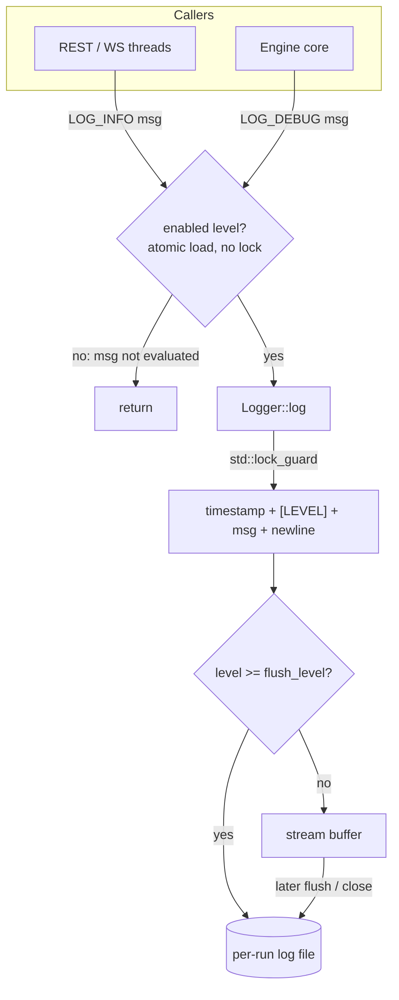

# File: src/logger.hpp

A small, thread-safe diagnostics logger that writes to a file. Rewritten in 2.0 (P1.15, fixes D19): the file path and level are configurable, it no longer flushes after every line, and each run of the server gets its own log file.

---

## What it Does

1. **Off until opened.** `Logger` starts with no file and the threshold `LEVEL_OFF`. Nothing is written and no `logs/` folder is created until `open()` is called. Only the server (`main.cpp`) opens the global logger, so unit tests, `bench_core` and future backtests that use the engine as a library stay silent. In 1.0 the constructor always created `logs/matching_engine.log` in the current directory.
2. **Options** (`LoggerOptions`):

   | Field | Default | Meaning |
   | :--- | :--- | :--- |
   | `path` | — | Log file. Missing parent directories are created. An empty or unopenable path makes `open()` return `false` and leaves the logger off |
   | `level` | `LEVEL_INFO` | Lines below this level are dropped |
   | `flush_level` | `LEVEL_WARN` | Lines at or above this level are flushed at once; others stay buffered |
   | `append` | `true` | `false` truncates an existing file |

   `open()` on an open logger closes the old file first, so a backtest can switch files between runs. `close()` flushes and turns it off. `set_level()` changes the threshold of an open logger.
3. **Levels:** `LEVEL_DEBUG`, `LEVEL_INFO`, `LEVEL_WARN`, `LEVEL_ERROR`, plus `LEVEL_OFF` (a threshold only). `parse_log_level("debug" | "info" | "warn" | "warning" | "error" | "off")` and `log_level_name()` convert to and from the names used on the command line.
   - *Note:* Windows headers (`wingdi.h`) define `ERROR` as a macro, which is why the values carry the `LEVEL_` prefix.
4. **Cheap when disabled.** The macros `LOG_DEBUG`, `LOG_INFO`, `LOG_WARN` and `LOG_ERROR` first check `enabled(level)`, which is one atomic load and takes no lock. The message expression (usually string concatenation) is evaluated only when the line will be written.
5. **Buffered output.** Lines end with `'\n'` instead of `std::endl`, so a line is flushed only when its level reaches `flush_level`, on `flush()` or on `close()`. That keeps disk flushes off busy paths.
6. **One log per run.** `Logger::run_log_path(dir, prefix)` returns `dir/prefix-YYYYMMDD-HHMMSS.log` (UTC), adding `-2`, `-3`, ... if a run in the same second already used that name.
7. **Line format:** an ISO-8601 UTC timestamp with milliseconds, the level, and the message:
   ```
   2026-11-05T17:45:01.297Z [INFO] === Starting Crypto Trading Engine ===
   ```
   1.0 used local time without a zone. UTC matches the recorder archive and the exchange timestamps.
8. **Thread safety:** one `std::mutex` guards the file, so lines from REST, WebSocket and engine threads never interleave. `Logger` can also be instantiated directly, e.g. one per backtest; `Logger::getInstance()` is the process-wide one the macros use.

---

## Server command line

`crypto_matching_engine` opens the global logger at startup:

| Option | Effect |
| :--- | :--- |
| *(none)* | Logs at `info` to `logs/matching_engine-YYYYMMDD-HHMMSS.log` (a new file per run) |
| `--log-dir DIR` | Per-run file in `DIR` instead of `logs` |
| `--log-file PATH` | Log to `PATH` (appends), e.g. to keep one file across restarts |
| `--log-level LEVEL` | `debug`, `info`, `warn`, `error` or `off` |
| `--no-log` | No log file |
| `--help` | Usage |

The server sets `flush_level` to `info` because it logs rarely (start, stop, resets), so those lines appear at once even if the process is killed. `debug` lines (one per WebSocket connection) stay buffered.

---

## Architectural Diagram


