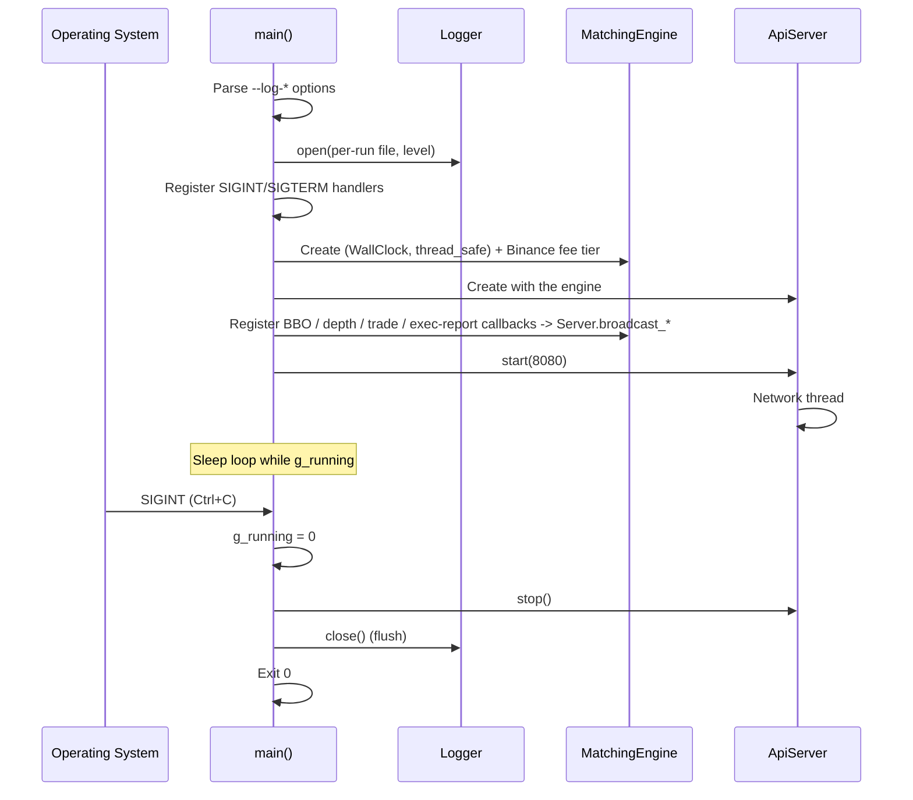

# File: src/main.cpp

The entry point of the live server (`crypto_matching_engine`). It parses the command line, opens the log, creates the engine and the API server, wires the engine's callbacks to the server's broadcasts, and shuts down cleanly on Ctrl+C or `SIGTERM`.

---

## What it Does

1. **Command line** (P1.15):

   | Option | Effect |
   | :--- | :--- |
   | *(none)* | Logs at `info` to `logs/matching_engine-YYYYMMDD-HHMMSS.log` (a new file per run, UTC) |
   | `--log-dir DIR` | Per-run log file in `DIR` |
   | `--log-file PATH` | Log to `PATH` (appends) |
   | `--log-level LEVEL` | `debug`, `info`, `warn`, `error` or `off` |
   | `--no-log` | No log file |
   | `--help` | Usage |

   An unknown option or level exits with code 2. See [logger.md](logger.md).
2. **Creates the engine:** a `MatchingEngine` with the wall clock and locking on (the defaults), and fees set to Binance's regular spot tier, 0.10% maker / 0.10% taker (`binance_spot_regular()`); clients can change them through `POST /api/fees`.
3. **Wires the callbacks** to the `ApiServer`:
   - BBO changes → `broadcast_bbo` (`/ws/market-data`)
   - depth → `broadcast_depth` (coalesced to one update per symbol every 100 ms)
   - trades → `broadcast_trade` (`/ws/trades`)
   - execution reports → `broadcast_exec_report` (`/ws/executions`)

   The callbacks receive plain structs; the server builds JSON only if someone is subscribed.
4. **Starts the server** on port 8080 (HTTP and WebSocket on one port; the server runs its own network thread).
5. **Waits** in a 100 ms sleep loop until a signal handler clears `g_running`.
6. **Shuts down:** stops the server (closes connections, joins its thread), then flushes and closes the log.

---

## Architectural Diagram

