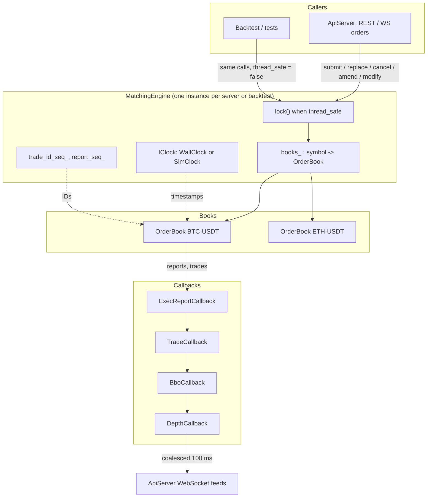

# File: src/core/matching_engine.hpp & src/core/matching_engine.cpp

`MatchingEngine` manages one `OrderBook` per symbol, routes orders to them, and publishes what happened: execution reports, trades, BBO changes and depth. Up to 1.0 it was the singleton `MatchingEngineManager`; since 2.0 (P1.8) it's a normal class, so several engines can run side by side (one per backtest in a parameter sweep, or one per test case).

---

## What it Does

1. **Order book registry:** `std::unordered_map<std::string, std::unique_ptr<OrderBook>> books_`. A book is created on the first order for a new symbol.
2. **Injected clock (P1.7):** `MatchingEngine(std::shared_ptr<const IClock> clock, EngineOptions options)`. The live server uses `WallClock`; a backtest drives a `SimClock` from historical timestamps, so results don't depend on when or how fast a replay runs ([clock.md](clock.md)). The clock is read once per call: everything one call produces carries the same timestamp.
3. **Per-engine sequences:** trade IDs and execution report `seq` numbers start at 1 for every engine and are shared by its books, so two runs over the same input produce identical IDs.
4. **Optional locking:** `EngineOptions::thread_safe` (default `true`) guards every call with one `std::recursive_mutex`. A single-threaded simulation turns it off.
5. **Order operations:** `submit_order`, `replace_order`, `cancel_order`, `amend_order` (new total quantity, Binance semantics) and `modify_order` (new open quantity, 1.0 semantics); see [order_book.md](order_book.md). Each takes an optional `std::vector<ExecReport>* reports` that receives the execution reports it produced (P1.10, see [events.md](events.md)). `cancel`, `amend` and `modify` return `false` for an unknown symbol without creating a book.
6. **Market data:** `bbo(symbol)` and `depth(symbol, levels)` return plain structs ([market_data.md](market_data.md)) and never create a book. `get_bbo` and `get_l2_depth` return the same data in the 1.0 JSON format for the API, tools and tests.
7. **Trading rules and fees:** `set_symbol_spec` ([symbol_spec.md](symbol_spec.md)) and `set_default_fee_schedule` / `set_fee_schedule` ([fees.md](fees.md)). Both apply to existing and future books and survive `reset()`, which clears the books but continues the ID sequences.
8. **Checks:** `check_invariants(symbol)` and `is_crossed(symbol)` for tests and debugging.

## Callbacks

Registered once, called synchronously inside the engine call, in this order:

| Callback | Receives | When |
| :--- | :--- | :--- |
| `register_exec_report_callback` | `const ExecReport&` | Every report, in `seq` order |
| `register_trade_callback` | `symbol, const Trade&` | Every trade |
| `register_bbo_callback` | `symbol, const Bbo&` | After a submit/replace that changed the BBO; after every successful cancel, amend or modify |
| `register_depth_callback` | `symbol, const Depth&` (top 10) | After a LIMIT submit, a trade or a BBO change; after every successful cancel, amend or modify |

## Hot path (P1.11, P1.18)

The engine works only with integers and plain structs. BBO changes are detected by comparing four integers (`Bbo::same_quotes`). JSON is produced only at the boundary: the API server converts the structs when a subscriber is connected, and coalesces depth to at most one update per symbol every 100 ms. Up to P1.10, every order built the BBO as JSON twice and compared it as strings, which made the engine 15–85× slower.

Per call, the engine also:
- reads the clock once (`begin_call`);
- builds execution reports only if a callback or a `reports` vector receives them;
- reuses one report buffer (`ReportBuffer`, safe if a callback calls back into the engine);
- skips the BBO and depth work when neither callback is registered;
- checks the most recently used book before hashing the symbol.

In a backtest configuration (`sim`) the engine does 2.7–3.2 M operations per second on the development laptop; see [docs/baseline/bench_core.md](../docs/baseline/bench_core.md).

---

## Architectural Diagram

---

## Concurrency

With `thread_safe = true`, one mutex serializes every call across all symbols. That keeps trade IDs, report sequence numbers and timestamps strictly consistent, which matters more here than parallelism between symbols. With locking and every callback on, the engine still handles about a million operations per second (`bench_core`, `live`), so the lock isn't the bottleneck for the live server, where network and JSON handling dominate. The mutex is recursive, so a callback may call back into the engine.
