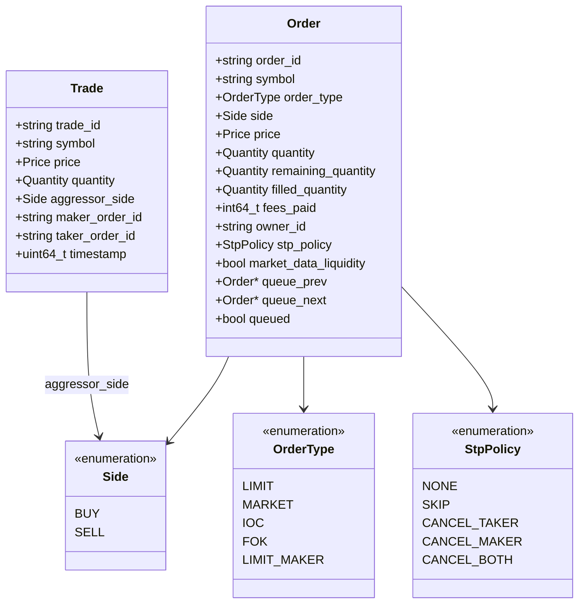

# File: src/core/models.hpp

The basic enums and structs shared by the engine core, the API server and the tests: sides, order types, self-trade prevention policies, `Order`, `Trade`, timestamp formatting and the trade JSON.

---

## What it Does

1. **`Side`:** `BUY`, `SELL` (`"buy"`, `"sell"`).
2. **`OrderType`:** `LIMIT`, `MARKET`, `IOC`, `FOK`, and `LIMIT_MAKER` (post-only, P1.14; `"limit_maker"`, alias `"post_only"`). See [order_book.md](order_book.md) for what each does.
3. **`StpPolicy`** (P1.9): `NONE`, `SKIP`, `CANCEL_TAKER`, `CANCEL_MAKER` (the default), `CANCEL_BOTH` (`"none"`, `"skip"`, `"cancel_taker"`, `"cancel_maker"`, `"cancel_both"`). The incoming order's policy decides what happens when it meets a resting order of the same owner.
4. **String conversions:** `sideToString` / `stringToSide`, `orderTypeToString` / `stringToOrderType`, `stpPolicyToString` / `stringToStpPolicy`. The `string → enum` direction throws `std::invalid_argument` for unknown names (the API turns that into `400`).
5. **`Order`:**

   | Field | Meaning |
   | :--- | :--- |
   | `order_id`, `symbol`, `order_type`, `side` | As submitted |
   | `price`, `quantity` | Fixed-point, 1e-8 units ([types.md](types.md)). `price` is 0 for `MARKET`. `quantity` is the total as last set (by submit or amend) |
   | `remaining_quantity`, `filled_quantity` | Open and filled parts; `filled_quantity` survives amends |
   | `fees_paid` | Fees charged so far, quote units of 1e-8 (negative = rebates) |
   | `owner_id` | Participant (`""` = anonymous; `"MARKET"` = mirrored exchange liquidity) |
   | `stp_policy` | Self-trade prevention when this order is the incoming one |
   | `market_data_liquidity` | A level reconstructed from market data: exempt from the symbol's trading rules, pays no fees |
   | `is_cancelled`, `timestamp` | Engine bookkeeping |
   | `queue_prev`, `queue_next`, `queued` | Links in its price level's FIFO while resting (P1.18, intrusive list). Valid only while `queued` |

   A resting order is owned by its book. Its `order_id` must not change while it rests: the book's lookup key points at it.
6. **`Trade`:** `trade_id` (per engine, from 1), `symbol`, `price` (the maker's), `quantity`, `aggressor_side` (the taker's side), `maker_order_id`, `taker_order_id`, `timestamp`. Fees are not part of the public trade; they're in the execution reports ([events.md](events.md)).
7. **`formatIsoTimestamp(ns)`:** nanoseconds since the epoch → `YYYY-MM-DDTHH:MM:SS.ffffffZ` (UTC, microseconds), using `gmtime_s` / `gmtime_r`. Timestamps themselves come from the engine's clock ([clock.md](clock.md)). 1.0's `getCurrentTimestampNs()` was removed in P1.7.
8. **`to_json(Trade)`:** the 1.0 wire format, prices and quantities as `"%f"` strings (`"100.500000"`), kept for compatibility. Execution reports use exact decimals instead.

---

## Architectural Diagram

