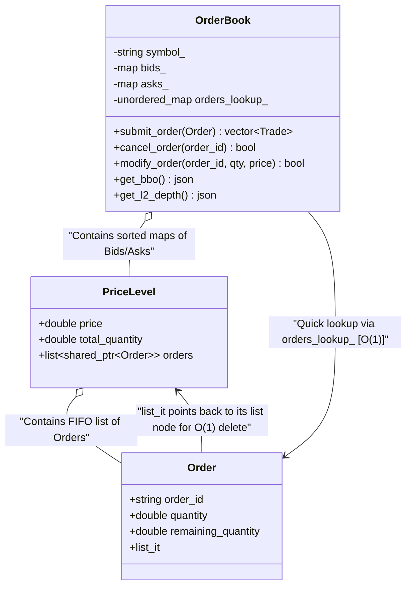
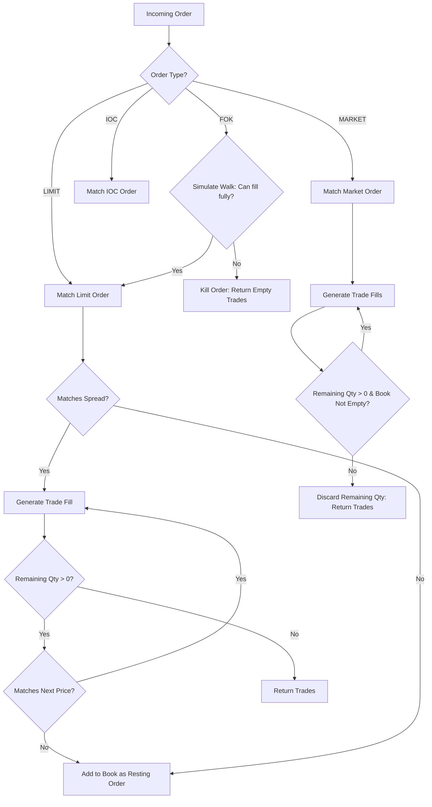

# File: src/core/order_book.hpp & src/core/order_book.cpp

This component implements the core order book data structure, price-time priority queues (FIFO), matching algorithms, order cancellations, and modification logic for a single trading pair.

---

## What it Does

1. **Represents Price Levels**:
   - **`PriceLevel`**: A structure representing a single price coordinate. It keeps a `total_quantity` sum and a double-linked list (`std::list<std::shared_ptr<Order>>`) of active orders.
   - Orders at the same price are appended to the back of the list, preserving their time of arrival (FIFO).
2. **Maintains Bid/Ask Books**:
   - `bids_`: A `std::map<double, PriceLevel, std::greater<double>>` sorted in descending order so that the highest buy price is always at the front.
   - `asks_`: A `std::map<double, PriceLevel, std::less<double>>` sorted in ascending order so that the lowest sell price is always at the front.
   - `orders_lookup_`: A hash map (`std::unordered_map<std::string, std::shared_ptr<Order>>`) mapping order IDs to the order pointers for $O(1)$ lookup speeds.
3. **Implements Matching Routines**:
   - **`match_limit_order`**: Traverses opposite side price levels. Generates trades until either the order is fully filled or the price crossing boundary is reached. If there is remaining quantity, it inserts the order into the book.
   - **`match_market_order`**: Same sweep mechanism as limit orders, but runs regardless of price until filled or the book runs empty. Remaining quantity is cancelled immediately (never rests).
   - **`match_ioc_order`**: Matches immediately up to its limit price. Any unfilled remainder is canceled.
   - **`match_fok_order`**: Performs a dry-run iteration. If the opposite side contains enough quantity to satisfy the FOK order completely, it matches. Otherwise, it cancels without executing any trades.
4. **Order Cancellation**: Uses `orders_lookup_` to find the order, sets `is_cancelled = true`, and uses the stored list iterator to delete it from the `PriceLevel` list in $O(1)$ time, maintaining accurate BBO and L2 depth calculations.
5. **Post-only orders (2.0, P1.14):** `OrderType::LIMIT_MAKER` (`"limit_maker"`, alias `"post_only"`) rests on the book or is rejected with `post_only_would_take` if it would trade on arrival, including at exactly the best opposite price. That guarantees the maker fee. As on Binance, it's rejected even when the order it would hit belongs to the same owner.
6. **Amend vs modify (2.0, P1.14, fixes D11):**
   - `amend_order(id, new_total, new_price?)` takes the new **total** quantity (filled + open), like Binance's amend. Omitting the price keeps it. A total at or below the filled quantity cancels the rest.
   - `modify_order(id, new_open, new_price)` keeps the 1.0 meaning: the new **open** quantity.
   - Both keep queue priority only when the open quantity goes down at the same price. Both reject (order unchanged) values that break the symbol's rules, and a post-only order may not be amended to a crossing price.
7. **Order Modification (1.0 rules, still used by both calls)**:
   - If the price remains unchanged and the quantity decreases: Updates the quantity in-place. The order **retains** its queue priority.
   - If the price changes or quantity increases: Cancels the old order and submits a new one. The order **loses** its queue priority.
8. **Self-Trade Prevention (STP), Replacement and Duplicate IDs** (2.0, P1.9):
   - **Owners:** an order may carry an `owner_id`. Two orders self-trade only if they have the same non-empty owner; anonymous orders never do. Mirrored Binance liquidity uses the owner `MARKET`, which the API accepts only from localhost.
   - **Policies:** the *incoming* order's `stp_policy` decides what happens on a self-trade:

     | Policy | Effect | Binance equivalent |
     | :--- | :--- | :--- |
     | `NONE` | Self-trade allowed | `NONE` |
     | `SKIP` | Pass over own orders and keep matching others, at that level and deeper (mirrored liquidity) | — |
     | `CANCEL_TAKER` | Stop and cancel the rest of the incoming order | `EXPIRE_TAKER` |
     | `CANCEL_MAKER` (default) | Cancel the own resting order and keep matching | `EXPIRE_MAKER` |
     | `CANCEL_BOTH` | Cancel the own resting order and the rest of the incoming order | `EXPIRE_BOTH` |

   - **Never crossed:** a LIMIT remainder rests only if it doesn't cross the book. One that would (only possible after `SKIP` passed over own orders) is cancelled. In 1.0 it rested through the opposite side (defect D7).
   - **FOK:** the dry run applies the same self-trade rules as the sweep, so a confirmed FOK fills completely and never rests (1.0 defect D21).
   - **Duplicate IDs:** submitting an `order_id` that is already resting throws (`400` on the API). Use `replace_order` (`PUT /api/orders`, WebSocket `"action": "replace"`) to cancel and re-submit in one step; the new order joins the back of the queue. In 1.0 a duplicate silently replaced the resting order (D9).

---

## Architectural Diagram

The diagram below shows how the internal maps, price levels, and order lists are structured:

---

## Execution Flow: Order Submission

