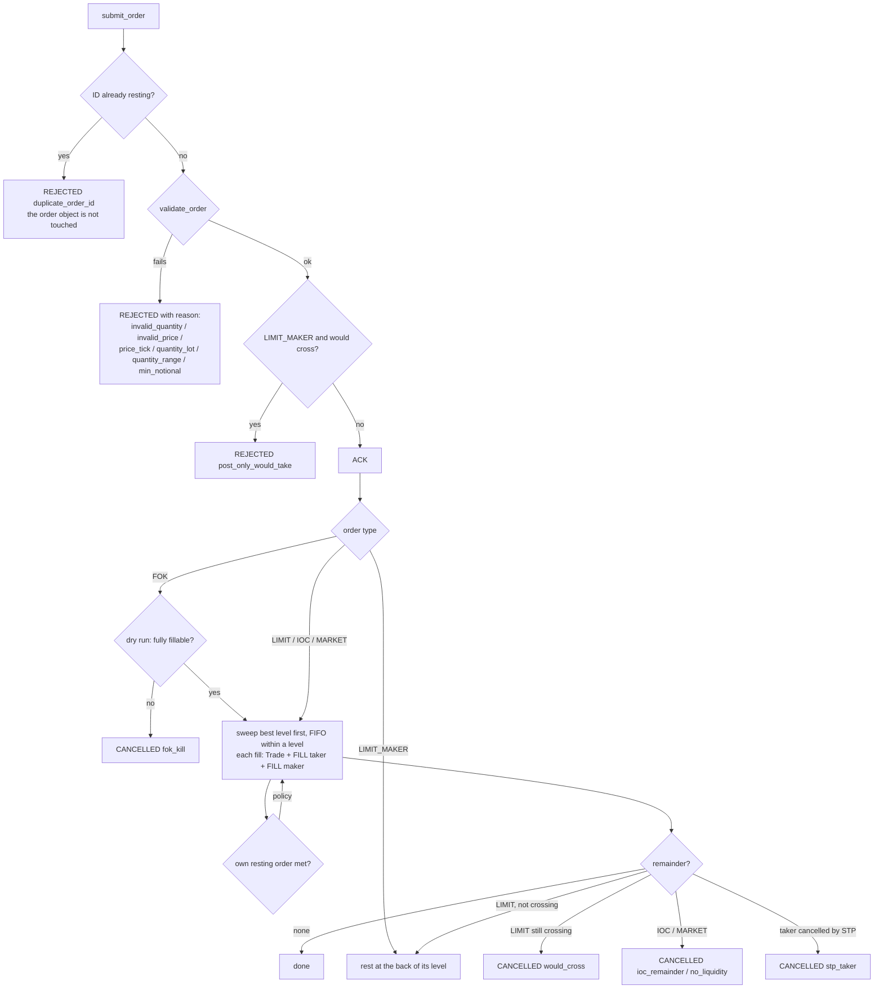
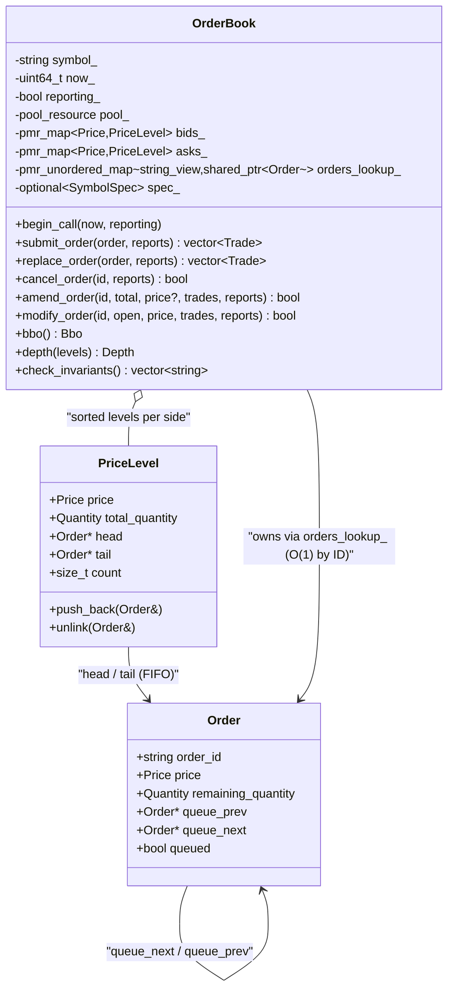

# File: src/core/order_book.hpp & src/core/order_book.cpp

`OrderBook` holds the resting orders of one symbol and does all matching for it: price-time priority (FIFO), the five order types, self-trade prevention, cancel, replace, amend and modify, validation and fees. It reports everything it does as execution reports ([events.md](events.md)). Only `MatchingEngine` creates and calls books ([matching_engine.md](matching_engine.md)).

---

## Data structures

| Member | Type | Purpose |
| :--- | :--- | :--- |
| `bids_` | `std::pmr::map<Price, PriceLevel, std::greater<Price>>` | Buy levels, best (highest) first |
| `asks_` | `std::pmr::map<Price, PriceLevel, std::less<Price>>` | Sell levels, best (lowest) first |
| `orders_lookup_` | `std::pmr::unordered_map<std::string_view, std::shared_ptr<Order>>` | Resting orders by ID. **Owns** them. The key views the order's own `order_id`, so the ID isn't copied |
| `pool_` | `std::pmr::unsynchronized_pool_resource` | Node memory for the three containers above, so resting, filling and cancelling don't go through the global heap (P1.18) |
| `spec_` | `std::optional<SymbolSpec>` | The symbol's trading rules, if set ([symbol_spec.md](symbol_spec.md)) |

Prices and quantities are `int64` fixed-point in 1e-8 units ([types.md](types.md)), so equal prices always land on the same level. 1.0 keyed the maps by `double`, which could split one price into two levels (D5).

**`PriceLevel`** holds a level's `price`, its `total_quantity` (sum of the open quantities) and its orders in time priority as an **intrusive doubly linked list**: `head` (oldest, matched first), `tail` (newest) and `count`, linked through `Order::queue_prev` / `queue_next`. Resting an order allocates no list node; cancelling unlinks it in O(1) from the pointers it carries. 1.0 used `std::list<std::shared_ptr<Order>>` plus a stored iterator (D15).

Ownership rule: the lookup entry owns a resting order. Whenever an order leaves the book, unlinking it from its level comes first and erasing the lookup entry last (`release_maker`), because erasing the entry may destroy the order.

---

## One engine call

The engine starts each call with `begin_call(now, reporting)`:
- `now` is read from the engine's clock **once per call** and stamps every report, trade and snapshot the call produces (P1.18). Under a `SimClock` that's the replay time.
- `reporting` is false when nobody receives reports (no exec-report callback and no `reports` vector). The book then skips building them; sequence numbers still advance.

---

## Order types

| Type | Matching | Unfilled remainder |
| :--- | :--- | :--- |
| `LIMIT` | Sweeps opposite levels while they cross its price | Rests at the back of its level. Cancelled (`would_cross`) if it would still cross, which only happens after self-trade prevention skipped own orders |
| `MARKET` | Sweeps regardless of price | Cancelled (`no_liquidity`) |
| `IOC` | Like `LIMIT` | Cancelled (`ioc_remainder`) |
| `FOK` | First a dry run (`can_fok_be_fully_filled`) with the same self-trade rules as the sweep; matches only if it can fill completely | Never trades partially; killed (`fok_kill`) |
| `LIMIT_MAKER` (post-only) | Never matches | Rests, or is rejected (`post_only_would_take`) if it would trade on arrival, even at exactly the best opposite price |

Every fill trades at the **maker's** price. Each fill produces a `Trade` and two `FILL` reports, the taker's then the maker's, each with its fee.

## Submission flow

## Self-trade prevention (P1.9)

Two orders self-trade only if they have the same non-empty `owner_id`; anonymous orders never do. The **incoming** order's `stp_policy` decides:

| Policy | Effect | Binance equivalent |
| :--- | :--- | :--- |
| `NONE` | Self-trade allowed | `NONE` |
| `SKIP` | Pass over own orders and keep matching others, at that level and deeper (mirrored liquidity) | — |
| `CANCEL_TAKER` | Stop and cancel the rest of the incoming order | `EXPIRE_TAKER` |
| `CANCEL_MAKER` (default) | Cancel the own resting order (`stp_maker`) and keep matching | `EXPIRE_MAKER` |
| `CANCEL_BOTH` | Cancel the own resting order and the rest of the incoming order | `EXPIRE_BOTH` |

Mirrored Binance liquidity uses the owner `MARKET` with `SKIP`, so the connector's levels never trade with each other. The book never rests crossed: a remainder that would cross after `SKIP` is cancelled (1.0 rested it, D7). The FOK dry run applies the same rules, so a confirmed FOK always fills completely (1.0 could partly fill and rest it, D21).

## Cancel, replace, amend, modify

| Call | Meaning | Queue priority |
| :--- | :--- | :--- |
| `cancel_order(id)` | Removes the order: `CANCELLED user`. `false` if not resting | — |
| `replace_order(order)` | Cancels the resting order with the same ID (`CANCELLED replaced`), then submits the new one. A duplicate `submit_order` is rejected instead (1.0 silently replaced it, D9) | Back of the queue |
| `amend_order(id, new_total, price?)` (P1.14) | Binance semantics: the new **total** quantity (filled + open). Omitting the price keeps it. A total at or below the filled quantity cancels the rest (`CANCELLED user`) | Kept only if reduced at the same price |
| `modify_order(id, new_open, price)` | 1.0 semantics: the new **open** quantity; 0 cancels | Kept only if reduced at the same price |

Both amend and modify report `AMENDED`. A reduction at the same price is applied in place. Anything else unlinks the order and re-submits it with the same ID, owner, policy, fills and fees; it may then trade. New values that break the symbol's rules, or a post-only order amended to a crossing price, are `REJECTED` and the order stays as it was.

## Fees (P1.13)

For each fill, the taker and the maker pay `fee_for(maker price, quantity, rate)` at their owner's taker or maker rate ([fees.md](fees.md)). The fee goes into the fill report (`fee`) and accumulates in `Order::fees_paid` (`cum_fee`), which survives amends. Market-data liquidity pays nothing.

## Snapshots and checks

- `bbo()` and `depth(levels)` return plain structs (`Bbo`, `Depth`, [market_data.md](market_data.md)) stamped with the call's time.
- `check_invariants()` walks every structure, O(orders), and returns one message per violation. It checks that:
  - no level is empty and each level's key equals its price;
  - every order rests on the right side at its level's price, with a positive open quantity, and is not cancelled;
  - the queue links are consistent (each order's `queue_prev`, the level's `tail` and `count`);
  - every queued order is in the lookup and every lookup entry is queued;
  - each level's `total_quantity` equals the sum of its orders;
  - the book is not crossed.

  The invariant, fuzz and determinism tests run it after every operation ([tests.md](tests.md)).

---

## Architectural Diagram

