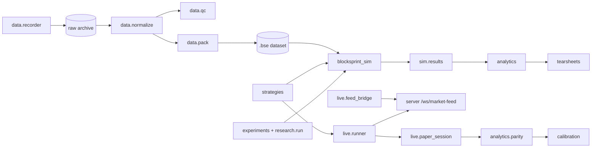

# Folder: research/ (the Python toolkit)

Everything around the C++ simulator: recording and packing market data, Python strategies, experiments, analytics, live and paper mode, and calibration. Each module's docstring is its reference; this page is the map. Every command runs through `uv run` (`uv sync` first builds `blocksprint_sim`, [bindings.md](bindings.md)).

---

## `research/data/`: market data (Phase 2, [docs/data_pipeline.md](../docs/data_pipeline.md))

| Module | Does |
| :--- | :--- |
| `recorder.py` | Records Binance spot depth, trades and snapshots into the raw archive, with clock-quality and venue metadata (`meta.py`). Operations: [docs/recorder_ops.md](../docs/recorder_ops.md); `keep_awake.py` stops Windows from sleeping |
| `rawio.py` | The raw archive: append-only, hourly-rotated, zstd-compressed JSON-lines files |
| `inspect_raw.py` | A quality report for a raw archive |
| `binance_sync.py` | Binance's diff-depth sync rules, shared by the normalizer and the live feed bridge, so recorded and live data decide every event the same way |
| `normalize.py` | Raw archive → normalized Parquet partitions, one per symbol and UTC date (`schema.py`) |
| `refbook.py` | The Python reference book: the oracle for the C++ reconstruction (gate V0) |
| `qc.py` | QC suite: `qc.json` and `qc.html` per symbol-date, with a pass/fail verdict |
| `pack.py` | Partitions → one `.bse` file per symbol plus the dataset manifest ([sim_data_files.md](sim_data_files.md)) |
| `catalog.py` | Lists, inspects and verifies datasets and partitions |
| `downloader.py` | Public `data.binance.vision` daily files → verified zips → Parquet |
| `sample.py` | The sample dataset (P8.4): `get` downloads one packed hour of BTCUSDT and ETHUSDT from the GitHub release and checks its SHA-256 and manifest; `make` rebuilds the archive byte for byte |

## `research/strategies/`: Python strategies (P4.6, P5.10, [docs/strategies.md](../docs/strategies.md))

| Module | Strategy |
| :--- | :--- |
| `base.py` | `Strategy`, the base class: callbacks a subclass doesn't override cost nothing (the adapter never takes the GIL for them), and a misspelt `on_*` method is an error when the class is defined. Typed `Protocol`s describe the C++ objects for editors. `Strategy.run(config)` returns `Results` |
| `passive_quoter.py` | A line-for-line port of the C++ passive quoter; same output hashes |
| `avellaneda_stoikov.py` | Market maker quoting around a reservation price that leans against inventory |
| `imbalance_taker.py` | Takes liquidity in the direction the book leans, then gets out |
| `execution.py` | `Executor`: works a parent order over time, TWAP or POV |

The same classes run unchanged in paper mode (`live/runner.py` below).

## `research/sim/`: results and checks

| Module | Does |
| :--- | :--- |
| `results.py` | `Results`: a run's tables as numpy arrays (no copy) and polars DataFrames equal to the CSVs; `for_symbol(name)` narrows a multi-symbol run |
| `check_reconstruct.py` | Gate V0: `bs_sim reconstruct` must equal `data/refbook.py` |

## `research/experiments/` and `research/run.py`: experiments (P5.1–P5.3, [docs/experiments.md](../docs/experiments.md))

| Module | Does |
| :--- | :--- |
| `schema.py` | One YAML file describes a set of runs: base config, window, strategy, sweeps (grid or random over distributions) and seeds, validated with pydantic |
| `store.py` | One directory per run, named by the SHA-256 of what determines its results: the config, the data's hash, the compiled module's hash and a Python strategy's source. An existing run is a cache hit; runs are written to a temporary directory and renamed into place |
| `runner.py` | Runs the plan in parallel processes through the store |
| `run.py` | `python -m research.run EXPERIMENT.yaml`: the runs, then the tearsheets and comparison report |

## `research/analytics/`: results analysis (Phase 5, [docs/analytics.md](../docs/analytics.md))

| Module | Measures |
| :--- | :--- |
| `market.py` | The market the run saw: the data's BBO and trades (`data_bbo`, `data_trades`) |
| `pnl.py` | Mark-to-mid PnL split into spread capture, inventory PnL and fees |
| `tca.py` | Transaction costs against the market, per order and per fill |
| `markouts.py` | What each fill was worth some time later, at the mid |
| `queue.py` | Where passive orders joined the queue, how long they waited, how often they filled |
| `risk.py` | Risk-adjusted returns, drawdown, inventory, time at limits, turnover |
| `report.py` | One self-contained HTML tearsheet per run, and a comparison page per experiment |
| `parity.py` | P7.5: a paper session against its simulator replays: fill ratio, markouts and fill times, with the tolerances of [docs/parity_protocol.md](../docs/parity_protocol.md) |

## `research/live/`: paper mode (Phase 7, [docs/live_platform_architecture.md](../docs/live_platform_architecture.md))

| Module | Does |
| :--- | :--- |
| `feed_bridge.py` | Connector v2 (P7.2): Binance's `@depth@100ms` and `@trade` streams, synced with `binance_sync`, sent to the server's `/ws/market-feed` ([sim_live.md](sim_live.md)). A gap, a stale stream or a lost connection sends `gap` and resyncs from the next snapshot |
| `runner.py` | P7.3: a research strategy, unchanged, in paper mode. `LiveContext` implements the simulator's `Context` over the server's WebSockets and records `session.jsonl` |
| `paper_session.py` | P7.4: the parity protocol. Records a paper session with its data, then replays the same window in the simulator for several seeds |
| `soak.py` | P7.8: runs the server and bridge for hours, compares the book with Binance's REST book every minute, and checks resyncs, crossed books, memory growth and the 24 h reconnect |
| `testnet.py` | P7.7: REST and order round trips on the **Spot Testnet** only, the one module allowed to sign requests (enforced in CI) |

`scripts/binance_connector.py` starts the feed bridge for five symbols; the 1.0 connector it used to hold (`--v1`) was removed in P7.8.

## `research/calibration/`: calibration (P7.6, [docs/calibration.md](../docs/calibration.md))

`calibrate.py` grid-searches the queue model's exponent and scale factors on the latency, replaying paper sessions and scoring each point by fill ratio and markout against the paper result. The best points are re-checked on held-out seeds, so a point that only fits noise loses. The result is a profile such as `configs/sim/calibrated/paper_btcusdt.json`.

## Notebooks

`research/notebooks/`: data exploration, a strategy walkthrough and a sensitivity study. `tests/python/test_notebooks.py` runs each one top to bottom on the committed data slice.

## Tests

`tests/python/` covers every module above (pytest; `uv run pytest -q`). Tests that need the server binary or `bs_sim` skip when they aren't built.
