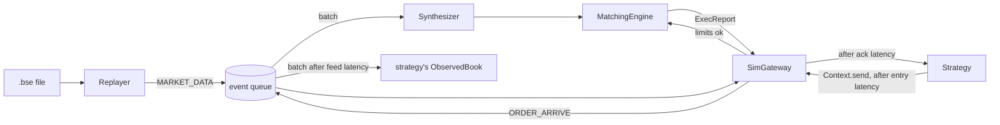

# Files: src/sim/simulator, event_queue.hpp, rng.hpp, latency_models.hpp, gateway, observed_book, recorder

The simulator's event loop and everything between a strategy and the exchange: latency, Binance's request limits, what the strategy is allowed to know, and the result files. Design: [docs/simulator_architecture.md](../docs/simulator_architecture.md) §5, §10–12.

---

## `Simulator` (P3.11)

One `MatchingEngine` on a `SimClock` ([clock.md](clock.md)), with locking and reports for synthetic liquidity turned off ([matching_engine.md](matching_engine.md)). Per symbol, a `Replayer`, a `Synthesizer` and the impact models. Several files (P6.7, one symbol each, the primary first) are merged by time.

| Phase | What happens |
| :--- | :--- |
| Fast-forward | Data before the window's start goes to the synthesizer and straight into the strategies' observed books, with no latency and no callbacks. The run starts with a book already in sync |
| Window | `on_start`, then data batches (one in the queue at a time, at their `ts_local`) and the gateway's events, ordered by (time, class, seq). Data stops at the window's end; strategy events at or after it are dropped. Then `on_end` |
| Warm-up | The first `warmup_ns` of the window: strategies see the market but `ctx.can_trade()` is false and requests throw |

Data timestamps that go backwards are clamped to the last data time, so simulation time never decreases. `set_sampler(every, fn)` calls `fn(t)` at fixed intervals, before the events at that time (the recorder's BBO and position samples). `SimulatorOptions` holds the window, warm-up, tie-break, queue model, impact settings, latency regime and seed.

## `EventQueue` (P3.3)

A min-heap ordered by **(time, class, insertion sequence)**. The sequence breaks every tie, so the order never depends on the heap's internals and a run is reproducible event by event. Classes at equal times, first to last: `MARKET_DATA`, `ORDER_ARRIVE`, `STRATEGY_MD`, `STRATEGY_EXEC`, `TIMER`. `TieBreak::DATA_FIRST` (the default) is conservative: an order arriving at the same nanosecond as a data update meets the updated book. `ORDERS_FIRST` is for sensitivity runs.

## `Rng` (P3.2)

The same seed must give the same numbers on MSVC and GCC. `std::*_distribution` differs between standard libraries and `std::log`/`std::exp` aren't required to be correctly rounded, so `rng.hpp` uses xoshiro256** seeded through SplitMix64, and builds `det_log`, `det_exp` and `det_pow` from `+ − × ÷` and `sqrt`, which IEEE 754 rounds exactly. Normal and lognormal draws and empirical (inverse-CDF) sampling are built on them. `stream_rng(seed, name)` derives an independent stream per name (FNV-1a mixed through SplitMix64), so adding draws in one place leaves every other stream unchanged.

## Latency (`latency_models.hpp`, P3.8)

Three delays per strategy connection:

| Channel | From → to |
| :--- | :--- |
| `feed` | Exchange event (`ts_local`) → the strategy sees it |
| `entry` | The strategy sends a request → the exchange receives it |
| `ack` | The exchange reports → the strategy learns of it |

Models, in config form (times in µs): `constant`, `normal`, `lognormal` (median × e^(σN)), and `empirical` (a file of observed values). Each takes `min_us` and `max_us` clamps. A `LatencyChannel` never lets requests overtake each other (arrival = max(send + sample, previous arrival)), as on a TCP connection, and draws from its own named stream.

**Regime latency (P6.3).** A `LatencyRegime` scales the delays by a multiplier that depends on the market's recent message rate (records per second over a sliding window), piecewise linear through configured (rate, multiplier) points. It's applied after the draw, so it never changes the random samples.

Presets (`latency_presets()`): `zero`, `binance_spot_home_pc` (measured on the testnet) and `binance_spot_tokyo_vps` (an estimate). See [docs/calibration.md](../docs/calibration.md).

## `SimGateway` (P3.10)

Connects strategies to the engine through latency, the way a real connection would. It pushes events onto the simulator's queue and the loop hands them back through `dispatch()`.

| Side | Behavior |
| :--- | :--- |
| Strategy | `Context` calls become `ORDER_ARRIVE` events at entry latency. Book batches, reports and request rejects are delivered after feed or ack latency, and only then change what the strategy knows (its book, open orders, account) |
| Risk (P6.4) | Each strategy's `RiskGuard` checks new orders, amends and replaces before they leave; a refusal comes back at once ([sim_strategies.md](sim_strategies.md)) |
| Gaps (P6.5) | When the strategy sees a `GAP`: `halt` (the default) cancels every open order and refuses new ones (`gap_halted`) until a snapshot resyncs; `flatten` also closes the position with a MARKET order at the resync; `continue` leaves it to the strategy's `on_gap` |
| Exchange | Arriving requests go through Binance's limits (`GatewayLimits`: request weight 6,000/min, 100 orders per 10 s, 200,000 per day, 200 open orders per symbol), then into the engine. Every engine report for a strategy's order, whatever caused it, updates the exchange-side account and goes back through the ack channel |
| Symbols (P6.7) | Each session keeps a book, two accounts, open orders and a gap halt per symbol. Request limits are per connection; max open orders is per symbol |

Each strategy has **two accounts**: the exchange's (updated when a fill happens; the run's results) and the strategy's own (updated when it learns of the fill). A strategy can't know about a fill before its report arrives. A `GatewayListener` (the recorder) sees every message with the time it will be delivered.

## `ObservedBook` (P3.9)

A strategy's own L2 view, built from book batches as they are **delivered** to it (after feed latency) with the reconstruction rules, so after the same batches it equals the `Reconstructor`'s book. It shows the market's data, not the strategy's own orders or its impact, just like the live exchange feed. Prices and quantities come out in 1e-8 units, moved by the batch's permanent-impact `shift`. `data_time()` is the market time the view shows; `seen_at()` is when it reached the strategy.

## `ResultRecorder` (P3.13)

Writes one run's outputs to a directory:

| File | Contents |
| :--- | :--- |
| `orders.csv` | Every strategy request when sent: send and arrival time, request type, order fields |
| `exec_reports.csv` | Every report for a strategy's order: exchange time and delivery time |
| `request_rejects.csv` | Every refused cancel, amend or replace |
| `bbo_samples.csv` | Per sample interval and strategy: the data's BBO, the engine's BBO (with strategy orders) and the BBO the strategy sees |
| `positions.csv` | Per sample interval and at the end: the exchange-side account and mark-to-mid PnL |
| `run_meta.json` | Inputs (resolved config, hashes), window, event counts, final accounts, output hashes |
| `output_hash` | SHA-256 over the five CSVs: identical runs give identical hashes |

Times are ns since the epoch, prices and quantities exact decimals. Everything except wall time is a pure function of the inputs. With `keep_tables` the rows are also kept in memory as fixed-width records that numpy views without a copy (P4.5, [bindings.md](bindings.md)). A multi-symbol run adds a `symbol` column after `owner`.

## Tests

`tests/sim` builds into `sim_tests`: `simulator_test`, `gateway_test`, `latency_observed_test`, `recorder_test`, `multi_symbol_test`, plus `determinism_test` (pinned output hashes for reference runs, identical on MSVC and GCC), and `golden_test` (hand-written end-to-end scenarios in `tests/sim/golden/*.golden`, P3.16). `bench/bench_sim.cpp` measures replay throughput.
